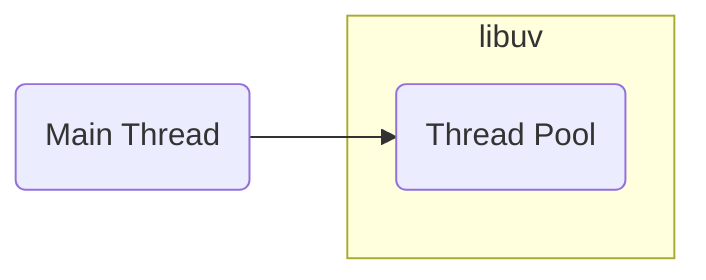
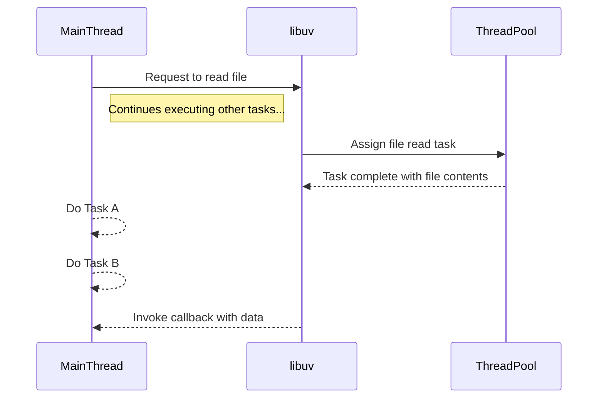
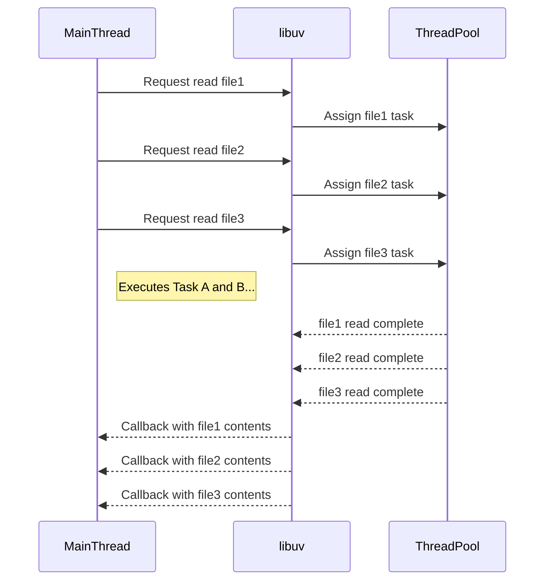
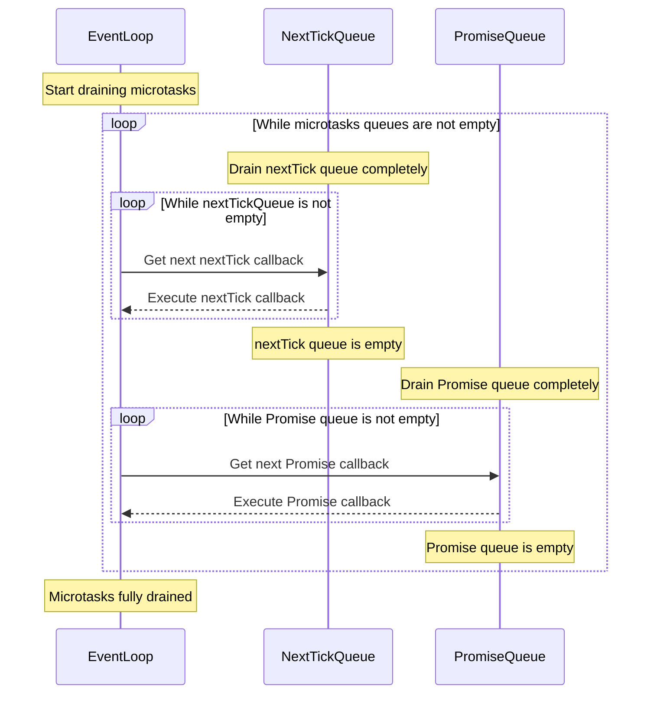
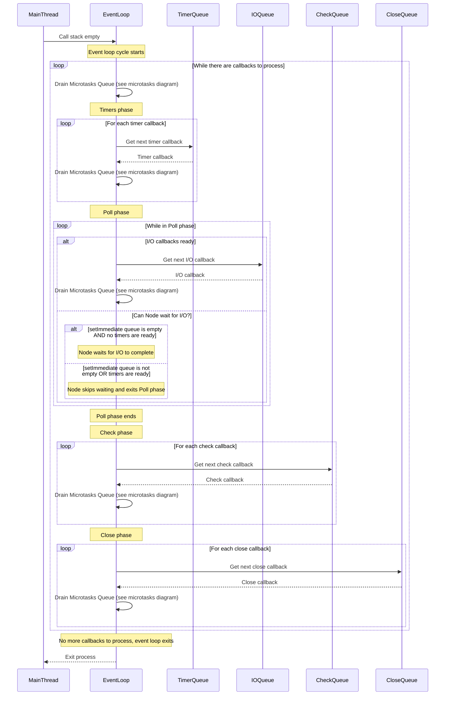
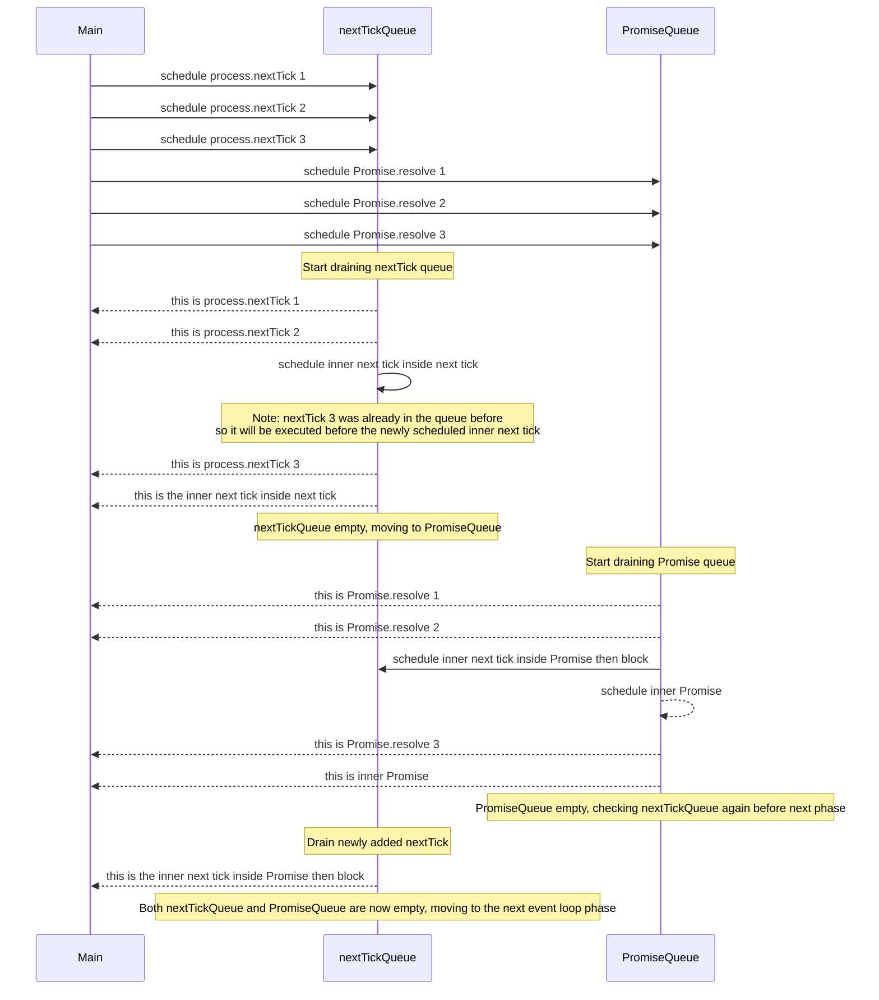
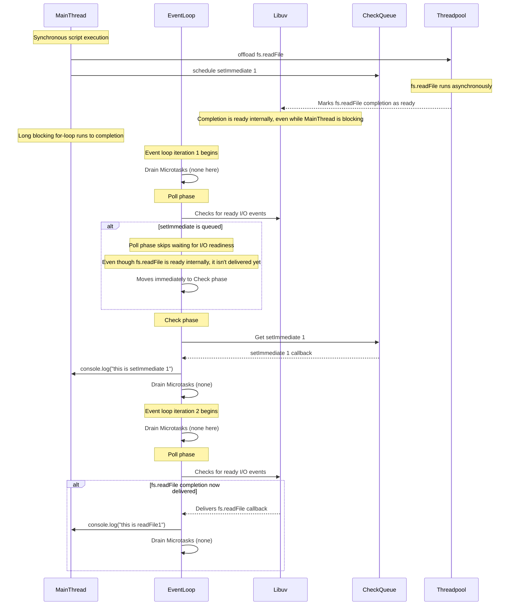

# Internals

## libuv

* **what?**: `Libuv` is a cross platform open source library written in C language
* **why?**: handles asynchronous non-blocking operations in Node.JS
* **how?**: using, mainly, thread pool and event loop

In Node.JS, async methods are handled by libuv

They are handled in two different ways:

1) Native async mechanism (delegates to the OS kernel)
   * Network I/O (TCP, UDP, pipes, TTY)
   * File system change notifications
   * Timers
   * OS signals
   * Child process spawning
   * Cross-thread async notifications
2) Thread pool
   * Filesystem operations (reading, writing, metadata)
   * DNS resolution
   * CPU-bound tasks (e.g., crypto, compression, custom work)

### thread pool

#### Structure



#### How it works

For example, the code:

```javascript
const fs = require('fs');

// 1. Offload file read to libuv's thread pool via async API
fs.readFile('example.txt', 'utf8', (err, data) => {
  if (err) {
    console.error('Error reading file:', err);
    return;
  }
  console.log('Main thread: File contents received:', data);
});

// 2. Meanwhile, main thread keeps running other tasks
console.log('Main thread: Doing Task A...');
console.log('Main thread: Doing Task B...');;
```

It runs:



It increases the performance in doing multiple async tasks at same time, for example:

```javascript
const fs = require('fs');

// List of files to read
const files = ['file1.txt', 'file2.txt', 'file3.txt'];

files.forEach((filename) => {
  fs.readFile(filename, 'utf8', (err, data) => {
    if (err) {
      console.error(`Error reading ${filename}:`, err);
      return;
    }
    console.log(`File ${filename} contents:\n`, data);
  });
});

// Meanwhile, the main thread keeps doing other things
console.log('Main thread: Executing Task A...');
console.log('Main thread: Executing Task B...');
```



By default, Libuv's thread pool have 4 threads.

* You can change it by:

  ```
  process.env.UV_THREADPOOL_SIZE = 5;
  ```

  * if you increase the thread-pool size beyond to number of CPU cores, the average time per CPU-bound task increase.
    * Given `n` cores and `UV_THREADPOOL_SIZE=n`, each task has its own CPU core. Then, `n` similar asynchronous CPU-bound tasks requested at the same time will run in parallel, with each taking roughly `t` time, so all tasks together will take about `t` time.
    * Conversely, given `UV_THREADPOOL_SIZE=2n`, each pair of tasks shares the same CPU core, so their pace is halved. Then, `2n` similar asynchronous CPU-bound tasks requested at the same time will run in parallel, with each taking roughly `2t` time, so all tasks together will take about `2t` time.
    * Although the thread pool preserves asynchronous with respect to Node’s main thread, it can still become a bottleneck if all threads are busy

network IO tasks don't use thread pool, instead Libuv delegates the work to the operation system kernel and whenever possible, it will poll the kernel and see if the request has completed.

### Event loop

* It is a C program and is part of libuv
* A design pattern that orchestrates or co-ordinates the execution of synchronous and asynchronous code in Node.js.
* It co-ordinates the execution of callbacks in six different queues:

  * 4 macro-tasks queue:
    1) **timer queue**: `setTimeout`/`setInterval` callbacks
    2) **I/O queue**: I/O callbacks
    3) **check queue**: `setImmediate` callbacks
    4) **close queue**: close handlers
  * 2 micro-tasks queue
    1) **nextTick queue**
    2) **promise queue**

#### Process

1) After the call stack is empty, the event loop takes control.
   * Synchronous JavaScript runs to completion before any async callbacks.
   * Async callbacks are enqueued synchronously.

2) The event loop processes its phases in order. In each phase, it executes *all* ready callbacks in that phase. For **each** callback:
   * Runs the callback.
   * Drains all microtasks:
     * `process.nextTick` queue first, then the Promise microtask queue.
     * After draining Promises, Node.js rechecks `nextTick` before continuing.
     * If microtasks keep being scheduled, this draining can repeat indefinitely before the next callback.

3) Phases are processed in order:
   1. Timers phase: executes timer callbacks one by one, draining microtasks after each.
   1. I/O phase: executes I/O callbacks one by one, draining microtasks after each.
   1. Check phase: executes check callbacks one by one, draining microtasks after each.
   1. Close phase: executes close callbacks one by one, draining microtasks after each.

4) When there are no more callbacks to process in any queue and no pending work, the event loop exits and the process ends.

So:






#### Micro tasks queue

##### nextTick queue

```javascript
process.nextTick(() => {
    console.log("this is process.nextTick 1")
})
```

it will enqueue the callback to nextTick queue

##### promise queue

```javascript
Promise.resolve().then(() => {
    console.log("this is Promise.resolve 1")
})
```

##### Experiment

The, the code:

```javascript
process.nextTick(() => console.log("this is process.nextTick 1"));
process.nextTick(() => {
    console.log("this is process.nextTick 2");
    process.nextTick(() =>
        console.log("this is the inner next tick inside next tick")
    );
});
process.nextTick(() => console.log("this is process.nextTick 3"));

Promise.resolve().then(() => console.log("this is Promise.resolve 1"));
Promise.resolve().then(() => {
    console.log("this is Promise.resolve 2");
    process.nextTick(() =>
        console.log("this is the inner next tick inside Promise then block")
    );
    Promise.resolve().then(() => console.log("this is inner Promise"));
});
Promise.resolve().then(() => console.log("this is Promise.resolve 3"));

```

It would result:

```
this is process.nextTick 1
this is process.nextTick 2
this is process.nextTick 3
this is the inner next tick inside next tick
this is Promise.resolve 1
this is Promise.resolve 2
this is Promise.resolve 3
this is inner Promise
this is the inner next tick inside Promise then block
```

It is executed in this way:



#### Timer Queue

It is called "queue", but it is heap, because involves time

```javascript
setTimeout(() => console.log("this is setTimeout"), 0)
```

##### Experiment 1

```javascript
setTimeout(() => {
  console.log('timer 1');
  process.nextTick(() => console.log('microtask inside timer 1'))
});

setTimeout(() => {
  console.log('timer 2');
}, 0);
```

results in:

```
timer 1
microtask inside timer 1
timer 2
```

##### Experiment 2

```javascript
setTimeout(() =>  console.log('timer 1'), 1000);
setTimeout(() =>  console.log('timer 2'), 500);
setTimeout(() =>  console.log('timer 3'), 0);
```

results in:

```
timer 3
timer 2
timer 1
```

#### I/O Queue

Most of the async methods from the built-in modules queue the callback function in the I/O queue

```javascript
fs.readFile(__filename, () => {
    console.log("this is readFile 1")
})
```

##### Experiment 3

The code

```javascript
const fs = require("fs");

setTimeout(() => console.log("this is setTimeout1"), 0);
fs.readFile(__filename, () => console.log("this is readFile1"))
```

Will result in:

```bash

$ node index.js 
this is readFile1
this is setTimeout1
$ node index.js 
this is readFile1
this is setTimeout1
$ node index.js 
this is readFile1
this is setTimeout1
$ node index.js 
this is setTimeout1
this is readFile1
```

When running `setTimeout` with delay `0ms` and an I/O async method, the order of execution can never be guaranteed.

* It is because even when you use 0 milliseconds, the JavaScript puts a least 1 milliseconds delay. And whether the event pass pass through queue time before or after it is pure fluke

If we put a loop that does nothing, but ensures that the event loop pass through timer queue after 1 millisecond, the order can be guaranteed

```javascript
const fs = require("fs");

setTimeout(() => console.log("this is setTimeout1"), 0);
fs.readFile(__filename, () => console.log("this is readFile1"))

for(let i = 0; i < 2e6; i++) {}
```

```bash
$ node index.js 
this is setTimeout1
this is readFile1
$ node index.js 
this is setTimeout1
this is readFile1
$ node index.js 
this is setTimeout1
this is readFile1
```

#### Check Queue

```javascript
setImmediate(() => console.log("this is setImmediate 1"))
```

##### Experiment 4

```javascript
const fs = require("fs");

fs.readFile(__filename, () => console.log("this is readFile1"))
setImmediate(() => console.log("this is setImmediate 1"))

for(let i = 0; i < 2e6; i++) {}
```

will result in

```bash
$ node index.js 
this is setImmediate 1
this is readFile1
```

The `this is setImmediate 1` was printed before `this is readFile1` because when the Poll phase ran, the `fs.readFile` I/O had not completed yet, so there were no ready I/O callbacks. Since the `setImmediate` was already queued, Node skipped waiting in the Poll phase and moved immediately to the Check phase to run `setImmediate 1`. The `readFile1` callback only ran later, once the I/O actually finished and the event loop returned to the Poll phase in a subsequent iteration.



#### Close Queue

```javascript
const fs = require("fs");

const readableStream = fs.createReadStream(__filename);
readableStream.close();

readableStream.on("close", () => {
  console.log("this is from readableStream close event callback");
});
```

