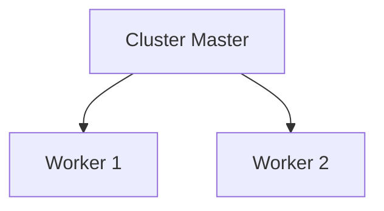

# Extras

## Cluster Module

Node is single threaded
* No matter how many cores you have, node only uses a single core of your CPU
  * This is fine for I/O operations but if the code has long running and CPU intensive operations, your application might struggle from a performance point of view


The cluster module is a built-in module to help you out on this aspect

* The cluster module enables the creation of child processes (also called workers) that run simultaneously
  * All created workers share the same server port, on [Multiple Listeners on the same port and address](../../Fundamentals of Backend Engineering/05 Backend Execution Patterns/05 Architecture.md) architecture

### Overall workflow

* There is a cluster master, responsible to spawn and manager the workers, and don't execute the application itself
* Workers are in charge of handling incoming requests, read files, etc.
* Each worker gets it own event loop, memory and V8 instance.



### Example

```javascript
const cluster = require("node:cluster");
const numWorkers = 2;

if (cluster.isMaster) {
    console.log(`Master process (PID: ${process.pid}) is running`);

    for (let i = 0; i < numWorkers; i++) {
        cluster.fork();
    }
} else {
    console.log(`Worker process (PID: ${process.pid}) started`);

    const http = require("node:http");

    const server = http.createServer((req, res) => {
        if (req.url === "/") {
            res.writeHead(200, { "Content-Type": "text/plain" });
            res.end("Home page");
        } else if (req.url === "/slow-page") {
            for (let i = 0; i < 6000000000; i++) { } // Simulate CPU work
            res.writeHead(200, { "Content-Type": "text/plain" });
            res.end("Slow Page");
        }
    });

    server.listen(8000, () => console.log("Server is running on port 8000"));
}
```


You can base the number of worker on the number of CPUs:

```javascript
const os = require("node:os");

const numWorkers = os.cpus().length;
```


## Worker Threads Module

The worker_threads module enables the use of threads that execute JavaScript in parallel

* Code executed in a worker thread runs in a separate child process, preventing it from blocking your main application
* The difference between threads and cluster Module 
  * The cluster module can be used to run multiple instances of Node.js that can distribute workloads
  * worker_threads module allows running multiple application threads within a single Node.js instance
* When process isolation is not needed, that is, no separate instances of V8, event loop and memory are needed, you should use worker_threads

* on `worker-thread.js`

  ```javascript
  const { parentPort } = require("node:worker_threads");
  
  let j = 0;
  for (let i = 0; i < 600000000; i++) {
      j++;
  }
  
  parentPort.postMessage(j);
  ```

* on `index.js`

  ```javascript
  const http = require("http");
  const { Worker } = require("node:worker_threads");
  
  const server = http.createServer((req, res) => {
    if (req.url === "/") {
      res.writeHead(200, { "Content-Type": "text/plain" });
      res.end("Home page");
    } else if (req.url === "/slow-page") {
      const worker = new Worker("./worker-thread.js");
      worker.on("message", (j) => {
        res.writeHead(200, { "Content-Type": "text/plain" });
        res.end(`Slow Page ${j}`);
      });
    }
  });
  
  server.listen(8000, () => console.log("Server is running on port 8000"));
  
  ```

  
