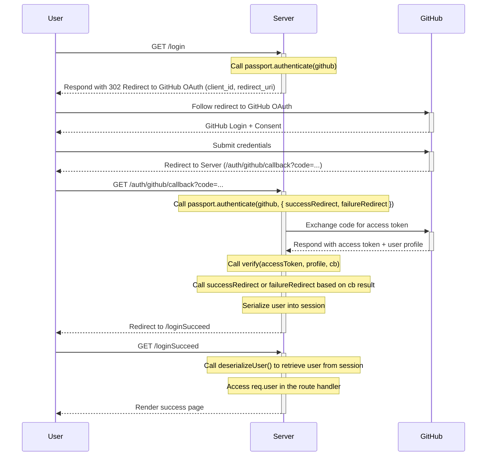
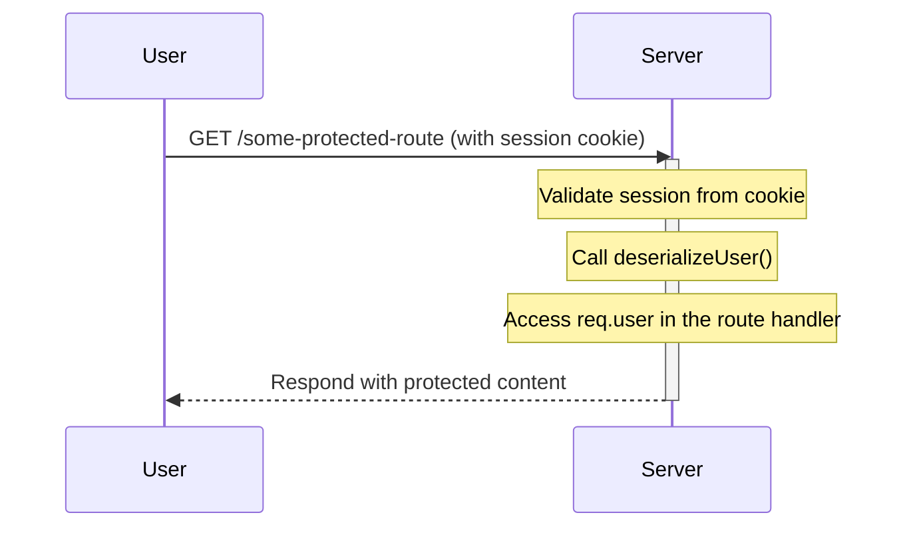

# Passport

A library that creates authentication for Node.JS: https://www.passportjs.org/

* It helps you out to implement [OAuth 2.0](../../Autentication/OAuth 2.0.md)
* You have to install the base passport, along with the set strategies that you want to use https://www.passportjs.org/packages/
  * We can use `passport-http-bearer`, `passport-facebook`, `passport-google-oauth`, `passport-twitter`, `passport-jwt`, `passport-oauth2`, and so on and so forth.

## How to use

```bash
npm install passport express-session --save
```

* `express-session` is a tool that allows you save session data at the server, required by the `passport`. The session data is stored on the server, and only the session ID is stored in the user's cookies.

Here we will configure a authentication to github, each strategy has it own way of use, which is expected be described on its documentation.

```bash
npm install passport-github --save
```

Now you need to register your application [along with github](https://github.com/settings/applications/new).

* The Application Name, Homepage URL and Application Destination are only information that will be shown to the user.
  * Application Name: `LocalTest`
  * Homepage URL: `http://local.test.mock.com` (doesn't exist)
  * Application description: `Local test`
* The callback URL is the unique attribute with technical implications. This is the URL GitHub will redirect the user to with the token.
  * `http://localhost:3000/auth`

Once registered, you will have access to your Client ID

In your `app.js` file, set up Passport as follows:

```javascript
const session = require("express-session")
const passport = require("passport")
const GitHubStrategy = require("passport-github").Strategy


app.use(session({
  secret: process.env.SESSION_SECRET,
  resave: false,
  saveUninitialized: true,
  cookie: { secure: true }
}))
app.use(passport.initialize())
app.use(passport.session())
passport.use(new GitHubStrategy({
    clientID: process.env.GITHUB_CLIENT_ID,
    clientSecret: process.env.GITHUB_CLIENT_SECRET,
    callbackURL: "http://localhost:3000/users/auth/github/callback"
  },
  function verify(accessToken, refreshToken, profile, cb) {
    return cb(null, profile)
  }
));
passport.serializeUser((user, cb) => {
  cb(null, user)
})

passport.deserializeUser((user, cb) => {
  cb(null, user)
})
```

* on `app.use(session({`:

  * The `secret` in `secret()` serve to encrypt the session data.
    * it can be any string.

  * `cookie: { secure: true }` indicates the client to don't send the cookies back unless it is on HTTPS connection.

* on `passport.use(new GitHubStrategy({`:

  * The `callbackURL` should be exactly the same that you configured on github.
    * For example if in one you set "localhost" and on the other "127.0.0.1", it won't work.

* on `verify` function:

  * the `profile` is where the user information lies.
  * you must call `cb` (callback) in order to complete authentication.

* To maintain a login session, Passport serializes and deserializes user information to and from the session. The information that is stored is determined by the application, which supplies a `serializeUser` and a `deserializeUser` function.

  * look at these examples:

    ```javascript
    passport.serializeUser(function(user, cb) {
      process.nextTick(function() {
        return cb(null, user.id);
      });
    });
    
    passport.deserializeUser(function(id, cb) {
      db.get('SELECT * FROM users WHERE id = ?', [ id ], function(err, user) {
        if (err) { return cb(err); }
        return cb(null, user);
      });
    });
    ```

    * Storing less data in the session will require heavier queries to a database to obtain that information. Conversely, storing more data in the session reduces database queries while potentially exceeding the maximum amount of data that can be stored in a cookie


So, in some route:

```javascript
router.get('/login', passport.authenticate("github"));

router.get('/auth/github/callback', passport.authenticate("github", {
  successRedirect: "/loginSucceed",
  failureRedirect: "/loginFailed"
}));
```

* It can use relative path

  ```javascript
  router.get('/auth/github/callback', passport.authenticate("github", {
    failureRedirect: "../../loginFailed",
    successRedirect: "../../loginSucceed"
  }));
  ```

  * It will make `<prefix>/auth/github/callback` lead `<prefix>/loginSucceed` or `<prefix>/loginFailed`

It will redirect your user to git hub, along with information of your site

* If the user accept, they will be redirected to the callback url, along with the `code` query parameter.
* The `passport.authenticate` will handle the OAuth flow for you, and call the verify function that you defined on `app.js`

So you can access the user profile from `req.user`

```javascript
router.get('/loginSucceed', function (req, res, next) {
  console.log(req.user)
  res.send('Login Succeed');
});
```

As long as the user's session cookie is valid, other routes can access `req.user`



So:



