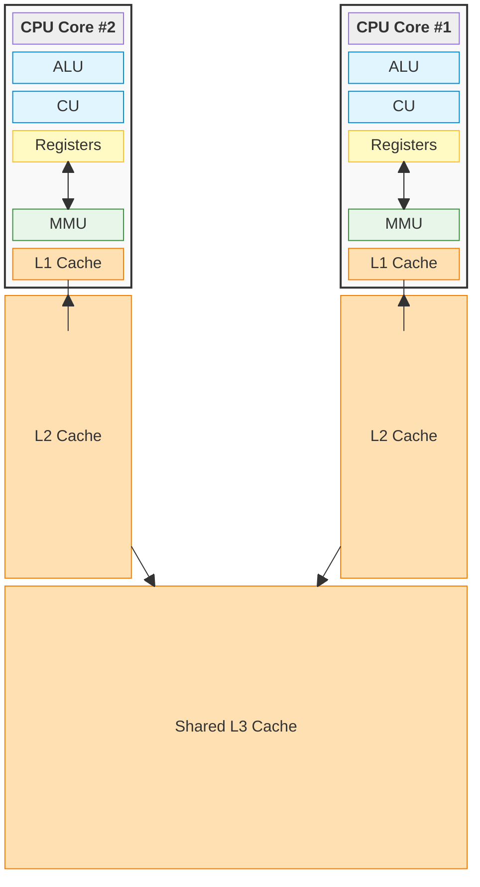

# System Architecture

- **Every system has a limited set of resources.** Because these hardware resources are scarce, they must be carefully managed to keep the system running smoothly.
- **The kernel is the core component of an Operating System.** It acts as the foundational layer of software; everything else in the system is built directly on top of it.
- **The primary job of the kernel is resource management.** It directly handles how hardware like the CPU, memory, and storage are allocated to different tasks.
- **The OS includes additional tools on top of the kernel for usability.** While the kernel handles the low-level hardware communication, the rest of the OS provides user interfaces, libraries, and application management tools to make the computer user-friendly.

## CPU

The CPU is where actual execution **happens**, making it one of the most valuable resources in a computer system.

To maximize performance, data that is accessed frequently must reside as close to the execution cores as possible. This storage exists inside the CPU itself rather than at the system memory (RAM) level.

This internal storage is structured as a hierarchy of caches:

- **L1 Cache:** The fastest and closest to the core.
- **L2 Cache:** Slightly larger and slower than L1. Like L1, it is usually dedicated to a single core.
- **L3 Cache:** The largest and slowest of the on-chip caches, typically shared across all cores on the CPU.

Because the L1 and L2 caches are private to each individual core, they introduce complex **cache coherency** challenges. To write highly optimized software and prevent the CPU from constantly invalidating and discarding cached data, developers must understand how this underlying hardware operates.

Each core operates at a specific clock speed, which dictates how many **cycles per second** it can execute.
- Depending on the CPU architecture and the specific type of instruction, a single operation may take less than, exactly, or more than one clock cycle to complete.

Every CPU family has its own unique set of machine-level instructions.
- Because your source code must ultimately be translated into these specific machine instructions, the **compilation process is highly dependent on the target CPU architecture** (e.g., x86 vs. ARM).

## Memory

Accessing system memory (RAM) is a notoriously slow operation. The performance bottleneck is caused by two compounding factors: the time it takes to read/write the data itself, and the physical, electrical distance the signals must travel between the CPU and the motherboard's RAM slots.

To understand why this matters, think of the CPU and RAM as a frontend and backend system web application:

- **Network Chattiness:** The more "chatty" the frontend and backend are—making thousands of tiny, individual requests back and forth—the more the latency builds up.
- **The Sluggish Accumulation:** Even if a single request's latency seems completely insignificant on its own, multiplying that delay across millions of operations quickly adds up, resulting in a severely sluggish and bottlenecked system.

This accumulation of microscopic delays is exactly why CPUs rely so heavily on the internal cache hierarchy (L1, L2, L3). By keeping the most frequently used data on the CPU chip itself, the processor avoids making that "expensive network trip" to system memory, dramatically reducing latency and keeping the system responsive.

**RAM** stands for **Random Access Memory**, which means the CPU can access any data location directly in a constant amount of time ($O(1)$ complexity), regardless of its physical position or the order in which it was stored. This contrasts with spinning mechanical hard drives, which rely on physical movement where a read/write head must traverse intermediate disk space to reach a specific target, resulting in significantly higher latency.
- **SSDs have diluted the literal meaning of the acronym "RAM."** Because SSDs also use flash memory circuits to access data electronically and non-sequentially, they are technically random-access devices too. However, the term "RAM" persists as a proper noun in the industry to specifically differentiate volatile, byte-addressable _system memory_ from non-volatile, block-addressable _storage_ like SSDs.

RAM are fast, but volatile and scarce. 

Memory stores process states and data. 

Directly addressing physical memory slots causes immediate failure on a multi-program computer because multiple applications running at the same time will inevitably try to use the exact same physical RAM address. When this happens, they overwrite each other's data, causing crashes, data corruption, and major security breaches where one program can spy on another.

To solve this conflict, Operating Systems introduced **Virtual Memory**.

Instead of letting a program see the actual physical hardware, the OS provides every single program with its own completely isolated, private, and continuous layout of fake addresses called a **virtual address space**.
- When a program attempts to execute a command at a specific virtual address, a hardware component inside the CPU core called the **MMU (Memory Management Unit)** intercepts the request. The MMU looks at a master mapping directory controlled by the OS (called a **Page Table**) and translates that virtual address into a safe, completely separate physical location in the actual RAM.
- Because of this constant translation layer, every program operates under the illusion that it has the computer's memory entirely to itself, completely preventing address conflicts and securing the data of individual applications.
- **Virtual memory allows physical RAM to be dynamically shared by scattering and intertwining chunks of data across whatever free space is available.** Even though every individual program thinks it occupies a perfectly sequential, unbroken block of memory from start to finish, the OS breaks that memory down into small units called "pages." The mapping layer allows the OS to take those pages and interleave them across physical RAM, filling in any random gaps left by other applications. Because a program's data doesn't actually need to be kept together in a single, massive continuous block to run, the OS can efficiently piece together physical memory like a mosaic, maximizing RAM utilization without the software ever knowing its data is fragmented.
- **Virtual memory allows the OS to transparently offload inactive data from RAM to the disk through a process called "paging" or "swapping."** If the physical RAM fills up, the OS identifies blocks of memory (pages) that haven't been used in a while—such as a background application you minimized an hour ago—and copies them onto the much larger, slower SSD or hard drive. It then completely clears those physical RAM slots to make room for your active, demanding tasks.
