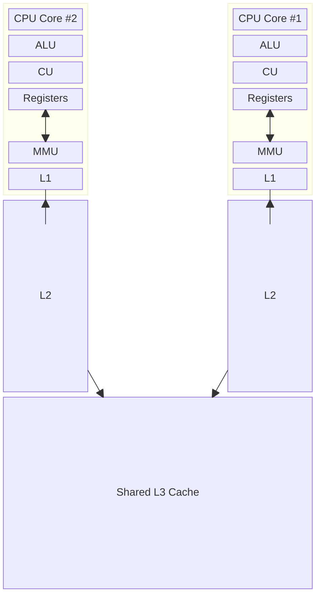

# System Architecture

* Every system have a set of resources - and those are scarce - so they need to be managed.
* The kernel is OS core component - everything else are built on top of that.
* The Kernel manages the resources
* OS has more tools on top of Kernel for usability.
## CPU
Where the actual execution happen - so it is a very valuable resource. 

It is very critical that the values accessed frequently be as close to the CPU as possible. It isn't memory level, it is actually inside the CPU.

The closest is the L1 level, followed by L2 and L3 - the first two are one-per-core, while the latter often is shared by all the cores of the CPU. 

Notice that the fact that L1 and L2 caches are individual by core, it creates a whole slew of problem about cache syntonization

Each core has a clock speed.