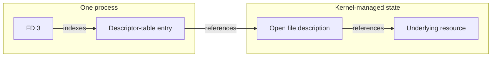
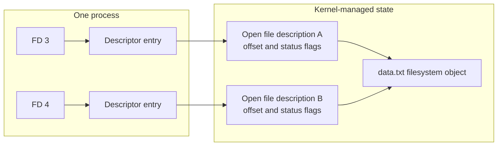
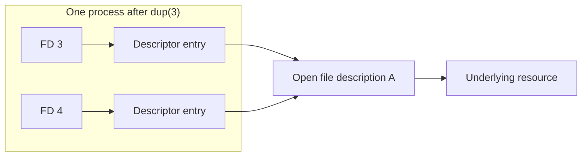
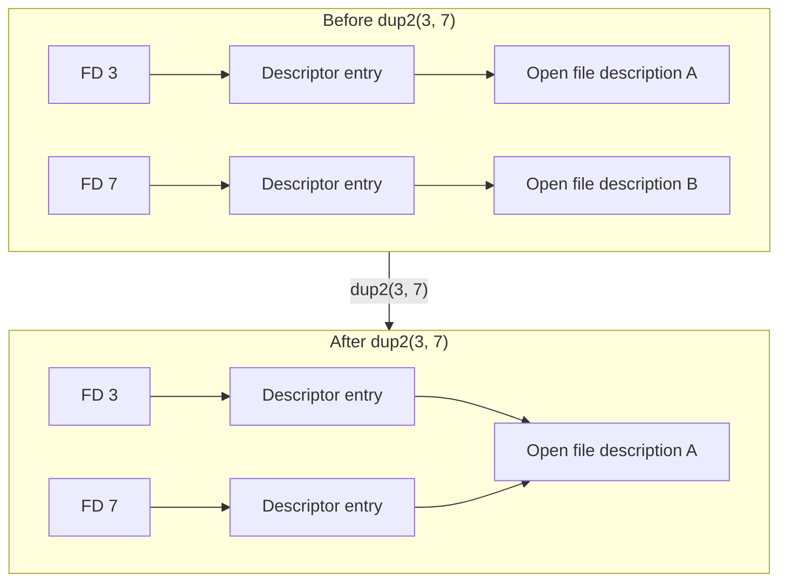
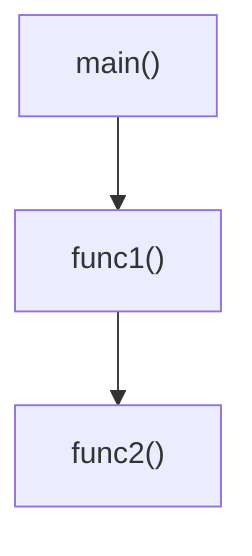
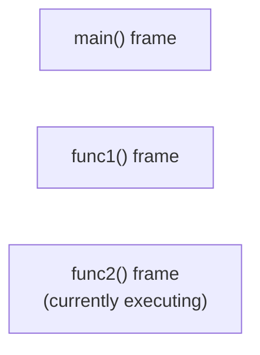
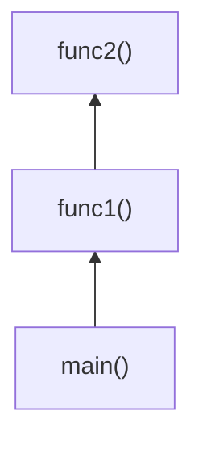
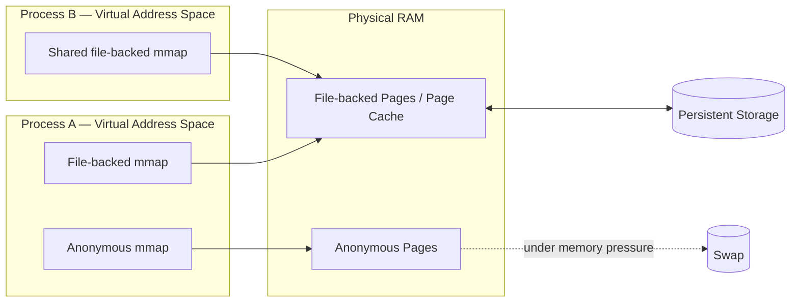

# The Anatomy of a Process

## Program vs Process

A **program** is stored code and data that an execution environment can load: it may be a [compiled executable](Compilers%2C%20Linkers%2C%20and%20Program%20Loading.md#From%20Source%20Code%20to%20a%20Running%20Process), a script, bytecode, or another runtime-hosted representation. A **process** is the live operating-system context created to run that program. It has an identity, a [virtual address space](03%20Memory%20Management.md#The%20Solution:%20Virtual%20Address%20Space%20%26%20MMU%20Isolation), and kernel-managed resources; its [threads](05%20Process%20Management.md#Processes%20vs.%20Threads) provide the schedulable execution contexts.

One program can produce multiple independent processes. For a native executable, the operating system reads the executable format, maps the program image, initializes execution state, and transfers control to its entry point. A runtime can instead create a process and then load a script or bytecode representation into that process.

## Process Identifiers

A **process identifier (PID)** identifies a process while that process exists within one PID namespace. After the process terminates and the operating system releases its process state, the numeric PID becomes available for a later process in the same namespace. A PID alone is therefore not an enduring identity across process lifetimes.

On Linux, a **PID namespace** gives a group of processes its own PID number space. Two live processes in different namespaces can use the same numeric PID. A container commonly uses a PID namespace: its initial process is PID 1 inside that namespace, while the host observes the same process through a different PID. [Containers](10%20Virtualization%20and%20Containerization.md#Containers) combine this isolated process view with other isolation and resource-control mechanisms.

## File Descriptors (FDs)

In the [POSIX](01%20Why%20an%20OS.md#Software%2C%20Hardware%2C%20and%20POSIX) interface used by Unix-like systems, a **File Descriptor (FD)** is a non-negative integer that a process uses as a local handle for an open I/O resource. The integer contains no resource data by itself; it is meaningful only as an index into that process's descriptor table.

The important abstraction is that the process manipulates a small handle while the kernel owns the actual resource and its state. Many different resources participate in this model, so common operations such as `read()`, `write()`, and `close()` can accept the same descriptor type even though the resources behind those descriptors behave differently.

### Descriptor Indirection

An FD reaches an underlying resource through a chain of kernel-managed references:



- **Descriptor number:** The FD is a process-local non-negative integer. By itself, the number contains no resource data.
- **Descriptor-table entry:** The number selects an entry in the calling process's descriptor table. Properties attached to this entry remain descriptor-specific; the close-on-exec flag, for example, does not apply to every other descriptor that refers to the same open resource.
- **Shared open-resource state:** The entry refers to kernel-maintained state for an already-open resource. For a regular file, POSIX calls this state an **open file description**. It stores the current file offset and file-status flags and maintains the reference to the underlying filesystem object.
- **Underlying resource:** The final object depends on what was opened: a regular file reaches filesystem state, a socket reaches networking state, a pipe reaches kernel pipe state, and a device reaches driver-specific state.

Two descriptors can refer to the same open file description. Shared regular-file state, including the current offset, remains common to those descriptors. Pipes and sockets use the same descriptor-table model, but their shared kernel state has resource-specific semantics rather than regular-file position semantics.

### Resources Referenced by File Descriptors

Because the descriptor is only a handle, the same integer abstraction can refer to several kinds of resources:

- **Regular Files:** A descriptor can refer to an [open regular file and its filesystem-backed state](06%20Storage%20Management.md#Opening%20Files), including file-position behavior, file-specific operations, and persistence semantics.
- **Standard Streams (`0`, `1`, `2`):** On POSIX systems, `0` conventionally denotes standard input, `1` standard output, and `2` standard error. These descriptor-table positions can refer to terminals, files, pipes, sockets, devices, or other compatible resources; they can also be closed or reassigned. The C `stdin`, `stdout`, and `stderr` objects are higher-level buffered `FILE *` streams normally associated with these descriptors.
- **Network Sockets:** A descriptor can refer to [kernel networking state representing a socket](07%20Socket%20Management.md#Sockets%20as%20Kernel%20Objects).
- **Pipes and FIFOs:** Descriptors can represent the read and write ends of byte streams used for inter-process communication.
- [**Device Files (`/dev`)**](06%20Storage%20Management.md#%60/dev%60%20%E2%80%94%20Device%20Nodes)**:** Opening a device node can produce a descriptor whose operations are handled by the corresponding device driver.
- **Event Facilities:** Descriptor-based asynchronous I/O uses either an existing descriptor as the resource being monitored or a descriptor that refers to the coordination facility itself.
    - **Repeated readiness sets:** [`select()`](07%20Socket%20Management.md#%60select%28%29%60%20Readiness%20Cycle), [`poll()`](07%20Socket%20Management.md#%60poll%28%29%60), [`pselect()` and `ppoll()`](07%20Socket%20Management.md#%60pselect%28%29%60%20and%20%60ppoll%28%29%60) monitor descriptors supplied by the caller for readiness.
    - **Persistent readiness facilities:** Linux [`epoll`](07%20Socket%20Management.md#%60epoll%60%20Readiness%20Cycle), BSD-derived [`kqueue`](07%20Socket%20Management.md#%60kqueue%60%20Readiness%20Cycle), Solaris [event ports](07%20Socket%20Management.md#Solaris%20Event%20Ports), and Solaris [`/dev/poll`](07%20Socket%20Management.md#Solaris%20%60/dev/poll%60) retain readiness state in kernel-managed facilities. `epoll_create1()` and `kqueue()` return descriptors for their facilities; event ports and `/dev/poll` also use descriptors as their coordination handles.
    - **Completion-based coordination:** Linux [`io_uring`](07%20Socket%20Management.md#%60io_uring%60%20Completion%20Cycle) submits operations that identify resources such as socket descriptors, and `io_uring_setup()` returns a descriptor for the ring itself.

> [!note] Inspecting File Descriptors Through `/proc`  
> On Linux, the virtual [/proc](06%20Storage%20Management.md#proc-process-and-kernel-information) filesystem exposes a process's currently open descriptors under `/proc/<pid>/fd`.
>
> This does not mean that the descriptors themselves are files stored under `/proc`. The descriptor table remains kernel-managed process state; `procfs` merely exposes a filesystem-based view through which that state can be inspected.

### The POSIX Descriptor Interface

POSIX allows many different resources to participate in common descriptor-based operations. Low-level code can therefore sometimes process a regular file, pipe, or socket through the same `read()` and `write()` interface:

```c
void stream_data(int read_fd, int write_fd) {
    char buffer[4096];
    ssize_t bytes_read;

    while ((bytes_read = read(read_fd, buffer, sizeof(buffer))) > 0) {
        write(write_fd, buffer, bytes_read);
    }
}
```

- **Common Reference Model:** The same integer descriptor abstraction identifies many different kernel-managed resources.
- **Common Operations:** Calls such as `read()`, `write()`, and `close()` can operate on multiple resource types when the underlying resource supports that operation.
- **Resource-Specific Semantics:** A common interface does **not** mean the resources behave identically.
    - **Regular File:** `read()` consumes bytes according to regular-file position semantics.
    - **TCP Socket:** `read()` consumes bytes from a network byte stream.
    - **Pipe:** `read()` consumes bytes supplied through the pipe.
    - **Device:** The driver can define the operation's behavior.

### Descriptor Operations and Lifetime

Descriptor operations either create, change, or release the relationship between a process-local entry and kernel-managed resource state. `read()` and `write()` use that relationship to transfer bytes, but the resource determines what those transfers mean.

- **Acquire a descriptor:** Resource-specific creation or opening calls install a descriptor in the calling process's table. `open()` returns one for a regular file; `socket()` returns one for a socket; `pipe()` returns descriptors for pipe endpoints; and `accept()` returns one for an accepted socket.

#### Independent and Shared Open File Descriptions

Two independent calls to `open()` on the same pathname normally create independent open file descriptions. The descriptors reach the same filesystem object but maintain independent offsets:

```c
int a = open("data.txt", O_RDONLY);
int b = open("data.txt", O_RDONLY);
```

If those calls return FDs 3 and 4, their descriptor entries refer to separate open file descriptions even though both reach `data.txt`:



- **Transfer data — `read()` and `write()`:** These operations transfer bytes when the referenced resource supports them. Regular files use file-position semantics, sockets use networking semantics, and pipes use stream semantics.
- **Release a reference — `close()`:** `close(fd)` removes one descriptor-table reference. The underlying open resource remains alive while other descriptors or kernel references still refer to it.

#### `dup()` and `dup2()`

Both operations add another descriptor-table entry that refers to the same open file description; they do not reopen the underlying resource.
- `dup()` chooses a new available descriptor number.
- `dup2(oldfd, newfd)` assigns the duplicate to `newfd`, replacing that descriptor's previous reference when necessary.

Shell redirection uses this property: a shell can open a file and use `dup2()` to make standard output refer to the same open resource before launching another program.

After `dup(3)` returns `4`, both descriptors in the same process refer to the same open file description:



`dup2(3, 7)` first replaces FD 7's existing descriptor-table reference when one exists, then makes FD 7 refer to the same open file description as FD 3:



Replacing FD 7 releases only its previous descriptor-table reference. Its previous open resource remains alive if other descriptors or kernel references still refer to it.

- **Control descriptor and open-resource flags — `fcntl()`:** `fcntl()` operates on both kinds of state. Close-on-exec is descriptor-specific, while file-status flags such as `O_NONBLOCK` belong to shared open-resource state when the resource supports them.
- **Inherit references — `fork()`:** The child receives descriptor-table entries referring to the same underlying open resources as the parent. Inherited files, pipes, and listening sockets therefore remain shared after a process forks.
- **Control survival across `exec()` — close-on-exec:** A successful `exec()` replaces the process image while open descriptors normally survive. A descriptor whose close-on-exec flag is set is closed during that transition.

### Descriptor Limits and Exhaustion

> [!note] FD Exhaustion
> - **Per-Process Limit:** Operating systems limit how many descriptors a process may keep open. On Unix-like systems this is commonly controlled by a per-process resource limit such as `RLIMIT_NOFILE`.
> - **Failure:** If a program repeatedly opens files, [sockets](07%20Socket%20Management.md#Socket%20Lifetime%20and%20Closure), or other resources without closing descriptors it no longer needs, it can eventually reach that limit and receive `EMFILE` ("Too many open files").
> - **System-Wide Limits:** System-wide limits can also exist independently of the per-process limit.
> - **Different Resource Limits:** Descriptor exhaustion is distinct from exhaustion of resource-specific kernel memory such as socket buffers.

### Resource-Specific Operations

Beyond the common descriptor interface, operations depend on the resource behind the FD.

- **Regular Files:** Operations such as [`lseek()`, `pread()`, and `pwrite()`](06%20Storage%20Management.md#Reading%20and%20Writing%20Files) use file-position semantics that do not apply to non-seekable resources.
- **Sockets:** Operations such as [`bind()`, `listen()`, `accept()`, `connect()`, `send()`, and `recv()`](07%20Socket%20Management.md#POSIX%20Socket%20Interface) manipulate networking-specific state.

#### Specialized Descriptor Transfers and Zero-Copy

Linux exposes specialized operations for transferring unmodified bytes between compatible file-descriptor-backed resources without copying the payload through an application buffer. These operations are not interchangeable with generic `read()` and `write()` for every descriptor pair.

- **`sendfile()`:** Transfers bytes from a regular file to a compatible output descriptor, such as a socket.
- **`splice()`:** Transfers bytes to or from a pipe; at least one of its descriptors must refer to [pipes](08%20Inter-Process%20Communication.md#Pipes%20and%20FIFOs). It can support paths such as regular file → pipe and pipe → socket when the endpoints support the operation.

Both operations avoid application-buffer copies rather than every physical movement of data. Storage devices and network interfaces can still move bytes between memory and the device through DMA.

##### File-to-Socket Transfers with `sendfile()`

##### Conventional File-to-Socket Path

With a conventional `read()` followed by `write()`, data typically moves through these stages:

1. **Storage to Page Cache:** The storage device transfers data into the [page cache](06%20Storage%20Management.md#Caching), usually using DMA.
2. **Page Cache to User Buffer:** `read()` copies the data into an application buffer.
3. **User Buffer to Kernel Networking Path:** `write()` copies the data back into the kernel's networking path.
4. **Kernel Memory to NIC:** The network interface reads the data from memory for transmission, usually using DMA.

The two middle copies consume CPU time and memory bandwidth even when the application only forwards unchanged bytes.

##### Zero-Copy with `sendfile()`

- **Avoided Copies:** `sendfile()` avoids the two intermediate application-buffer copies. On Linux, the networking stack can queue [`sk_buff`](07%20Socket%20Management.md#Linux%20sk_buff%20Objects) objects whose page-backed, non-linear payload fragments reference the existing page-cache-backed file data. The application therefore does not copy the payload into user space and back into the kernel, and the networking stack does not need to copy those fragments into separate socket-owned payload backing before transmission.
- **Meaning of Zero-Copy:** In this context, **zero-copy** means zero unnecessary CPU-mediated payload copies through application memory. Bytes still move between storage, memory, and the network device, often via DMA.
- **Unchanged-Body Requirement:** The output body must already exist in a form that can be forwarded unchanged.
    - **Transformations:** An ordinary `sendfile()` path cannot itself produce dynamically compressed, serialized, templated, or TLS-encrypted bytes; those transformations require processing the payload before it is sent. For example, a compressed response can use this path only when the selected file already contains the compressed representation.
    - **Headers:** An HTTP response puts its status line and headers before its body. A server can write that small prefix to the socket through its normal output path, then call `sendfile()` to transfer the unchanged file body. It must finish writing the headers before starting the file transfer and handle partial writes or partial `sendfile()` transfers, preserving the response's byte order.

> [!note] Linux kTLS and `SSL_sendfile()`
>
> Linux Kernel TLS (kTLS) can accept `sendfile()` on a TCP socket after TLS negotiation establishes the socket's transmit cryptographic state. The kernel then frames and encrypts the file data as TLS records before TCP sends it. Conventional user-space TLS must still read and encrypt the file body before writing it.
> - **OpenSSL interface:** OpenSSL 3.0 exposes this path as `SSL_sendfile(ssl, file_fd, offset, size, 0)`. The function is available only when the established connection uses kTLS: an application enables kTLS before the handshake and verifies the write BIO with `BIO_get_ktls_send()`.
> - **Copy limits:** kTLS still avoids copies through the application buffer, but its software path allocates a buffer for encrypted output. Sending file pages directly to a compatible network interface requires TLS device offload and Linux's opt-in `TLS_TX_ZEROCOPY_RO` mode; the source data must remain unchanged until transmission completes.
<!-- -->
> [!example] Kafka and Bun — Zero-Copy Eligibility
>
> - **Kafka:** A broker can serve the same persisted log batches to many consumers. Its shared record format, including compressed batches that remain stored in that form, favors `sendfile()` when the stored batch can be forwarded unchanged, so one page-cache copy can support repeated network transfers.
> - **Bun:** A static-file response can use `sendfile()` when its file body is forwarded unchanged. Dynamic response bodies are less likely to qualify because the runtime must first produce their output bytes.

## The Stack

- **LIFO Structure:** The Stack in memory operates strictly as a Last-In, First-Out (LIFO) data structure.
- **Downward Growth:** In conventional layouts, a stack grows toward lower virtual addresses. Its exact placement and growth direction depend on the platform, runtime, and thread implementation.
- **Function Frames:** Every time a function is called, it gets its own dedicated block of memory on the stack called a **Stack Frame**. This frame stores the function's local variables and execution context.
- **The "Top" of the Stack:** The currently active function is always located at the active edge (conceptually called the "top" of the stack, even though it sits at the lowest physical memory address). Because functions strictly follow LIFO, no process can accidentally touch or corrupt the frames of paused, parent functions sitting higher up the stack.
- **Contiguous Memory & Caching:** Stack space is strictly contiguous (sequential). Because the data is packed tightly together, it often has good **spatial locality**, which can increase cache-hit rates. Stack allocation does not inherently make every access faster than heap access; access latency depends primarily on cache residency and the access pattern.
- **Size Limits:** Stack space is strictly limited in size (typically a few megabytes per thread) because it must remain a continuous block of virtual memory.

### Stack Pointer (`sp`)

- **Definition:** A dedicated CPU register that holds the memory address of the very edge (the lowest address) of the currently active frame.
- **Allocation via Math:** Creating local variables doesn't require complex system calls. The compiled code simply subtracts bytes from the `sp` to "grow" the frame downwards, reserving the necessary space.
- **Lazy Deallocation:** When a function finishes, the CPU doesn't waste time physically deleting or wiping the old data. It simply moves the `sp` back upwards. The old data remains in RAM (as garbage) and will just be naturally overwritten the next time the stack grows downwards.
- **Intra-Frame Deallocation:** Deallocating individual variables inside an active frame is rarely done. The CPU simply waits for the function to return and deallocates the entire frame at once by moving the `sp`.

### Base Pointer (`bp` / Frame Pointer)

- **Definition:** Another dedicated CPU register that holds the starting address (the highest address) of the currently active frame.
- **The Anchor:** Because the Stack Pointer (`sp`) constantly moves up and down as local variables are pushed or popped, it is a terrible reference point for finding specific data. The Base Pointer (`bp`) solves this by acting as a fixed anchor for the duration of the function.
- **Variable Referencing:** Once the `bp` is set, the compiler can reliably find any local variable using fixed offsets (e.g., `bp - 8 bytes` or `bp - 16 bytes`), regardless of what the `sp` is currently doing.
- **Frame Pointer Omission (FPO):** While the Base Pointer is the standard anchor, it is not strictly mandatory. If a function's stack frame has a fixed, known size at compile time, modern compilers can track all local variables simply by calculating offsets directly from the moving Stack Pointer (`sp`). Through an aggressive optimization called Frame Pointer Omission, the compiler discards the Base Pointer entirely, freeing up that valuable CPU register for general computation to improve execution speed—though this trade-off makes debugging and reading stack traces significantly more difficult.

### Function Prologue and Epilogue

- **The Prologue:** When a function begins executing, the compiler generates a short sequence of machine instructions called the **function prologue** to create a stack frame for local variables, saved registers, and other temporary state.
    - **Preserving Registers:** It saves registers whose current values must survive the function call.
    - **Reserving Stack Space:** It moves the Stack Pointer (`sp`) to allocate space for local variables and temporary data.
    - **Establishing a Frame Pointer:** It optionally saves the previous Frame Pointer and makes `bp` / `fp` point to the new stack frame.
    - **Runtime-Specific Checks:** It performs additional runtime work, such as the [stack-growth checks](../Technologies/Golang/99%20Misc/Go%20Internals.md#Stack%20Growth%20Checks) that Go places in the prologue of many functions.
- **The Epilogue:** After the function body finishes, the compiler generates a corresponding **function epilogue** that reverses the setup performed by the prologue.
    - **Releasing Stack Space:** It releases the current function's stack space by restoring the Stack Pointer.
    - **Restoring Registers:** It restores the registers that were saved by the function.
    - **Restoring the Frame Pointer:** It restores the previous Frame Pointer, if one was used.
    - **Returning Execution:** It returns control flow back to the caller.

> [!note] Optimization Exemptions
> Not every function has a large or even clearly visible prologue and epilogue. Optimizing compilers can eliminate unnecessary stack frames, omit the Frame Pointer, keep local values entirely in registers, or inline the function directly into its caller.

### Nested Function Calls

When one function calls another, the caller does not disappear. Its stack frame remains in memory while a new frame is created for the called function.

For example:



While `func2` is executing, the stack conceptually contains these frames, arranged from higher to lower addresses:



Because the stack follows **Last-In, First-Out (LIFO)** ordering, `func2` must finish before `func1` can resume, and `func1` must finish before `main` can resume.

#### Return Address

Before execution transfers to the called function, the machine must preserve the location where the caller should continue afterward. This location is the **return address**.

> [!warning] Return Address ≠ Returned Value Address  
The **return address** is the address of the **next machine instruction that the caller should execute after the called function finishes**.
>
> It is **not** the memory address of the value returned by the function.

A function's return value is usually passed according to the platform's calling convention, commonly through a CPU register, although larger values may use memory. The return address exists purely to restore **control flow** back to the caller.

How this is represented depends on the CPU architecture:

- **x86:** The `call` instruction normally pushes the return address onto the stack and jumps to the called function. The eventual `ret` instruction retrieves that address and jumps back to it.
- **ARM:** A branch-with-link instruction normally stores the return address in the **Link Register (`LR`)**. If the called function needs to call another function, its prologue may save the current `LR`, commonly onto the stack, so it is not lost when the next call overwrites it.

Each nested call can therefore add another frame to the stack. When functions return, those frames are removed in the reverse order in which they were created.

This chain of active function frames is the **call stack**. It records the current hierarchy of function calls and is what debuggers use to produce stack traces such as:



### Calling Conventions (Parameters & Returns)

- **The Rulebook:** A calling convention is the ABI component that specifies how a caller and callee exchange arguments and results, preserve registers, and meet stack-related obligations. The ABI also includes other binary-interface agreements; [Compilers, Linkers, and Program Loading](Compilers%2C%20Linkers%2C%20and%20Program%20Loading.md#ABI%20and%20Separate%20Compilation) gives the broader context.
- **Passing Parameters (Registers First):** Accessing RAM has higher latency than accessing a register, so modern calling conventions pass the first arguments in CPU registers when possible and use the Stack for additional arguments.
    - _ARM Architecture:_ The first four parameters of a function are placed directly into registers `r0`, `r1`, `r2`, and `r3` before the `call` instruction is executed.
    - _x86-64 Architecture:_ Uses a similar trick, placing the first six parameters into specific registers (like `rdi`, `rsi`, `rdx`, etc.).
- **Stack Spilling (Too Many Parameters):** What happens if your function takes 8 parameters, but ARM only allocates 4 registers for them? The CPU "spills" the excess. The first 4 parameters go into registers, and the remaining 4 are pushed directly onto the **Stack memory** just before the function is called. The new function frame will then read those extra parameters by calculating an offset from the Base Pointer (`bp`).
- **Returning Values:** When a function finishes its computation, it needs to leave the final answer somewhere predictable for the parent function to find. By standard convention, the return value is almost always placed in the very first general-purpose register.
    - On ARM, the function saves its return value into `r0` just before returning.
    - On x86, it saves the return value into the `rax` (or `eax`) register.
    - When the parent function resumes execution, it immediately looks at `r0` (or `rax`) to grab the result.

### Stack Overflow

- **The Cause:** Because stack memory is a fixed, contiguous block, it has a strict size limit. If a program enters an infinite loop of nested function calls (infinite recursion) or tries to allocate massively oversized local variables inside a single frame, the Stack Pointer (`sp`) will continuously move downwards until it entirely runs out of allocated space.
- **Stack Limits:** Stack size is platform-, runtime-, and configuration-dependent. An operating system may apply a per-thread resource limit, and some executable formats or runtimes express a stack reservation or request; neither mechanism nor a particular default size is universal.
- **The Guard Page (Protection):** To prevent the downward-growing stack from silently crashing into the upward-growing heap and corrupting application data, the kernel sets up a trap. It places a special, inaccessible memory page at the very boundary of the stack's allowed virtual memory space, known as a **Guard Page**.
- **The Crash (Segmentation Fault):** If the Stack Pointer (`sp`) reaches the limit and attempts to write data into the Guard Page, the CPU's Memory Management Unit (MMU) instantly detects a permission violation. The hardware triggers an interrupt, and the kernel ruthlessly kills the process to protect the rest of the system memory. This fatal crash is the infamous "Stack Overflow."

### Buffer Overflow

- **The Concept:** A buffer overflow occurs when a program attempts to write more data into a fixed-size block of memory (a buffer) than it was allocated to hold. Because low-level languages (like C and C++) trust the programmer implicitly, the CPU does not automatically check if the data fits. It simply continues writing the excess bytes sequentially into the adjacent memory addresses.
- **The Mechanism (No Bounds Checking):** If you allocate a 10-byte array on the Stack to hold user input, but the user submits a 50-character string, legacy standard library functions like `strcpy()` or `gets()` will write the first 10 bytes into the array, and "overflow" the remaining 40 bytes directly over whatever happens to be sitting next to it in memory.
- **Stack Smashing (The Security Exploit):** As established in the Stack memory layout, a function's local variables (the buffer) sit in the exact same memory frame as critical control data—specifically, the saved Return Address (the value destined for the Instruction Pointer).
    - Hackers actively exploit buffer overflows by carefully crafting an oversized input. They overflow the array just enough to overwrite the saved Return Address with a new memory address of their choosing.
    - When the function finishes and attempts to return, the CPU pops the corrupted address off the stack and blindly jumps to it. This allows the attacker to fully hijack the execution flow, often forcing the program to execute rogue machine instructions they injected into memory themselves.
- **Modern Mitigations:** To combat this massive security vulnerability, modern compilers and operating systems enforce several layers of defense:
    - **W^X (Write XOR Execute):** Enforcing strict hardware-level permissions so that writable memory (like the Stack or Heap) cannot be executed, and executable memory (like the Text segment) cannot be written to. If an attacker injects their own machine code into an overflowing buffer, the CPU will refuse to execute it.
    - **Stack Canaries:** The compiler automatically injects a secret, random value (a "canary") onto the Stack between the local variables and the Return Address. Before the function returns, it checks if the canary is still intact. If a buffer overflow overwrites the return address, it inherently must overwrite the canary first, allowing the program to detect the tampering and instantly crash itself safely.
    - **ASLR (Address Space Layout Randomization):** The OS randomizes the starting virtual memory addresses of the Stack, Heap, and standard libraries every single time the process launches. Even if an attacker successfully hijacks the Instruction Pointer, they have no idea what memory address to point it to.
    - **Memory-Safe Languages:** Modern languages (like Python, Java, Go, or Rust) eliminate this entire class of vulnerabilities by enforcing strict, automatic bounds-checking at runtime. If an array is 10 bytes long and you attempt to write an 11th byte, the runtime instantly throws a safe exception instead of blindly corrupting the adjacent memory.

## Static Storage in a Process

Global and static storage enters a process through mappings derived from the program image or shared libraries. The compiler and linker organize material such as initialized writable data, zero-initialized storage, and read-only constants into artifact sections; the loader maps the resulting segments into the process. [Executable formats and program loading](Compilers%2C%20Linkers%2C%20and%20Program%20Loading.md#Executable%20Formats%20and%20Program%20Loading) explains that section-to-segment transition.

- **Addressing:** Unlike local stack variables, static-storage locations are addressed independently of the moving stack or frame pointer.
- **Cache-coherency cost:** Reads of global variables can be cache hits, but a write on one core can invalidate copies held by other cores. A later access elsewhere may need the updated cache line from another cache or RAM.
- **Cache efficiency:** When global or static variables are laid out contiguously, sequential reads can benefit from [spatial locality](03%20Memory%20Management.md#Spatial%20Locality).

## The Heap

- **Dynamic Allocation:** A massive, dynamic region of memory used for variables whose size or lifespan cannot be determined at compile time.
- **Global Access:** Unlike stack frames which are isolated to specific functions, memory allocated on the heap can be accessed by any function in the program as long as it has the correct pointer.
- **Upward Growth:** In conventional layouts, the heap grows toward higher virtual addresses. Its exact placement and growth direction depend on the platform, runtime, and allocator.
- **Manual Lifespans:** Data on the heap remains there indefinitely until it is explicitly deallocated by the programmer (or a garbage collector).
- **The Allocator (`malloc` & `free`):** In languages like C/C++, you allocate heap memory using standard library functions like `malloc` and `free`.
       - **User-Space Management:** `malloc` is not a system call. It is a User Space manager. It asks the kernel for a giant pool of memory (using actual system calls like `brk` or `mmap`) and then slices that pool into smaller allocations for your program.
       - **Metadata Headers:** When `malloc` gives you memory, it secretly writes a metadata header directly above the returned memory address. This header stores the exact size of the allocation block.
       - **Deallocation:** When you call `free(pointer)`, the allocator looks slightly backward in memory to read that hidden header, figures out how many bytes to reclaim, and marks that chunk as "available" for future `malloc` calls.
- **The Program Break (`brk`):** The absolute "top" boundary of the heap's available memory is called the Program Break.
       - To request more raw memory from the kernel, the allocator uses the `brk` or `sbrk` system calls to push the Program Break upwards.
       - Unlike the Stack Pointer, we cannot simply lower the Program Break to deallocate memory, because heap allocations are completely out of order (fragmented).
- **Escape Analysis:** Some modern languages (like Go) attempt to keep eligible variables on the Stack. The compiler performs [Escape Analysis](../Technologies/Golang/99%20Misc/Go%20Internals.md#Escape%20Analysis)—if it detects that a variable's reference "escapes" the function's scope (meaning it needs to outlive the function), the compiler automatically moves that allocation to the Heap.

### The `mmap` System Call (Memory Mapping)

`mmap` creates a region in a process's **virtual address space** and defines what backs that region, how it may be accessed, and whether changes are private or shared. The mapping does not necessarily allocate physical RAM immediately; physical pages are commonly attached lazily as the process accesses the mapped addresses.

Unlike `brk`, which historically expands the heap by moving the program break, `mmap` can create independent virtual-memory regions wherever the operating system finds suitable address-space ranges. The backing may be an existing file or anonymous memory with no file associated with it.



#### File-Backed Mapping

`mmap` is not primarily about creating the illusion that storage is RAM; the broader **virtual-memory system** already provides mechanisms for keeping only part of a process's address space resident.

The important distinction is that a file-backed mapping connects a virtual-memory region directly to an **existing file**. The file itself becomes the recoverable backing store for clean mapped pages. The mapped physical pages can come from the kernel-managed [page cache](06%20Storage%20Management.md#Caching), which retains file contents in RAM and is also used by buffered I/O.

When the page is resident, the page table translates the virtual address to a physical page. If it is not resident, a page fault transfers control to the kernel, which uses the mapping metadata to determine which file and offset must be loaded.

- **Avoiding an Extra Copy:** With conventional buffered `read()`, file data commonly enters the page cache and is then copied into an application-provided buffer. With `mmap`, the cached file page itself can be mapped into the process's address space, avoiding that additional page-cache-to-user-buffer copy.
- **Ordinary Memory Access:** Once resident, mapped file contents are accessed with normal CPU loads and stores rather than requiring a `read()` system call for each access. Page faults and storage I/O still involve the kernel.
- **Lazy Loading:** Mapping a 1 GiB file does not immediately consume 1 GiB of physical RAM. The mapping reserves virtual address space, and individual file pages can be loaded only when they are accessed.
- **Cheap Eviction of Clean Pages:** If a clean file-backed page becomes cold, the kernel can simply discard it from RAM. Its contents do not need to be copied to swap because the original file already contains the data. A later access can load that page from the file again.

> [!example] LMDB — Delegating Working-Set Management to the Operating System
>
> [LMDB](../Databases/LMDB.md#Storage%20Model) stores its ordered key-value data in a file-backed B+ tree and memory-maps the database into the process's virtual address space. Once the necessary tree pages are resident in RAM, reads can operate directly on those mapped pages rather than first copying them into a separate database buffer pool.
>
> The operating system therefore participates directly in managing the database's resident working set. Frequently accessed pages tend to remain in memory, while colder clean pages can be reclaimed because their contents can be loaded again from the database file.
<!-- -->
> [!example] Lucene — Searching an Index Larger Than Available RAM
>
> [Lucene](../AI%20Engineering/Lexical%20Information%20Retrieval.md#Apache%20Lucene%20%28Java%29) can memory-map large search-index files. A query generally touches only portions of the complete index, so the process can address the entire index while physical RAM is concentrated on the pages forming the current working set.
>
> Cold clean index pages can be reclaimed and later loaded again from the index files. `mmap` therefore allows the operating system's virtual-memory and page-cache mechanisms to become part of the search engine's caching strategy without requiring the entire index to be copied into the Java heap.
<!-- -->
> [!example] llama.cpp — Mapping Read-Only Model Weights
>
> During [LLM inference](../AI%20Engineering/LLM/LLM%20Processing%20Pipeline.md#Inference%20vs.%20Training), billions of frozen model parameters are repeatedly read while tokens pass through the Transformer layers. `llama.cpp` can memory-map the model file so CPU inference can access resident weight pages without first copying the complete model into a second anonymous heap allocation.
>
> These persistent model weights are different from the [KV Cache](../AI%20Engineering/LLM/LLM%20Processing%20Pipeline.md#6.%20Iterative%20Generation%20Loop), which is temporary runtime state produced from the current context.
>
> Mapping a model does not mean that arbitrarily large models can be executed efficiently with little RAM. Dense inference repeatedly needs most of the model weights. If the active weight working set exceeds available RAM and pages must constantly be reloaded from storage, inference can become dominated by page faults and storage latency. GPU offloading and VRAM placement remain separate memory-placement decisions.
<!-- -->
> [!example] SQLite — `mmap` as an Optional Optimization
>
> [SQLite](../Databases/SQLite.md#Storage%20Model) normally manages database pages using its own pager and page cache, but it can optionally memory-map portions of the database for reads. When a suitable page is mapped, SQLite can inspect the file-backed page directly rather than copying it into another SQLite-managed buffer.
>
> SQLite demonstrates that `mmap` is not automatically the best I/O mechanism. It can reduce copying and explicit read operations, but page faults make some I/O occur implicitly as a consequence of ordinary memory access. Explicit I/O gives the application more direct control over when reads happen and how I/O errors are handled.

#### Anonymous Mapping (`MAP_ANONYMOUS`)

`MAP_ANONYMOUS` creates a virtual-memory mapping with **no file backing**. Its contents initially read as zero, and physical pages are commonly allocated only when they are actually needed.

Once populated, these pages behave like ordinary anonymous process memory. Because there is no original file from which modified contents can be reconstructed, the operating system cannot simply discard an anonymous page that still contains live data. Under memory pressure, such pages may instead be moved to **swap**, if swap is available.

This is the major distinction from a clean file-backed page:

- **File-backed page:** can be discarded and reconstructed from the original file.
- **Anonymous page:** must remain in RAM or have its contents preserved somewhere such as swap.
- **Large Allocations:** Some memory allocators use anonymous `mmap` for sufficiently large allocations rather than extending the traditional heap with `brk`. The exact threshold and strategy depend on the allocator and configuration.
- **Independent Deallocation:** A separately mapped region can be returned to the operating system with `munmap()` without requiring the surrounding heap layout to shrink.
- **Demand-Zero Paging:** Requesting a large anonymous mapping does not normally cause every corresponding physical page to be allocated immediately. The kernel can defer allocation until pages are first accessed.
    - **Initial State:** Newly allocated anonymous memory must appear zero-initialized to the process.
    - **First Write:** When a process first writes to a page that has not yet received private physical storage, a page fault can transfer control to the kernel.
    - **Physical Allocation:** The kernel allocates a physical page, ensures it is zero-initialized, updates the page table, and resumes execution.
    - **Shared Zero-Page Optimization:** Some operating systems, including Linux, can optimize reads from untouched anonymous memory by mapping many virtual pages to a shared read-only zero page. The first write then causes a private physical page to be allocated.

#### Shared and Private Mapping Visibility

Mappings can also be used to make the same underlying physical pages accessible from multiple processes.

##### `MAP_SHARED`

When multiple processes create compatible `MAP_SHARED` mappings of the same file region, their different virtual addresses can ultimately refer to the same underlying file-backed physical pages.

Changes to shared mapped memory can therefore be observed through the other compatible mappings.

When processes use this visibility for [shared-memory IPC](08%20Inter-Process%20Communication.md#Shared-Memory%20IPC), `MAP_SHARED` provides the shared storage but not synchronization. Processes still need mechanisms such as locks, atomic operations, or other concurrency protocols to determine when data is safe to read or modify.

For file-backed shared mappings, write permissions also depend on how the file was opened and the protection requested for the mapping.

##### Anonymous Shared Mappings

A process can also combine:

```c
MAP_ANONYMOUS | MAP_SHARED
```

to create shared memory without an underlying file.

If such a mapping exists before `fork()`, the child inherits the mapping and both processes can access the same underlying anonymous pages. The mapping has no filesystem pathname.

##### Copy-on-Write (`MAP_PRIVATE`)

`MAP_PRIVATE` creates a **private copy-on-write mapping**.

Reads may initially use the same file-backed physical pages as other mappings. However, if the process writes to a mapped page, the kernel creates a private anonymous copy of that page for the writing process.

The modification is therefore:

- visible to the writing process;
- not visible through other processes' mappings of the original file;
- not written back to the underlying file through that private mapping.

The mapping may still be writable from the process's perspective when created with `PROT_WRITE`; `MAP_PRIVATE` does not mean read-only.

#### Best Practices & Edge Cases

When using `mmap`, several lifecycle and performance characteristics matter:

- **Unmapping:** `munmap()` removes a mapping from the calling process's virtual address space. This does not necessarily remove the corresponding physical page from RAM. File-backed pages, for example, may remain in the page cache or remain mapped by other processes.
- **Process Termination:** Explicit `munmap()` is necessary when a process wants to release a mapping during its lifetime, but the operating system automatically removes the process's mappings when the process exits.
- **Dirty Shared Pages:** Modified `MAP_SHARED` file-backed pages are eventually written back by the operating system. `msync()` can be used when an application needs greater control over when changes are synchronized with the backing file. Exact durability guarantees across crashes or power failures depend on the operating system, filesystem, storage device, and synchronization options being used.
- **Thrashing:** Mapping a file larger than RAM is not inherently problematic. Performance degrades when the **actively accessed working set** exceeds available physical memory. The kernel may then repeatedly evict and reload pages, causing execution to become dominated by storage latency.
- **Swap:** Anonymous pages cannot normally be reconstructed from an original file. Under memory pressure, inactive anonymous pages may therefore be written to swap so their physical frames can be reused.

### Pointers

- **The Concept:** A pointer is simply a variable that stores a raw memory address instead of a standard value. They can point to data on the Stack, the Heap, or the Data section.
- **First Byte Addressing:** A pointer always stores the exact memory address of the _very first byte_ of the data block it is referencing.
- **Type Awareness:** The pointer's data type (e.g., `int*` vs `char*`) tells the CPU how many consecutive bytes to read starting from that first address. An `int*` tells the CPU to read 4 contiguous bytes, while a `char*` tells it to read just 1 byte.

### Memory Leaks & Garbage Collection

- **The Leak:** If a function allocates memory on the heap but loses the pointer or exits without calling `free()`, that memory becomes permanently "orphaned." The allocator thinks it is still in use, so it cannot be reused. This is a memory leak, and over time, it will drain the system's available RAM.
- **Automated Management:** To prevent human error, modern languages (like Java, Python, or Go) use automated memory management.
       - **Reference Counting:** The allocator adds a hidden counter to every object's metadata. Every time a new variable points to the object, the counter increments. When a variable is destroyed, it decrements. If the counter hits `0`, the system automatically calls `free()`. However, constantly updating this counter in memory is computationally expensive.
       - **Garbage Collection (Tracing):** Other languages periodically pause the program, scan the entire Stack to find all active pointers, and trace them into the Heap. Anything in the Heap that isn't connected to an active pointer is swept away and freed.

### Dangling Pointers & Double-Frees

- **The Dangling Pointer:** This happens when memory is explicitly freed, but the program still accidentally holds onto a pointer referencing that exact memory address.
- **Unpredictable Danger:**
       - If the allocator has already reused that address for a new variable, the dangling pointer will accidentally overwrite or read corrupted "garbage" data belonging to something else.
       - If the memory was returned to the OS, trying to access it will trigger an instant hardware crash (Segmentation Fault).
- **Double-Free Exploits:** If a program tries to `free()` the exact same pointer twice, it will attempt to read a metadata header that no longer exists (or has been overwritten). This heavily corrupts the allocator's internal tracking lists and will usually crash the process. Hackers actively exploit double-frees to overwrite memory and hijack the execution flow of a program.

### Performance (Stack vs Heap)

- **Allocation Overhead:** Stack allocation commonly requires only an adjustment to the Stack Pointer. Heap allocation generally performs more allocator bookkeeping and may request additional memory from the OS, so it can cost more than stack allocation.
- **Cache Efficiency:** The Stack is tightly packed and can benefit from [Spatial Locality](03%20Memory%20Management.md#Spatial%20Locality). Heap allocations may be scattered, so pointer-heavy access patterns can produce more cache misses and more RAM accesses. This depends on the allocator and workload.

### Bulk Allocations

For workloads that create many short-lived objects, allocating a larger block up front can reduce allocation overhead and improve locality compared with many separate allocations. The benefit depends on object lifetimes, allocator behavior, and access patterns:
- **Eliminating Metadata Bloat:** Every single time you call `malloc`, it writes a hidden metadata header (usually 8 to 16 bytes) to track the size of that specific block.
    - If you allocate 10,000 individual 4-byte integers, you are also secretly allocating up to 160,000 bytes of pure metadata overhead!
    - If you allocate one massive array of 10,000 integers in a single `malloc` call, there is only _one_ header. You save huge amounts of RAM.
- **Avoiding System Call Overhead:** While `malloc` is in User Space, if you spam it with thousands of small requests, it will quickly run out of its pre-allocated pool. It is forced to repeatedly pause your program, switch to Kernel Mode, and execute `brk` or `mmap` system calls to beg the OS for more chunks of RAM. One large upfront allocation triggers a single system call.
- **Preventing Memory Fragmentation:** If you make many small allocations and free them randomly over time, the Heap turns into "Swiss cheese"—full of tiny, unusable holes. This is called fragmentation. A single large allocation reserves a pure, unbroken block of memory.
- **Enforcing Spatial Locality:** If you `malloc` 100 small objects individually, the allocator might scatter them randomly across the entire Heap wherever it finds free space. Reading them sequentially will cause massive CPU Cache misses. A single large allocation (like a giant array) guarantees the data is physically contiguous in RAM, allowing the CPU to load it into the L1 cache flawlessly.

#### The Arena Pattern

- **The Concept:** Instead of asking the standard `malloc` for memory every time an object is created, the program makes a single, massive system call (like `mmap`) at startup to reserve a huge, contiguous block of virtual memory (e.g., 1GB) known as an Arena.
- **The "Bump" Allocator:** To manage this memory, the program creates its own microscopic allocation system. It simply keeps a single pointer (the "offset") pointing to the start of the empty Arena.
    - When the program needs 32 bytes for an object, the custom allocator doesn't search complex free-lists or write metadata headers. It simply returns the current pointer address to the program, and then "bumps" the pointer forward by 32 bytes.
    - Mathematically, allocation becomes a single CPU addition instruction: `pointer = pointer + size`. This makes Heap allocation exactly as fast as Stack allocation!
- **Bulk Deallocation (The Real Magic):** The true power of an Arena is that you generally **do not free individual objects**.
    - If you try to free objects one by one, you have to build complex tracking lists, which defeats the purpose.
    - Instead, Arenas are tied to specific lifespans (like rendering a single frame in a video game, or processing a single HTTP request in a web server). When the frame or request is finished, the allocator simply resets the internal pointer all the way back to zero.
    - In one single CPU instruction, thousands of objects are instantly "freed" and the memory is ready to be overwritten by the next task.
- **Zero Fragmentation:** Because objects are allocated strictly sequentially and deleted all at once, it is physically impossible for the Arena to suffer from memory fragmentation.
- **Massive Cache Hits:** Because every object allocated inside the Arena is packed perfectly back-to-back, processing them sequentially results in virtually 100% L1 CPU Cache hit rates (maximizing Spatial Locality).

### The OOP Penalty

- **The `new` Keyword Paradigm:** In heavily Object-Oriented languages (like Java, Python, or idiomatic C#), almost every entity is a Class. When you instantiate a class (e.g., `new Player()`), the language runtime automatically executes a small, individual Heap allocation to store that specific object.
- **The Object Graph (Pointers to Pointers):** OOP encourages composition—objects containing other objects.
    - If you have a `Car` object that contains an `Engine` object and four `Tire` objects, the `Car` memory block does not physically hold the engine and tires.
    - Instead, the `Car` holds **pointers** to five completely separate, random locations on the Heap where the engine and tires were individually allocated.
    - If you create an array of 1,000 `Car` objects, you aren't creating a block of 1,000 cars. You are creating a block of 1,000 _pointers_, which point to 1,000 scattered `Car` objects, which point to thousands of scattered `Engine` and `Tire` objects.
- **Pointer Chasing (Destroying Spatial Locality):** Because these objects are randomly scattered across the Heap, trying to execute a loop like `car.engine.start()` is a hardware nightmare. The CPU loads the Car, reads the pointer to the Engine, and is forced to jump to a completely random memory address. This immediately causes an **L1 Cache Miss**, forcing the CPU to stall and wait for system RAM. This phenomenon is known as "Pointer Chasing."
- **Massive Metadata Bloat:** Because every object is its own tiny allocation, every object requires its own hidden metadata header.
    - For example, in Java, wrapping a simple primitive 4-byte integer inside an `Integer` object class adds up to 16 bytes of metadata overhead. You are using 20 bytes of RAM just to store the number `5`!
- **The Garbage Collection Burden:** OOP design patterns create millions of these tiny, short-lived objects. This puts immense pressure on the Garbage Collector, which now has to constantly pause your program to traverse millions of scattered pointers to figure out which tiny objects are safe to delete.
