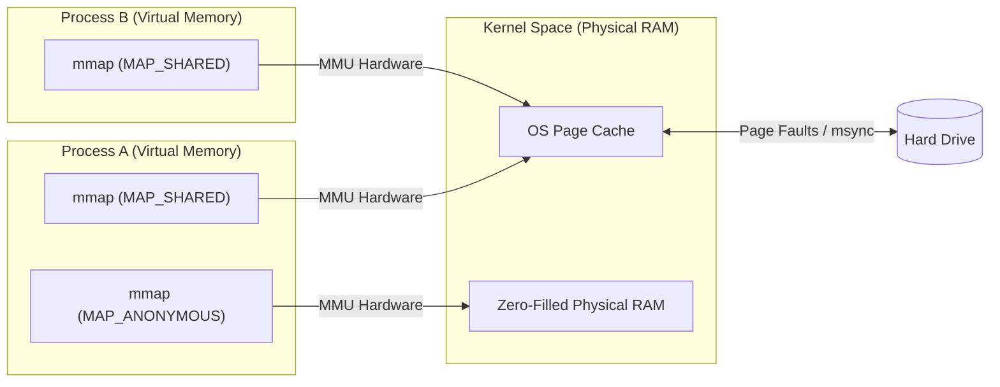

# The Anatomy of a Process

## Program vs Process

- **Program:** A static, compiled executable file sitting dormant on your storage drive.
- **Process:** An active, running instance of that program. It is a "program in motion." When the OS launches a program, it creates a process by allocating it a unique identifier (PID) and its own isolated virtual address space to store its state and active data.
- **One-to-Many Relationship:** A single program can spawn multiple distinct processes. For example, opening three separate terminal windows launches three completely independent processes that all originate from the exact same underlying executable file.
- **Executable Formats:** Executables are structured in strict formats dictated by the OS (such as **PE** for Windows, **ELF** for Linux, and **Mach-O** for macOS). These formats are not just raw machine code; they contain essential metadata and headers that tell the OS exactly how to load the file into memory, where execution should start, and what external libraries are required.

## Program

- **Definition:** A program is a static, executable file containing code that has been explicitly compiled and linked for a specific CPU.
- **Compilation:** The process of transforming human-readable programming languages into raw machine code. Because every CPU family has its own unique set of machine-level instructions, the compilation process is highly dependent on the target CPU architecture (e.g., x86 vs. ARM). Consequently, a compiled program will _only_ work on the specific architecture it was built for.
- **Linking:** The final step of the build process that connects your compiled code with the external software libraries it relies on.
    - **Static Linking:** Embeds a complete, physical copy of all used libraries directly into your final executable file. This makes the resulting file larger, but entirely self-contained and portable across systems with the same CPU architecture.
    - **Dynamic Linking:** Instead of embedding the actual code, the executable only includes references (pointers) to a specific version of a library. The OS resolves these references and loads the library into memory when the program is executed. On Windows, these external files are known as **DLLs** (Dynamic Link Libraries), while Linux refers to them as Shared Objects (`.so`).
- **Executable Formats:** The final output of the compilation and linking process is packaged into a structured executable format (such as PE for Windows or ELF for Linux). This format contains the essential headers and metadata the OS needs to correctly load the program's machine code into memory.

## Process Execution and State

- **Virtual Memory Layout:** When an active process lives in memory, it operates within a completely isolated, private virtual address space spanning from a minimum to a maximum address. This space is divided into distinct regions:
    - **Text/Code:** The region starting near the minimum address where the actual compiled machine instructions are loaded.
    - **Data/Static:** Stores initialized and uninitialized global variables.
    - **Heap:** Starts just after the data segment and grows _upwards_. It is used for dynamic memory allocation (e.g., when a program requests more memory at runtime).
    - **Stack:** Starts at the maximum address and grows _downwards_ (towards the heap). It stores local variables, function calls, and execution context.
- **Process Identification (PID) & Namespaces:**
    - **PID Wraparound:** Every process is uniquely identified by an ID. The kernel increments this sequentially. Once the OS hits its maximum PID limit (e.g., 32,768 on default Linux), it wraps around and _reuses_ available PIDs from dead processes. Security is maintained because the kernel completely destroys the old process's page tables upon termination, ensuring no residual data can be accessed.
    - **Namespaces:** The kernel uses Namespaces to isolate PID lists. This allows multiple processes across different Docker containers and the host system to all possess the exact same PID (e.g., PID `700`) simultaneously. The kernel internally pairs the Namespace + PID to uniquely isolate and identify them, completely hiding them from one another.
- **Instruction Pointer (Program Counter):**
    - The Instruction Pointer (IP) tracks the exact virtual address of the next instruction to be executed from the Text/Code segment.
    - **Hardware Register Execution:** The IP is an ultra-fast hardware register located physically inside the CPU. Because it is a CPU register, it increments automatically with every single execution cycle at zero performance penalty.
- **Process Control Block (PCB):**
    - The PCB is a vital data structure residing securely in Kernel Space memory. It acts as the process's master metadata record, storing its PID, open file descriptors, memory limits, and state.
    - **Context Switching Overhead:** Because the PCB lives in system memory (RAM), reading and writing to it involves latency. When the kernel performs a context switch, it must physically copy the current value of the CPU's Instruction Pointer register—and all other working registers—into the PCB in memory to save the process's state. This RAM-dependent save/load cycle is a primary reason context switching is computationally expensive.

## File Descriptors (FDs)

A File Descriptor is a fundamental UNIX and Linux concept built entirely on the principle of **Indirection**. At its core, an FD is nothing more than a non-negative integer (e.g., `0`, `1`, `5`, `12`) returned by the kernel to a user-space process.

Because of the overarching UNIX design philosophy—_"Everything is a file"_—this simple integer serves as the universal "coat check ticket" for almost all input/output resources in the operating system.

### The Table Hierarchy

To maintain security and isolation, your program never holds the actual resource in its memory. It only holds the integer. The kernel resolves this integer using a strict three-table lookup:

1. **The File Descriptor Table (Per-Process):** An array completely isolated to your specific process. The integer (e.g., `5`) is just the index in this array. 
2. **The Open File Table (System-Wide):** The process's array index points here. This kernel table tracks the "state" of the connection, such as your Read/Write offset and access permissions.
3. **The Inode Table (System-Wide):** The final destination. This points to the actual metadata of the underlying physical or virtual resource.
  
### Types of File Descriptors

Because the OS routes the data behind the scenes, your code can use the exact same `read()` and `write()` system calls regardless of what the underlying resource actually is.

- **Regular Files:** The most common type. An FD pointing to an Inode that represents a literal block of data on your physical hard drive (e.g., `database.db` or `config.json`).
- **Standard Streams (0, 1, 2):** When a process launches, the kernel pre-allocates three FDs automatically.
    - `0` (**stdin**): Reads input, defaulting to the user's keyboard.
    - `1` (**stdout**): Writes output, defaulting to the terminal screen.
    - `2` (**stderr**): Writes error messages, also defaulting to the screen but kept logically separate so it can be routed elsewhere if the program crashes.
- **Network Sockets:** FDs created via the `socket()` system call. Instead of pointing to a disk, the Open File Table points directly to a massive kernel-space TCP/IP data structure. When you execute `write(fd, data)`, the kernel intercepts it, wraps the data in TCP headers using the IP/Port stored in its internal structure, and fires it out of the physical Network Interface Card (NIC).
- **Pipes (IPC):** FDs used for Inter-Process Communication. When you pipe commands in a terminal (e.g., `cat logs | grep error`), the OS creates a unidirectional, purely in-RAM data channel. It hands a "write-end" FD to the first process and a "read-end" FD to the second. There is no disk and no network involved.
- **Device Files (`/dev`):** Hardware components are abstracted as files. If you open `/dev/urandom`, the kernel hands you an FD. When you `read()` from it, you aren't reading a file—the OS hardware dynamically generates random numbers and streams them into your buffer. Writing to `/dev/null` simply tells the kernel to instantly discard the data.
- **Event Monitors (`epoll` / `kqueue`):** Advanced system calls allow you to create a special FD whose sole purpose is to monitor _other_ FDs. High-performance web servers use an `epoll` FD to watch thousands of network socket FDs simultaneously, waiting for the kernel to notify them the exact millisecond one receives new network data.

### The Universal Interface

Because all these diverse resources are wrapped in the exact same integer abstraction, low-level C code can handle them identically:
```c
// This function doesn't care WHAT the fd is.
// It could be a text file, a TCP socket to Japan, or a local pipe.
void stream_data(int read_fd, int write_fd) {
    char buffer[4096];
    ssize_t bytes_read;

    // Read from the source
    while ((bytes_read = read(read_fd, buffer, sizeof(buffer))) > 0) {
        // Write to the destination
        write(write_fd, buffer, bytes_read); 
    }
}
```
### Manipulating the Open File Table

While the file descriptor itself is just a static integer array index, the system calls that act upon it are what drive actual state changes within the kernel's underlying Open File Table.

- **Stateful Operations (`read` & `write`):** When you execute a standard `read()` or `write()`, the kernel processes the requested bytes and automatically advances a hidden **File Offset** pointer stored inside the system-wide Open File Table. This means sequential calls to `read()` will naturally walk forward through a file, pulling the next continuous chunk of data each time without the programmer needing to manually track their position.
- **Manual Navigation (`lseek`):** If you need to jump to a specific location in a regular file (e.g., to read a specific database record or rewrite a specific header), you use `lseek()`. This system call does not transfer any data; it simply tells the kernel to fast-forward or rewind the File Offset pointer to a specific byte index. _(Note: `lseek` only works on physical/block resources; you cannot seek a network socket or a pipe)._
- **Stateless Operations (`pread` & `pwrite`):** In multi-threaded applications, relying on the shared Open File Table's hidden offset is highly dangerous. If Thread A and Thread B both call `read()` on the same file descriptor simultaneously, a data race occurs, and they will scramble the file offset. `pread()` (positional read) and `pwrite()` solve this by requiring you to pass an explicit byte offset as an argument. They perform the I/O at that exact physical location and **do not** update the shared Open File Table offset, allowing thousands of concurrent threads to safely hammer the exact same file descriptor without requiring expensive mutex locks.
- **Resource Duplication (`dup` & `dup2`):** These system calls allow a process to clone a file descriptor. The kernel simply takes a new integer index in your Per-Process File Descriptor Table and points it to the exact same entry in the Open File Table. This is the underlying magic of terminal redirection (like `ls > output.txt`)—the shell opens the text file, uses `dup2()` to overwrite standard output (`fd 1`) with the text file's descriptor, and instantly tricks the child process into writing to the disk instead of the screen.

> [!note] FD Exhaustion (FD Leaks)
> 
> The Per-Process File Descriptor Table is a fixed-size array in system RAM. Operating systems enforce a strict limit on how many FDs a single process can have open at once (historically `1024`, though easily increased today). If a program opens files or network connections but forgets to call `close(fd)` when finished, it "leaks" descriptors. Once the table fills up, the OS will aggressively refuse to open anything else, resulting in the fatal `EMFILE` ("Too many open files") error.
## Producing machine code

During compilation, high-level human-readable code is translated into low-level assembly language. Given this C code:

```c
#include <stdio.h>
int main ()
{
    int a = 1;
    int b = 3;
    int c = a + b;
    printf("a + b = %d", c);

    return 0;
}
```
This assembly represents the exact, step-by-step machine instructions the target CPU architecture will execute.

```armasm
mov r0, #1
mov r1, #3
add r3, r0, r1
str r3, #0xffeeddcc
```

- **CPU Registers (`r0`, `r1`, `r3`):** Notice that the assembly code does not use variable names like `a` or `b`. Instead, it uses **registers**. These are the ultra-fast, temporary storage locations physically built directly into the CPU core. Before the CPU can do math on data, that data must be loaded into a register.
- **Instruction Breakdown**
	- `mov r0, #1` **and** `mov r1, #3`: The `mov` (move) instruction loads the literal, hardcoded numbers (`#1` and `#3`) directly into the CPU registers `r0` and `r1`.
	- `add r3, r0, r1`: The CPU's computation hardware (the ALU) reads the values held inside `r0` and `r1`, adds them together, and immediately saves the resulting sum into a new register, `r3`.
	- `str r3, #0xffeeddcc`: The `str` (store) instruction takes the computed result out of the CPU's internal register (`r3`) and writes it out to system memory. The sequence `#0xffeeddcc` is a hexadecimal virtual memory address. 
### Compiler Optimization
In the previous example, `a` and `b` are hardcoded constants (`1` and `3`). A modern compiler will realize that there is no reason to force the CPU to calculate `1 + 3` every single time the program runs. Instead, the compiler does the math itself _during_ the compilation phase. It simply "folds" the constants together into the final value of `4`.    
- **Dead Code Elimination:** Because the original variables `a` and `b` are never used again after `c` is calculated, the compiler won't even bother wasting CPU registers or stack memory on them. It completely strips those steps out of the final executable.

```armasm
mov r3, #4
str r3, #0xffeeddcc
```

By doing this work at compile time, the resulting program is smaller (takes up less disk space and memory) and faster (requires fewer execution cycles from the CPU's ALU) while producing the exact same final output.

> [!note] The Side Effects of Compiler Optimization
> While optimizations make programs faster and smaller, altering the underlying machine code can introduce unintended consequences, particularly in low-level systems programming.
> - **Debugging Nightmares:** Because the compiler fundamentally changes the structure of the code—removing variables entirely or rearranging logic—the resulting assembly no longer maps 1:1 with your human-readable source code. If you try to step through a highly optimized program with a debugger, variables you want to inspect may simply not exist in memory or CPU registers, making troubleshooting extremely difficult.    
> - **Breaking Hardware Polling:** As noted in the [Device Drivers](00%20System%20Architecture%20Overview.md#Device%20Drivers) section, high-speed hardware often relies on "polling," where the CPU constantly checks a specific memory address for new data. If you write a loop that constantly checks a variable (e.g., `while(status == 0)`), an aggressive compiler will assume that since the _software_ isn't changing `status` inside the loop, the check is redundant. It will optimize the read away, breaking the driver. To prevent this, developers must use the `volatile` keyword in C, which strictly forbids the compiler from optimizing reads and writes to that specific memory location.
  > - **Instruction Reordering in Concurrency:** Compilers often rearrange the order of machine instructions to maximize CPU efficiency. In an isolated, single-threaded process, this is perfectly safe. However, if multiple threads are running concurrently across different CPU cores, this reordering can cause disastrous synchronization bugs (data races) if one thread depends on memory being updated in the exact sequential order written in the original source code.
### SIMD (Single Instruction, Multiple Data)

- **Scalar vs Vector:** The standard assembly instructions (like the `add` example above) are **scalar**; they perform one mathematical operation on one set of numbers at a time. SIMD introduces **vector** processing, allowing the CPU's ∂ to execute the exact same instruction on a large batch of data simultaneously within a single clock cycle.    
- **Massive Registers:** To achieve this, modern CPUs include specialized, extra-wide hardware registers (often 128, 256, or even 512 bits wide). Instead of loading a single 32-bit integer into a register, the CPU can pack four, eight, or sixteen integers into one giant SIMD register.
    - _Architecture Note:_ On x86 processors, these SIMD extensions are known as **SSE** or **AVX**. On modern ARM processors, the SIMD architecture is called **NEON**.
- **Auto-Vectorization (Compiler Optimization):** You rarely write SIMD assembly by hand. If you write a simple `for` loop in C that adds two large arrays together, an optimizing compiler will recognize the pattern. Through a process called auto-vectorization, the compiler completely rips out your scalar loop and replaces it with SIMD machine code, processing the arrays in massive parallel chunks to drastically improve execution speed.
- **Use Cases:** SIMD is heavily utilized for workloads that require repetitive, predictable math on large datasets, such as graphics rendering, video encoding, cryptography, and machine learning matrices.
### Assembling into Machine Code

 While assembly language is incredibly low-level, it is still text designed for humans to read. The CPU hardware cannot natively execute a string of characters like `add r3, r0, r1`. A tool called an **Assembler** must translate these textual mnemonics into raw binary machine code (opcodes)—the actual sequence of 1s and 0s that trigger the CPU's physical electrical circuits.
 
|Assembly Instruction|Binary Machine Code|Hexadecimal|
|---|---|---|
|`mov r0, #1`|`11100011 10100000 00000000 00000001`|`0xE3A00001`|
|`mov r1, #3`|`11100011 10100000 00010000 00000011`|`0xE3A01003`|
|`add r3, r0, r1`|`11100000 10000000 00110000 00000001`|`0xE0803001`|

- **Direct-to-Binary (Skipping the Assembly File):** While compilation is conceptually a multi-step pipeline (Source Code -> Assembly -> Machine Code), modern compilers (like Clang or GCC) often skip generating a physical, intermediate assembly text file. To optimize the build process and reduce disk I/O, they translate the high-level code directly into binary object files in memory.
- **Read-Only Text Segment (Security & Caching):** Once the machine code (the Text/Code segment) is loaded into virtual memory, the OS enforces strict hardware-level protection marking that region as **read-only** and **executable** (a principle known as Write XOR Execute, or W^X).
	- **Security:** If an application could write to its own code segment, malicious actors could exploit bugs (like [buffer overflows](#Buffer%20Overflow)) to inject and execute their own rogue machine instructions.
	- **Cache Coherency:** Because the CPU knows the instructions will never change, it can aggressively load them into the L1 cache without ever worrying about complex cache coherency issues or invalidating the data.
- **Just-In-Time (JIT) and Interpreted Languages:** The traditional ahead-of-time (AOT) assembly step is bypassed entirely by languages like Python, JavaScript, and Java. Instead of pre-compiling a static executable bound to a specific CPU architecture, these languages rely on a runtime engine. The engine either interprets the code line-by-line or uses a JIT compiler to generate the necessary raw machine instructions on the fly, right as the program is executing.
	- **The JIT Memory Challenge:** The runtime engine uses a JIT compiler to generate raw machine instructions on the fly. Because of the strict read-only security rule mentioned above, the JIT compiler has to constantly juggle memory permissions—requesting writable memory from the OS to generate the new machine code, and then explicitly changing that memory's permission to read-only/executable before the CPU is allowed to run it.
- **Memory Representation (Top vs. Bottom):** The first instruction is always stored at the lowest memory address. If you are looking at an academic memory diagram where the lowest address is drawn at the bottom, the machine code is represented **bottom-to-top**. However, if you are looking at a real-world debugger or hex editor where the lowest address starts at the top, it is read **top-to-bottom**.
- **Little-Endian Storage:** Many CPU architectures (including most x86 and ARM chips) use a format called **Little-Endian**, meaning the least significant _byte_ is stored at the lowest memory address. This means that while humans read the 32-bit instruction `0xE3A00001` left-to-right, physical RAM stores its byte-chunks in reverse order (`01 00 A0 E3`).

## The Stack

- **LIFO Structure:** The Stack in memory operates strictly as a Last-In, First-Out (LIFO) data structure.
- **Downward Growth:** As established in the memory layout, the stack starts at the highest memory address of its designated virtual space and grows _downwards_ toward the heap.
- **Function Frames:** Every time a function is called, it gets its own dedicated block of memory on the stack called a **Stack Frame**. This frame stores the function's local variables and execution context.
- **The "Top" of the Stack:** The currently active function is always located at the active edge (conceptually called the "top" of the stack, even though it sits at the lowest physical memory address). Because functions strictly follow LIFO, no process can accidentally touch or corrupt the frames of paused, parent functions sitting higher up the stack.
- **Contiguous Memory & Caching:** Stack space is strictly contiguous (sequential). Because the data is packed tightly together, it maximizes **spatial locality**. This makes it incredibly easy for the CPU to predict and load stack data into the ultra-fast L1/L2 caches, making stack memory significantly faster to access than heap memory.
- **Size Limits:** Stack space is strictly limited in size (typically a few megabytes per thread) because it must remain a continuous block of virtual memory.

### Stack Pointer (`sp`)

- **Definition:** A dedicated CPU register that holds the memory address of the very edge (the lowest address) of the currently active frame.
- **Allocation via Math:** Creating local variables doesn't require complex system calls. The compiled code simply subtracts bytes from the `sp` to "grow" the frame downwards, reserving the necessary space.
- **Lazy Deallocation:** When a function finishes, the CPU doesn't waste time physically deleting or wiping the old data. It simply moves the `sp` back upwards. The old data remains in RAM (as garbage) and will just be naturally overwritten the next time the stack grows downwards.
- **Intra-Frame Deallocation:** Deallocating individual variables inside an active frame is rarely done. The CPU simply waits for the function to return and deallocates the entire frame at once by moving the `sp`.

### Base Pointer (`bp` / Frame Pointer)

- **Definition:** Another dedicated CPU register that holds the starting address (the highest address) of the currently active frame.
- **The Anchor:** Because the Stack Pointer (`sp`) constantly moves up and down as local variables are pushed or popped, it is a terrible reference point for finding specific data. The Base Pointer (`bp`) solves this by acting as a fixed anchor for the duration of the function.
- **Variable Referencing:** Once the `bp` is set, the compiler can reliably find any local variable using fixed offsets (e.g., `bp - 8 bytes` or `bp - 16 bytes`), regardless of what the `sp` is currently doing.
- **Frame Pointer Omission (FPO):** While the Base Pointer is the standard anchor, it is not strictly mandatory. If a function's stack frame has a fixed, known size at compile time, modern compilers can track all local variables simply by calculating offsets directly from the moving Stack Pointer (`sp`). Through an aggressive optimization called Frame Pointer Omission, the compiler discards the Base Pointer entirely, freeing up that valuable CPU register for general computation to improve execution speed—though this trade-off makes debugging and reading stack traces significantly more difficult.
### Nested Calls & Context Switching

When an active function (`func1`) calls a new function (`func2`), `func2` must become the new active frame. The machine code executes a specific sequence to preserve the state safely:

1. **Save the Return Address:** The system saves the exact instruction address where `func1` left off, so it knows exactly where to resume later.
    - _Architecture Note:_ On x86 processors, it is pushed directly into the stack memory. On ARM processors, this is stored in a dedicated CPU register called the **Link Register (LR)** - see [Nested Calls in ARM.](#Nested%20Calls%20in%20ARM%20(The%20Link%20Register%20Problem))
2. **Save the Old Base Pointer:** The current value of `bp` (which anchors `func1`) is pushed onto the stack inside the new `func2` frame.
3. **Update Pointers:** The `bp` is updated to match the current `sp` (establishing the new anchor for `func2`), and the `sp` is moved down to allocate space for `func2`'s local variables.

**When `func2` returns:**

1. The CPU completely collapses `func2`'s frame by setting the `sp` back to the current `bp`.
2. It pops the saved `func1` base pointer off the stack and puts it back into the `bp` register, restoring `func1` as the active frame.
3. It takes the saved Return Address and loads it into the **Instruction Pointer**, seamlessly resuming `func1`'s execution exactly where it paused.
#### Nested Calls in ARM

- **The Link Register Bottleneck:** ARM processors use a single hardware Link Register (LR) to store the return address when a function is called. If `func1` calls `func2`, the LR holds the return address for `func1`. If `func2` then calls `func3`, the hardware will overwrite the LR, permanently losing the way back to `func1`.
- **Leaf vs. Non-Leaf Functions:**
	* A **Leaf Function** is a function that does not call any other functions (it is the end of the branch). It can safely leave its return address in the ultra-fast LR hardware register and use it to return.
    - A **Non-Leaf Function** (like `func2` in our example) _does_ call other functions.
- **Spilling to the Stack:** To prevent the return address from being destroyed, the compiled machine code for a non-leaf function will immediately push the current value of the LR onto the Stack the moment the function starts (in a phase called the function prologue). It gets stored in the memory frame right alongside the Base Pointer.
- **The Return:** When `func2` is finally ready to return to `func1`, it doesn't look at the physical LR hardware register anymore. Instead, it pops the original return address directly off the stack memory and loads it into the Instruction Pointer to safely resume execution.
### Calling Conventions (Parameters & Returns)

- **The Rulebook:** A Calling Convention is a standardized set of rules (an ABI - Application Binary Interface) that dictates exactly how the compiler should pass variables into a function and how that function should send its result back.
- **Passing Parameters (Registers First):** Accessing RAM is slow, so modern calling conventions try to avoid using the Stack for parameters whenever possible. Instead, they pass arguments using the ultra-fast CPU registers.
    - _ARM Architecture:_ The first four parameters of a function are placed directly into registers `r0`, `r1`, `r2`, and `r3` before the `call` instruction is executed.
    - _x86-64 Architecture:_ Uses a similar trick, placing the first six parameters into specific registers (like `rdi`, `rsi`, `rdx`, etc.).
- **Stack Spilling (Too Many Parameters):** What happens if your function takes 8 parameters, but ARM only allocates 4 registers for them? The CPU "spills" the excess. The first 4 parameters go into registers, and the remaining 4 are pushed directly onto the **Stack memory** just before the function is called. The new function frame will then read those extra parameters by calculating an offset from the Base Pointer (`bp`).
- **Returning Values:** When a function finishes its computation, it needs to leave the final answer somewhere predictable for the parent function to find. By standard convention, the return value is almost always placed in the very first general-purpose register.
    - On ARM, the function saves its return value into `r0` just before returning.
    - On x86, it saves the return value into the `rax` (or `eax`) register.
    - When the parent function resumes execution, it immediately looks at `r0` (or `rax`) to grab the result.
### Stack Overflow

- **The Cause:** Because stack memory is a fixed, contiguous block, it has a strict size limit. If a program enters an infinite loop of nested function calls (infinite recursion) or tries to allocate massively oversized local variables inside a single frame, the Stack Pointer (`sp`) will continuously move downwards until it entirely runs out of allocated space.
- **The OS Limit:** The maximum size of the stack is primarily enforced by the Operating System (e.g., typically 8MB on Linux), though the compiler/linker can embed a requested stack size into the executable's format headers during the build process.
- **The Guard Page (Protection):** To prevent the downward-growing stack from silently crashing into the upward-growing heap and corrupting application data, the kernel sets up a trap. It places a special, inaccessible memory page at the very boundary of the stack's allowed virtual memory space, known as a **Guard Page**.
- **The Crash (Segmentation Fault):** If the Stack Pointer (`sp`) reaches the limit and attempts to write data into the Guard Page, the CPU's Memory Management Unit (MMU) instantly detects a permission violation. The hardware triggers an interrupt, and the kernel ruthlessly kills the process to protect the rest of the system memory. This fatal crash is the infamous "Stack Overflow."
### Buffer Overflow

- **The Concept:** A buffer overflow occurs when a program attempts to write more data into a fixed-size block of memory (a buffer) than it was allocated to hold. Because low-level languages (like C and C++) trust the programmer implicitly, the CPU does not automatically check if the data fits. It simply continues writing the excess bytes sequentially into the adjacent memory addresses.
- **The Mechanism (No Bounds Checking):** If you allocate a 10-byte array on the Stack to hold user input, but the user submits a 50-character string, legacy standard library functions like `strcpy()` or `gets()` will write the first 10 bytes into the array, and "overflow" the remaining 40 bytes directly over whatever happens to be sitting next to it in memory.
- **Stack Smashing (The Security Exploit):** As established in the Stack memory layout, a function's local variables (the buffer) sit in the exact same memory frame as critical control data—specifically, the saved Return Address (the value destined for the Instruction Pointer).
    - Hackers actively exploit buffer overflows by carefully crafting an oversized input. They overflow the array just enough to overwrite the saved Return Address with a new memory address of their choosing.
    - When the function finishes and attempts to return, the CPU pops the corrupted address off the stack and blindly jumps to it. This allows the attacker to fully hijack the execution flow, often forcing the program to execute rogue machine instructions they injected into memory themselves.
- **Modern Mitigations:** To combat this massive security vulnerability, modern compilers and operating systems enforce several layers of defense:
    - **W^X (Write XOR Execute):** Enforcing strict hardware-level permissions so that writable memory (like the Stack or Heap) cannot be executed, and executable memory (like the Text segment) cannot be written to. If an attacker injects their own machine code into an overflowing buffer, the CPU will refuse to execute it.
    - **Stack Canaries:** The compiler automatically injects a secret, random value (a "canary") onto the Stack between the local variables and the Return Address. Before the function returns, it checks if the canary is still intact. If a buffer overflow overwrites the return address, it inherently must overwrite the canary first, allowing the program to detect the tampering and instantly crash itself safely.
    - **ASLR (Address Space Layout Randomization):** The OS randomizes the starting virtual memory addresses of the Stack, Heap, and standard libraries every single time the process launches. Even if an attacker successfully hijacks the Instruction Pointer, they have no idea what memory address to point it to.
    - **Memory-Safe Languages:** Modern languages (like Python, Java, Go, or Rust) eliminate this entire class of vulnerabilities by enforcing strict, automatic bounds-checking at runtime. If an array is 10 bytes long and you attempt to write an 11th byte, the runtime instantly throws a safe exception instead of blindly corrupting the adjacent memory.
## The Data Section

- **Definition & Size:** This section of virtual memory stores global and static variables. Because the compiler knows exactly how many global variables exist in the code, the total size of the Data section is strictly fixed at compile time.
- **Memory Placement:** It resides in memory immediately above the Text/Code segment.
- **The Compiler Split (`.data`, `.bss`, `.rodata`):** The OS actually divides this region into optimized sub-sections:
    - **`.data`:** Stores initialized global variables (e.g., `int x = 100;`). This section is Read/Write.
    - **`.bss`:** Stores _uninitialized_ global variables (e.g., `int y;`). To save space in the executable file, the OS just zeroes out this memory when the program launches.
    - **`.rodata` (Read-Only Data):** Stores constants and string literals (e.g., `"Hello World"` or `const int z = 5;`). The hardware strictly enforces this as read-only.
- **Addressing:** Unlike local stack variables (which are found using offsets from the moving Stack/Base pointers), variables in the Data section reside at fixed, static memory addresses.
- **Cache Coherency Penalty:** While reading global variables is fast, _writing_ to them in a modern multi-core system is costly. If Core A updates a global variable, the hardware must instantly trigger "cache invalidation" signals to Cores B, C, and D, forcing them to flush their local caches and fetch the newly updated value from RAM to avoid data corruption.
- **Cache Efficiency:** Because the compiler packs these global and static variables tightly together in a continuous, fixed-size memory block, reading them sequentially heavily benefits from [Spatial Locality](03%20Memory%20Management.md#Spatial%20Locality). Traversing arrays or adjacent variables in the Data section results in massive CPU cache hit rates, making these reads nearly instantaneous.
## The Heap

* **Dynamic Allocation:** A massive, dynamic region of memory used for variables whose size or lifespan cannot be determined at compile time.
* **Global Access:** Unlike stack frames which are isolated to specific functions, memory allocated on the heap can be accessed by any function in the program as long as it has the correct pointer.
* **Upward Growth:** As established in the memory layout, the heap starts immediately after the BSS/Data section and grows *upwards* toward the descending Stack.
* **Manual Lifespans:** Data on the heap remains there indefinitely until it is explicitly deallocated by the programmer (or a garbage collector).
* **The Allocator (`malloc` & `free`):** In languages like C/C++, you allocate heap memory using standard library functions like `malloc` and `free`.
	* **User-Space Management:** `malloc` is not a system call. It is a User Space manager. It asks the kernel for a giant pool of memory (using actual system calls like `brk` or `mmap`) and then slices that pool into smaller allocations for your program.
	* **Metadata Headers:** When `malloc` gives you memory, it secretly writes a metadata header directly above the returned memory address. This header stores the exact size of the allocation block.
	* **Deallocation:** When you call `free(pointer)`, the allocator looks slightly backward in memory to read that hidden header, figures out how many bytes to reclaim, and marks that chunk as "available" for future `malloc` calls.
* **The Program Break (`brk`):** The absolute "top" boundary of the heap's available memory is called the Program Break.
	* To request more raw memory from the kernel, the allocator uses the `brk` or `sbrk` system calls to push the Program Break upwards.
	* Unlike the Stack Pointer, we cannot simply lower the Program Break to deallocate memory, because heap allocations are completely out of order (fragmented).
* **Escape Analysis:** Some modern languages (like Go) attempt to keep all variables on the ultra-fast Stack by default. The compiler performs [Escape Analysis](Go%20Internals.md#Escape%20Analysis)—if it detects that a variable's reference "escapes" the function's scope (meaning it needs to outlive the function), the compiler automatically moves that allocation to the Heap.
### The `mmap` System Call (Memory Mapping)

While the traditional Heap grows sequentially via the `brk` system call, modern allocators use `mmap` (Memory Map) to parachute chunks of memory directly into the wide-open virtual address space between the Stack and the Heap.



#### The OS Page Cache

To understand `mmap`, you must understand the OS Page Cache. The Page Cache is not a separate physical chip on your motherboard; it is simply a dynamic, massive pool of **standard physical RAM residing in Kernel Space**.

* **Greedy by Design:** The OS actively hates unused RAM. Any physical memory not currently assigned to an active application is automatically consumed by the kernel to expand the Page Cache.
* **The Unified Middleman:** It acts as a global deduplicator for the entire system. Whether a program uses standard `read()`/`write()` calls or maps a file via `mmap`, the data lands in this exact same pool of Kernel Space RAM.
* **4KB Chunks:** The kernel manages this memory strictly in 4KB blocks called "pages."
#### What "Mapping" Actually Means

In operating system terminology, the word "mapping" does not strictly require a file. Instead, **mapping is the act of connecting a Virtual Address to a Physical Resource.** It is simply the OS configuring your process's Page Table to tell the CPU where to route memory requests.

- **File-Backed Mapping:** Virtual Address → Page Table → Physical RAM (Page Cache) → Hard Drive File.
- **Anonymous Mapping:** Virtual Address → Page Table → Physical RAM (and it stops there).

Because the `mmap` system call allows the kernel to parachute these virtual addresses anywhere in the process's memory layout, it is used as a highly flexible allocation tool for pure RAM, even when no file system is involved.
#### File-Backed Mapping 

Mapping a file creates the illusion that the entire file is just a standard array sitting in RAM.

* **Bypassing Syscalls:** `mmap` entirely eliminates the overhead of copying data back and forth between the physical disk, the kernel, and user space.
* **Lazy Loading & Page Faults:** Mapping a 1GB file does not immediately load 1GB of data; it only configures the virtual addresses. When the CPU touches an unmapped address, it triggers a hardware trap called a **Page Fault**. The OS pauses execution, fetches that specific 4KB chunk from the hard drive into the Page Cache, and resumes execution at native RAM speed.

#### Anonymous Mapping (`MAP_ANONYMOUS`)

This flag bypasses the file system entirely to provide pure, file-less RAM directly to a process. While it functions as a raw memory allocator, it utilizes a brilliant architectural shortcut to save time and hardware resources.

- **Large Heap Allocations:** When `malloc()` needs to allocate massive objects (typically anything > 128KB), it automatically bypasses the standard Heap and uses an anonymous `mmap`. This prevents severe memory fragmentation because the entire block can be instantly deleted and returned to the OS (via `munmap()`) without leaving a permanent hole in the standard Heap.
- **The "Demand Zero" Magic Trick:** If you ask for 1GB of anonymous memory, the kernel does not freeze your program to fetch and scrub 1GB of physical RAM upfront. Instead, it uses **Demand Zero Paging**:
    - **The Illusion:** The OS points all of your newly mapped virtual addresses to a _single_, shared 4KB page in physical RAM that is permanently filled with zeros, marked as Read-Only. If your program reads the array, it just reads this single zeroed page.
    - **The Write Fault (The Reality):** The exact millisecond your program attempts to _write_ data to a specific virtual address, the CPU hits the Read-Only lock and triggers a Page Fault.
    - **Just-in-Time Allocation:** The kernel intercepts the fault, grabs a real, free 4KB physical page, scrubs just that single page with zeros, updates your Page Table to point to it (with Write permissions), and lets your program proceed. You only consume physical RAM at the exact moment you write to it.

#### Memory Visibility & IPC

Because `mmap` controls how virtual addresses route to physical RAM, it is the ultimate tool for Inter-Process Communication (IPC).

* **`MAP_SHARED`:** If two processes map the exact same file, the OS points their isolated virtual addresses to the exact same physical RAM chips in the Page Cache. Writes by one process are instantly visible to the other, completely bypassing kernel communication overhead.
* **File System Security:** The OS secures shared memory using standard file permissions. If a process does not have OS-level write access to the underlying file, the kernel blocks the mapping attempt.
* **Total Invisibility:** If a parent creates a `MAP_ANONYMOUS | MAP_SHARED` mapping *before* calling `fork()`, the child inherits the page tables. They now share RAM that lacks a filename or file descriptor, making it invisible and inaccessible to any other process on the system.
* **Copy-on-Write (`MAP_PRIVATE`):** Maps shared memory strictly as Read-Only. The exact moment a process attempts to execute a write, the hardware MMU intercepts the action and creates a secret, private copy of that 4KB page in RAM, leaving the original data untouched.

> [!note] Best Practices & Edge Cases
> * **Manual Cleanup:** Memory is not garbage collected. The program must explicitly call `munmap()` to destroy the mapping and release the RAM.
> * **Persisting Data:** The kernel lazily writes "dirty" (modified) shared pages back to the disk. Developers must explicitly call `msync()` to force a save and prevent data loss during a crash.
> * **Thrashing:** Accessing random addresses across a mapped file that is significantly larger than the available physical RAM forces the kernel to constantly drop and fetch pages. This destroys performance, making the CPU wait for the hard drive's mechanical latency.
> * **Swap Space:** If physical RAM runs out, the kernel may write inactive `MAP_ANONYMOUS` pages to the hard drive's Swap Partition to keep the system running.
### Pointers

* **The Concept:** A pointer is simply a variable that stores a raw memory address instead of a standard value. They can point to data on the Stack, the Heap, or the Data section.
* **First Byte Addressing:** A pointer always stores the exact memory address of the *very first byte* of the data block it is referencing.
* **Type Awareness:** The pointer's data type (e.g., `int*` vs `char*`) tells the CPU how many consecutive bytes to read starting from that first address. An `int*` tells the CPU to read 4 contiguous bytes, while a `char*` tells it to read just 1 byte.

### Memory Leaks & Garbage Collection

* **The Leak:** If a function allocates memory on the heap but loses the pointer or exits without calling `free()`, that memory becomes permanently "orphaned." The allocator thinks it is still in use, so it cannot be reused. This is a memory leak, and over time, it will drain the system's available RAM.
* **Automated Management:** To prevent human error, modern languages (like Java, Python, or Go) use automated memory management.
	* **Reference Counting:** The allocator adds a hidden counter to every object's metadata. Every time a new variable points to the object, the counter increments. When a variable is destroyed, it decrements. If the counter hits `0`, the system automatically calls `free()`. However, constantly updating this counter in memory is computationally expensive.
	* **Garbage Collection (Tracing):** Other languages periodically pause the program, scan the entire Stack to find all active pointers, and trace them into the Heap. Anything in the Heap that isn't connected to an active pointer is swept away and freed.

### Dangling Pointers & Double-Frees

* **The Dangling Pointer:** This happens when memory is explicitly freed, but the program still accidentally holds onto a pointer referencing that exact memory address.
* **Unpredictable Danger:**
	* If the allocator has already reused that address for a new variable, the dangling pointer will accidentally overwrite or read corrupted "garbage" data belonging to something else.
	* If the memory was returned to the OS, trying to access it will trigger an instant hardware crash (Segmentation Fault).
* **Double-Free Exploits:** If a program tries to `free()` the exact same pointer twice, it will attempt to read a metadata header that no longer exists (or has been overwritten). This heavily corrupts the allocator's internal tracking lists and will usually crash the process. Hackers actively exploit double-frees to overwrite memory and hijack the execution flow of a program.

### Performance (Stack vs Heap)

* **Allocation Overhead:** Stack allocation is incredibly fast (just subtracting from the CPU's Stack Pointer register). Heap allocation is drastically slower because `malloc` has to search its internal lists for an appropriately sized free block, and occasionally trigger expensive context switches to Kernel Mode to ask for more memory via `brk`.
* **Cache Efficiency:** The Stack is tightly packed, resulting in massive CPU Cache hit rates ([Spatial Caching](03%20Memory%20Management.md#Spatial%20Locality)). The Heap, however, is heavily fragmented. Because allocations are scattered randomly across memory, jumping between heap pointers frequently causes CPU cache misses, forcing slow reads from physical RAM. 
### Bulk Allocations

When writing performance-critical code, allocating one massive block of memory upfront is drastically faster and more efficient than making thousands of tiny allocations. Here is exactly why the hardware and OS favor bulk allocation:
- **Eliminating Metadata Bloat:** Every single time you call `malloc`, it writes a hidden metadata header (usually 8 to 16 bytes) to track the size of that specific block.
    - If you allocate 10,000 individual 4-byte integers, you are also secretly allocating up to 160,000 bytes of pure metadata overhead!
    - If you allocate one massive array of 10,000 integers in a single `malloc` call, there is only _one_ header. You save huge amounts of RAM.
- **Avoiding System Call Overhead:** While `malloc` is in User Space, if you spam it with thousands of small requests, it will quickly run out of its pre-allocated pool. It is forced to repeatedly pause your program, switch to Kernel Mode, and execute `brk` or `mmap` system calls to beg the OS for more chunks of RAM. One large upfront allocation triggers a single system call.
- **Preventing Memory Fragmentation:** If you make many small allocations and free them randomly over time, the Heap turns into "Swiss cheese"—full of tiny, unusable holes. This is called fragmentation. A single large allocation reserves a pure, unbroken block of memory.
- **Enforcing Spatial Locality:** If you `malloc` 100 small objects individually, the allocator might scatter them randomly across the entire Heap wherever it finds free space. Reading them sequentially will cause massive CPU Cache misses. A single large allocation (like a giant array) guarantees the data is physically contiguous in RAM, allowing the CPU to load it into the L1 cache flawlessly.

#### The Arena Pattern

- **The Concept:** Instead of asking the standard `malloc` for memory every time an object is created, the program makes a single, massive system call (like `mmap`) at startup to reserve a huge, contiguous block of virtual memory (e.g., 1GB) known as an Arena.
- **The "Bump" Allocator:** To manage this memory, the program creates its own microscopic allocation system. It simply keeps a single pointer (the "offset") pointing to the start of the empty Arena.
    - When the program needs 32 bytes for an object, the custom allocator doesn't search complex free-lists or write metadata headers. It simply returns the current pointer address to the program, and then "bumps" the pointer forward by 32 bytes.
    - Mathematically, allocation becomes a single CPU addition instruction: `pointer = pointer + size`. This makes Heap allocation exactly as fast as Stack allocation!
- **Bulk Deallocation (The Real Magic):** The true power of an Arena is that you generally **do not free individual objects**.
    - If you try to free objects one by one, you have to build complex tracking lists, which defeats the purpose.
    - Instead, Arenas are tied to specific lifespans (like rendering a single frame in a video game, or processing a single HTTP request in a web server). When the frame or request is finished, the allocator simply resets the internal pointer all the way back to zero.
    - In one single CPU instruction, thousands of objects are instantly "freed" and the memory is ready to be overwritten by the next task.
- **Zero Fragmentation:** Because objects are allocated strictly sequentially and deleted all at once, it is physically impossible for the Arena to suffer from memory fragmentation.
- **Massive Cache Hits:** Because every object allocated inside the Arena is packed perfectly back-to-back, processing them sequentially results in virtually 100% L1 CPU Cache hit rates (maximizing Spatial Locality).

### The OOP Penalty 

- **The `new` Keyword Paradigm:** In heavily Object-Oriented languages (like Java, Python, or idiomatic C#), almost every entity is a Class. When you instantiate a class (e.g., `new Player()`), the language runtime automatically executes a small, individual Heap allocation to store that specific object.
- **The Object Graph (Pointers to Pointers):** OOP encourages composition—objects containing other objects.
    - If you have a `Car` object that contains an `Engine` object and four `Tire` objects, the `Car` memory block does not physically hold the engine and tires.
    - Instead, the `Car` holds **pointers** to five completely separate, random locations on the Heap where the engine and tires were individually allocated.
    - If you create an array of 1,000 `Car` objects, you aren't creating a block of 1,000 cars. You are creating a block of 1,000 _pointers_, which point to 1,000 scattered `Car` objects, which point to thousands of scattered `Engine` and `Tire` objects.
- **Pointer Chasing (Destroying Spatial Locality):** Because these objects are randomly scattered across the Heap, trying to execute a loop like `car.engine.start()` is a hardware nightmare. The CPU loads the Car, reads the pointer to the Engine, and is forced to jump to a completely random memory address. This immediately causes an **L1 Cache Miss**, forcing the CPU to stall and wait for system RAM. This phenomenon is known as "Pointer Chasing."
- **Massive Metadata Bloat:** Because every object is its own tiny allocation, every object requires its own hidden metadata header.
    - For example, in Java, wrapping a simple primitive 4-byte integer inside an `Integer` object class adds up to 16 bytes of metadata overhead. You are using 20 bytes of RAM just to store the number `5`!
- **The Garbage Collection Burden:** OOP design patterns create millions of these tiny, short-lived objects. This puts immense pressure on the Garbage Collector, which now has to constantly pause your program to traverse millions of scattered pointers to figure out which tiny objects are safe to delete.

## Processes vs. Threads

- **The Container vs. The Execution:**
    - **Process:** The ultimate resource container. It holds the isolated virtual memory space, the Per-Process File Descriptor Table, and the Process Control Block (PCB). By itself, a process doesn't "do" anything; it is simply the bounded environment in which code runs.
    - **Thread:** The actual active unit of execution. Every process starts with exactly one main thread, but it can spawn multiple child threads. The OS scheduler does not actually schedule processes; it schedules _threads_ onto physical CPU cores.
- **Resource Sharing:** Because threads exist _within_ the same parent process, they inherently share almost all system resources, completely bypassing the need for complex Inter-Process Communication (IPC) like pipes or shared `mmap` files.
    - **Shared:** All threads within a process read from the exact same Text/Code segment, the Data/BSS segments (global variables), the Heap (dynamic memory), and the File Descriptor array.
    - **Isolated:** Each thread must maintain its own independent execution state. Therefore, the OS allocates every thread its own private **Stack** memory (to track its own function calls and local variables) and saves its own dedicated copy of the CPU registers (including its own Instruction Pointer, Base Pointer, and Stack Pointer).
- **Context Switching Overhead:**
    - **Process Switch (Heavy):** Switching the CPU from Process A to Process B is incredibly computationally expensive. The kernel must physically swap out the entire virtual memory mapping (updating the CPU's Memory Management Unit) and flush the CPU's Translation Lookaside Buffer (TLB). This forces a massive wave of L1/L2 cache misses as the new process is forced to pull its data all the way from system RAM.
    - **Thread Switch (Lightweight):** Switching from Thread 1 to Thread 2 _within the exact same process_ is drastically faster. Because they share the same virtual memory space, the kernel does not need to touch the MMU or flush the TLB. It simply swaps the hardware registers (saving Thread 1's Instruction/Stack Pointers and loading Thread 2's) and execution resumes almost instantly.
- **Multi-Core Parallelism:** The primary physical purpose of threading is true parallel hardware execution. If a single-threaded process runs on an 8-core CPU, 7 cores sit completely idle. If that process spawns 8 threads, the OS can assign one thread to each physical CPU core, allowing them to execute machine instructions simultaneously and divide the workload.
### Multi-Threaded Memory Layout

- **The Single-Thread Illusion:** The classic memory layout—where the Stack starts at the absolute maximum address and grows downwards toward the Heap—technically represents a purely single-threaded process. 
- **The Collision Problem:** Because threads within the same process share the exact same virtual memory space, they cannot all share the Main Thread's top-level Stack. If they did, their independent Last-In, First-Out (LIFO) function frames would instantly collide and corrupt one another.
- **Parachuting Stacks via `mmap`:** To provide each newly spawned thread with its own isolated execution state, the kernel utilizes the `mmap` system call. It allocates new, fixed-size blocks of memory and parachutes them directly into the massive gulf of empty virtual addresses residing in the "middle space" between the upward-growing Heap and the Main Thread's Stack.
- - **Guard Pages (Preventing Silent Corruption):** While any `mmap` allocation can suffer from a software [buffer overflows](#Buffer%20Overflow), stacks are uniquely dangerous because their growth is implicit. The CPU hardware blindly decrements the Stack Pointer (`sp`) as functions are called, never checking if memory limits have been reached. Because these mapped thread stacks float dangerously close to one another in virtual memory, the OS places a Read/Write-protected [**Guard Page**](#Stack%20Overflow) at the absolute bottom of each thread's block. Just like the Main Thread's boundary, if a runaway thread's `sp` hits this hardware tripwire, the MMU triggers an instant Segmentation Fault, killing the process before it can silently overwrite an adjacent thread's function frames. 