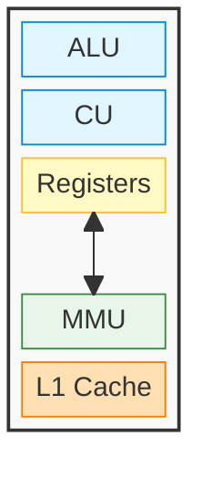
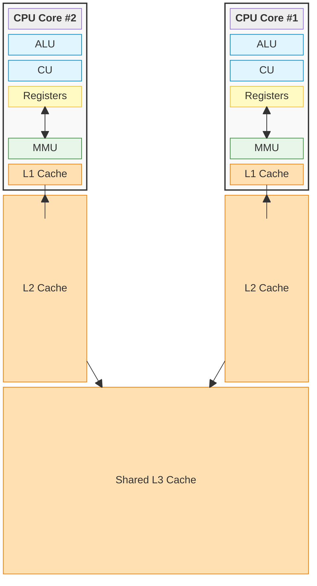
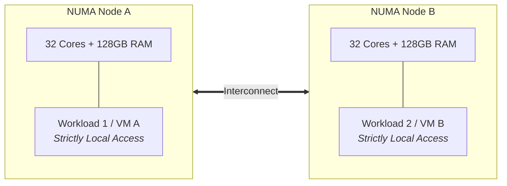

# Inside The CPU

The CPU is where actual execution **happens**, making it one of the most valuable resources in a computer system.

## Basic Components

When we write software, it is easy to imagine the CPU as a single, unified "brain" that simply reads a line of code and executes it. However, at the hardware level, a processor is bound by a relentless physical metronome: the clock cycle.

If the CPU were built as a single, monolithic circuit, it would suffer from a massive bottleneck. The entire chip would have to wait while it slowly fetched data from memory, then wait again while it decoded the instruction, and wait _again_ to actually perform the math. Millions of clock cycles would be wasted doing absolutely nothing.

To achieve billions of operations per second, hardware engineers had to abandon the idea of a single "brain" and instead design the CPU as a highly parallel **assembly line**. By breaking the processor into distinct, specialized physical components, the CPU can overlap its work. While one component is busy calculating the current instruction, another component is already fetching the next one from memory.

To make this assembly line function, the CPU relies on a core set of specialized silicon:



- **Arithmetic Logic Unit (ALU):** The standard mathematical engine of the processor. It performs all integer arithmetic (addition, subtraction) and bitwise logic (AND, OR, XOR) on raw binary data. If the math involves integer numbers or simple memory offsets, it happens here.
- **Floating-Point Unit (FPU):** The complex math engine. While the ALU is limited to integers, the FPU is specifically designed to calculate decimals, fractions, and scientific notation (using standards like IEEE 754). It handles the heavy mathematical workloads that the ALU cannot physically process, such as trigonometry, physics simulations, and large [SIMD](04%20Inside%20The%20CPU.md#Single%20Instruction,%20Multiple%20Data%20(SIMD)) vector calculations.
- **Control Unit (CU):** The conductor of the silicon orchestra. It drives the **Fetch-Decode-Execute** cycle. It fetches the next instruction from memory, decodes its binary intent, and physically routes the correct electrical signals to the ALU, registers, or memory bus to execute the command.
- **Registers:** The lowest-latency storage available to an execution core, built directly into the core. They have much lower latency than cache or RAM, but very limited capacity (typically 64 bits per register). They hold the values the ALU is currently mutating.
- **Memory Management Unit (MMU):** The hardware translator. It intercepts the virtual addresses requested by the Control Unit and translates them into physical RAM locations using the OS-managed Page Tables. Largely talked about at [Memory Management](03%20Memory%20Management.md) notes.
- **CPU Caches (L1 / L2 / L3):** A latency bridge between cores and RAM. Because RAM access has substantially higher latency than an ALU operation, the CPU includes layers of SRAM on the processor die. This hierarchy keeps recently or frequently used data and instructions closer to the core, reducing RAM accesses.
- **The Bus (The Interconnect):** The microscopic communication highways that wire the entire assembly line together. Instead of chaotic point-to-point wiring, components share dedicated channels. Internally, high-speed interconnects (like a Ring or Mesh bus) synchronize the cores and the caches. Externally, the System Bus acts as the sole bridge to the motherboard and RAM, physically split into three distinct paths: the _Address Bus_ (transmitting memory locations), the _Data Bus_ (carrying the actual payloads), and the _Control Bus_ (delivering timing and command signals from the Control Unit).
## The Cache Hierarchy

CPU cores can execute instructions much faster than data can be retrieved from system RAM. If every instruction depended on RAM, memory latency would frequently stall execution. This latency gap is known as the "Memory Wall."

To reduce those stalls, engineers place layers of lower-latency **SRAM (Static RAM)** directly on the CPU die. This internal storage is structured as a strict hierarchy of caches, balancing latency against physical size:

- **L1 Cache:** The lowest-latency cache, located closest to the execution core. It typically has lower latency than L2, L3, and RAM (~1-2 nanoseconds). Its limited space (typically 32KB to 64KB) is usually split into two dedicated halves: **L1i** (Instruction cache, fed to the Control Unit) and **L1d** (Data cache, fed to the ALU).
- **L2 Cache:** The secondary private cache for the core. It is slightly larger (typically 256KB to 1MB) but takes longer to search (~3-5 nanoseconds). It acts as a staging ground, catching data before the core has to reach out to the rest of the chip.
- **L3 Cache:** A larger, shared cache at the center of the processor. It is typically larger (10MB to 64MB+) and has higher latency (~10-20 nanoseconds) than L1 and L2. Unlike L1 and L2, the L3 cache is shared across _all_ cores on the CPU. It is the last cache level before an access must go to physical RAM, which commonly has substantially higher latency (~100 nanoseconds).



### Cache coherency

Because the L1 and L2 caches are strictly private to each individual core, they introduce a massive architectural hazard. If Core 1 and Core 2 both cache the same variable from RAM, and Core 1 modifies its private copy, Core 2's cache is instantly out of date.

To prevent the CPU from executing calculations on stale, corrupted data, the hardware utilizes highly complex **cache coherency protocols**. To write highly optimized multithreaded software, developers must understand how this underlying hardware operates, or they risk triggering constant cache invalidations that cripple system performance.
#### The MESI Protocol

The CPU does not manage the cache byte-by-byte. It groups memory into chunks called **Cache Lines**. The CPU hardware tags every single cache line with one of four states

| **State**         | **Meaning**                                                                | **Core Action**                                                                                                     |
| ----------------- | -------------------------------------------------------------------------- | ------------------------------------------------------------------------------------------------------------------- |
| **Modified (M)**  | This core changed the data. The copy in RAM is now stale.                  | No other core has this line. If another core asks for it, this core must write it back to RAM/L3 first.             |
| **Exclusive (E)** | This core is the _only_ one holding this data, and it matches RAM exactly. | The core can modify this data locally without first requesting ownership over the bus.                               |
| **Shared (S)**    | Multiple cores hold this exact data. It matches RAM exactly.               | Cores can read freely. If a core wants to write, it must broadcast an "Invalidate" signal to all other cores first. |
| **Invalid (I)**   | The data is stale because another core modified it.                        | The core cannot read this line. It suffers a "cache miss" and must fetch fresh data from L3/RAM.                    |

When a core modifies a Shared cache line, it forces all other cores to mark their copies as **Invalid**. This hardware mechanism ensures data integrity, but it creates a massive trap for software engineers.
#### The Developer Trap: False Sharing

Because the MESI protocol operates on entire 64-byte Cache Lines rather than individual variables, it creates a phenomenon called **False Sharing**—one of the most notorious performance killers in multithreaded software.

Imagine you write a multithreaded program where Thread 1 continuously updates a counter variable `X`, and Thread 2 continuously updates a counter variable `Y`.

Logically, these threads are completely independent. They aren't sharing data, so you don't use any software locks (like mutexes). You expect them to run at maximum speed on separate cores.

However, if you defined those variables right next to each other in your code (e.g., inside the same array or struct), they sit next to each other in physical RAM. **Because they are physically close, the CPU pulls both `X` and `Y` into the exact same 64-byte Cache Line.**

Here is the physical disaster that follows:

1. Core 1 modifies `X`. The MESI protocol marks Core 1's cache line as **Modified**.
2. To do this, Core 1 sends an invalidate signal over the bus. Core 2's cache line (which contains `Y`) is instantly marked **Invalid**.
3. A nanosecond later, Core 2 wants to modify `Y`. It checks its L1 cache and sees the Invalid flag. It suffers a cache miss.
4. Core 2 forces Core 1 to flush the Modified cache line back to L3 memory. Core 2 then pulls the fresh cache line, modifies `Y`, marks its own line **Modified**, and invalidates Core 1.

Even though the threads use different variables, the hardware treats them as contending for the same cache line. The 64-byte cache line can move repeatedly between cores. This prevents each core from retaining a local copy and makes the updates slower than accesses to an uncontended L1 cache; the exact cost depends on the processor and workload.

To fix False Sharing, high-performance developers use **Cache Line Padding**. They intentionally waste memory by inserting 64 bytes of dummy variables between `X` and `Y` in the source code. This forces the hardware to place `X` and `Y` onto completely separate cache lines, allowing both CPU cores to hold them in the Exclusive (E) state and modify them simultaneously with zero cross-talk.

### Non-Uniform Memory Access (NUMA)

In early computers, every CPU core sat on an equal playing field, sharing a single bus to a single pool of RAM (Symmetric Multiprocessing, or SMP). But as servers grew to have 64, 128, or even 256 cores, a single shared bus became a catastrophic bottleneck—it simply couldn't physically transmit enough data per nanosecond.

To solve this, hardware engineers split the motherboard into distinct zones called Non-Uniform Memory Access (NUMA) Nodes.

- **The Physical Split:** Instead of one massive memory controller, the memory is physically divided. For example, Cores 1-16 are physically wired directly to DIMM 1 (Node A), and Cores 17-32 are physically wired directly to DIMM 2 (Node B).
    - _Note: On modern AMD Ryzen/EPYC processors, this split actually happens completely inside a single CPU chip using tiny sub-processors called "Chiplets"!_
- **Local vs. Remote Memory:** If Core 1 needs data from DIMM 1, it uses its local memory controller. This access has lower latency and usually more available bandwidth than an access to DIMM 2, which must cross the NUMA boundary.
#### Distributed Shared Memory (DSM)

When a CPU core attempts to access memory located on a remote NUMA node, the request must cross a specialized CPU-to-CPU bridge (like Intel’s UPI or AMD’s Infinity Fabric). This physical traversal alone pushes the baseline memory latency from ~100 nanoseconds up to ~300 nanoseconds.

However, moving the data is only half the battle—the real bottleneck is **cache coherency**. In smaller processors, cores use "snooping" to stay synced, literally broadcasting every MESI state change to all other cores. But in a massive server with 64 or 128 cores, broadcasting every memory operation across the interconnect bridges would instantly choke the entire system.

To solve this broadcast storm, modern hardware implements **Distributed Shared Memory (DSM)** using a mechanism called **Directory-Based Coherence**.

Instead of system-wide shouting, the hardware embeds a dedicated directory controller at each NUMA node. This directory acts as a registry, meticulously tracking the MESI state and core location of every cached memory line homed in its local RAM.

Here is the exact step-by-step negotiation that occurs when Core 1 (on Node A) needs to modify a variable physically stored in Node B:

1. **The Targeted Request:** Core 1 does not broadcast an invalidation to the system. Instead, it sends a single request across the interconnect directly to Node B's directory.
2. **The Directory Lookup:** Node B's directory checks its registry to identify exactly which other cores currently hold a cached copy of that specific memory address.
3. **Point-to-Point Invalidation:** The directory dispatches precise invalidation messages _only_ to the specific cores holding the data, completely avoiding unnecessary bus traffic.

While this highly orchestrated lookup saves the interconnect bus from collapsing under broadcast spam, it comes at a cost. This multi-step hardware negotiation—querying the remote directory, dispatching targeted messages, and waiting for cross-node acknowledgments—is exactly what generates the punishing latency penalty of remote memory access.
#### NUMA-Awareness

Because of this physical hardware design, modern Operating Systems and databases (like PostgreSQL or Redis) are heavily **NUMA-Aware**. The OS scheduler will aggressively try to pin an application's threads and its memory allocations strictly to the exact same NUMA node, actively preventing the software from ever accidentally crossing the interconnect bridge.

Here is the reformatted text with non-question headings, converted sub-bullet structures, and a Mermaid diagram replacing the ASCII art.
#### Ideal Use Cases for NUMA Architecture

While NUMA introduces a latency penalty for cross-node accesses, it is not a "flaw"—it is the **only physically viable way to scale compute density and memory capacity** on a single motherboard.

Without NUMA, a system is bound by Symmetric Multiprocessing (SMP), where all CPU cores share a single centralized memory controller and bus. As core counts scale beyond 8 or 16 cores, an SMP system hits a hard physical wall: the shared bus becomes permanently saturated, and adding more cores yields zero performance gain.

NUMA trades a small fraction of uniform access speed for massive, linear scaling across three specific operational profiles:



* **High-Density Virtualization (Cloud & Hypervisors)**
	* Hypervisors (like VMware ESXi, KVM, or Hyper-V) thrive on NUMA because virtual machines (VMs) are inherently isolated workloads.
	* A 64-core, 256GB RAM server divided into two NUMA nodes can run twenty 3-core VMs.
	* The hypervisor's scheduler dynamically pins each VM’s virtual CPUs and allocated RAM strictly to **Node A** or **Node B**.
	* Because VM 1 never touches Node B's memory, it experiences **100% local RAM performance** (~60–100 ns) while sharing the same physical motherboard with dozens of other workloads.
* **Process-Isolated Architecture (Microservices & Web Servers)**
	* Applications that scale out via independent worker processes—such as NGINX, Node.js clusters, or Redis instances—naturally align with NUMA hardware.
	* By running separate process instances pinned to separate NUMA nodes (using Linux commands like `numactl --cpunodebind=0 --membind=0`), each worker process gets its own dedicated CPU cores and local memory bus.
	* This provides complete hardware-level throughput isolation without cross-talk or interconnect contention.
* **Partitioned In-Memory Databases (Sharded Systems)**
	* Enterprise databases like PostgreSQL, MySQL, or SAP HANA handle massive concurrency by partitioning data.
	* When a database is NUMA-aware, it creates buffer pools per node. A thread processing a query for Partition A runs on Node A's CPU and fetches from Node A's RAM.
	* Instead of fighting over a single central memory bus, the database effectively operates as multiple independent, high-speed computers communicating inside a single chassis.

> [!example] Python’s `None` and the Cache Invalidation Storm
> An interesting case related to it is the massive performance bottleneck caused by refcount churn on Python singletons (`None`, `True`, `False`), which created cache-line contention and CoW memory bloat. For the full walkthrough of how Python 3.12 fixed it with immortal objects, see [[Python Internals#Hardware Collisions and Immortal Objects]].

## Registers

The absolute fastest storage in the machine, built directly into the execution core. Registers operate with zero latency (0 clock cycles) because they hold the exact values the CPU is actively using at this exact nanosecond. They have microscopic capacity (typically 32 or 64 bits per register).

- **Instruction Pointer (IP) / Program Counter (PC):** Holds the virtual address of the next instruction to execute. For process state and context switching, see [Process Execution and State](02%20The%20Anatomy%20of%20a%20Process.md#Process%20Execution%20and%20State).
- **Stack Pointer (`sp`):** Points to the active edge of the current stack frame. See [Stack Pointer](02%20The%20Anatomy%20of%20a%20Process.md#Stack%20Pointer%20(`sp`)).
- **Base Pointer (`bp`) / Frame Pointer:** Anchors the current stack frame when one is used. See [Base Pointer](02%20The%20Anatomy%20of%20a%20Process.md#Base%20Pointer%20(`bp`%20/%20Frame%20Pointer)).
- **Link Register (LR):** On ARM, holds a function's return address until it must be saved to the stack. See [Nested Calls in ARM](02%20The%20Anatomy%20of%20a%20Process.md#Nested%20Calls%20in%20ARM).
- **Page Table Base Register (PTBR):** Points to the active process's page table, allowing the MMU to translate virtual addresses. See [The Page Table & Hardware Translation](03%20Memory%20Management.md#The%20Page%20Table%20%26%20Hardware%20Translation).
- **General-purpose registers:** Hold operands, intermediate values, function arguments, and return values, such as ARM's `r0`–`r3` and x86-64's `rax`. For examples, see [Producing machine code](02%20The%20Anatomy%20of%20a%20Process.md#Producing%20machine%20code) and [Calling Conventions](02%20The%20Anatomy%20of%20a%20Process.md#Calling%20Conventions%20(Parameters%20%26%20Returns)).

The registers listed above are the primary architectural registers a software engineer interacts with during debugging, reverse engineering, or standard systems programming. However, to understand how the hardware actually executes code and manages the system, we must look at the specialized and hidden registers:

- **Status / Flags Register (`FLAGS` on x86, `CPSR` on ARM):** Holds 1-bit boolean switches (Zero, Carry, Overflow) that record the physical result of the ALU's last calculation. This register is the hardware mechanism that drives all conditional branching in your software, such as `if` statements and loops.
- **Vector / SIMD Registers:** Massive registers (ranging from 128-bit to 512-bit, such as AVX-512 or ARM NEON) designed for [Single Instruction, Multiple Data (SIMD)](04%20Inside%20The%20CPU.md#Single%20Instruction,%20Multiple%20Data%20(SIMD)) operations. They allow the CPU to execute math on large arrays of numbers simultaneously rather than one by one. 
- **System and Control Registers (e.g., `CR0`, `CR3`):** Privileged hardware levers accessible only by the OS kernel (Ring 0). They toggle fundamental CPU states, such as physically enabling the MMU or altering CPU cache behavior.
- **Physical Register File (Shadow Registers):** Hidden hardware registers completely invisible to your software. Even if the architecture only exposes 16 general-purpose registers to the programmer, the physical core holds 100+ shadow registers used to dynamically rename variables and execute instructions out of order.

### Single Instruction, Multiple Data (SIMD)

- **/sɪmd/**
- **Scalar vs Vector:** The standard assembly instructions (like a basic `add`) are **scalar**; they route single numbers through standard ALUs or FPUs to perform one mathematical operation at a time. SIMD introduces **vector** processing. By treating memory as a contiguous block, the CPU can execute the exact same mathematical instruction on a large batch of data simultaneously within a single clock cycle.
- **Massive Registers:** To achieve this, modern CPUs include specialized, extra-wide hardware registers (often 128, 256, or even 512 bits wide). Instead of loading a single 32-bit integer into a register, the CPU packs four, eight, or sixteen integers side-by-side into one giant SIMD register.
    - _Architecture Note:_ On x86 processors, these SIMD hardware extensions are known as **SSE** or **AVX** (e.g., AVX-512). On modern ARM processors (like Apple Silicon), the SIMD architecture is called **NEON**.
- **Vector Execution Units:** The CPU does not process these massive registers by firing up dozens of normal ALUs. Instead, modern CPU cores contain dedicated "Vector Ports" that house exceptionally wide calculators:
    - **Vector ALUs:** Designed to execute SIMD instructions on packed integers. These are heavily used for cryptography (like AES encryption), fast text parsing (like evaluating 32 characters of a JSON file simultaneously), and bitwise logic on large arrays.
    - **Vector FPUs:** Designed to execute SIMD instructions on packed decimals (floating-point numbers). These are heavily used for physics calculations and local machine learning inference.
- **Use Cases:** SIMD is the undisputed champion for workloads that require repetitive, predictably structured math on datasets already sitting in main RAM. Standard use cases include video encoding, database B-tree searches, high-speed network packet encryption, and pure mathematical libraries (like standard Python NumPy).

### The Case Study: Optimizing `memchr()` in the Linux Kernel

The `memchr` function is a fundamental Linux utility used to search a block of memory to find the first occurrence of a specific character (byte).

#### The Problem: Wasting the Register

The original implementation used a simple `while` loop to check the memory **byte-by-byte** (8 bits at a time):

```c
void *memchr(const void *s, int c, size_t n)
{
    const unsigned char *p = s;

    while (n-- != 0) {
        if ((unsigned char)c == *p++) {
            return (void *)(p - 1);
        }
    }

    return NULL;
}

EXPORT_SYMBOL(memchr);
#endif
```

While this is easy for humans to read, it is horribly inefficient for modern hardware. A standard general-purpose register on a 64-bit CPU holds 64 bits (8 bytes). By checking only 1 byte at a time, the original code was leaving $1 - \frac{1}{8} = 87.5\%$ of the register's capacity empty. Furthermore, it forced the CPU's Control Unit to evaluate a branch instruction (`if character == target`) for every single byte, wasting thousands of clock cycles on long strings.

#### The Solution: Word-Wise Processing and "Bit-Twiddling"

To fix this, kernel developers rewrote the function to process a full 64-bit "word" (8 bytes) per CPU cycle. This makes it 4x faster on long strings.

To accomplish this without writing 8 separate `if` statements, they used a mathematical ALU trick known as **Zero-Byte Detection**:
```c
void *memchr(const void *p, int c, unsigned long length)
{
    u64 mask, val;
    const void *end = p + length;

    c &= 0xff;
    if (p <= end - 8) {
        mask = c;
        MEMCHR_MASK_GEN(mask);

        for (; p <= end - 8; p += 8) {
            val = *(u64 *)p ^ mask;
            if ((val + 0xfefefefefefefeffu) &
                (~val & 0x8080808080808080u))
                break;
        }
    }

    for (; p < end; p++)
        if (*(unsigned char *)p == c)
            return (void *)p;
}
```

1. **Broadcast the Target**: If the function is looking for the letter 'A' (`0x41` in hex), the code first creates a 64-bit mask where that byte is repeated 8 times: `mask = 0x4141414141414141`
2. **The XOR Check**: The CPU fetches 8 bytes of memory at once and places them into a 64-bit register. It then applies a bitwise XOR (`^`) against the mask: `val = *(u64 *)p ^ mask;` Because XOR outputs `0` when two bits match, if the letter 'A' exists anywhere in those 8 bytes, that specific byte's position in `val` will become exactly `0x00`.
3. **Alan Mycroft's Bithack:** To find out if _any_ of the 8 bytes in `val` are exactly `0x00` without using a slow loop, the kernel uses this single-cycle mathematical trap: `if ((val + 0xfefefefefefefeffu) & (~val & 0x8080808080808080u))`
	- **The Subtraction (`val + 0xfefe...`):** This magic number mathematically subtracts `1` from all 8 bytes simultaneously without the carry-over ruining adjacent bytes. If a byte is exactly `0x00`, its underflows to `0xFF`, flipping its highest bit from `0` to `1`.
	- **The False-Positive Filter (`~val`):** Large numbers (like `0x81`) will _also_ have a highest bit of `1` after subtraction. Inverting the original bits (`~val`) filters these out, guaranteeing we only keep bytes that originally started with a highest bit of `0`.
	- **The Mask (`& 0x8080...`):** The final bitwise AND isolates just those highest bits. The ALU flags a match _only_ if a byte started with a `0` high-bit but ended with a `1` high-bit—a mathematical condition entirely unique to `0x00`.
4. **The Cleanup Loop**: Because strings aren't always perfectly divisible by 8 bytes, the optimized code finishes with a standard byte-by-byte `for` loop to check the final 1 to 7 leftover bytes at the very end of the memory block.

**The Result:** Instead of 8 memory fetches and 8 branch evaluations, the CPU fetches 8 bytes once, runs a single line of math through the ALU, and knows instantly if the target character is inside that block.

## CPU Instruction Set Architectures (ISA)

At the hardware level, there are two primary design philosophies for how a CPU understands code. This mirrors a classic software engineering pattern: "verbose and simple" vs. "concise and complex." This tradeoff revolves entirely around how the CPU's Arithmetic Logic Unit (ALU) is allowed to interact with memory.

### RISC (Reduced Instruction Set Computer)

- **The Philosophy:** "Verbose and simple." Keep instructions atomic, predictable, and fast. Ideally, one instruction executes in exactly one clock cycle.
- **The Memory Model (Load/Store):** The ALU is physically barred from touching RAM. It can only perform math on data that is already sitting inside the CPU's internal registers. Memory access is strictly separated into dedicated `LOAD` and `STORE` commands.
- **The Trade-off:** Less variety of instructions. Software binaries are larger and more verbose (more lines of assembly required), but the hardware decoder is incredibly small, fast, and power-efficient.
- **Examples:** ARM (Apple Silicon, Mobile devices), RISC-V.
### CISC (Complex Instruction Set Computer)

- **The Philosophy:** "Concise and complex." Do as much work as possible with as few lines of code as possible, saving memory and bandwidth.
- **The Memory Model (Read-Modify-Write):** Instructions are allowed to reach directly into RAM, perform math on the data, and write it back to RAM, all within a single command.
- **The Trade-off:** Software binaries are tiny and highly concise. However, executing a single instruction might take multiple clock cycles, and the hardware decoder required to understand these complex commands is massive and power-hungry.
- **Examples:** x86-64 (Intel, AMD desktops and servers).

### The Classic Example: `a = a + b`

To see the difference, look at how the two architectures compile a simple addition where `a` is a location in memory, and `b` is a value already in a register.

**CISC (x86 style) — 1 Instruction:**

The CPU does the memory fetch, the math, and the memory save all at once.

```armasm
ADD [a], r1   ; "Go to memory address [a], add register r1 to it, and save it back to [a]"
```

**RISC (ARM style) — 3 Instructions:**

The CPU must manually break the process into explicit, single-cycle steps.

```armasm
LDR r0, [a]      ; Step 1: Fetch the value from memory [a] into register r0
ADD r0, r0, r1   ; Step 2: Add r0 and r1, store the result in r0
STR r0, [a]      ; Step 3: Store the new value of r0 back into memory [a]
```

### The Modern Reality: The Micro-Op Secret

While the RISC vs. CISC distinction is crucial for understanding compilers and assembly code, modern hardware has blurred the line.

Today, a modern x86 CPU (Intel/AMD) is actually **a RISC processor wearing a CISC disguise**. Because CISC instructions are too complex to pipeline efficiently at 5GHz, modern x86 processors have a massive translation layer built into the front of the chip. When it receives a complex CISC instruction like `ADD [a], r1`, a hardware decoder instantly shreds it into smaller, RISC-like instructions called **Micro-Operations (μops)** before handing them to the execution cores.

## Clock Speed

The clock speed is the physical heartbeat of the CPU, dictating how many internal synchronizations (**cycles**) the core performs per second. A clock speed of **3.0 GHz** means the CPU core pulses **3 billion times per second**.

However, measuring a CPU's actual performance requires understanding that **one clock cycle does not always equal one instruction executed.** The true speed of a CPU is defined by its Clock Speed multiplied by its **IPC (Instructions Per Cycle)**.

- **Varying Latency:** Depending on the complexity of the math, an instruction might take vastly different amounts of time. Adding two registers might take 1 cycle. Dividing two 64-bit numbers might take 15 cycles. Fetching from RAM takes ~400 cycles.
- **RISC vs. CISC:** Historically, RISC architectures aimed for a strict 1-to-1 ratio (1 instruction = 1 cycle). CISC instructions inherently took multiple cycles because a single command included fetching, calculating, and storing.
- **Superscalar Execution:** Modern processors (both RISC and CISC) are "superscalar." They have multiple ALUs inside a single core. If two instructions don't depend on each other, a modern core can actually execute 4 to 6 instructions simultaneously in a _single_ clock cycle (an IPC > 1).
- **The SIMD Multiplier:** Features like [Single Instruction, Multiple Data (SIMD)](04%20Inside%20The%20CPU.md#Single%20Instruction,%20Multiple%20Data%20(SIMD)) don't necessarily reduce the number of cycles an instruction takes, but they drastically increase the _amount of data_ processed per cycle (e.g., adding 16 pairs of numbers in the same 1-cycle heartbeat). 
- **The Overhead Bottleneck:** Actually fetching the code from memory and decoding it into electrical signals takes several clock cycles on its own. If the execution core has to wait for the decoder, billions of cycles are wasted. This is solved by **Instruction Pipelining**.
## The Instruction Life Cycle & Pipelining

The lifecycle of every instruction follows a strict sequence of hardware stages. To maximize IPC (Instructions Per Cycle), modern CPUs use **Pipelining**—an assembly-line technique where the CPU overlaps these stages. While Instruction 1 is being executed, Instruction 2 is being decoded, and Instruction 3 is being fetched.

> [!info] Same word, different bottleneck
> CPU pipelining and [HTTP/1.1 pipelining](../Networking/02%20Protocols/07%20HTTP1.1.md#HTTP%20Pipelining%20(The%20Failed%20Feature)) share the same core idea: start later work before earlier work has fully finished so an expensive path stays busy instead of idle. The important difference is what is being overlapped. In a CPU, the overlapped units are fixed hardware stages of different instructions. In HTTP/1.1, the overlapped units are multiple requests on one TCP connection. The analogy is useful because both try to increase throughput by filling idle gaps, but their failure modes differ: CPU pipelines mainly suffer from hazards such as branches and data dependencies, while HTTP/1.1 pipelining suffered from protocol-level head-of-line blocking and intermediates proxies.

The classic pipeline consists of five stages:

1. **Instruction Fetch (IF):**
    - The CPU reads the Program Counter (PC/IP) to find the virtual address of the next instruction.
    - The MMU/TLB translates this to a physical address.
    - The CPU fetches the raw binary instruction from the L1 Instruction Cache (fetching a full 64-byte cache line from L2/L3 if there is a cache miss).
2. **Instruction Decode (ID):**
    - The **Control Unit (CU)** takes the raw binary opcode and translates it into electrical control signals.
    - _Example:_ It sees the binary for `ADD`, identifies which registers hold the data, and flips the microscopic physical switches to wire those specific registers to the ALU. (In CISC x86 CPUs, this is also where complex instructions are shredded into smaller Micro-ops).
3. **Execute (EX):**
    - The **Arithmetic Logic Unit (ALU)** performs the actual computation.
    - The Control Unit routes the electrical signals from the source registers directly into the ALU's inputs. The ALU crunches the operation (e.g., executing the mathematical addition, or evaluating if `x == y`) and generates the physical result to be passed down the pipeline.
4. **Memory Access (MEM - Optional):**
    - If the instruction was a pure math calculation (like adding two registers), this stage is skipped.
    - If the instruction is a `LOAD` or `STORE`, the CPU interacts with the L1 Data Cache to read from or write to main system RAM.
5. **Write-Back (WB):**
    - The final result—whether it is the mathematical answer from the ALU or the data retrieved from memory in the previous stage—is written back into the designated architectural destination register (e.g., updating `rax`).
### Branch Prediction & Speculative Execution

Because modern CPUs use deep pipelines, they face a massive bottleneck when they encounter a conditional branch (like an `if/else` statement or a `while` loop).

When the CPU fetches the `if` instruction, it won't actually know the result of that condition until the instruction reaches the **Execute (EX)** stage a few clock cycles later. If the CPU simply paused and waited for the ALU to output the answer, the entire pipeline would sit idle. Over millions of branches, this would destroy performance.

To solve this, modern CPUs use two interconnected technologies:
#### 1. The Branch Predictor

Instead of waiting, the CPU simply guesses which way the `if` statement will go. It uses complex historical tracking (the Branch Target Buffer) to remember how this specific `if` statement behaved the last few times it was run. (For example, if a `for` loop runs 100 times, it branches back to the top 99 times. The predictor learns to safely guess "go to the top").
#### 2. Speculative Execution

Once the CPU guesses the path, it doesn't just queue up the instructions—it actually starts **executing** them before the `if` statement has been officially solved.

* **If the guess is right:** The pipeline stays completely full. The CPU effectively executed code in zero time.
* **If the guess is wrong (Misprediction):** The CPU performs a **Pipeline Flush**. It instantly throws away all the speculative work, rolls back the registers to their previous state, and fetches the correct path. This wastes about 10–20 clock cycles, but because predictors are ~95% accurate, the math heavily favors guessing.
#### The Spectre Vulnerability (Hardware Hacking)

In 2018, security researchers discovered a catastrophic flaw in this exact architecture, naming it **Spectre**.

Spectre proved that while a CPU rolls back its *registers* when it makes a wrong guess, **it forgets to roll back the CPU Cache.**

Hackers realized they could weaponize this by doing the following:

1. **Train the Predictor:** Feed the CPU harmless data to train the Branch Predictor to always guess `True` on a specific `if` statement.
2. **The Trap:** Feed the CPU a malicious input that makes the `if` statement evaluate to `False`, but specifically ask it to read highly secure memory (like a password) inside the `True` block.
3. **The Speculative Theft:** Because the CPU is trained to guess `True`, it speculatively executes the block. It fetches the secret password from memory and loads it into the L1 Cache.
4. **The Rollback Failure:** A fraction of a second later, the ALU finishes the math, realizes the `if` statement was actually `False`, and flushes the pipeline. The CPU thinks it stopped the hack.
5. **The Extraction:** The password is left sitting in the hardware cache. The hacker can then use a timing attack (measuring exactly how many nanoseconds it takes to read certain memory blocks) to reconstruct the password directly from the cache line.

> **The Takeaway:** Spectre proved that perfectly functioning, correctly designed hardware can still be exploited. It forced the entire software industry to rewrite operating systems to build software barriers around the CPU's speculative execution engine.

### Simultaneous Multithreading (SMT) / Hyper-Threading

"Hyper-Threading" (Intel's marketing term for Simultaneous Multithreading, or SMT) is a hardware trick that exposes a single physical CPU core to the Operating System as **two logical (virtual) cores**.

#### The Hardware Split

To accomplish this, CPU engineers duplicate the "Architectural State" but share the "Execution Engine":

- **Duplicated:** The core physically contains two sets of Registers (including two Program Counters and two sets of Flags).
- **Shared:** They share the heavy, expensive machinery: the L1/L2 Caches, the Control Unit, the Memory Management Unit (MMU), and the ALU execution ports.

#### The Goal: Hiding Latency

Without SMT, if a thread suffers a cache miss and has to fetch data from main RAM, the entire CPU core stalls for ~400 clock cycles doing absolutely nothing. With SMT, if Logical Core 0 stalls waiting for memory, Logical Core 1 instantly steps in and uses the idle ALU to crunch math. SMT exists purely to keep the execution pipelines fed when one thread stalls.

#### The Trade-off: Performance Variance

While SMT generally yields a 20-30% overall performance boost in multitasking, it introduces high variance and unpredictability:

- **Resource Contention:** Because both logical cores share the exact same execution ports and caches, they can step on each other's toes. If both threads need to do heavy floating-point math at the exact same time, they will fight over the FPU (Floating-Point Unit), potentially running _slower_ than if they had just run sequentially.
- **Cache Thrashing:** Two threads fighting for the same tiny L1 cache will overwrite each other's data, causing constant cache misses.
- **The Fix:** For workloads that demand absolute predictability and zero latency variance (like high-frequency algorithmic trading, real-time audio processing, or high-end gaming), engineers will often physically disable SMT in the BIOS, ensuring one thread gets 100% undisputed access to the core's cache and ALUs.
## CPU Pressure Stall Information

Traditional CPU usage (e.g., in `top`) is a **utilization metric**. It shows how busy the hardware is, but it cannot tell you if 4 threads are running perfectly or if 400 threads are violently fighting for execution time. Both look like "100% Usage."

PSI (`/proc/pressure/cpu`) is a **queueing metric**. It measures the percentage of wall-clock time that software threads wasted waiting in line for a hardware core.

- **Reading CPU PSI:** `cat /proc/pressure/cpu`    
- **The `some` metric:** Indicates the percentage of time (averaged over 10, 60, and 300 seconds) that _at least one_ runnable thread was stalled waiting for the CPU. 
	- The CPU file does not use a `full` metric, because if all threads are waiting for the CPU, the CPU is idle, making a 100% CPU stall a logical paradox.

**The Threading Decision Matrix:**

- **CPU < 100% & PSI `some` = 0.00:** Hardware is underutilized. You can safely spin up more threads.
- **CPU = 100% & PSI `some` = 0.00:** Perfect tuning. Cores are fed, but no threads are waiting. Do not add more threads.
- **CPU = 100% & PSI `some` > 0.00:** CPU Saturation. Threads are fighting. Adding more threads will increase context-switching overhead and slow the app down. You need a bigger CPU or fewer threads.
- **CPU < 100% & PSI `some` > 0.00:** Artificial Throttling. The physical hardware has plenty of free cycles, but your threads are still waiting in line. This almost always means your application is hitting an artificial software boundary—usually a strict Docker/Kubernetes CPU limit (cgroups quota), or it is heavily pinned to a single overloaded core while the others sit idle. Adding a larger CPU won't fix this; you must increase the container's CPU limits or fix the core-pinning configuration.
