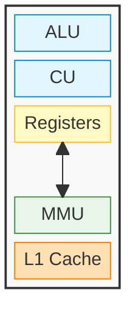
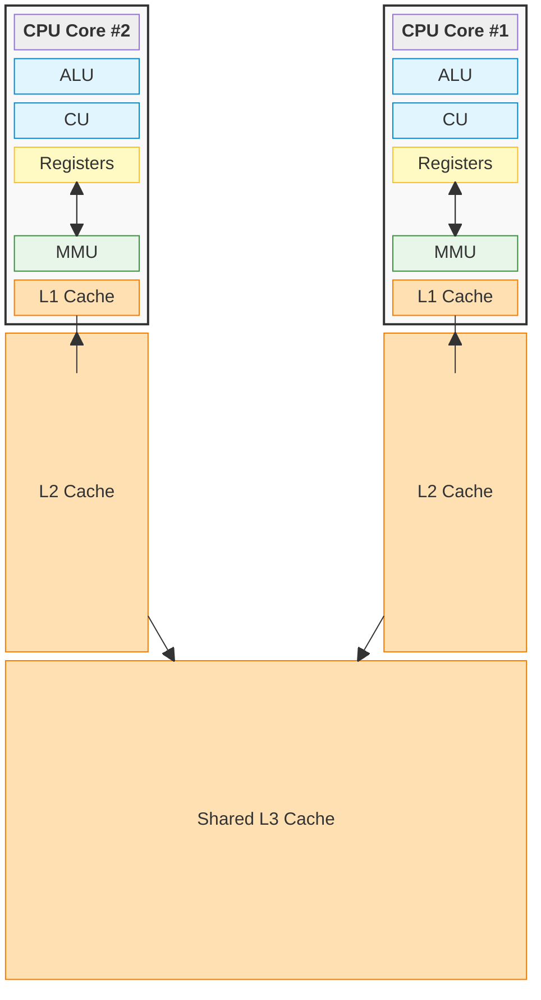
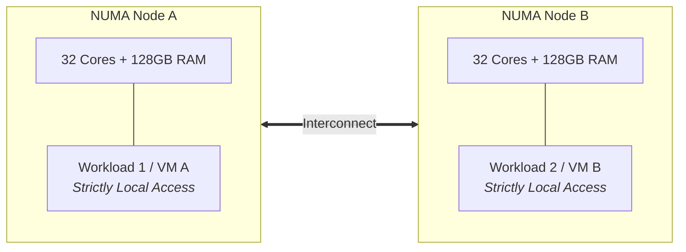

# Inside The CPU

The CPU is where actual execution **happens**, making it one of the most valuable resources in a computer system.

## Basic Components

When we write software, it is easy to imagine the CPU as a single, unified "brain" that simply reads a line of code and executes it. However, at the hardware level, a processor is bound by a relentless physical metronome: the clock cycle.

If the CPU were built as a single, monolithic circuit, it would suffer from a massive bottleneck. The entire chip would have to wait while it slowly fetched data from memory, then wait again while it decoded the instruction, and wait _again_ to actually perform the math. Millions of clock cycles would be wasted doing absolutely nothing.

To achieve billions of operations per second, hardware engineers had to abandon the idea of a single "brain" and instead design the CPU as a highly parallel **assembly line**. By breaking the processor into distinct, specialized physical components, the CPU can overlap its work. While one component is busy calculating the current instruction, another component is already fetching the next one from memory.

To make this assembly line function, the CPU relies on a core set of specialized silicon:

- **Arithmetic Logic Unit (ALU):** The actual mathematical engine of the processor. It performs all integer arithmetic (addition, subtraction) and bitwise logic (AND, OR, XOR) on raw binary data. Modern cores also include a Floating-Point Unit (FPU) specifically dedicated to complex decimal math.
- **Control Unit (CU):** The conductor of the silicon orchestra. It drives the **Fetch-Decode-Execute** cycle. It fetches the next instruction from memory, decodes its binary intent, and physically routes the correct electrical signals to the ALU, registers, or memory bus to execute the command.
- **Registers:** The lowest-latency storage available to an execution core, built directly into the core. They have much lower latency than cache or RAM, but very limited capacity (typically 64 bits per register). They hold the values the ALU is currently mutating.
- **Memory Management Unit (MMU):** The hardware translator. It intercepts the virtual addresses requested by the Control Unit and translates them into physical RAM locations using the OS-managed Page Tables. Largely talked about at [Memory Management](03%20Memory%20Management.md) notes.
- **CPU Caches (L1 / L2 / L3):** A latency bridge between cores and RAM. Because RAM access has substantially higher latency than an ALU operation, the CPU includes layers of SRAM on the processor die. This hierarchy keeps recently or frequently used data and instructions closer to the core, reducing RAM accesses.
- **The Bus (The Interconnect):** The microscopic communication highways that wire the entire assembly line together. Instead of chaotic point-to-point wiring, components share dedicated channels. Internally, high-speed interconnects (like a Ring or Mesh bus) synchronize the cores and the caches. Externally, the System Bus acts as the sole bridge to the motherboard and RAM, physically split into three distinct paths: the _Address Bus_ (transmitting memory locations), the _Data Bus_ (carrying the actual payloads), and the _Control Bus_ (delivering timing and command signals from the Control Unit).
## The Cache Hierarchy

CPU cores can execute instructions much faster than data can be retrieved from system RAM. If every instruction depended on RAM, memory latency would frequently stall execution. This latency gap is known as the "Memory Wall."

To reduce those stalls, engineers place layers of lower-latency **SRAM (Static RAM)** directly on the CPU die. This internal storage is structured as a strict hierarchy of caches, balancing latency against physical size:

- **L1 Cache:** The lowest-latency cache, located closest to the execution core. It typically has lower latency than L2, L3, and RAM (~1-2 nanoseconds). Its limited space (typically 32KB to 64KB) is usually split into two dedicated halves: **L1i** (Instruction cache, fed to the Control Unit) and **L1d** (Data cache, fed to the ALU).
- **L2 Cache:** The secondary private cache for the core. It is slightly larger (typically 256KB to 1MB) but takes longer to search (~3-5 nanoseconds). It acts as a staging ground, catching data before the core has to reach out to the rest of the chip.
- **L3 Cache:** A larger, shared cache at the center of the processor. It is typically larger (10MB to 64MB+) and has higher latency (~10-20 nanoseconds) than L1 and L2. Unlike L1 and L2, the L3 cache is shared across _all_ cores on the CPU. It is the last cache level before an access must go to physical RAM, which commonly has substantially higher latency (~100 nanoseconds).

### Cache coherency

Because the L1 and L2 caches are strictly private to each individual core, they introduce a massive architectural hazard. If Core 1 and Core 2 both cache the same variable from RAM, and Core 1 modifies its private copy, Core 2's cache is instantly out of date.

To prevent the CPU from executing calculations on stale, corrupted data, the hardware utilizes highly complex **cache coherency protocols**. To write highly optimized multithreaded software, developers must understand how this underlying hardware operates, or they risk triggering constant cache invalidations that cripple system performance.
#### The MESI Protocol

The CPU does not manage the cache byte-by-byte. It groups memory into chunks called **Cache Lines**. The CPU hardware tags every single cache line with one of four states

| **State**         | **Meaning**                                                                | **Core Action**                                                                                                     |
| ----------------- | -------------------------------------------------------------------------- | ------------------------------------------------------------------------------------------------------------------- |
| **Modified (M)**  | This core changed the data. The copy in RAM is now stale.                  | No other core has this line. If another core asks for it, this core must write it back to RAM/L3 first.             |
| **Exclusive (E)** | This core is the _only_ one holding this data, and it matches RAM exactly. | The core can modify this data locally without first requesting ownership over the bus.                               |
| **Shared (S)**    | Multiple cores hold this exact data. It matches RAM exactly.               | Cores can read freely. If a core wants to write, it must broadcast an "Invalidate" signal to all other cores first. |
| **Invalid (I)**   | The data is stale because another core modified it.                        | The core cannot read this line. It suffers a "cache miss" and must fetch fresh data from L3/RAM.                    |

When a core modifies a Shared cache line, it forces all other cores to mark their copies as **Invalid**. This hardware mechanism ensures data integrity, but it creates a massive trap for software engineers.
#### The Developer Trap: False Sharing

Because the MESI protocol operates on entire 64-byte Cache Lines rather than individual variables, it creates a phenomenon called **False Sharing**—one of the most notorious performance killers in multithreaded software.

Imagine you write a multithreaded program where Thread 1 continuously updates a counter variable `X`, and Thread 2 continuously updates a counter variable `Y`.

Logically, these threads are completely independent. They aren't sharing data, so you don't use any software locks (like mutexes). You expect them to run at maximum speed on separate cores.

However, if you defined those variables right next to each other in your code (e.g., inside the same array or struct), they sit next to each other in physical RAM. **Because they are physically close, the CPU pulls both `X` and `Y` into the exact same 64-byte Cache Line.**

Here is the physical disaster that follows:

1. Core 1 modifies `X`. The MESI protocol marks Core 1's cache line as **Modified**.
2. To do this, Core 1 sends an invalidate signal over the bus. Core 2's cache line (which contains `Y`) is instantly marked **Invalid**.
3. A nanosecond later, Core 2 wants to modify `Y`. It checks its L1 cache and sees the Invalid flag. It suffers a cache miss.
4. Core 2 forces Core 1 to flush the Modified cache line back to L3 memory. Core 2 then pulls the fresh cache line, modifies `Y`, marks its own line **Modified**, and invalidates Core 1.

Even though the threads use different variables, the hardware treats them as contending for the same cache line. The 64-byte cache line can move repeatedly between cores. This prevents each core from retaining a local copy and makes the updates slower than accesses to an uncontended L1 cache; the exact cost depends on the processor and workload.

To fix False Sharing, high-performance developers use **Cache Line Padding**. They intentionally waste memory by inserting 64 bytes of dummy variables between `X` and `Y` in the source code. This forces the hardware to place `X` and `Y` onto completely separate cache lines, allowing both CPU cores to hold them in the Exclusive (E) state and modify them simultaneously with zero cross-talk.

### Non-Uniform Memory Access (NUMA)

In early computers, every CPU core sat on an equal playing field, sharing a single bus to a single pool of RAM (Symmetric Multiprocessing, or SMP). But as servers grew to have 64, 128, or even 256 cores, a single shared bus became a catastrophic bottleneck—it simply couldn't physically transmit enough data per nanosecond.

To solve this, hardware engineers split the motherboard into distinct zones called Non-Uniform Memory Access (NUMA) Nodes.

- **The Physical Split:** Instead of one massive memory controller, the memory is physically divided. For example, Cores 1-16 are physically wired directly to DIMM 1 (Node A), and Cores 17-32 are physically wired directly to DIMM 2 (Node B).
    - _Note: On modern AMD Ryzen/EPYC processors, this split actually happens completely inside a single CPU chip using tiny sub-processors called "Chiplets"!_
- **Local vs. Remote Memory:** If Core 1 needs data from DIMM 1, it uses its local memory controller. This access has lower latency and usually more available bandwidth than an access to DIMM 2, which must cross the NUMA boundary.
#### Distributed Shared Memory (DSM)

When a CPU core attempts to access memory located on a remote NUMA node, the request must cross a specialized CPU-to-CPU bridge (like Intel’s UPI or AMD’s Infinity Fabric). This physical traversal alone pushes the baseline memory latency from ~100 nanoseconds up to ~300 nanoseconds.

However, moving the data is only half the battle—the real bottleneck is **cache coherency**. In smaller processors, cores use "snooping" to stay synced, literally broadcasting every MESI state change to all other cores. But in a massive server with 64 or 128 cores, broadcasting every memory operation across the interconnect bridges would instantly choke the entire system.

To solve this broadcast storm, modern hardware implements **Distributed Shared Memory (DSM)** using a mechanism called **Directory-Based Coherence**.

Instead of system-wide shouting, the hardware embeds a dedicated directory controller at each NUMA node. This directory acts as a registry, meticulously tracking the MESI state and core location of every cached memory line homed in its local RAM.

Here is the exact step-by-step negotiation that occurs when Core 1 (on Node A) needs to modify a variable physically stored in Node B:

1. **The Targeted Request:** Core 1 does not broadcast an invalidation to the system. Instead, it sends a single request across the interconnect directly to Node B's directory.
2. **The Directory Lookup:** Node B's directory checks its registry to identify exactly which other cores currently hold a cached copy of that specific memory address.
3. **Point-to-Point Invalidation:** The directory dispatches precise invalidation messages _only_ to the specific cores holding the data, completely avoiding unnecessary bus traffic.

While this highly orchestrated lookup saves the interconnect bus from collapsing under broadcast spam, it comes at a cost. This multi-step hardware negotiation—querying the remote directory, dispatching targeted messages, and waiting for cross-node acknowledgments—is exactly what generates the punishing latency penalty of remote memory access.
#### NUMA-Awareness

Because of this physical hardware design, modern Operating Systems and databases (like PostgreSQL or Redis) are heavily **NUMA-Aware**. The OS scheduler will aggressively try to pin an application's threads and its memory allocations strictly to the exact same NUMA node, actively preventing the software from ever accidentally crossing the interconnect bridge.

Here is the reformatted text with non-question headings, converted sub-bullet structures, and a Mermaid diagram replacing the ASCII art.
#### Ideal Use Cases for NUMA Architecture

While NUMA introduces a latency penalty for cross-node accesses, it is not a "flaw"—it is the **only physically viable way to scale compute density and memory capacity** on a single motherboard.

Without NUMA, a system is bound by Symmetric Multiprocessing (SMP), where all CPU cores share a single centralized memory controller and bus. As core counts scale beyond 8 or 16 cores, an SMP system hits a hard physical wall: the shared bus becomes permanently saturated, and adding more cores yields zero performance gain.

NUMA trades a small fraction of uniform access speed for massive, linear scaling across three specific operational profiles:

* **High-Density Virtualization (Cloud & Hypervisors)**
	* Hypervisors (like VMware ESXi, KVM, or Hyper-V) thrive on NUMA because virtual machines (VMs) are inherently isolated workloads.
	* A 64-core, 256GB RAM server divided into two NUMA nodes can run twenty 3-core VMs.
	* The hypervisor's scheduler dynamically pins each VM’s virtual CPUs and allocated RAM strictly to **Node A** or **Node B**.
	* Because VM 1 never touches Node B's memory, it experiences **100% local RAM performance** (~60–100 ns) while sharing the same physical motherboard with dozens of other workloads.
* **Process-Isolated Architecture (Microservices & Web Servers)**
	* Applications that scale out via independent worker processes—such as NGINX, Node.js clusters, or Redis instances—naturally align with NUMA hardware.
	* By running separate process instances pinned to separate NUMA nodes (using Linux commands like `numactl --cpunodebind=0 --membind=0`), each worker process gets its own dedicated CPU cores and local memory bus.
	* This provides complete hardware-level throughput isolation without cross-talk or interconnect contention.
* **Partitioned In-Memory Databases (Sharded Systems)**
	* Enterprise databases like PostgreSQL, MySQL, or SAP HANA handle massive concurrency by partitioning data.
	* When a database is NUMA-aware, it creates buffer pools per node. A thread processing a query for Partition A runs on Node A's CPU and fetches from Node A's RAM.
	* Instead of fighting over a single central memory bus, the database effectively operates as multiple independent, high-speed computers communicating inside a single chassis.
## ...

Each core operates at a specific clock speed, which dictates how many **cycles per second** it can execute.
- Depending on the CPU architecture and the specific type of instruction, a single operation may take less than, exactly, or more than one clock cycle to complete.

Every CPU family has its own unique set of machine-level instructions.
- Because your source code must ultimately be translated into these specific machine instructions, the **compilation process is highly dependent on the target CPU architecture** (e.g., x86 vs. ARM).
