# Storage Management

## Storage

Some data must survive process termination, system shutdowns, and power loss. Because RAM is **volatile**, it cannot provide this persistence by itself. Computers therefore use non-volatile storage such as **magnetic tape, HDDs, SSDs, and flash-based devices**.

Persistent storage is generally much slower than RAM, especially in terms of access latency. The performance difference is particularly important for storage technologies such as HDDs, where accessing data may require physical mechanical movement.

### HDD

A **Hard Disk Drive (HDD)** is a non-volatile storage device that stores data magnetically on rotating disks called **platters**. HDDs historically became the dominant form of secondary storage because they could provide large capacities at a relatively low cost per byte.

Unlike RAM or SSDs, an HDD is partly mechanical. Reading data may require moving a physical arm and waiting for the desired portion of a spinning platter to reach the read/write head. This mechanical behavior explains many of the characteristic performance properties of HDDs.

> [!note] Why HDDs Are Called “Hard”
>
> The term **“hard”** in **hard disk drive (HDD)** refers to the rigid platters used to store data. This originally distinguished HDDs from **floppy disks**, whose magnetic storage medium was physically flexible.
>
> HDD platters are typically made from rigid materials such as aluminum or glass and coated with a magnetic material. Modern devices such as SSDs are also physically rigid, so the word **hard** is mainly a historical distinction that survived after floppy disks disappeared from common use.

#### Physical Geometry and CHS

- **Platters and Heads**: An HDD contains one or more **platters** mounted on a spindle and rotating at a fixed speed.
    - Each recording surface is accessed by a **read/write head** positioned extremely close to the platter.
    - The heads are attached to the same actuator assembly, so moving the actuator changes the radial position of all heads together.
- **Tracks and Sectors**: Each platter surface is organized into concentric circles called **tracks**, and each track is divided into **sectors** containing chunks of data.
- **Cylinders**: Tracks at the same radial position across the different platter surfaces form a **cylinder**.
- **CHS Addressing**: Early systems exposed this geometry directly through **CHS (Cylinder, Head, Sector)** addressing. A location was identified using three values:
    - **Cylinder:** selects the radial position of the actuator.
    - **Head:** selects a particular recording surface.
    - **Sector:** selects a region of the track as the platter rotates.
- **Geometric Evolution**: CHS reflected the physical organization of early disks relatively closely. However, as HDDs became more sophisticated, their internal geometry stopped mapping cleanly to a simple fixed number of tracks and sectors.
    - **Variable Circumference**: For example, modern drives can place more sectors on outer tracks because those tracks have a greater circumference.
    - **Shift to LBA**: This made exposing physical disk geometry to software increasingly inconvenient and eventually led to the adoption of Logical Block Addressing.

#### Data Access

- **Block Devices**: HDDs are **block devices**, software addresses storage in blocks rather than requesting arbitrary individual bytes directly from the device.
- **Sector Sizes**: At the hardware level, HDDs traditionally used **512-byte sectors**, while modern drives commonly use **4 KiB physical sectors**, known as **Advanced Format**.
    - **Logical Sectors**: Some drives expose those 4 KiB sectors directly, while others maintain compatibility by exposing 512-byte **logical sectors** even though the underlying physical sector is 4 KiB.
- **Mechanical Delays**: The mechanical nature of HDDs has an even larger effect on performance. Accessing a block generally involves two important delays:
    - **Seek time:** moving the actuator so that the head reaches the correct track.
    - **Rotational latency:** waiting for the desired sector to rotate underneath the head.
- **Access Patterns**: Once the head is correctly positioned, contiguous sectors can be transferred rapidly as they pass beneath it. Consequently, HDD performance depends strongly on the access pattern.
    - **Sequential Access**: With **sequential access**, nearby blocks can be read or written with relatively little additional mechanical movement.
    - **Random Access**: With **random access**, the drive may repeatedly seek between distant tracks and wait for different sectors to rotate into position. Random I/O is therefore dramatically slower than sequential I/O on HDDs.
- **Workload Distribution**: This distinction means that two workloads transferring the same number of bytes can have very different performance depending on how those bytes are distributed across the disk.

#### Logical Block Addressing (LBA)

- **Simpler Abstraction**: Exposing CHS geometry forced software to understand details of the physical disk layout, so **Logical Block Addressing (LBA)** replaces this interface with a much simpler abstraction.
- **Linear Sequence**: Under LBA, the disk is presented as a linear sequence of fixed-size logical blocks such as `LBA 0, LBA 1, LBA 2, ...`. Software therefore requests a block by its number rather than specifying a cylinder, head, and sector.
- **Internal Mapping**: The drive's internal controller and firmware determine where each logical block is physically stored. The mapping does not need to correspond to a simple CHS calculation: modern drives can internally reorganize storage, compensate for differences in track geometry, and transparently replace defective sectors with spare sectors.
- **Indirection**: This indirection allows the physical implementation of the drive to evolve independently from the interface exposed to the operating system. The OS only needs to understand a linear address space of logical blocks, while the HDD manages its actual physical geometry internally.
- **Bad-Sector Remapping**: The same abstraction also makes **bad-sector remapping** possible. If a physical sector becomes unreliable, the drive can redirect its LBA to a spare physical sector while continuing to expose the same logical address to the operating system. From the software's perspective, the location of the block has not changed.

> [!note] LBA Blocks and Virtual Memory Pages
> - **Independent Abstractions**: **LBA logical blocks** and [virtual memory](03%20Memory%20Management.md#Virtual%20Memory) are independent abstractions, but having compatible sizes is convenient for operations such as [swapping](03%20Memory%20Management.md#Swapping%20%26%20Extending%20RAM%20to%20Disk).
> - **Swapping Units**: The kernel swaps memory in page-sized units. If the system uses 4 KiB virtual-memory pages and the storage device exposes 4 KiB logical blocks, one swapped page can conceptually fit into one LBA block. If the device instead exposes 512-byte logical blocks, the same 4 KiB page simply spans eight consecutive LBAs.
> - **Page-Sized Slots**: The operating system therefore does not require `1 VM page = 1 LBA block`. It normally manages swapping in **page-sized swap slots**, while the block layer translates those slots into however many logical blocks the storage device requires.
> - **Aligned Granularities**: Matching or well-aligned granularities are still useful because they can simplify I/O and avoid inefficient partial operations. This is one reason sizes such as **4 KiB** appear repeatedly across virtual memory, filesystems, and storage devices, even though each layer chooses its granularity independently.
>
> [!note] Logical vs. Physical Sector Size
> - **Logical Sector Size**: **LBA (Logical Block Addressing)** identifies blocks in the logical address space exposed by the storage device to the operating system. An LBA is an **address**, while the **logical sector size** describes how many bytes each address represents.
> - **Physical Sector Size**: Internally, the device may operate using a different **physical sector size**. The physical location corresponding to logical data is sometimes described using a **Physical Block Address (PBA)**, although the exact internal addressing scheme is device-specific and normally hidden from the host.
> - **Size Mismatch**: The logical and physical sizes do not need to match. For example, a **512e** HDD may expose 512-byte logical sectors while internally using 4 KiB physical sectors, so `8 × 512 B logical sectors → 1 × 4 KiB physical sector`. A **4Kn** drive instead exposes 4 KiB logical sectors directly, making the logical and physical sector sizes equal.
> - **Translation**: This distinction is possible because the storage controller translates the host-visible LBA space into the device's internal physical organization.

#### File Fragmentation and Defragmentation

- **Contiguous Allocation**: Filesystems generally try to allocate the logical blocks belonging to a file close together. Over time, however, files are created, extended, modified, and deleted, leaving available regions of different sizes throughout the filesystem.
- **File Fragmentation**: When there is not enough contiguous free space for a file, the filesystem may split it into multiple non-contiguous [**extents**](#Extents%20and%20Contiguous%20Ranges). This is known as **file fragmentation**.
    - **Partially Random Operations**: A logically sequential operation can therefore become a sequence of smaller, partially random operations: `Extent A → seek → Extent B → seek → Extent C`.
- **Mechanical Seeks**: Fragmentation is particularly expensive on an HDD because sequential file access can turn into multiple mechanical seeks. Suppose a large file consists of three extents located in distant regions of the disk. Reading each extent internally may be sequential, but when the read reaches the end of one extent, the actuator may need to move to another track and wait for the correct sector to rotate under the head before continuing.
- **Performance Penalty**: The more fragmented the file is, the more often the HDD may pay **seek time** and **rotational latency** instead of continuously transferring data.
- **Defragmentation**: **Defragmentation** attempts to reverse this process. The filesystem or defragmentation utility moves file extents so that the logical blocks belonging to the same files become more contiguous. It may also consolidate free space, making it easier for future files to receive contiguous allocations.
- **Sequential Transfers**: After defragmentation, reading a file can require fewer seeks and allow the HDD to spend more time performing efficient sequential transfers. This can significantly improve workloads involving large fragmented files or systems where fragmentation has accumulated for a long time.

> [!note] Logical vs. Physical Contiguity
> - **Logical Contiguity**: Because software operates through LBA, it does not directly control the exact physical platter coordinates. Defragmentation therefore primarily makes the file's **logical blocks** contiguous.
> - **Physical Locality**: HDD firmware generally maps nearby sequential LBAs to nearby physical locations, so this still tends to preserve physical locality, although internal remapping such as bad-sector replacement can prevent the correspondence from being perfect.

### SSD

A **Solid-State Drive (SSD)** is a non-volatile storage device built primarily from **NAND flash memory**. Unlike HDDs, SSDs have no moving mechanical parts: data is accessed electronically rather than by moving a head over a rotating platter. This gives SSDs much lower access latency and makes **random reads and writes** dramatically faster than on HDDs.

However, NAND flash has an important constraint that shapes the entire architecture of an SSD: **reading, programming, and erasing operate at different granularities**. Data is read and programmed in relatively small units called **pages**, but pages cannot normally be overwritten in place. Before previously programmed flash can be reused, a much larger group of pages must be erased together.

The SSD controller therefore sits between the host and the raw NAND chips, maintaining mappings and continuously reorganizing physical storage so that the device can still expose the simple linear block interface expected by the operating system.

#### NAND Pages and Physical Blocks

- **Hierarchical Organization**: NAND flash is organized hierarchically.
    - **Pages**: The smallest unit normally read or programmed is a **page**, commonly several KiB to tens of KiB in modern NAND.
    - **Physical Blocks**: Many pages are grouped into a much larger **physical block**, which is the smallest unit that NAND can erase.
- **Operation Asymmetry**: This creates an important asymmetry:
    - **Read**: operates on pages.
    - **Program/write**: operates on pages.
    - **Erase**: operates on entire physical blocks containing many pages.
- **Erase Granularity**: A physical block can contain hundreds or even thousands of pages depending on the NAND generation.
    - **Page Reuse Constraints**: Because erase operations happen at this larger granularity, individual pages cannot simply be erased and reused independently.
- **Architectural Impact**: This read/program/erase asymmetry is the fundamental reason SSDs need mechanisms such as the **Flash Translation Layer**, out-of-place writes, garbage collection, and wear leveling.

> [!note]
> - **Overloaded Terms**: **Page** and **block** are heavily overloaded terms in computer systems.
>     - **Logical Blocks**: In storage, a **logical block** refers to a unit in the LBA address space exposed to the operating system.
>     - **Physical Blocks**: A NAND **physical block** refers to an erase unit containing many flash pages.
> - **Terminology Usage**: In these notes, **logical block** refers to storage addressed through LBA, while **physical block** refers to the NAND erase unit inside an SSD.

#### Flash Translation Layer

- The **Flash Translation Layer (FTL)** acts as a bridge that abstracts the physical NAND flash, allowing the operating system to interact with a standard, linear Logical Block Addressing (LBA) interface rather than addressing the memory directly.
- **Simplified Model**: A useful simplified model is to imagine that each logical block maps to one physical NAND page: `Logical block → Physical NAND page`.
    - **Read Lookup**: For example, `LBA 100 → Page P40`: Under this model, when the host reads `LBA 100`, the FTL looks up its mapping and retrieves the data from physical page `P40`.
- **Dynamic Mapping**: The important property of the mapping is that it is **dynamic rather than permanent**.
    - **Mapping Changes**: Because NAND pages cannot normally be overwritten in place, updating a logical block may cause the SSD to write the new value into another free physical page and then change the mapping.
    - **Transparent Updates**: For example, `LBA 100 → P40` may later become `LBA 100 → P93`. The logical address visible to the operating system has not changed, but its physical location inside the NAND has.
    - **Enabling Mechanisms**: It allows the controller to perform [out-of-place writes](#Out-of-Place%20Writes), relocate data during [garbage collection](#Garbage%20Collection), and distribute writes through [wear leveling](#Wear%20Leveling) without changing the LBA addresses exposed to the host.
    - **Physical Adjacency**: As a consequence, consecutive logical blocks do not necessarily remain physically adjacent, and a logical block does not have a permanent physical NAND location.
    - **Mapping Metadata**: The FTL must maintain metadata describing these logical-to-physical mappings.
    - **Persistence**: Because the mappings are necessary to reconstruct the drive's state after power loss, authoritative metadata must ultimately be persisted in non-volatile storage.
- **Metadata Caching**: SSDs commonly cache frequently accessed mapping information in **DRAM**, while smaller amounts of SRAM are used internally by the controller.
    - **DRAM-less SSDs**: DRAM-less SSDs rely more heavily on NAND metadata or, in some designs, host memory.

> [!note] The One-LBA-to-One-Page Model Is a Simplification
> - **Convenient Model**: Treating the FTL as `1 logical block → 1 physical NAND page` is a convenient model for understanding SSD behavior, but it is not a requirement of the hardware.
> - **Independent Sizes**: The **LBA logical block size** exposed to the host and the internal **NAND page size** are independent.
> - **Shared Pages**: For example, an SSD may expose 4 KiB logical blocks while using 16 KiB NAND pages internally. Several logical blocks may therefore share one physical page, and controllers may buffer, combine, or reorganize writes before programming NAND.
> - **Complex Schemes**: Real FTLs may also use more complex mapping schemes to reduce the amount of metadata they must maintain.
> - **Essential Abstraction**: The essential abstraction remains the same: the FTL translates the **host-visible logical address space** into **physical locations within NAND**. The one-to-one model is useful for reasoning about this translation without implying that the underlying granularities must actually match.

#### States of a Page

- **Logical States**: From the SSD controller's perspective, a NAND page can usually be understood as being in one of three logical states:
    - **Free / erased**: the page belongs to an erased physical block and is available to receive new data.
    - **Valid**: the page contains the current physical representation of some logical data and is referenced by the FTL.
    - **Invalid / stale**: the page still physically contains old data, but the FTL no longer references it because that logical data was updated or discarded.
- **Mapping Dependency**: The distinction between **valid** and **invalid** therefore depends on the FTL mapping rather than on whether bits are physically present in the page.
- **Transition Constraints**: A crucial constraint is that an invalid page cannot simply transition back to **free** by itself.
    - **Block Erasure**: NAND erase operations apply to an entire physical block, so invalid pages become reusable only after the whole block containing them is erased.
- **State Mixtures**: As updates accumulate, physical blocks gradually become mixtures of valid and invalid pages.
    - **Space Reclamation**: Reclaiming the space occupied by those invalid pages is the purpose of garbage collection.

#### Out-of-Place Writes

Because NAND pages cannot normally be overwritten directly, SSD updates use **out-of-place writes**.

- Suppose logical block `LBA 100` currently maps to physical page `P40`: `LBA 100 → P40`
- If the host updates that logical block, the SSD does not overwrite `P40`. Instead, the controller finds a free page such as `P93`, writes the new data there, and changes the FTL mapping: `LBA 100 → P93`
- The old page `P40` is then considered **invalid** because no logical block references it anymore.

The update therefore follows this sequence:

1. Find a free physical page.
2. Program the new data into that page.
3. Update the FTL mapping.
4. Mark the previous physical page as invalid.

Out-of-place writes avoid performing an expensive block erase for every small update. However, they gradually consume free pages and leave invalid pages distributed throughout physical blocks. Those invalid pages must eventually be reclaimed before the underlying space can be reused.

#### Garbage Collection

- **Erase Limitations**: Because NAND can erase only entire physical blocks, the SSD cannot independently reclaim individual invalid pages.
    - **Preserving Data**: A physical block may also contain valid pages that must be preserved before the block can be erased.
- **Garbage Collection (GC)**: When the controller needs additional reusable space, it performs **Garbage Collection (GC)**.
    - **Relocation and Erasure**: It selects a physical block containing invalid pages, copies any remaining valid pages into free locations elsewhere, updates their FTL mappings, and erases the original physical block.
- **Relocation Example**: For example, suppose a physical block contains 100 pages:
    - 80 invalid pages.
    - 20 valid pages.
    - **Block Recovery**: The SSD can copy the 20 valid pages elsewhere and then erase the entire physical block. After the erase, all 100 pages become free again.
- **Space Conversion**: Garbage collection therefore converts fragmented invalid space into reusable erased blocks.

> [!note] The Cost of Garbage Collection
> - **Internal Overhead**: The trade-off is that the SSD must perform additional internal reads and writes that were never explicitly requested by the host.
> - **Free Space Dependency**: Garbage collection is particularly expensive when the drive has little free space.
>     - **Relocation Cost**: If candidate blocks contain many valid pages, the controller must relocate more data before it can reclaim a block.

#### Write Amplification

Garbage collection and other internal relocation operations mean that the amount of data physically written to NAND can exceed the amount requested by the host. This effect is called **write amplification**.
- **Formula**: It can be expressed as: `Write Amplification = NAND bytes written / Host bytes written`.
    - **Example Calculation**: For example, if the host writes 1 GiB but the SSD internally writes 1.5 GiB because it also needs to relocate existing pages, the write amplification factor is: `1.5 GiB / 1 GiB = 1.5`.
- **Performance and Endurance Impact**: Write amplification matters for two reasons:
    - **Bandwidth**: First, additional internal writes consume NAND bandwidth and can reduce sustained write performance.
    - **Lifespan**: Second, NAND cells tolerate only a finite number of program/erase cycles, so unnecessary writes also consume part of the drive's endurance.
- **Influencing Factors**: Garbage collection, filesystem access patterns, free-space availability, over-provisioning, and the efficiency of the FTL all influence write amplification.

#### TRIM

- **Filesystem Deletion**: When a file is deleted, the filesystem usually does not overwrite all of its previous data.
    - **Metadata Updates**: It simply updates its own metadata and considers the corresponding logical blocks available for reuse.
- **SSD Blindness**: Without additional information, the SSD cannot know that those logical blocks are no longer useful.
    - **Apparent Validity**: From the drive's perspective, their physical pages may still appear valid because they remain mapped by the FTL.
- **The TRIM Command**: The **TRIM** command allows the operating system to tell the SSD that specific logical blocks are no longer needed.
    - **Mapping Invalidation**: The controller can then invalidate the corresponding mappings and treat their physical pages as stale.
    - **Garbage Collection Efficiency**: During future garbage collection, those pages no longer need to be copied elsewhere.
- **Reduced Amplification**: TRIM therefore communicates filesystem knowledge to the SSD, reducing unnecessary data movement and potentially lowering write amplification.

> [!note] TRIM Extends the Basic LBA Abstraction
> - **Minimal LBA Interface**: A minimal **LBA** interface only needs to let the host **read** and **write** logical blocks. It does not communicate whether the data currently stored at an LBA is still useful.
> - **HDD vs. NAND**: This was usually sufficient for traditional HDDs because a sector can simply be overwritten later. NAND flash is different: an SSD cannot overwrite a programmed page in place, so knowing that some logical data has been discarded allows the controller to treat the corresponding physical pages as invalid instead of preserving them during garbage collection.
> - **Semantic Extension**: **TRIM** therefore extends the basic block-device interface with an additional semantic operation: the host can tell the device that it no longer cares about the contents of a range of logical blocks.
> - **Conceptual Interface**: Conceptually, the interface becomes:
>     - `read(LBA)`
>     - `write(LBA, data)`
>     - `discard(LBA range)`
> - **Alternative Terminology**: **TRIM** is the ATA name for this operation. Other storage interfaces provide equivalent mechanisms, such as **SCSI UNMAP** and **NVMe deallocation**. The more general concept is usually called **discard** or **block deallocation**.
> - **Broader Applications**: Although this mechanism became especially important with SSDs, it is not inherently SSD-specific. Thin-provisioned storage, virtual disks, and other storage systems can also use discard information to reclaim underlying resources.

#### Wear Leveling

- **Limited Endurance**: NAND flash has limited endurance. A physical block can tolerate only a finite number of **program/erase cycles** before its cells become unreliable.
- **Uneven Access**: Workloads also tend to access data unevenly. Some pages are rewritten frequently, while others remain unchanged for long periods.
    - **SSD Terminology**: SSD terminology often describes these as:
        - **Hot pages**: data that is updated frequently.
        - **Cold pages**: data that changes rarely or remains static for long periods.
- **Uneven Wear**: If the controller always reused the same convenient physical blocks for hot data, those blocks would accumulate erase cycles much faster than blocks holding cold data. Some parts of the NAND could therefore wear out while others had experienced relatively little use.
- **Wear Leveling Mechanism**: SSDs avoid this through **wear leveling**, which distributes program/erase cycles across the available physical blocks.
    - **FTL Indirection**: The indirection provided by the FTL makes this possible because logical addresses are not permanently tied to particular physical locations.
- **Forms of Wear Leveling**: Wear leveling generally has two forms:
    - **Dynamic wear leveling**: when writing or relocating hot data, the controller prefers physical blocks with lower erase counts. This spreads future writes across blocks that have experienced less wear.
    - **Static wear leveling**: the controller may also relocate cold data. A physical block containing cold pages might otherwise remain occupied for years while hotter blocks are repeatedly erased. Moving that cold data into a more heavily worn block frees the less-worn block so it can participate in future writes.
        - **Counterintuitive Movement**: Static wear leveling is therefore somewhat counterintuitive: the SSD may deliberately move data that has not changed at all.
        - **Preventing Reservation**: The purpose is not to improve that data's access performance, but to prevent cold data from permanently reserving the least-worn physical blocks.
        - **Lifespan Trade-off**: Wear leveling trades additional internal data movement for a more uniform distribution of wear across the NAND, increasing the usable lifetime of the drive.

#### Over-Provisioning

- **Reserved Capacity**: An SSD usually contains more physical NAND capacity than it exposes to the operating system. The portion that is deliberately kept outside the host-visible LBA address space is called **over-provisioning**.
    - **Spare Pool**: For example, an SSD might physically contain more NAND than its advertised usable capacity. The operating system can never allocate this reserved space directly, so the SSD controller can rely on it as a permanent pool of spare physical pages and blocks.
- **Out-of-Place Writes**: This matters because SSD writes are [**out-of-place**](#Out-of-Place%20Writes).
    - **Temporary Space Needs**: When the host updates data, the controller needs a free physical page where it can write the new version before invalidating the old one. Garbage collection also needs temporary free space when it copies valid pages out of a physical block before erasing that block.
- **Free Space Constraints**: Without enough free space, these operations become increasingly difficult.
    - **Costly Operations**: The controller may need to perform garbage collection before it can satisfy a new write, and it may be forced to choose physical blocks containing many valid pages. That means more pages must be copied simply to reclaim a small amount of reusable space.
- **Controller Freedom**: Over-provisioning prevents the host from consuming all physical NAND, giving the controller additional freedom to:
    - satisfy out-of-place writes without first performing expensive cleanup,
    - choose better victim blocks during garbage collection,
    - relocate fewer valid pages when reclaiming space,
    - reduce **write amplification**,
    - distribute writes more effectively for **wear leveling**,
    - keep spare physical blocks available to replace worn or defective ones.
- **The Nearly Full SSD Effect**: The effect can be understood by considering a nearly full SSD.
    - **Reclaiming Blocks**: If almost every physical page contains valid data, reclaiming one physical block may require copying nearly all of its pages elsewhere before erasing it.
    - **Candidate Blocks**: With additional over-provisioned space, the controller has more free pages and more candidate blocks to work with, making it more likely that it can reclaim blocks containing mostly invalid data.
- **Efficient Management**: Over-provisioning therefore does not directly make NAND faster. Instead, it gives the SSD controller **working space to manage NAND efficiently**, which improves sustained write performance, reduces internal data movement, and helps extend the lifetime of the flash.

> [!note] TRIM and Unused Filesystem Space
> - **Related Effect**: There is also a related but distinct effect when the user leaves filesystem space unused.
> - **Reclaimable Pages**: If the operating system communicates that unused space through **TRIM**, the SSD can treat the corresponding physical pages as reclaimable and use them similarly to additional spare space.
> - **Temporary Reservation**: Unlike factory over-provisioning, however, this space is not permanently reserved: the host may allocate it again later.

#### SSD Performance Characteristics

- **Mechanical Delays Eliminated**: SSDs eliminate the **seek time** and **rotational latency** that dominate random-access performance on HDDs.
    - **No Mechanical Penalty**: Accessing physically distant NAND pages therefore does not incur the same mechanical penalty as jumping between distant locations on a disk platter.
- **Random I/O Advantage**: As a result, SSDs provide much higher random I/O performance and much lower latency than HDDs.
- **Non-Uniform Access**: However, SSD access is not completely uniform.
    - **Read vs. Write Cost**: Reads are generally cheaper than writes, and writes can become significantly more expensive when the drive must perform garbage collection or erase physical blocks.
- **Sequential Throughput**: Large sequential operations can also achieve higher throughput than small random operations because they make more efficient use of the SSD controller, NAND channels, and internal parallelism.

> [!note] The SSD Performance Model
> - **Locality Effects**: The performance model is therefore different from an HDD rather than completely free of locality effects.
> - **Influencing Factors**: HDD performance is dominated by mechanical positioning, while SSD performance is strongly influenced by **NAND parallelism, free-space availability, garbage collection, write amplification, and the read/program/erase asymmetry of flash memory**.

#### Fragmentation and Defragmentation on SSDs

The [file fragmentation](#File%20Fragmentation%20and%20Defragmentation) described for HDDs also exists at the filesystem level on SSDs: a file can still be split across multiple non-contiguous extents. What changes is the performance consequence.

On an HDD, defragmentation improves locality because reading separated extents may require expensive mechanical seeks and rotational waiting. An SSD has no equivalent mechanical movement, so accessing distant logical addresses is much closer in cost to accessing adjacent ones. Fragmentation therefore has a much smaller effect on read performance.

The **Flash Translation Layer (FTL)** weakens the value of filesystem-level contiguity even further. Consecutive logical blocks do not necessarily correspond to consecutive physical NAND pages because the FTL continuously remaps and relocates data through out-of-place writes, garbage collection, and wear leveling. Making a file contiguous in the LBA address space therefore does not guarantee physical contiguity inside the NAND.

Traditional defragmentation can instead be counterproductive on an SSD because it requires **moving and rewriting large amounts of data**. From the filesystem's perspective, the operation is reorganizing extents; to the SSD, those relocations are ordinary writes. The FTL must allocate new physical pages, invalidate the old pages, and eventually reclaim them through garbage collection.

These operations consume NAND endurance while providing little of the locality benefit that justified defragmentation on HDDs.

### Other Storage Devices

- **Magnetic Tape:** Stores data magnetically on a long strip of tape. It offers very high capacity and low cost per byte, but access is fundamentally sequential because the tape must be physically wound to the desired position. It is therefore mainly used for backups and long-term archival storage rather than interactive workloads.
- **Optical Discs:** Devices such as **CDs, DVDs, and Blu-ray discs** store data as physical or optical changes on a rotating disc that are read with a laser. They provide removable, non-volatile storage, but have relatively low capacity and performance compared with modern HDDs and SSDs.
- **USB Flash Drives:** Portable storage devices built from NAND flash memory and connected through USB. Internally they use many of the same principles as SSDs, including a controller and flash translation, but usually have simpler controllers, less parallelism, and lower endurance and sustained performance.
- **SD and microSD Cards:** Small removable NAND flash devices commonly used in cameras, smartphones, embedded systems, and other portable devices. Like USB flash drives, they contain a controller that hides the physical NAND organization behind a logical block interface, but their performance and endurance vary significantly between product classes.
- **eMMC:** An embedded storage package combining NAND flash and a controller in a single chip. It is soldered directly onto the device rather than being removable and is commonly found in inexpensive embedded systems and older mobile devices. It provides a simple block-device interface but generally offers less parallelism and performance than modern SSDs.
- **UFS (Universal Flash Storage):** An embedded NAND-based storage technology designed as a higher-performance successor to eMMC. Unlike eMMC's more limited command model, UFS supports features such as command queuing and simultaneous reads and writes, making it better suited to modern smartphones and embedded systems.
- **Persistent Memory / NVRAM:** Technologies that retain data without power while providing access characteristics closer to memory than conventional block storage. Some designs can be accessed directly through the CPU's memory address space rather than through traditional block I/O, partially blurring the distinction between **memory** and **storage**.

### Partitions

- **Logical Regions**: A **partition** divides a block device's Logical Block Addressing (LBA) space into logical regions. Instead of exposing the entire disk as one storage region, the operating system can treat each partition as an independent block device.
- **Partition Boundaries**: Partition boundaries are defined in terms of the storage device's logical blocks. Conceptually, a partition occupies a contiguous range of LBAs with a beginning and a length or ending LBA.
    - **Access Translation**: For example, a disk may contain a partition whose storage region begins at LBA `2048` and ends at LBA `1,000,447`. Reads and writes to that partition are ultimately translated into accesses within that range of the underlying disk.
- **Partition-Table Format**: The exact representation depends on the **partition-table format**. GPT, for example, records the first and last LBA belonging to each partition, while older MBR partition entries describe a starting LBA and a number of sectors.
- **Logical Segmentation**: Partitioning therefore provides **logical segmentation**, not another physical storage technology. The blocks still belong to the same underlying HDD, SSD, or other block device; the partition table simply describes which ranges are assigned to which logical regions.
- **Usage Options**: A partition can then be used in different ways. A common use is to create a filesystem on it, but a partition can instead contain [swap space](03%20Memory%20Management.md#Swapping%20%26%20Extending%20RAM%20to%20Disk), participate in a volume-management system, or be accessed as a raw block device.
- **Independent Filesystems**: When a filesystem is created on a partition, that filesystem manages only the block-address range exposed by that partition. Different partitions can therefore contain completely different filesystems.
    - **Filesystem Diversity**: For example, one disk could contain an ext4 partition and an NTFS partition. Each filesystem independently creates its own metadata structures and chooses its own supported filesystem block size.
- **Distinct Block Size**: The filesystem block size is distinct from both the partition size and the underlying LBA logical-sector size.
    - **Size Independence**: For example, a device might expose 512-byte logical sectors while one partition contains an ext4 filesystem using 4 KiB filesystem blocks. Another partition on the same device could use a filesystem with a different allocation-unit size.
- **Suitable Boundaries**: Partition boundaries are normally aligned to suitable storage boundaries.
    - **Clean Alignment**: Modern partitioning tools commonly choose boundaries such as multiples of 1 MiB, which align cleanly with common logical-sector, physical-sector, filesystem-block, and SSD erase-related granularities.
    - **Poor Alignment Consequences**: Poor alignment can cause one higher-level write to span multiple lower-level storage units and introduce unnecessary work.

> [!note] The Storage Hierarchy
>
> The important hierarchy is therefore:
> - the **storage device** exposes an LBA address space;
> - the **partition table** assigns ranges of that LBA space to partitions;
> - each partition is exposed as its own logical block device;
> - a **filesystem** may be created inside that partition and introduce its own filesystem-block and metadata structures.
> These layers have related boundaries, but their granularities are independent.

#### Partition Alignment

- **Starting LBA Efficiency**: A partition can begin at any logical-sector boundary permitted by the partition table, but not every starting LBA is equally efficient.
- **Partition alignment** means choosing the partition's starting LBA so that higher-level structures, such as filesystem blocks, align cleanly with important boundaries in the underlying storage device.

##### Logical vs. Physical Sectors

- **Size Discrepancies**: Alignment becomes especially important when the device exposes a smaller **logical sector size** than its actual **physical sector size**.
- **512e Drive Example**: A common example is a **512e drive**, which exposes 512-byte logical sectors while internally reading and writing 4 KiB physical sectors.
- **Physical-Sector Boundary Calculation**: Because `4 KiB / 512 B = 8`, each 4 KiB physical sector corresponds to **eight logical sectors**. Therefore, a partition whose starting LBA is divisible by `8` begins on a 4 KiB physical-sector boundary.

```mermaid
---
displayMode: compact
---
gantt
    title 512e Drive: 8 Logical Sectors per Physical Sector
    dateFormat m
    axisFormat %M KiB
    tickInterval 8minute

    section Logical sectors
    LBA 0–7   :l0, 0, 8m
    LBA 8–15  :l1, 8, 8m
    LBA 16–23 :l2, 16, 8m

    section Physical sectors
    Physical sector 0 :p0, 0, 8m
    Physical sector 1 :p1, 8, 8m
    Physical sector 2 :p2, 16, 8m
```



##### Proper Alignment

- **Filesystem Blocks**: Suppose the filesystem inside the partition also uses 4 KiB blocks.
- **Direct Alignment**: If the partition begins on a 4 KiB physical-sector boundary, the filesystem's 4 KiB blocks can line up directly with the device's 4 KiB physical sectors.

```mermaid
---
displayMode: compact
---
gantt
    title Properly Aligned 4 KiB Filesystem Blocks
    dateFormat m
    axisFormat %M KiB
    tickInterval 4minute

    section Physical sectors
    Physical sector 0 :p0, 0, 4m
    Physical sector 1 :p1, 4, 4m
    Physical sector 2 :p2, 8, 4m

    section Filesystem blocks
    Filesystem block 0 :f0, 0, 4m
    Filesystem block 1 :f1, 4, 4m
    Filesystem block 2 :f2, 8, 4m
```



- **Clean Updates**: In this case, updating one 4 KiB filesystem block can correspond cleanly to one 4 KiB physical-sector update.

##### Improper Alignment

- **Shifted Grid**: Now suppose the partition begins one 512-byte logical sector after a physical-sector boundary. The filesystem still creates perfectly regular 4 KiB blocks relative to the beginning of the partition, but the entire filesystem grid is shifted by 512 bytes relative to the physical-sector grid.

```mermaid
---
displayMode: compact
---
gantt
    title Misaligned 4 KiB Filesystem Blocks
    dateFormat m
    axisFormat %M KiB
    tickInterval 8minute

    section Physical sectors
    Physical sector 0 :p0, 0, 8m
    Physical sector 1 :p1, 8, 8m
    Physical sector 2 :p2, 16, 8m
    Physical sector 3 :p3, 24, 8m

    section Filesystem blocks
    Filesystem block 0 :f0, 1, 8m
    Filesystem block 1 :f1, 9, 8m
    Filesystem block 2 :f2, 17, 8m
```



- **Sector Overlap**: A single 4 KiB filesystem block now overlaps **two physical sectors** instead of fitting inside one.
- **Span Example**: For example, the first filesystem block spans logical sectors `1–8`, while the physical-sector boundaries are `Physical sector 0: LBA 0–7` and `Physical sector 1: LBA 8–15`.
- **Affected Portions**: Updating that filesystem block therefore affects portions of two different physical sectors.
- **Read-Modify-Write Penalty**: On devices that cannot update those portions independently, this can introduce additional **read-modify-write** work: the device reads the affected physical sectors, modifies the necessary portions, and writes the sectors back.

> [!note] Alignment Between Abstraction Layers
> - **Different Origins**: The underlying issue is that different layers measure offsets from different origins.
> - **Offset Reasoning**: The filesystem places blocks relative to the **beginning of the partition**, while the storage device places physical sectors relative to the **beginning of the disk**.
> - **Offset Calculation**: Thus `partition starting offset` + `filesystem-relative block offset` = `absolute filesystem-block offset`
> - **Inherited Displacement**: If the partition begins at an unsuitable offset, every filesystem structure inside it can inherit that displacement.
>
> ```mermaid
> ---
> displayMode: compact
> ---
> gantt
>     title Partition Offset Shifts the Filesystem Grid
>     dateFormat m
>     axisFormat %M KiB
>     tickInterval 8minute
>
>     section Physical sectors
>     Physical sector 0 :p0, 0, 8m
>     Physical sector 1 :p1, 8, 8m
>     Physical sector 2 :p2, 16, 8m
>     Physical sector 3 :p3, 24, 8m
>     section Misaligned partition
>     Filesystem block 0 :m0, 9, 8m
>     Filesystem block 1 :m1, 17, 8m
>
>     section Aligned partition
>     Filesystem block 0 :a0, 8, 8m
>     Filesystem block 1 :a1, 16, 8m
> ```
>
> - **Internal Regularity**: The filesystem is internally regular in both cases. The difference is the starting offset of the partition itself.

##### Why Modern Tools Use 1 MiB Alignment

- **Modern Partitioning Tools**: Modern partitioning tools commonly align partitions on **1 MiB boundaries**.
- **Starting Point Calculation**: With 512-byte logical sectors: `1 MiB / 512 B = 2048 logical sectors`
- **Common Starting LBA**: Therefore, **LBA 2048** is a common starting point for the first partition.

```mermaid
---
displayMode: compact
---
gantt
    title Common 1 MiB Partition Alignment
    dateFormat m
    axisFormat %M KiB
    tickInterval 8minute
    section Disk
    First 1 MiB :d0, 0, 8m
    Next 1 MiB  :d1, 8, 8m

    section Partition
    Partition starts at LBA 2048 :p0, 8, 8m
```



- **Smaller Granularities**: A 1 MiB boundary is also naturally aligned to many smaller granularities. For example: `1 MiB / 4 KiB = 256`
- **Natural Alignment**: So a partition starting at a 1 MiB boundary is also aligned to a 4 KiB physical-sector boundary. This makes 1 MiB alignment a practical default across devices with different internal geometries.

##### Other Storage Granularities

- **Other Granularities**: Alignment can matter beyond physical sectors. A storage stack may also contain granularities such as:
    - [RAID](#RAID%20%28Redundant%20Array%20of%20Independent%20Disks%29) stripe or chunk sizes;
    - SSD internal allocation units;
    - erase-block boundaries;
    - filesystem allocation units.
- **Avoiding Misalignment Problems**: There is no single partition boundary that can expose and perfectly match every internal implementation detail. Using a sufficiently large and regularly aligned boundary such as **1 MiB**, however, avoids many of the most common misalignment problems.

> [!note] Filesystem Blocks Do Not Need to Match Physical Sectors
> - **Size vs. Boundary Alignment**: Partition alignment does **not** require the filesystem block size to equal the physical-sector size.
> - **Clean Interaction**: For example, an 8 KiB filesystem block can be perfectly well aligned on a device with 4 KiB physical sectors.
>
> ```mermaid
> ---
> displayMode: compact
> ---
> gantt
>     title Aligned 8 KiB Block on 4 KiB Physical Sectors
>     dateFormat m
>     axisFormat %M KiB
>     tickInterval 8minute
>
>     section Physical sectors
>     Physical sector 0 :p0, 0, 8m
>     Physical sector 1 :p1, 8, 8m
>
>     section Filesystem
>     8 KiB filesystem block :f0, 0, 16m
> ```
>
> - **Natural Spanning**: The 8 KiB block naturally spans exactly two 4 KiB physical sectors.
> - **Shifted Block**: If the same block is shifted by one logical sector, however, it spans three physical sectors:
>
> ```mermaid
> ---
> displayMode: compact
> ---
> gantt
>     title Misaligned 8 KiB Block Touches Three Physical Sectors
>     dateFormat m
>     axisFormat %M KiB
>     tickInterval 8minute
>
>     section Physical sectors
>     Physical sector 0 :p0, 0, 8m
>     Physical sector 1 :p1, 8, 8m
>     Physical sector 2 :p2, 16, 8m
>
>     section Filesystem
>     8 KiB filesystem block :f0, 1, 16m
> ```
>
> - **Granularity Independence**: The important requirement is therefore not that different layers use the same granularity, but that their boundaries interact cleanly enough that a higher-level operation does not unnecessarily span additional lower-level units.

## File Systems

At the block-device level, storage is exposed as a flat **Logical Block Addressing (LBA)** space: essentially a large sequence of numbered logical blocks. This interface is convenient for the operating system but not for applications or users, which generally want to work with concepts such as **files, directories, paths, names, and permissions** rather than raw block numbers.

The file system provides this higher-level abstraction. It determines which logical blocks belong to each file, maintains the directory hierarchy used to locate files by name, records metadata about them, tracks which storage regions are free, and coordinates reads and writes to persistent storage.

A file therefore does not need to occupy one contiguous region of the device. The filesystem maintains metadata describing which logical blocks contain its contents, allowing a logically continuous file to be assembled from multiple physical regions.

### Basic Concepts

- **File:** A named logical sequence of data managed by the filesystem. The filesystem associates the file's contents with metadata describing properties such as its size, ownership, permissions, and timestamps.
- **Directory (Folder):** A structure that associates names with files and other directories, allowing files to be organized hierarchically. A directory is therefore not merely a visual container; it is part of the filesystem's name-resolution mechanism.
- **Path:** A sequence of directory names used to locate a filesystem object.
    - **Absolute Path:** Identifies an object starting from the filesystem's root
    - **Relative Path:** Identifies an object starting from some current directory.
- **File Extension:** A suffix such as `.txt`, `.jpg`, or `.exe` conventionally used to indicate a file's format or intended interpretation. The extension is normally just part of the filename; the filesystem itself does not necessarily use it to determine the actual type of the file.
- **File Permissions:** Metadata controlling which users or processes may perform operations such as reading, writing, or executing a file. The exact permission model depends on the filesystem and operating system. Unix-like systems, for example, commonly distinguish permissions for an owner, a group, and other users. [security permissions](../Security/03%20Cryptography%20and%20Data%20Protection/File%20and%20Filesystem%20Security.md#File%20and%20Filesystem%20Security) build on this metadata to enforce access control.

### Mounting and the Filesystem Namespace

- **Filesystem Existence vs. Visibility**: Creating a filesystem on a storage device does not by itself determine where its files appear in the directory hierarchy.
    - **Mounting**: A **mount** attaches a filesystem or another file hierarchy to a location in the operating system's filesystem tree.
    - **Mount Point**: The directory where that hierarchy is attached is called the **mount point**.
- **Single Directory Tree**: Unix-like systems organize mounted filesystems into a single hierarchy rooted at `/`.
    - A filesystem stored on one partition might provide `/`.
    - Another filesystem may be mounted at `/home`.
    - Another storage device may be mounted at `/data`.
    - Applications still navigate them through one continuous pathname hierarchy.
- **Path Resolution Across Mounts**: When pathname resolution reaches a mount point, the kernel continues the lookup from the root of the filesystem mounted there.
    - A path such as `/data/database.db` may therefore begin in the root filesystem and cross into another filesystem when resolution reaches `/data`.
    - This transition is normally transparent to the application.
- **Underlying Directory**: The mount point itself is an ordinary directory in the filesystem underneath the mount.
    - While another filesystem is mounted there, the mounted hierarchy is what pathname resolution exposes.
    - Existing contents of the underlying directory are therefore hidden rather than deleted.
    - After the filesystem is unmounted, those original contents become visible again.
- **Unmounting**: **Unmounting** removes the attachment between the mounted hierarchy and its mount point.
    - It does not normally destroy the filesystem or its data.
    - It removes that filesystem from that location in the filesystem tree.

#### Mounts Are Not Necessarily Physical Disks

- **Filesystem-Level Operation**: Mounting should not be understood simply as attaching a physical disk.
- **Possible Mounted Sources**: A mounted hierarchy may come from:
    - a filesystem stored on an HDD or SSD partition;
    - a network filesystem such as NFS;
    - an in-memory filesystem such as `tmpfs`;
    - a kernel-provided virtual filesystem such as `procfs` or `sysfs`;
    - another already-visible directory through a bind mount.
- **Common Abstraction**: What matters is that the mounted source contributes a hierarchy of filesystem objects that becomes reachable through a particular path.

#### Bind Mounts

- **Existing Hierarchy**: A **bind mount** exposes an already-accessible directory hierarchy at an additional location.
- **No Data Copy**: The files are not copied into the new path.
    - Both paths provide access to the same underlying filesystem objects.
- **Example**:

```python
mount --bind /srv/database /mnt/database
```

- **Result**: Files reachable through `/srv/database` also become reachable through `/mnt/database`.
- **Different Path, Same Objects**: `/srv/database/users.db` and `/mnt/database/users.db` can therefore refer to the same underlying file.
- **Distinction from Symbolic Links**:
    - A symbolic link is a filesystem object containing another pathname.
    - A bind mount instead adds another attachment of an existing filesystem hierarchy into the directory tree.

#### Mount Namespaces

- **Per-Process Mount View**: On Linux, **mount namespaces** allow different groups of processes to observe different mount configurations.
    - A mount namespace determines which mounts and mount points are visible to processes belonging to that namespace.
- **Mount vs. Mount Namespace**:
    - A **mount** attaches a filesystem hierarchy at a particular location.
    - A **mount namespace** determines which collection of those mount relationships a process observes.
- **Different Filesystem Trees**: Two processes running on the same kernel can therefore see different filesystem hierarchies.
    - A filesystem may appear mounted at a path in one namespace while not appearing there in another.
    - The same underlying filesystem may also appear at different paths in different namespaces.
- **Isolation Rather Than Duplication**: Creating a different mount namespace does not inherently copy the underlying files or storage.
    - The namespace isolates the organization and visibility of mounts.
    - Multiple namespaces may still reference the same underlying filesystem objects.
- **Namespace Creation**: A newly created mount namespace initially derives its mount configuration from another namespace.
    - Later mount and unmount operations can cause the namespaces to diverge.
- **Mount Propagation**: Linux also defines **mount propagation** rules controlling whether certain mount changes are propagated between related mount namespaces.
    - Mounts can, for example, be configured as shared, private, or with other propagation behaviors depending on how isolation should work.

> [!note] Mounts and Storage Layers
> Mounting occurs above the filesystem's internal mapping structures. The storage device exposes logical blocks, the filesystem organizes those blocks into files and directories, and mounting determines where that filesystem's directory hierarchy appears in the operating system's filesystem tree.
>
> A mount namespace adds another layer by determining which mount relationships a particular process observes. It changes the process-visible filesystem hierarchy without inherently changing where the underlying data is physically stored.
<!-- -->
> [!example] Docker and Mount Namespaces
> A concrete use of [mount namespaces](06%20Storage%20Management.md#Mount%20Namespaces) can be seen when Docker exposes host storage inside a container.
>
> Suppose the host stores database files under `/srv/database`, while the application inside the container expects them at `/app/data`. Docker can create a bind mount inside the container's mount namespace so that the same underlying directory appears as `/app/data` to processes inside the container.
>
> The files are not copied into the container. The host may access a file as `/srv/database/users.db`, while the container accesses the same underlying file as `/app/data/users.db`.
>
> The important mechanism is therefore not specific to Docker: Linux provides the mount and mount-namespace primitives, while Docker configures them to construct the filesystem view required by the container.
>
### Linux Filesystem Hierarchy

- **Root Directory**: Linux organizes the filesystem namespace as a single directory tree beginning at `/`.
- **Multiple Filesystems**: Different parts of this hierarchy may come from different mounted filesystems even though they appear under the same tree.
    - `/` may belong to the root filesystem.
    - `/boot` may be a separate filesystem.
    - [`/proc`](#%60/proc%60%20%E2%80%94%20Process%20and%20Kernel%20Information) may be backed by the kernel's `procfs`.
    - `/sys` may be backed by `sysfs`.
    - Another storage device may be mounted at `/data`.
- **Filesystem Hierarchy Standard (FHS)**: Linux distributions generally follow conventions derived from the **Filesystem Hierarchy Standard (FHS)** for the purpose of major directories.
    - These are conventions rather than a requirement that every Linux distribution use an identical layout.

#### `/etc` — System Configuration

- **Configuration**: `/etc` primarily stores system-wide and host-specific configuration.
- **Examples**:
    - `/etc/hosts`: static hostname mappings.
    - `/etc/fstab`: filesystems and mounts that the system may configure.
    - `/etc/ssh`: SSH configuration.
    - `/etc/nginx`: Nginx configuration.
- **Code vs. Configuration**: Executable program code normally lives elsewhere, while `/etc` describes how programs and the operating system should be configured on that machine.

#### `/usr` — Installed Software and Shared Resources

- **Installed Software**: `/usr` contains a large portion of the software and resources installed on the system.
- **Common Directories**:
    - `/usr/bin`: executable programs.
    - `/usr/sbin`: system-administration executables.
    - `/usr/lib`: libraries and program-support files.
    - `/usr/share`: architecture-independent resources such as documentation and localization data.
    - `/usr/include`: development headers.
- `**/usr/local**`: Conventionally reserved for software installed locally by the administrator rather than managed as part of the operating-system distribution.
    - `/usr/local/bin` may therefore contain locally installed executables.

#### `/bin`, `/sbin`, and the `/usr` Merge

- **Historical Separation**: Traditional Unix/Linux layouts kept essential programs needed during early boot under directories such as `/bin` and `/sbin`, while additional programs lived under `/usr`.
- **Modern Systems**: Many modern Linux distributions use a **merged** `**/usr**` layout.
    - `/bin` may be a symbolic link to `/usr/bin`.
    - `/sbin` may similarly refer into `/usr`.
- **Compatibility**: Historical paths remain available even though the underlying files may now be stored within `/usr`.

#### `/var` — Persistent Variable State

- **Mutable Persistent Data**: `/var` contains data that changes while the system operates but normally needs to survive reboot.
- **Common Directories**:
    - `/var/log`: system and application logs.
    - `/var/lib`: persistent state maintained by services and applications.
    - `/var/cache`: regeneratable persistent caches.
    - `/var/spool`: queued work such as print or mail jobs.
- **Configuration vs. State**:
    - `/etc` generally describes configuration.
    - `/var` generally stores changing persistent state.
- **Backend Relevance**: Services such as databases commonly maintain persistent application data somewhere beneath `/var/lib`.

#### `/run` — Current-Boot Runtime State

- **Transient Runtime State**: `/run` contains information associated with the currently running system.
- **Typical Contents**: [PID files](05%20Process%20Management.md#PID%20Files) that associate a service path with its current PID, sockets, locks, and other service runtime state may appear beneath `/run`.
- **Boot Lifetime**: Its contents generally do not need to survive reboot.
- **Memory Backing**: `/run` is commonly backed by a temporary memory-based filesystem such as `tmpfs`.
- **Useful Distinction**:
    - `/etc`: configuration.
    - `/var`: persistent mutable state.
    - `/run`: transient runtime state.

#### `/tmp` — Temporary Files

- **Temporary Data**: `/tmp` provides a conventional location for temporary application files.
- **Persistence**: Applications should generally not assume that data placed in `/tmp` survives indefinitely or across reboot.
- `**/var/tmp**`: Traditionally used for temporary files that should have a longer lifetime than files placed in `/tmp`.

#### `/home` and `/root` — User Home Directories

- **Normal Users**: User home directories commonly appear below `/home`, such as `/home/alice`.
- **Root User**: The root user's home directory is conventionally `/root`.
- **Different Meanings**:
    - `/` is the root of the filesystem namespace.
    - `/root` is an ordinary directory conventionally used as the home directory of the `root` user.

#### `/dev` — Device Nodes

- **Device Interface**: `/dev` exposes **device nodes**, which give filesystem names to devices and kernel-provided device abstractions.
- **Examples**:
    - `/dev/nvme0n1`: may represent an NVMe block device.
    - `/dev/tty`: represents a terminal interface.
    - `/dev/null`: discards data written to it.
    - `/dev/zero`: provides zero-filled data when read.
    - `/dev/random` and `/dev/urandom`: expose kernel random-number facilities.
- **Not Ordinary Files**: A device node generally does not contain ordinary persisted file data.
    - Instead, it acts as a filesystem entry through which the kernel can route operations to a device driver or another kernel implementation.
- **Opening a Device**: A process can resolve a pathname such as `/dev/nvme0n1` and open the corresponding device node.
    - A successful open produces a **[File Descriptor (FD)](02%20The%20Anatomy%20of%20a%20Process.md#File%20Descriptors%20%28FDs%29)**.
    - Subsequent operations such as `read()`, `write()`, or device-specific control operations act through that descriptor.
- **Storage Connection**: Storage hardware can therefore participate in the filesystem namespace before any filesystem stored on that hardware is mounted.
    - `/dev/nvme0n1p1` may represent a block-device partition.
    - That partition may contain a filesystem.
    - The filesystem can then be mounted somewhere such as `/data`.
    - `/dev/nvme0n1p1` and `/data` consequently represent different layers: the former exposes the block device, while the latter exposes the mounted filesystem hierarchy stored on it.

#### `/proc` — Process and Kernel Information

- **Virtual Filesystem**: `/proc` is normally the mount point for **procfs**, a virtual filesystem provided by the kernel.
- **Generated State**: Entries under `/proc` generally do not correspond to ordinary files persisted on storage.
    - Reading them causes the kernel to expose current process or system state through filesystem operations.
    - Some entries also allow controlled changes to kernel behavior when written to.
- **`/proc/<pid>/` — Per-Process Information**: Each running process can be represented by a directory named after its **PID**. For example, `/proc/1234/*` exposes information about process `1234`.
    - **`/proc/<pid>/status`**: Human-readable process status, including information such as process state, identifiers, memory usage, capabilities, and thread count.
    - [**`/proc/<pid>/maps`**](03%20Memory%20Management.md#Controlled%20Sharing%20%26%20Concurrency): Describes the process's virtual-memory mappings, including mapped files, shared libraries, heap regions, and other address ranges.
    - **`/proc/<pid>/cmdline`**: Exposes the command-line arguments with which the process was started.
    - **`/proc/<pid>/fd/` — Open File Descriptors**: Exposes entries corresponding to the process's **[File Descriptors (FDs)](02%20The%20Anatomy%20of%20a%20Process.md#File%20Descriptors%20%28FDs%29)**.
        - `/proc/1234/fd/0`, for example, represents file descriptor `0` of process `1234`.
        - Entries normally appear as symbolic links describing the resources referenced by the descriptors.
        - A descriptor for a regular file may point to a filesystem pathname, while sockets, pipes, and other kernel resources may use kernel-specific representations.
- **`/proc/pressure/` — Pressure Stall Information (PSI)**: This directory exposes Linux **Pressure Stall Information**, which measures how much execution is delayed because processes are waiting for important resources.
    - [**`/proc/pressure/cpu`**](04%20Inside%20The%20CPU.md#CPU%20Pressure%20Stall%20Information): Reports CPU pressure, indicating time during which runnable tasks could not obtain CPU execution time.
    - [**`/proc/pressure/memory`**](03%20Memory%20Management.md#Memory%20Pressure%20Stall%20Information%20%28PSI%29): Reports memory pressure, indicating time lost because tasks are stalled by memory shortages and related reclaim activity.
    - [**`/proc/pressure/io`**](#I/O%20Pressure%20Stall%20Information%20%28PSI%29): Reports I/O pressure, indicating time during which tasks are stalled waiting for I/O operations.
- **System-Wide Files — Kernel and Machine State**: Some files directly below `/proc` expose information about the system as a whole rather than about one particular process.
    - **`/proc/meminfo`**: Reports system-wide memory statistics such as total memory, available memory, cached memory, and swap usage.
    - **`/proc/cpuinfo`**: Reports information about CPUs visible to the operating system.
    - **`/proc/uptime`**: Reports how long the system has been running.
    - **`/proc/loadavg`**: Reports system load averages and information about runnable tasks.

> [!note] `/proc` Is a Filesystem Interface to Kernel State
> Paths such as `/proc/1234/status`, `/proc/pressure/io`, and `/proc/meminfo` look like ordinary files, but their contents are generally generated from kernel state when they are accessed.
>
> `procfs` therefore allows processes to inspect operating-system state through the same pathname, `open()`, `read()`, and [File Descriptor](02%20The%20Anatomy%20of%20a%20Process.md#File%20Descriptors%20%28FDs%29) abstractions used for many other I/O resources.

#### `/sys` — Kernel Objects and Devices

- **sysfs**: `/sys` is normally the mount point for **sysfs**, a virtual filesystem exposing kernel objects and their relationships.
- **Device Model**: It provides structured information about devices, drivers, buses, classes, and other kernel-managed objects.
- **Examples**:
    - `/sys/class/net`: network interfaces.
    - `/sys/class/block`: block devices.
    - `/sys/devices`: the kernel's device hierarchy.
- **Relationship with** `**/dev**`:
    - `/sys` primarily exposes information and attributes describing kernel devices.
    - `/dev` provides device nodes through which applications can interact with many of those devices.

> [!note] Filesystem Names and File Descriptors
>
> - **Pathnames Name Resources**: The filesystem namespace gives processes pathnames through which many filesystem-backed and kernel-provided resources can be located.
>
> - **Descriptors Reference Open Resources**: A [**File Descriptor (FD)**](02%20The%20Anatomy%20of%20a%20Process.md#File%20Descriptors%20%28FDs%29) is instead a process-local handle referring to an already opened or created I/O resource.
>
> - **Path to Descriptor**: For pathname-based resources, operations such as `open()` first resolve the pathname and then return a descriptor. The process normally performs later I/O through that descriptor rather than resolving the path again for every operation.
>
> - **Paths Are Not Required for Every FD**: Not every file descriptor originates from a filesystem pathname. Sockets, pipes, and facilities such as `epoll` can produce descriptors representing kernel objects that do not need an ordinary pathname.
>
> - **Paths Are Not Necessarily Persistent Files**: Conversely, a pathname does not imply that ordinary file data exists on persistent storage. `/dev` can name devices, while virtual filesystems such as `/proc` and `/sys` expose kernel state through filesystem operations.
>
>
> The filesystem namespace and the file-descriptor table are therefore complementary abstractions: **paths provide names used to locate resources, while descriptors provide process-local handles used to operate on resources after they have been opened or created**.
>
#### `/boot` — Boot Files

- **Boot Resources**: `/boot` contains files required during system startup.
- **Typical Contents**: Kernel images, initial RAM filesystem images, and bootloader-related data may live there.
- **Separate Filesystem**: `/boot` can itself be backed by a separately mounted filesystem.

#### `/mnt` and `/media` — Conventional Mount Locations

- `**/mnt**`: Conventionally used for temporary or administrator-controlled mounts.
- `**/media**`: Commonly used for removable media such as USB drives.
- **No Special Kernel Meaning**: These locations are primarily filesystem-layout conventions.
    - A filesystem can technically be mounted at many other suitable directories.

#### `/opt` and `/srv`

- `**/opt**`: Conventionally used for optional or self-contained third-party software packages.
- `**/srv**`: Intended for data served by services provided by the machine, such as files served through network services.

> [!note] One Namespace, Different Kinds of Objects
> The Linux filesystem namespace provides one path-based interface over resources with very different implementations.
>
> `/etc/nginx/nginx.conf` may represent persistent file data stored on an SSD, [`/proc/1234/status`](#%60/proc%60%20%E2%80%94%20Process%20and%20Kernel%20Information) may be generated dynamically by the kernel, `/dev/nvme0n1` may represent a block-device interface, and `/run/docker.sock` may represent a Unix domain socket.
>
> They participate in the same pathname hierarchy even though their underlying semantics are very different.
>
### Opening Files

Ordinary file-content I/O on Unix-like systems generally begins through the [POSIX](01%20Why%20an%20OS.md#Software%2C%20Hardware%2C%20and%20POSIX) regular-file interface. `open()` resolves a filesystem pathname and creates an open file description, then returns a process-local [file descriptor](02%20The%20Anatomy%20of%20a%20Process.md#File%20Descriptors%20%28FDs%29) referring to that state.

Conceptually, the interface looks like:

```c
open(path, flags, mode)
```

- **Path Resolution**: `path` identifies the filesystem object the process wants to access. The kernel resolves the pathname and checks whether the requested operation is permitted.
- **Behavior Selection**: `flags` describe what the caller wants to do with the file. They can independently control concerns such as:
    - whether the file is opened for reading, writing, or both;
    - whether a missing file should be created;
    - whether creation must fail if the pathname already exists;
    - whether writes should append;
    - whether normal page-cache behavior should be used;
    - whether writes require synchronous durability semantics.
- **Creation Permissions**: `mode` is relevant when the call actually creates a filesystem object through flags such as `O_CREAT` or OS-specific creation mechanisms. It specifies the initial permission bits, subject to mechanisms such as `umask`.
- **Subsequent Operations**: Calls such as `read()`, `write()`, and `fsync()` operate through the descriptor rather than resolving the pathname again on every operation.
- **Associated State**: The open regular file carries resource-specific state such as the current file offset and file-status flags, while the [descriptor-table and lifetime rules](02%20The%20Anatomy%20of%20a%20Process.md#Descriptor%20Operations%20and%20Lifetime) determine how process-local handles refer to and release that state.
- **Closing**: When the process no longer needs the reference, `close()` releases that descriptor according to the common descriptor-lifetime rules.

#### Open Flags

Flags passed to `open()` describe several largely independent properties of the requested file access. An application therefore normally combines multiple flags to express the behavior it needs.

##### Access Modes

Exactly one primary access mode normally specifies how the descriptor may access file contents:

- **`O_RDONLY`**: Opens the file for reading.
- **`O_WRONLY`**: Opens the file for writing.
- **`O_RDWR`**: Opens the file for both reading and writing.

> [!example] SQLite — Opening a Database
> An application using [SQLite](../Databases/SQLite.md#Opening%20the%20Database%20File) provides a concrete example of why these distinctions exist.
>
> A database inspection tool may open an existing database only for reading. An application that owns the database instead normally needs both reading and writing.
>
> At SQLite's API level, these intentions appear through options such as `SQLITE_OPEN_READONLY` and `SQLITE_OPEN_READWRITE`. SQLite has its own VFS abstraction, so these are not necessarily literal one-to-one translations into `O_RDONLY` and `O_RDWR`; they represent the same underlying distinction in required file access.

##### File Creation

Access mode and file creation are separate decisions.

- **`O_CREAT`**: Creates the file if the pathname does not already exist. If the file already exists, it opens that existing file according to the other supplied flags.
- **`O_EXCL` with `O_CREAT`**: Requires the creation itself to succeed. If the pathname already exists, the operation fails instead of opening the existing file.
- **`mode` Argument**: When a new file is actually created, `mode` provides its initial permission bits, subject to mechanisms such as the process's `umask`.

For example:

```c
open("app.db", O_RDWR | O_CREAT, 0600);
```

means that the process wants read/write access and wants the file created if it does not exist. The `0600` argument matters only if creation actually happens.

> [!example] First Application Launch
> A desktop application may use a local SQLite database such as `app.db`.
>
> - On later launches, the file already exists and is simply opened for reading and writing.
> - On the first launch, the application also needs the file to be created.
>
> SQLite exposes the same conceptual combination through `SQLITE_OPEN_READWRITE | SQLITE_OPEN_CREATE`.
<!-- -->
> [!example] PostgreSQL — Exclusive File Creation
> When PostgreSQL creates a new physical relation file, accepting an unrelated file that already occupies the intended pathname would be incorrect.
>
> A combination such as `O_CREAT | O_EXCL` expresses this stronger requirement: create a new filesystem object, but fail if something already exists at that pathname.
>
> This illustrates that `open()` flags are not only performance options. They can also establish correctness requirements around file creation.

##### Append Mode

- **`O_APPEND`**: Before each `write()`, the kernel positions the write at the current end of the file and performs the positioning and write as one append operation.
- **Concurrent Writers**: This avoids the [race](../Backend%20Engineering/Concurrency/01%20Concurrency%20Fundamentals.md#Race%20Conditions) that would result if each writer independently performed `seek-to-end → write`.
- **Network Filesystems**: Some network filesystems may need to emulate append behavior and can provide different guarantees.

> [!example] Application Logs
> A server writing `application.log` usually wants new records added to the end of the existing log rather than overwriting earlier entries.
>
> Conceptually:
>
> ```c
> open("application.log", O_WRONLY | O_CREAT | O_APPEND, 0640);
> ```
>
> The descriptor is writable, the log is created if necessary, and each write targets the current end of the file.

##### Caching and Transfer Path

- **`O_DIRECT`**: On systems such as Linux, `O_DIRECT` is an OS-specific extension that requests [Direct I/O](#Direct%20I/O%20(`O_DIRECT`)), causing file data to generally bypass or minimize participation in the normal page-cache path. It is not part of the portable POSIX core.
- **Independent Concern**: `O_DIRECT` primarily changes how data travels between application memory and storage. It does not by itself establish synchronous durability.

##### Synchronous Completion

- **`O_SYNC`**: Requests synchronized file-integrity completion. A successful write waits for the written data and the metadata required by the stronger synchronization guarantee.
- **`O_DSYNC`**: Requests synchronized data-integrity completion. It waits for the data and metadata needed to retrieve that data, without necessarily forcing unrelated metadata updates.
- **Independent Concern**: These flags control persistence behavior rather than page-cache participation.

> [!example] PostgreSQL WAL
> PostgreSQL's [`wal_sync_method`](../Databases/PostgreSQL.md#WAL%20Synchronization%20Method) makes this distinction concrete.
>
> - `open_sync` can use `O_SYNC`.
> - `open_datasync` can use `O_DSYNC`.
> - Other methods use ordinary writes followed by calls such as `fsync()` or `fdatasync()`.
>
> PostgreSQL therefore demonstrates that **how data is written** and **when a durability boundary is established** are related but separately selectable design decisions.

##### Combining Flags

Because these properties are independent, applications commonly combine several flags.

```c
open("application.log", O_WRONLY | O_CREAT | O_APPEND, 0640);
```

expresses:

- write access;
- create the file if necessary;
- append every write;
- use `0640` as the initial permissions if creation occurs.

Likewise:

```c
open("data.db", O_RDWR | O_CREAT, 0600);
```

expresses a different combination without requiring a different system call.

### Reading and Writing Files

Once a regular file is open, `read()` and `write()` operate on the descriptor using the file's current position. For an ordinary seekable regular file, the shared open file description stores this current offset. A successful sequential read or write advances the offset by the number of bytes transferred.

This is a **regular-file semantic**, not a property of the descriptor integer itself. If `dup()` or `fork()` produces multiple descriptors referring to the same open file description, those descriptors also observe the same current offset because the shared state lives beneath the descriptor-table entries. Independent calls to `open()` instead create [independent open file descriptions](02%20The%20Anatomy%20of%20a%20Process.md#Descriptor%20Indirection) and therefore independent offsets.

- **`read()`**: Reads bytes beginning at the current file offset and advances that offset by the number of bytes returned. Reaching the logical end of a regular file causes a later read to return zero bytes rather than waiting for future data as a socket or pipe might.
- **`write()`**: Writes bytes according to the descriptor's access mode and current offset, then advances the offset. A successful write reports how many bytes the kernel accepted for the file operation; persistence to non-volatile media depends on explicit [write durability and synchronization](#Write%20Durability%20and%20Synchronization).
- **`lseek()`**: Changes the current file offset without transferring data. It can position the next ordinary read or write relative to the beginning of the file, the current position, or the end. Non-seekable resources such as pipes and sockets reject seeking because they do not expose regular-file position semantics.
- **`pread()` and `pwrite()`**: Perform positional I/O at an explicit byte offset without changing the shared current file offset. This avoids coordination through one mutable offset when several operations need independent positions. It does not make overlapping concurrent writes inherently safe; application-level synchronization may still be required when operations target the same data.

These operations illustrate the distinction between the common [POSIX descriptor interface](02%20The%20Anatomy%20of%20a%20Process.md#The%20POSIX%20Descriptor%20Interface) and resource-specific semantics: the descriptor identifies the resource, while the regular-file API defines how positions, EOF, and persistence behave.

### Readiness and Completion for Regular Files

The distinction between [readiness and completion](07%20Socket%20Management.md#Readiness%20and%20Completion%20Compared) applies to regular files, but their readiness state does not reveal storage latency as socket readiness reveals changing data availability or send capacity.

- **Regular-file readiness:** POSIX `poll()` reports an ordinary regular file as readable and writable, even at EOF or when the next read must fetch uncached data from storage. It therefore cannot determine whether a file operation will wait for storage I/O or notify an application when a file grows.
    - On Linux, `O_NONBLOCK` does not change this behavior, and `epoll` rejects ordinary regular files (`epoll_ctl()` returns `EPERM`).
- **Submitted operations:** Asynchronous file I/O submits a specific read, write, or synchronization operation and later reports its result.
    - Requests commonly use explicit offsets, so they do not depend on the shared current file position.
    - The application keeps request state and buffers valid until completion, handles short transfers and errors, and does not assume independently submitted operations complete in submission order.
- **Execution models:** A native completion interface, such as Linux `io_uring` or Windows overlapped I/O with I/O completion ports, can report file-operation completions directly. -
    - Worker-thread offload instead prevents the event-loop thread from blocking while another thread performs a blocking file operation.
    - Both approaches wait for an operation's completion rather than treating readiness as an indication of storage latency.
- **Completion and durability:** Completion of a buffered write means the kernel accepted the operation, not that the data has reached non-volatile storage.
    - A completed synchronization operation or synchronized-write mode establishes the relevant [durability boundary](#Write%20Durability%20and%20Synchronization).
    - Writes that must be covered by a synchronization operation must complete before it runs; submission order alone does not establish that dependency when operations can execute independently.

### Mapping Files to Logical Blocks

- **Bridging the Views**: Applications work with files as logical sequences of bytes, while the storage device exposes a flat **LBA address space**. The filesystem bridges these views by dividing file data into allocation units and maintaining metadata that records where those units are stored.
- **Distributed Contents**: A file therefore does not need to occupy one contiguous region of the device. Its contents can be distributed across multiple logical-block ranges while still appearing to the application as one continuous byte sequence.

#### Filesystem Blocks

A **filesystem block** is the basic unit of space that a filesystem uses to allocate and manage file data. Rather than tracking individual bytes or individual storage-device sectors, the filesystem groups storage into fixed-size blocks and records which blocks belong to each file or directory.

These blocks are a **filesystem-level abstraction** and are distinct from the logical blocks exposed by the storage device through LBA. A single filesystem block may correspond to one or more logical sectors on the underlying device. For example, a filesystem using 4 KiB blocks on a device with 512-byte logical sectors represents each filesystem block using eight logical sectors.

- **Block Size Selection**: The filesystem block size is normally chosen when the filesystem is **created during formatting**. Tools such as `mkfs` may allow it to be configured explicitly, although they usually select a sensible default. Changing the block size later generally requires recreating the filesystem.
- **Logical Constraints**: The first constraint comes from the storage device's **logical sector size**. Because filesystem I/O is ultimately translated into LBA operations, a filesystem block must be representable as an integer number of logical sectors.
- **Physical Alignment**: The filesystem should also align its blocks with the device's **physical sector size** when possible. This is efficient because a filesystem block can be updated without unnecessarily touching multiple physical sectors. Block **boundaries** matter as well as block size.
- **Slack Space**: In the conventional allocation model, a data block allocated to one file is not reused by another unrelated file. If the file does not completely fill its final block, the remaining bytes become **slack space**, a form of internal fragmentation.
- **Sizing Trade-offs**:
    - **Smaller filesystem blocks** reduce slack space for workloads containing many small files, but large files require more allocation units and potentially more mapping metadata.
    - **Larger filesystem blocks** reduce the number of allocation units needed for large files and can simplify large sequential allocations, but may waste more space in partially filled final blocks.
- **Common Granularity**: For general-purpose systems, **4 KiB is a common choice** because it aligns well with several common granularities, including 4 KiB physical sectors, 4Kn logical sectors, and 4 KiB virtual-memory pages.

#### Extents and Contiguous Ranges

A filesystem does not necessarily record the location of every block in a file individually. When several consecutive portions of a file are stored in consecutive filesystem blocks, the filesystem can describe the entire run using an **extent**.

An **extent** is therefore a mapping for a contiguous range of file data to a contiguous range of storage blocks. It typically records information such as the starting block and the length of the range, allowing many adjacent blocks to be represented with a single mapping.

- **Contiguous Representation**: For example, rather than storing 1,000 separate mappings for 1,000 adjacent blocks, the filesystem can represent them as one extent with a starting location and a length of 1,000 blocks.
- **File Fragmentation**: A file may require multiple extents if sufficiently large contiguous free regions are unavailable or if the file grows over time. In that case, different portions of the file are stored in separate locations on the filesystem. This is a form of **file fragmentation**: one logical file is represented by multiple non-contiguous extents.

#### Object Metadata and Resolution

- **Inodes**: In Unix-like filesystems, each filesystem object is represented by a metadata structure called an **inode**. The inode describes the object itself rather than its filename. It commonly contains:
    - **Object type**: whether the object is a regular file, directory, symbolic link, or another supported type.
    - **Size**: the logical size of the object's data.
    - **Ownership**: the user ID and group ID associated with the object.
    - **Permissions**: the access permissions that control who may read, write, or execute it.
    - **Timestamps**: metadata such as modification, access, and status-change times.
    - **Link count**: the number of directory entries that refer to the inode.
    - **Data mappings**: references that identify where the object's contents are stored, often as filesystem blocks or extents.
    - **Additional metadata**: depending on the filesystem, this may include flags, extended attributes, or filesystem-specific information.
- **Directory Entries**: Filenames are normally stored separately from inodes.
    - A directory contains **directory entries** that associate filenames with inode numbers.
    - The inode number identifies the inode containing the metadata for that filesystem object.
- **Resolution Path**: This produces a conceptual path such as:
    - `Filename → Directory Entry → Inode → Extents / Filesystem Blocks → LBAs → File Data`
    - When an application accesses a pathname, the filesystem traverses directory entries until it identifies the inode for the target object.
    - For a regular file, it then uses the inode's block or extent mappings to locate the requested data on the underlying storage device.
- **Name and Object Separation**: A filename and an inode are separate filesystem concepts.
    - The **directory entry** provides the name.
    - The **inode** provides the object's metadata and storage mappings.
    - Because multiple directory entries can point to the same inode, a single file can have multiple names. This is the basis of **hard links**.

#### Internal Inode Management

- **Inode Numbers and Inode Records**: An **inode number** identifies a filesystem object, but it is not itself a memory address or disk address.
    - The filesystem uses the inode number to locate the persistent **inode record** associated with that object.
    - That inode record contains the object's metadata and its mappings or references to file data.
    - The mechanism used to locate inode records is filesystem-specific.
- **Storage Organization**: There is no universal operating-system-wide inode table shared by every filesystem.
    - Each filesystem defines how its inode records are stored and located.
    - Some filesystems use fixed inode tables, while others may use different or more dynamic metadata structures.

> [!EXAMPLE]
> **ext4: Block Groups and Inode Tables**
>
> ext4 provides a concrete example of how inode records can be organized on disk.
>
> - The filesystem is divided into **block groups**, which partition data and filesystem metadata.
> - Each block group contains structures such as:
>     - an **inode bitmap**, which records which inode slots are allocated;
>     - an **inode table**, which stores the inode records themselves;
>     - **block-allocation metadata**, which tracks available and allocated data blocks;
>     - the **data blocks** used to store file and directory contents.
> - When a new filesystem object is created, ext4 can find a free inode in the bitmap, mark it as allocated, and initialize the corresponding inode-table entry.
>
> Because ext4 knows how many inodes belong to each block group, it can use an inode number to determine which group contains the corresponding record.
>
> For inode number `i`, with `N` inodes per block group:
> - `block group = (i - 1) / N`
> - `index within group = (i - 1) % N`
>
> The filesystem can then use the block group's metadata to locate its inode table and calculate the position of the corresponding inode record.

- **Filename Lookup vs. Inode Lookup**: Resolving a filename and locating an inode record are two separate operations.
    - A **directory entry** maps a filename to an **inode number**.
    - The filesystem then uses that inode number and its internal metadata structures to locate the corresponding **inode record**.
    - Conceptually: `Filename → Directory Entry → Inode Number → Inode Record`
- **Delayed Reclamation**: Removing a filename does not necessarily cause the inode and its data to be freed immediately.
    - Removing a directory entry decreases the inode's **link count**.
    - If other hard links still refer to the inode, the object remains accessible through those names.
    - Even after the link count reaches zero, an inode may remain in use while a process still has the file open.
    - Once no directory entries refer to it and no open references require it to remain alive, the filesystem can reclaim the inode and its associated storage.

#### Hard and Symbolic Links

Because filenames are stored separately from inodes, Unix-like filesystems can support different types of links.

- **Hard Links (`ln`)**:
    - A hard link is another **directory entry** that refers to the **same inode**.
    - All hard-linked filenames therefore refer to the same underlying filesystem object and data.
    - There is no special or privileged "original" filename; each hard link is an equal reference to the inode.
    - Creating another hard link increases the inode's **link count**.
    - Removing one hard link decreases the link count but does not remove the underlying object while other hard links remain.
    - The inode and its data can be reclaimed once the link count reaches zero and no process still holds the file open.
- **Symbolic Links (`ln -s`)**:
    - A symbolic link is a **separate filesystem object** with its **own inode**.
    - Its contents represent a **pathname** referring to another filesystem object.
    - When the symbolic link is followed, the filesystem resolves that stored pathname through the normal pathname-resolution process.
    - The symbolic link does not directly share the target's inode.
    - If its stored pathname no longer resolves to an existing object, the symbolic link becomes **dangling**.

### Free Space Management

- **Tracking Availability**: The filesystem must also know which logical blocks are already occupied and which are available for new data.
- **Allocation Process**: When creating or extending a file, the filesystem's allocator searches its free-space metadata for suitable regions and assigns them to the file.
    - **Reclaiming Blocks**: When data is deleted, those logical blocks become available for future allocations.
- **Tracking Structures**: Filesystems use structures such as **bitmaps, free-space trees, or extent-based indexes** to maintain this information efficiently.

> [!note] Allocation Policy and Fragmentation
> - **Performance Impact**: Allocation policy has an important effect on performance.
> - **Data Locality**: When possible, the filesystem tries to place logically related data near each other so that files require fewer [extents](#Extents%20and%20Contiguous%20Ranges) and storage accesses have better locality.
> - **Scattered Space**: Over time, however, repeated creation, deletion, and expansion of files can leave available space scattered throughout the filesystem.
> - **Resulting Fragmentation**: New files may then need to be split across several extents, producing [file fragmentation](#File%20Fragmentation%20and%20Defragmentation).

### Caching

The **page cache** is a kernel-managed cache of file data stored in physical RAM. Filesystems integrate closely with this cache to reduce storage I/O by keeping recently or frequently accessed portions of files in memory.

- **Opportunistic Use of RAM:** Operating systems generally use otherwise idle physical memory for caches because cached pages can often be reclaimed later if applications need more RAM.
- **Page Granularity:** File-backed memory is managed in page-sized units. On many systems the base page size is commonly 4 KiB, although the exact size depends on the architecture and operating system.
- **Buffered I/O**: Normal buffered reads and writes generally pass through this cache rather than interacting synchronously with the storage device for every operation.
- **Read Mechanism**: When an application reads part of a file, the kernel first looks for the corresponding file region in the page cache.
    - **Cache Hit**: On a **cache hit**, the data can be returned directly from RAM.
    - **Cache Miss**: On a **cache miss**, the filesystem reads the data from storage and normally keeps it in the page cache so later accesses can reuse it.
- **System-Wide Scope**: The page cache is system-wide rather than private to one application. Buffered `read()` / `write()` operations and file-backed mappings can operate on the same cached file pages.
    - **Shared Access**: If two processes read the same region of the same file, the second process can generally reuse the pages already cached by the first instead of causing another storage read.

> [!note] Caching Optimization Strategies
> - **Read-Ahead**: Sequential access can also trigger **read-ahead**. If the kernel observes that an application is reading consecutive regions of a file, it may load upcoming data into the page cache before it is explicitly requested, hiding part of the storage latency.
> - **Locality Exploitation**: Caching therefore allows the operating system to exploit both **[temporal locality](../Cache/Caching.md#Temporal%20caching)**—reusing recently accessed data—and **[spatial locality](../Cache/Caching.md#Spatial%20caching)**—predicting that nearby file data will soon be accessed.

#### Writes, Writeback, and Durability

- **Buffered Writes**: Buffered writes also pass through the page cache.
- **Dirty Pages**: When an application writes to a file, the kernel locates or creates the corresponding page-cache entry, modifies the data in RAM, and marks that cached page as **dirty**.
- **Deferred Persistence**: A successful `write()` therefore does not normally mean that the corresponding bytes have already reached persistent storage.
- **Conceptual Flow**: Conceptually: `Application → Dirty Page Cache → Storage`.
- **Writeback Mechanism**: The dirty pages are later persisted by the kernel through **writeback**.
- **Writeback Triggers**: Writeback can happen because pages have remained dirty for some time, because the amount of dirty memory has grown sufficiently large, because memory needs to be reclaimed, or because an application explicitly requests synchronization.
- **Pattern Decoupling**: This delayed-write design decouples the application's write pattern from the storage device's write pattern.
- **Accumulation**: An application may perform several small writes because that is convenient for its logic, while the kernel can accumulate those changes in memory and later issue larger or fewer storage operations.
- **Batching Example**: For example, instead of immediately performing `write 100 B → device`, `write 200 B → device`, and `write 300 B → device`, multiple modifications may first accumulate in cached pages and later participate in a larger writeback operation.

> [!note] Design Intent of Delayed Writeback
> This should not be understood simply as the operating system assuming that application developers will write inefficient code: the abstraction deliberately allows applications to express writes according to their own semantics while the kernel handles device-level batching, scheduling, and locality. Even well-designed applications often have legitimate reasons to issue many small logical updates.

##### Write Durability and Synchronization

- **The Durability Gap**: Delayed writeback creates a critical distinction between **written** and **durable** data. If the operating system crashes or loses power while a page is still dirty in RAM, those updates are lost.
    - **The Complete Write Path**: Furthermore, the storage device itself usually contains a volatile, controller-managed **write-back cache**.
    - **Hardware Acknowledgment**: This allows the drive to acknowledge a write before the data reaches physical flash or disk platters.
    - **Four-Stage Journey**: The complete write path therefore looks approximately like: `Application → Page Cache → Device Write Cache → Non-volatile Storage`.
- **Explicit Synchronization (`fsync()` and `fdatasync()`)**: Applications that require strict durability boundaries use explicit synchronization calls to force data along this path.
    - **`fsync()` (File Integrity)**: Forces the file's dirty data and associated metadata required by the filesystem's synchronization semantics toward persistent storage and waits for the storage stack to report completion.
    - **`fdatasync()` (Data Integrity)**: Provides a narrower synchronization guarantee centered on file data and metadata necessary to retrieve it, such as file-size changes.
    - **Performance Cost**: Both calls deliberately establish a durability boundary and can reduce the amount of write batching available to the storage stack compared with ordinary buffered writes.
- **Synchronized Open Flags**: Instead of ordinary buffered writes followed by explicit synchronization at selected boundaries, an application can request synchronized semantics for writes through flags such as `O_SYNC` or `O_DSYNC`.
- **Page Cache Interaction**: These flags are distinct from `O_DIRECT`: synchronization controls when the required persistence work must complete, while Direct I/O primarily controls page-cache participation.
- **Higher-Level Durability Protocols**: Storage synchronization primitives become building blocks for higher-level recovery systems. A database's [Write-Ahead Logging (WAL)](../Databases/00%20Overview.md#Write-Ahead%20Logging%20%28WAL%29), for example, requires selected log records to become durable before dependent database changes can be considered safely committed.
- **Durability Composition**: `fsync()`, `fdatasync()`, `O_SYNC`, and `O_DSYNC` provide mechanisms for establishing persistence points; a database recovery protocol invokes those mechanisms where its ordering and recovery guarantees require data to be durable.
- **Batching Trade-offs**: Forcing a durability wait on every small update prevents the storage stack from grouping changes as freely. Applications can often batch many ordinary writes behind one deliberately chosen synchronization point when their higher-level correctness protocol permits it.

> [!note] Crash-Atomicity Limits
> - **Indivisible Operations**: The storage stack does not generally guarantee that an arbitrarily large application-level update reaches persistent media as one indivisible operation.
> - **Partial Updates**: If one logical update requires several lower-level writes, a crash or power loss may leave only part of that update durable.
> - **Database Example**: [Torn pages](../Databases/00%20Overview.md#Torn%20Pages) are a concrete database manifestation of this lower-level limit: one database page can be larger than the storage system's guaranteed crash-atomic write unit.
> - **Independent from Page Cache**: Bypassing buffered I/O does not automatically make a larger logical update atomic.
> - **Recovery Requirement**: Software that requires stronger crash consistency must build an appropriate recovery protocol on top of the ordering and persistence guarantees provided by the storage stack.
<!-- -->
> [!example] Firefox 3 and Excessive `fsync()`
> - **Observed Problem**: During Firefox 3 development, developers investigated severe responsiveness problems associated with frequent filesystem synchronization.
> - **SQLite Connection**: Firefox used [SQLite](../Databases/SQLite.md#Synchronization%20Policy)-backed local storage, and many small database transactions caused SQLite to establish durability boundaries repeatedly.
> - **Storage Consequence**: The repeated synchronization points prevented many dirty writes from remaining asynchronous long enough to benefit from normal write batching.
> - **Configuration Change**: Mozilla investigated reducing the synchronization frequency and changed its SQLite configuration so fewer durability barriers were required.
> - **Result**: Fewer synchronization operations reduced the amount of storage latency directly exposed to the application's critical path.
> - **Lesson**: The problem was not that `fsync()` is inherently undesirable. Durability-sensitive software requires explicit synchronization; the performance problem comes from establishing more durability boundaries than the application's guarantees actually require.

#### Direct I/O (`O_DIRECT`)

- **Page-Cache Bypass**: On systems such as Linux, `O_DIRECT` requests an I/O path in which file data generally bypasses or minimizes use of the normal filesystem page cache.
- **Application Buffers**: Data can instead be transferred between storage and application-provided memory without first becoming an ordinary long-lived page-cache entry.
- **DMA Interaction**: Storage hardware commonly performs bulk transfers using [Direct Memory Access (DMA)](03%20Memory%20Management.md#Direct%20Memory%20Access%20%28DMA%29), although the complete path still involves filesystem, block-layer, driver, and device logic.
- **Alignment Requirements**: Direct I/O commonly imposes alignment requirements on the memory address, file offset, and I/O size. The exact restrictions depend on the filesystem, kernel, device, and configuration.
- **Misaligned Operations**: A request that does not satisfy those requirements may fail or may use different behavior depending on the operating system and filesystem. `EINVAL` is a common failure mode on Linux, but it should not be treated as a universal rule.
- **Caching vs. Durability**: `O_DIRECT` controls page-cache participation, not whether the operation is durable. Device write caches and other volatile stages may still exist.
- **Combined Semantics**: Software requiring both Direct I/O and synchronous completion can combine `O_DIRECT` with mechanisms such as `O_SYNC`, `O_DSYNC`, or explicit synchronization calls.
- **Specialized Cache Ownership**: Direct I/O is particularly useful when an application deliberately wants its own cache-management layer to be the primary long-lived cache. Database [buffer pools](../Databases/00%20Overview.md#Buffer%20Pools%20and%20Storage%20Caching) are an important example.

> [!note] Mixing Buffered and Direct I/O
> - **Overlapping Access**: Mixing buffered and Direct I/O against overlapping regions of the same file is generally discouraged.
> - **Coherency Work**: Filesystems may need synchronization, dirty-page writeback, and page-cache invalidation to preserve coherent behavior between the two paths.
> - **Performance Effect**: That coordination can eliminate much of the performance benefit that motivated Direct I/O in the first place.
> - **Design Preference**: Applications that deliberately use Direct I/O commonly try to keep ownership of the affected data path consistent rather than repeatedly switching between buffered and direct access.
<!-- -->
> [!example] Apache Kafka — Using the OS Page Cache
> - **Cache Strategy**: Kafka deliberately relies heavily on the operating system's **page cache** for log data rather than maintaining an equivalent large application-owned cache inside the JVM.
> - **Sequential Workload**: Kafka's append-oriented log files and sequential consumer reads interact well with filesystem mechanisms such as delayed writeback and read-ahead.
> - **Process Independence**: Cached file pages belong to the operating system rather than the Kafka process itself, so useful cached data can survive a Kafka process restart as long as the operating system remains running and retains those pages.
> - **JVM Benefit**: Keeping the bulk of cached log data outside the JVM also avoids expanding the Java heap merely to duplicate file data already managed by the operating system.
> - **Zero-Copy Serving**: Kafka can combine this page-cache-oriented design with [zero-copy file-to-network techniques](02%20The%20Anatomy%20of%20a%20Process.md#Resource-Specific%20Operations), such as `sendfile()`, when serving consumers.
> - **Architectural Lesson**: Cache ownership is a design choice. Some storage engines maintain specialized user-space buffer pools, while Kafka deliberately delegates much of this responsibility to the operating system.

### Journaling and Crash Consistency

- **Multi-Structure Updates**: One logical filesystem operation may require changes to several persistent structures. Creating a file, for example, can involve a directory entry, inode metadata, free-space metadata, and allocated data blocks.
- **Crash Risk**: These writes do not necessarily reach persistent storage simultaneously. A crash after only some of them become durable could otherwise leave the filesystem structures inconsistent.
- **Journal**: A journaling filesystem maintains a special on-disk log containing enough information to recover protected filesystem changes.
- **Transaction Model**: Related filesystem changes can be grouped into a journal transaction. The filesystem records the recoverable transaction in the journal and commits it before the corresponding changes are considered safely represented for crash recovery.
- **Checkpointing**: Once committed, the final filesystem structures can be updated in their ordinary locations. When this has happened, the journal space can eventually be reused.
- **Crash Recovery**: After a crash, the filesystem examines the journal. Fully committed transactions can be replayed, while incomplete transactions are not treated as successfully committed filesystem updates.
- **Primary Goal**: Journaling primarily protects **filesystem consistency**. It should not be interpreted as a universal guarantee that every recent application data write is durable or that multiple file writes form one application-level transaction. Systems such as databases therefore use higher-level recovery mechanisms such as [Write-Ahead Logging (WAL)](../Databases/00%20Overview.md#Write-Ahead%20Logging%20%28WAL%29) to protect invariants that the filesystem cannot understand.

#### Metadata and Data Journaling

- **Metadata Journaling**: Many journaling filesystems primarily journal metadata rather than duplicating every ordinary file-data write through the journal.
- **Data Ordering**: Even when file contents themselves are not journaled, the filesystem can impose ordering rules between file-data writes and metadata commits.
- **Trade-off**: Stronger journal coverage or ordering guarantees can improve crash behavior but may require additional writes or synchronization.

#### ext4 Journaling Modes

- **`data=ordered`**: The default ext4 mode. File data is written to its normal location before the metadata transaction that makes the corresponding filesystem state visible is committed. The file data itself is not normally journaled.
- **`data=writeback`**: Metadata remains journaled, but associated file data does not need to reach its final location before the metadata transaction commits. This allows weaker ordering between data and metadata.
- **`data=journal`**: Both file data and metadata pass through the journal before reaching their final locations, increasing the amount of journal traffic.
- **Different Guarantees**: These modes demonstrate that “journaling” is not one single durability behavior. Filesystems can make different choices about which information is journaled and which ordering guarantees are provided.

#### Journal Commits and Latency

- **Commit Boundary**: A journal transaction eventually needs a commit point that establishes the state required for crash recovery.
- **Batching**: Filesystems can batch many metadata updates into transactions rather than synchronizing every filesystem operation independently.
- **Latency Cost**: A commit can still require storage synchronization, so journal activity can become visible as application latency under some workloads.
- **Fast Commits**: ext4 fast commits can record a smaller description of eligible metadata changes instead of requiring a traditional full journal commit for every case, reducing commit latency for suitable workloads.

### Disk Formatting

- **High-Level Formatting**: In ordinary operating-system usage, formatting a partition or block device usually means **creating a filesystem** on it.
- **Filesystem Initialization**: Tools such as `mkfs` initialize the structures required by the selected filesystem, which may include:
    - superblocks or equivalent global metadata;
    - allocation metadata;
    - inode or object metadata structures;
    - the root directory;
    - filesystem feature information.
- **Existing Data**: Creating a new filesystem does not necessarily overwrite every previously stored byte on the device. Much of the old physical data may remain until later overwritten or otherwise reclaimed.
- **Low-Level Device Preparation**: Modern HDDs and SSDs also require device-internal initialization, but this is normally performed and managed by the device manufacturer/controller rather than being the ordinary filesystem-formatting operation exposed to users.

#### Formatting vs. Sanitization

- **Separate Operations**: Creating a new filesystem and securely removing previous data are separate concerns.
- **Overwrite**: Some tools or workflows may overwrite the logical address space, for example by writing zeros or another pattern.
- **Discard**: Flash-oriented storage may use **[Discard/TRIM](#TRIM)** to tell the storage controller that logical ranges no longer contain useful data.
- **Secure Erase / Sanitize**: Storage devices may also provide device-specific commands intended specifically for sanitization.
- **No Universal “Full Format” Definition**: The exact behavior of a “quick” or “full” format depends on the operating system and tool. It should not be treated as a universal storage-layer distinction.

### FAT32

**FAT32 (File Allocation Table 32)** is an older filesystem that remains common on removable storage because of its broad compatibility across operating systems, firmware, cameras, game consoles, and other devices.

FAT32 organizes file data using **clusters**, its filesystem allocation unit. A cluster groups one or more consecutive logical sectors from the underlying LBA address space.

For example: `Logical sector = 512 B` and `Cluster = 8 logical sectors`. therefore: `Cluster size = 4 KiB`.

The filesystem allocates storage to files in whole clusters rather than individual logical sectors.

To keep track of which clusters belong to each file, FAT32 maintains a large **File Allocation Table (FAT)**. Conceptually, the FAT is an array indexed by cluster number whose values identify the next cluster in the same file: `FAT[cluster] = next cluster`.

A directory entry stores metadata about a file, including its name, size, and **first cluster**. From that starting point, the filesystem follows entries in the FAT until it reaches an end-of-chain marker: `Directory entry → First cluster → FAT → Next cluster → ... → End of chain`.

For example: `FAT[120] = 121`, `FAT[121] = 450`, and `FAT[450] = EOF`.

A file beginning at cluster `120` therefore occupies clusters `120`, `121`, and `450`. Each cluster can then be translated into the corresponding range of LBAs when the filesystem performs storage I/O.

This linked structure makes FAT32 conceptually simple, but it also means that finding data deep inside a fragmented file may require following a chain of FAT entries unless the filesystem caches that information.

Each FAT32 entry occupies **32 bits**, but only the lower **28 bits** are available for identifying clusters. The remaining bits are reserved. Some values from the usable range are also reserved to represent states such as **free cluster**, **bad cluster**, and **end of chain**.

Using clusters is important because each FAT entry can represent considerably more storage than if it represented only one logical sector. With roughly 28 bits available for cluster identifiers, FAT32 can represent on the order of: `2^28 clusters`. If each cluster contained only one 512-byte logical sector, this would correspond to roughly: `2^28 × 512 B ≈ 128 GiB`.

With 32 KiB clusters instead: `2^28 × 32 KiB ≈ 8 TiB`.

The practical maximum FAT32 volume size is lower and depends on filesystem and operating-system restrictions, but the mechanism is important: **increasing the cluster size increases how much storage the same number of FAT entries can represent**.

The cost is **internal fragmentation**. In the conventional FAT32 allocation model, a cluster allocated to one file cannot simultaneously store unrelated file data. If a file does not completely fill its final cluster, the remaining capacity becomes **slack space**.

For example, with 32 KiB clusters: `1 KiB file → 1 × 32 KiB cluster`.

Most of that cluster remains unused.

Cluster size therefore creates a trade-off:

- **Smaller clusters** reduce slack space, particularly when storing many small files, but require more FAT entries to represent the same volume.
- **Larger clusters** allow the filesystem to represent larger volumes with fewer allocation entries, but increase internal fragmentation.

Clusters are FAT32's implementation of the more general **filesystem block/allocation-unit** concept: they determine the granularity at which storage is assigned to files.

> [!note] Why FAT32 Has a 4 GiB File-Size Limit
>
> FAT32's maximum individual file size is **not caused by the FAT cluster chain itself**.
>
> The FAT determines **which clusters are allocated to a file**, but it does not record the exact byte at which the file ends inside its final cluster. FAT32 therefore stores the file's total logical length separately in a **32-bit `FileSize` field** inside the directory entry.
>
> This makes operations such as checking a file's size or determining its logical EOF very cheap, because the filesystem can read the value directly instead of traversing the entire FAT chain and counting clusters.
>
> The trade-off is that a 32-bit byte counter can represent at most: `2^32 - 1 bytes = 4 GiB - 1 byte`.
> This is the actual origin of FAT32's maximum file-size limit.
>
> The limitation is therefore a **metadata format decision**, not an inherent property of linked-cluster allocation. A differently designed filesystem could store the number of bytes used in the final cluster and derive the total size from the chain length, or simply use a larger file-size field.

### Common File Systems

- **NTFS (New Technology File System):** The primary filesystem used by modern Windows installations. It supports large files and volumes, [journaling](#Journaling%20and%20Crash%20Consistency), access-control lists (ACLs), compression, encryption, hard links, symbolic links, and other features expected from a general-purpose desktop and server filesystem.
- **APFS (Apple File System):** The default filesystem for modern macOS, iOS, and other Apple operating systems. It was designed primarily for flash storage and uses **copy-on-write (CoW)** metadata. APFS supports features such as snapshots, cloning, encryption, and space sharing between multiple volumes inside the same container.
- **HFS+ (Hierarchical File System Plus):** Apple's previous primary filesystem, used by macOS before APFS replaced it. HFS+ supports journaling, large files, permissions, and hierarchical directories, but is now mainly relevant for compatibility with older Apple systems and storage devices.
- **ext4 (Fourth Extended File System):** A widely used general-purpose Linux filesystem and the default choice in many Linux distributions. It uses [journaling](#Journaling%20and%20Crash%20Consistency) for crash recovery and **extents** to efficiently represent contiguous file regions. ext4 supports large files and volumes but does not natively provide features such as transparent compression, snapshots, or checksumming of file data.
- **XFS:** A high-performance journaling filesystem commonly used on Linux servers, particularly for workloads involving very large files, large filesystems, and high levels of parallel I/O. It uses extent-based allocation and B-tree structures extensively to scale filesystem metadata operations.
- **Btrfs (B-Tree File System):** A modern Linux filesystem built around **copy-on-write (CoW)**. It supports snapshots, subvolumes, checksumming of data and metadata, compression, and integrated management of multiple storage devices. Checksums allow Btrfs to detect silent corruption, and when another valid copy of the data is available through redundancy, it may use that copy to repair the damaged data.
- **FAT32:** An older and relatively simple filesystem whose broad support makes it useful for removable media and compatibility between devices. Its major limitations include a maximum individual file size of approximately **4 GiB** and fewer features for permissions, reliability, and large-volume management than modern filesystems.
- **exFAT (Extended File Allocation Table):** A filesystem designed primarily for removable flash storage. It retains much of FAT's simplicity and broad cross-platform compatibility while supporting much larger files and volumes than FAT32, making it common on SD cards, USB drives, and external storage exchanged between different operating systems.
- **tmpfs (Temporary File System):** A memory-backed filesystem commonly found on Unix-like systems. File contents reside primarily in virtual memory and may be moved to [swap](03%20Memory%20Management.md#Swapping%20%26%20Extending%20RAM%20to%20Disk) under memory pressure, rather than being persistently stored on an HDD or SSD. This makes tmpfs useful for temporary data that benefits from normal filesystem semantics without requiring persistent storage. Its contents disappear when the filesystem is unmounted or the system shuts down or reboots.

> [!example] Allegro — Migrating Kafka from ext4 to XFS
>
> - **Observed Problem**: In 2024, Allegro investigated large **tail-latency spikes** in its main Kafka cluster. Median produce latency was only a few milliseconds, while p99 and p999 could become dramatically larger.
> - **Filesystem Correlation**: eBPF tracing associated many of the slow requests with filesystem writes on **ext4**, particularly periodic [journal commits](#Journal%20Commits%20and%20Latency).
> - **Amplification Through Serialization**: Because Kafka serialized some work around its log files, an isolated slow filesystem operation could create [contention](../Backend%20Engineering/Concurrency/01%20Concurrency%20Fundamentals.md) and delay additional produce requests waiting behind it.
> - **ext4 Experiments**: Allegro tested alternative ext4 behavior, including `data=writeback` and fast commits, and observed substantial reductions in high-percentile latency.
> - **XFS Experiment**: A broker migrated to **XFS** showed especially consistent tail latency compared with the tested ext4 configurations.
> - **Cluster Migration**: After extended testing, Allegro migrated the Kafka cluster to XFS and reported a large reduction in produce requests exceeding its latency SLO.
> - **Lesson**: Filesystem implementation choices can become application-level latency behavior. The result does not imply that XFS universally outperforms ext4; it shows that filesystem mechanisms interacted differently with Kafka's particular append-heavy and partially serialized workload.

## Network Storage and Redundancy

While local file systems manage how data is organized on an individual operating system, enterprise environments require advanced methods for combining multiple physical drives for reliability and sharing storage across networks.

### RAID (Redundant Array of Independent Disks)

RAID (`/reɪd/`) is a technology used to combine multiple physical hard drives into a single logical unit. The primary goals of RAID are to provide **fault tolerance** (protecting against drive failures) and/or to increase **performance** (speeding up read/write operations).

- **Striping (Performance):** Splitting data across multiple drives. This allows the OS to read or write to multiple disks simultaneously, drastically increasing speed. However, it offers zero data protection.
- **Mirroring (Redundancy):** Duplicating the exact same data onto two or more drives. If one drive dies, the system keeps running smoothly using the mirror.
- **Parity (Balance):** A mathematical calculation used to reconstruct lost data if a drive fails. It provides redundancy without requiring the 100% capacity overhead of mirroring.

#### Common RAID Levels

|**RAID Level**|**Description**|**Key Advantage**|**Minimum Drives**|**Fault Tolerance**|
|---|---|---|---|---|
|**RAID 0**|**Striping only.** Data is sliced and spread across drives.|Maximum performance and storage capacity.|2|**None.** If one drive fails, *all* data is lost.|
|**RAID 1**|**Mirroring only.** Data is written identically to two drives.|High fault tolerance; simple data recovery.|2|Can survive 1 drive failure.|
|**RAID 5**|**Striping with distributed parity.** Data and parity blocks are spread across all disks.|Great balance of performance, capacity, and fault tolerance.|3|Can survive 1 drive failure.|
|**RAID 6**|**Striping with dual distributed parity.** Similar to RAID 5 but writes two blocks of parity.|Extremely robust; ideal for large, modern hard drives.|4|Can survive **2 concurrent** drive failures.|
|**RAID 10**|**A hybrid (1+0).** Mirrors data first, then stripes those mirrored sets.|Combines the speed of RAID 0 with the security of RAID 1.|4|Can survive multiple failures (as long as they aren't in the same mirror set).|

### Networked Storage Architectures: NAS vs. SAN

When storage needs to be accessed by multiple servers or users over a network, organizations rely on two primary architectures: **Network-Attached Storage (NAS)** and **Storage Area Network (SAN)**.

#### Network-Attached Storage (NAS)

NAS (`/næz/` or `/næs/`) is a dedicated, file-sharing storage device connected to a standard local area network (LAN). Think of it as a specialized, high-powered shared folder sitting on your network.

- **File-Level Storage:** The NAS manages its own file system (like EXT4 or Btrfs). It exposes files and folders to clients using network protocols.
- **Common Protocols:**
    - **SMB/CIFS:** Primarily used by Windows environments.
    - **NFS:** Primarily used by Linux/Unix environments.
- **Use Cases:** General file sharing, user home directories, central backups, and media streaming.
- **Pros/Cons:** Easy to set up and less expensive, but performance is limited by standard network traffic and latency.

#### Storage Area Network (SAN)

A SAN `/sæn/` is a highly specialized, high-speed, dedicated subnetwork that connects servers to a consolidated pool of block-level storage.

- **Block-Level Storage:** Unlike NAS, a SAN does not manage a file system. It exposes raw storage blocks (LUNs) directly to servers. To a connected server, a SAN volume looks and acts like a local internal hard drive (an array of raw [LBA](#Logical%20Block%20Addressing%20%28LBA%29) blocks). The server's own OS is responsible for formatting it with a file system (like NTFS or EXT4).
- **Common Protocols:**
    - **Fibre Channel (FC):** Uses dedicated fiber-optic cables and switches for ultra-low latency and massive throughput.
    - **iSCSI:** Runs block-level SCSI commands over standard Ethernet cables, making it a cheaper alternative to Fibre Channel.
- **Use Cases:** Massive databases (like Oracle or SQL), virtualization clusters (VMware/Hyper-V) requiring fast VM migration, and high-performance transactional applications.
- **Pros/Cons:** Incredibly fast, highly scalable, and ultra-low latency; however, it is highly complex to manage and very expensive to implement.

## I/O Pressure Stall Information (PSI)

Linux **Pressure Stall Information (PSI)** measures how resource pressure delays useful execution. [`/proc/pressure/io`](#%60/proc%60%20%E2%80%94%20Process%20and%20Kernel%20Information) reports pressure associated with tasks stalled by I/O.

- **`some`**: Reports periods during which at least one non-idle task is stalled because of I/O pressure. Other runnable work may still be able to execute.
- **`full`**: Reports periods during which all non-idle tasks are simultaneously stalled by I/O pressure, so no useful non-idle task can make progress during that interval.
- **Interpretation**: PSI measures **time lost to resource pressure**, not raw device throughput, latency, queue depth, or IOPS by itself.
- **Concurrency Relationship**: Whether an application can continue useful work while some operations are blocked depends on its [concurrency model](../Backend%20Engineering/Concurrency/01%20Concurrency%20Fundamentals.md). PSI reports the pressure; the application's execution model determines how effectively other work can proceed around it.
- **Reading the Metric**:

```bash
cat /proc/pressure/io
```

- **Operational Use**: Sustained I/O pressure can indicate that storage or another I/O path is preventing tasks from making progress, but PSI should normally be interpreted together with device and application-level metrics.
