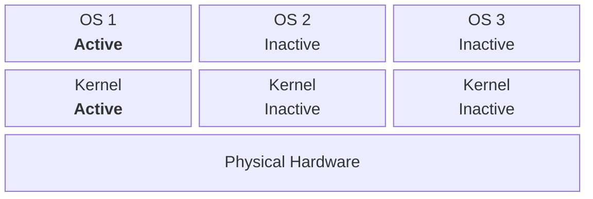
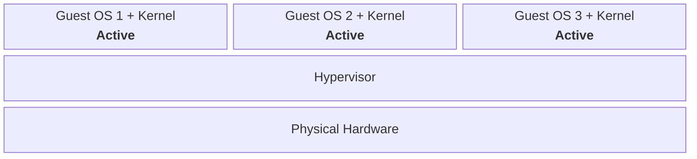
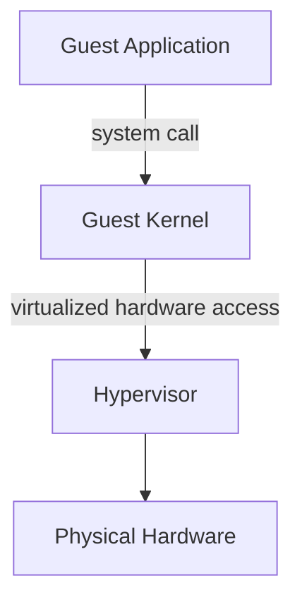
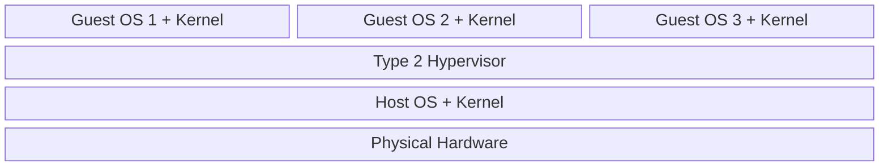
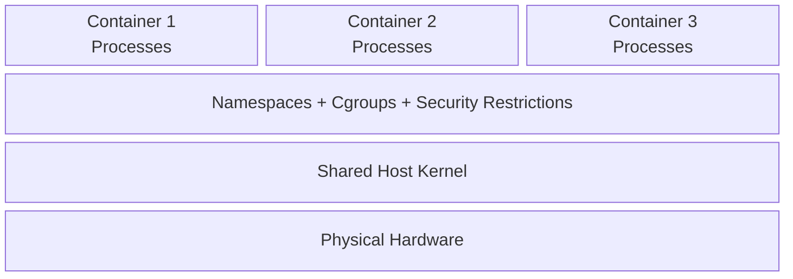

# Virtualization and Containerization

A physical machine can host multiple isolated software environments in several ways, depending on where the isolation boundary is placed. Multiple operating systems can be installed directly on the same hardware and selected at boot, virtual machines can run multiple guest operating systems concurrently on virtualized hardware, and containers can isolate groups of processes while sharing the host kernel.

These models differ primarily in **what is shared** and **which layer controls the physical hardware**. Understanding that distinction explains their differences in isolation, resource overhead, startup cost, and flexibility.

## Multiple Operating Systems on Bare Metal

A physical machine can have multiple operating systems installed without virtualization. In a **multiboot** configuration, each operating system has its own kernel and runs directly on the physical hardware, but normally only one operating system is active at a time.

A bootloader selects the operating system to start. Its kernel then takes control of the machine and manages the physical CPU, memory, devices, and other hardware resources; the other installed operating systems remain inactive.

- **Switching systems:** Starting another installed operating system replaces the running kernel, so switching normally requires rebooting the machine.
- **Runtime separation:** Inactive operating systems have no running processes or kernel state. Their persistent storage is not necessarily isolated: the active operating system may still access another installation's disk partitions.

Multiboot's limitation is concurrency. Because one kernel controls the physical machine at a time, it cannot keep several operating-system environments running simultaneously. **Virtualization** removes this restriction by introducing a layer that lets multiple operating systems share the same physical hardware concurrently.

## Virtual Machines

With multiple operating systems installed directly on bare metal, only one kernel normally controls the physical machine at a time. A **virtual machine (VM)** removes this restriction by giving each operating system a virtual computer on which it can run concurrently with other operating systems.

Each VM contains a **guest operating system**, including its own kernel. From the guest's perspective, it has CPUs, memory, storage, network interfaces, and other hardware resources. A **hypervisor** provides those virtual resources and maps their use onto the underlying machine's physical resources.

Unlike the bare-metal multiboot model, several guest kernels can therefore be active at the same time. Each behaves as though it controls its own machine, while the hypervisor arbitrates access to the physical resources shared by all VMs.

### Virtual Hardware

The hypervisor exposes hardware resources to each guest. They appear as the guest's own hardware even though the underlying machine ultimately provides them:

- **Virtual CPUs (vCPUs):** Execution contexts that the hypervisor maps onto physical CPU resources.
- **Virtual memory:** Memory visible to the guest as its physical memory, ultimately backed by memory managed on the physical machine.
- **Virtual storage:** Disks presented to the guest independently of how their data is stored physically.
- **Virtual devices:** Network interfaces and other devices that appear as hardware from the guest operating system's perspective.

This extra layer allows different guests to have independent kernels, process tables, virtual-memory systems, filesystems, network configurations, and operating-system policies even though they ultimately share the same physical machine.

### Hypervisor Boundary

The hypervisor operates below the guest operating system; it does not replace the guest kernel. An application inside a VM therefore makes system calls to that guest kernel:

For example, when a guest process performs a file operation, the guest kernel still handles the process's filesystem and system-call semantics. When satisfying that operation eventually requires access to a disk or another hardware resource, the interaction proceeds through hardware that the guest sees as virtual and that the virtualization layer maps onto underlying resources.

The hypervisor does not generally proxy application system calls into another kernel. It provides and controls the **virtual machine boundary** on which the guest kernel operates.

### Hypervisor Architectures

Two common hypervisor architectures differ in **where the virtualization layer sits**. In both, the hypervisor provides virtual machines and mediates their access to the underlying machine. From the guest's perspective, each architecture provides a virtual computer with its own virtual CPUs, memory, storage, and devices.

#### Type 1 Hypervisor

A **type 1 hypervisor** runs as the primary layer on the physical machine and hosts guest operating systems above it. It directly controls the hardware and presents virtual hardware to each guest.

This architecture avoids requiring a separate general-purpose host operating system underneath the virtualization layer.

#### Type 2 Hypervisor

A **type 2 hypervisor** runs within a host operating system. The host operating system and its kernel manage the physical hardware, while the hypervisor uses the host's facilities to provide virtual machines above it.

The presence of a host operating system is an architectural difference, not the defining property of a virtual machine.

### Isolation and Cost

Each VM runs its own kernel, which separates its operating-system environment from other guests while introducing work that a shared-kernel environment does not need.

- **Guest isolation:** Failures, configuration changes, process state, and most operating-system resources inside one guest remain separated from those of other guests.
- **Shared lower boundary:** All VMs still depend on the hypervisor and the same physical hardware.
- **Resource cost:** Every VM requires its own guest kernel and operating-system environment, and the hypervisor maintains virtual hardware state for each machine. VMs therefore generally consume more memory and storage and take longer to start than environments that share a single kernel.

Virtual machines provide multiple concurrently running operating-system environments by virtualizing the hardware boundary, at the cost of maintaining a separate guest kernel and OS environment for each VM.

## Containers

A container is an isolated environment for one or more processes. It does not normally emulate an entire computer or run a separate kernel: its processes execute as ordinary processes on the host operating system and share the host kernel.

On Linux, a container runtime combines **namespaces**, **cgroups**, and security restrictions around a process group. Each mechanism controls a different part of the boundary, so no single mechanism creates a complete container.

### Namespaces: Isolated Resource Views

A namespace gives its member processes a separate view of a particular kernel-managed resource. The resources still belong to the same kernel, but operations performed through one namespace do not automatically appear in another. A runtime may intentionally share a namespace with the host or another container, so the exact boundary depends on its configuration.

- **Mount namespace:** Determines which mounts and mount points form a process's [filesystem tree](06%20Storage%20Management.md#Mount%20Namespaces). A runtime arranges a container root directory and its volume mounts in this namespace, so they appear at the paths expected by the process. The namespace neither copies underlying storage nor independently enforces file access permissions; a bind mount deliberately exposes the underlying host objects it attaches.
- **PID namespace:** Gives processes a separate [PID number space](02%20The%20Anatomy%20of%20a%20Process.md#Process%20Identifiers) and limits their process view to their namespace and its descendants. The first process is PID 1 and becomes the parent of orphaned descendants; when it exits, the kernel terminates the remaining processes in that namespace. The same process still has a PID in each ancestor namespace, including the host's initial namespace.
- **Network namespace:** Separates network devices, protocol stacks, addresses, routes, firewall rules, and socket port numbers. A virtual Ethernet pair and a bridge are one way to connect that private network view to the host or another network; they are separate from the namespace itself.
- **IPC namespace:** Separates System V IPC objects and POSIX message queues, preventing unrelated process groups from discovering or using the same IPC objects through those interfaces.
- **UTS namespace:** Separates the hostname and NIS domain name, allowing a container to present its own system identity without changing the host's.
- **User namespace:** Separates user and group IDs and scopes capabilities to resources governed by namespaces owned by that user namespace. When a runtime uses one, UID 0 inside the container need not be a privileged host identity.
- **Cgroup namespace:** Virtualizes the cgroup paths that processes see. It does not create resource limits; cgroups enforce them separately.
- **Time namespace:** Virtualizes offsets for the boot-time and monotonic clocks. It is available when a workload needs that view, but it is not required for every container.

### OverlayFS: Layered Container Filesystems

**OverlayFS** is a Linux filesystem that presents a merged view of directory trees. A container runtime may use it within a container's mount namespace to combine read-only image layers with a private writable layer, so the process sees one filesystem tree instead of the separate layers.

- **Lower layers:** One or more lower directories supply the read-only base. Their contents can be shared by several overlay mounts.
- **Upper layer:** The upper directory holds changes for one writable overlay. When a pathname exists in both layers, the upper object is visible; directories from both layers can be merged.
- **Merged view:** The runtime mounts the overlay view as the container's filesystem root or another mount point, hiding the layer layout from processes in that mount namespace.

Reading a file that exists only in a lower layer reads that lower object. A modification that requires write access causes OverlayFS to **copy up** the object into the upper layer; later access uses that upper copy. Creating a file writes directly to the upper layer. Deleting a lower-layer file instead records a **whiteout** in the upper layer, which hides the corresponding lower name without changing the read-only layer.

This layout lets containers reuse unchanged image data while keeping each container's changes separate. It does not create a separate kernel or replace filesystem permissions: normal permission checks and the container's other security restrictions still apply.

### Cgroups: Resource Governance

While namespaces primarily control what a process can see, **control groups (cgroups)** organize processes for resource accounting and control.

- **Accounting and control:** Enabled controllers can limit and monitor CPU time, memory, process count, and I/O usage for the group and its descendants.
- **Boundary:** Cgroups prevent one container from consuming a configured share or ceiling of those resources, but they do not give the group a private filesystem, process table, or network stack.

### Security Restrictions

Namespaces and cgroups do not by themselves restrict every operation that a process may request from the shared kernel. Container runtimes commonly compose additional restrictions:

- **Capabilities:** A runtime can remove Linux capabilities that the workload does not need, reducing the privileged operations available to a process even when it runs as UID 0 in its own view.
- **Filesystem and device policy:** Read-only mounts, filesystem permissions, and the set of mounted device nodes constrain which objects a process can modify or use.
- **System-call filtering:** A seccomp policy restricts the system calls and, where the policy tests them, arguments that a process may use. It reduces the kernel interface exposed to the workload rather than creating an independent kernel.

### Shared-Kernel Boundary

After the runtime applies those boundaries, a process can appear to be PID 1, have a private filesystem layout and network configuration, and run under resource limits. From the host's perspective, it remains a normal [process](05%20Process%20Management.md#Processes%20vs.%20Threads) with a host PID that the same kernel schedules onto the CPU.

Because every container reaches the host kernel through system calls, a kernel vulnerability or host-level privilege can compromise isolation across containers. Virtual machines place a guest kernel behind a virtual-hardware boundary instead, which changes that isolation and resource-cost trade-off.
