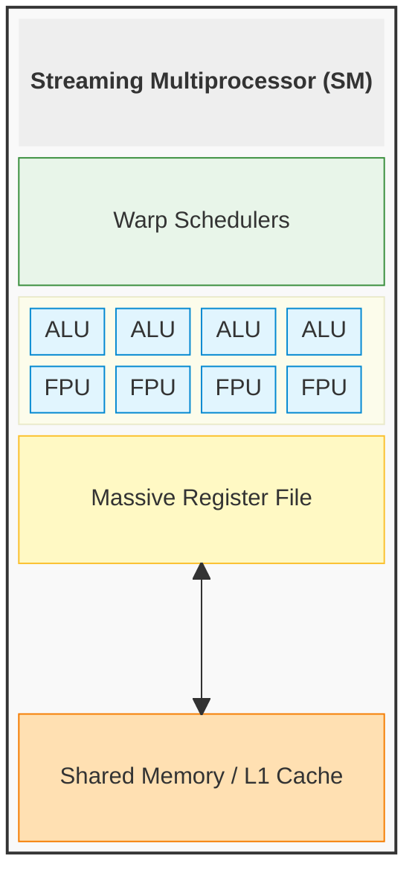

# GPU

A **GPU (Graphics Processing Unit)** is a throughput-oriented processor designed to run the exact same mathematical operation across a massive dataset in parallel. While originally built to calculate pixel colors for 3D graphics, modern GPUs form the backbone of machine learning, scientific computing, and video processing—workloads dominated by heavy matrix and vector math.

- **The Design Philosophy (Throughput vs. Latency):**
    - **CPUs** are optimized for **Low Latency**. They dedicate massive amounts of silicon to [Branch Prediction](04%20Inside%20The%20CPU.md#Branch%20Prediction%20&%20Speculative%20Execution), [deep caches](04%20Inside%20The%20CPU.md#The%20Cache%20Hierarchy), and complex [pipelines](04%20Inside%20The%20CPU.md#The%20Instruction%20Life%20Cycle%20&%20Pipelining) to get a single, branch-heavy task done as fast as possible.  
    - **GPUs** are optimized for **High Throughput**. They strip away complex control logic and caches in favor of packing thousands of simple ALUs onto the die. They sacrifice the speed of a single operation to execute millions of operations simultaneously.
- **The Mechanism:** GPUs use an execution model called **SIMT (Single Instruction, Multiple Threads)**. Instead of fetching different instructions for every core, the GPU's control unit fetches a _single_ instruction (e.g., "multiply by 2") and blasts it to hundreds of ALUs at once, which apply it to different pieces of data simultaneously.
- **The Practical Implication:** A GPU is not inherently "faster" than a CPU; it is highly specialized. A GPU only wins when a workload contains enough parallel math to keep its thousands of cores fed. If the code relies heavily on sequential logic, loops, or complex branching (`if/else`), it will actually run much slower on a GPU.

## Basic Components

When we write standard software, it is easy to imagine the processor executing a single, branch-heavy task as fast as possible. In a CPU, hardware engineers designed a highly parallel assembly line to minimize latency, relying on complex control logic and caches so the execution core doesn't waste clock cycles.

However, at the hardware level, a GPU is bound by a completely different philosophy: maximizing throughput. If a GPU were built with the complex components of a CPU, it would waste massive amounts of silicon that could otherwise be used for raw math. To achieve millions of operations simultaneously, hardware engineers stripped away the complex control units and designed the GPU as a massive array of specialized calculators. By grouping thousands of threads into strict hardware-scheduled units, the GPU hides memory latency through sheer overwhelming parallelism rather than caching.

To make this high-throughput factory function, the GPU relies on a core set of specialized silicon grouped into Streaming Multiprocessors:

- **Streaming Multiprocessor (SM):** The actual hardware "core" of the GPU. While a CPU core relies on a single Control Unit to drive its cycle, an SM is a massive factory floor containing dozens of mathematical units, its own control logic, and warp schedulers. A modern GPU contains well over 100 SMs wired together.
- **Warp Schedulers:** The managers that decide what gets executed next. The hardware physically cannot issue an instruction to a single thread; instead, the scheduler issues a single instruction to a Warp (a strictly grouped squad of 32 threads) simultaneously. If one Warp pauses to wait for memory, the scheduler instantly swaps to another Warp with zero overhead to keep the execution units fed.
- **Arithmetic Logic Unit (ALU):** Operates on the exact same integer math and bitwise logic principles detailed in [Inside The CPU](04%20Inside%20The%20CPU.md). The critical difference is scale: instead of having one or two per core, an SM packs hundreds of ALUs to execute the exact same instruction across a massive dataset simultaneously.
- **Floating-Point Unit (FPU):** The complex math engine, functioning exactly as outlined in [Inside The CPU](04%20Inside%20The%20CPU.md). While CPUs use FPUs for localized decimal math, GPUs dedicate vast portions of their silicon to FPUs to crunch the massive floating-point vectors required for 3D graphics, physics simulations, and machine learning.
- **Registers:** The lowest-latency storage available to an execution core, built directly into the core. GPU registers operate exactly like CPU registers but are massively expanded in capacity. This massive internal storage allows the SM to hold the exact states of dozens of Warps simultaneously, enabling the zero-overhead context swap when a Warp stalls.
- **Shared Memory / L1 Cache:** A latency bridge between cores and RAM. It is an ultra-fast memory bank physically located right next to the calculators inside the SM. While it functions like a CPU's L1 cache, "Shared Memory" can also be explicitly managed by the software to allow threads within the same Thread Block to communicate at extreme speeds.
- **Global Memory (VRAM):** The main memory of the GPU. Similar to how a CPU must reach out to physical RAM with substantially higher latency (~100 nanoseconds), VRAM takes hundreds of clock cycles to access. GPUs hide this latency via Occupancy, instantly switching Warps rather than waiting for the data to arrive.

## Single Instruction, Multiple Threads (SIMT)

While CPUs use [SIMD](04%20Inside%20The%20CPU.md#Single%20Instruction,%20Multiple%20Data%20(SIMD)) to pack multiple data points into a single, extra-wide register for one massive calculator, GPUs use SIMT to achieve parallelism through a completely different hardware mechanism and developer abstraction.

### The Hardware Mechanism

Instead of relying on a single wide Vector ALU, the GPU's Streaming Multiprocessor (SM) distributes the workload across an army of standard-sized calculators.

- **The Warp Scheduler:** The control unit fetches **one single instruction** (e.g., a mathematical addition).
- **The Broadcast:** Instead of sending it to one wide ALU, the scheduler blasts that instruction to **32 separate, individual ALUs** simultaneously.
- **Independent Contexts:** Each of those 32 ALUs reads from its own independent register and processes its own distinct thread. They all do the exact same math at the exact same clock cycle, just on different pieces of data.

### Memory Flexibility and Coalescing

CPU SIMD is incredibly rigid regarding memory: to load a 512-bit SIMD register efficiently, the data must sit sequentially in RAM. If the data is scattered, the CPU struggles to "gather" it before doing the math. SIMT solves this hardware limitation:

- **Independent Fetching:** Because each ALU in a Warp has its own register and its own thread, they can fetch scattered data freely. Thread 1 can request memory address `0x01`, while Thread 2 requests `0xFF`.
- **Memory Coalescing:** To ensure maximum performance, the GPU hardware includes a dynamic memory controller. If it notices that all 32 threads in a Warp _happen_ to be asking for contiguous memory addresses, the controller automatically fuses those 32 separate requests into one massive, ultra-fast memory fetch. You get the speed of vector memory blocks when the data aligns, but the execution doesn't break when the data is scattered.

### The Developer Abstraction (The Language Gap)

While array-based programming (like Python's NumPy) is highly intuitive for complex math, the high-performance systems languages historically used to program hardware (C, C++, Fortran) were strictly built around a scalar mental model: fetch one instruction, do one thing, repeat.

- **The CPU SIMD Friction:** Writing CPU SIMD in C/C++ often forces developers to abandon standard math syntax and write complex, low-level compiler intrinsics (e.g., `_mm512_add_ps()`) to manually pack data into rigid hardware registers.
- **The SIMT Illusion:** SIMT was designed specifically to bypass this language limitation. It allows developers to write standard, single-threaded (scalar) C code using standard syntax. The abstraction layer is built directly into the silicon's Warp Scheduler, which transparently takes that scalar code, groups 32 threads together, and secretly executes them like a massive vector array.

### Handling Conditional Logic

Because CPU SIMD relies on packed hardware registers, conditional logic (`if/else` statements) inside the dataset often breaks the vectorization completely. Under SIMT, the GPU hardware automatically manages divergence to keep the parallel model intact:

- **Hardware Masking:** If threads within a Warp diverge on an `if` statement, the hardware cannot run both branches at once. It physically disables (masks out) the ALUs for the threads that evaluate to `False` and executes the `True` path.
- **The Re-convergence:** Once the `True` path finishes, it flips the mask, activates the `False` threads, executes the `else` path, and then converges them back together.
- **The Trade-off:** While this prevents the execution model from breaking, it wastes clock cycles. If a Warp diverges, it takes twice as long to execute, cutting parallel efficiency in half.

## GPU Memory Hierarchy

While GPUs possess unimaginable arithmetic throughput, modern GPU performance is rarely limited by raw math. The true bottleneck is almost always **memory movement**. A GPU can crunch numbers significantly faster than it can physically move the data into the calculators.

If a workload is slow on a GPU, it is usually because the execution units are starving for data.

### The On-Device Memory Hierarchy

Similar to a CPU, the GPU relies on a physical hierarchy of memory, trading capacity for lower latency as data moves closer to the execution cores.

- **Registers:** The absolute fastest, zero-latency memory built directly into the Streaming Multiprocessor (SM). Because GPUs rely on instant context switching to hide latency, their register files are massive. While a CPU core might have a few hundred registers, a single SM can contain tens of thousands, allowing it to hold the exact states of dozens of active Warps simultaneously.
- **Shared Memory (L1 Cache):** A block of ultra-fast SRAM located directly inside each physical SM. Unlike a CPU's L1 cache, which the hardware manages entirely behind your back, GPU **Shared Memory** is programmable. Developers can explicitly write code to load data from VRAM into Shared Memory, allowing all threads within a Thread Block to share and reuse that data at near-register speeds without ever going back to main memory.
- **Global Memory (VRAM):** The main storage pool of the GPU (e.g., 24GB on an RTX 4090). While accessing VRAM takes hundreds of clock cycles, it compensates with unimaginably wide **Bandwidth**. Instead of standard DDR memory, GPUs use GDDR or HBM (High Bandwidth Memory), allowing the memory controller to fetch massive, contiguous blocks of data simultaneously to feed the thousands of waiting threads.

### Host Interaction and The PCIe Bottleneck

A GPU does not exist in a vacuum; it is a peripheral device physically plugged into the motherboard's PCIe bus. It cannot independently read a file from the hard drive or fetch data from the network.

- **Host RAM & Pinned Memory:** To move data from standard motherboard RAM ("Host RAM") to the GPU's VRAM without bottlenecking the CPU, the GPU uses a standard [Direct Memory Access (DMA)](03%20Memory%20Management.md#Direct%20Memory%20Access%20(DMA)) controller over the PCIe bus. Just like any high-speed peripheral, this hardware transfer requires **Pinned (Page-Locked) Memory** to safely bypass the OS virtual memory system. If a developer attempts to send standard unpinned memory to the GPU, the driver secretly wastes CPU cycles copying it into a temporary pinned "bounce buffer" first, crippling the PCIe transfer speed.
- **The Interconnect Bottleneck:** The physical distance and bandwidth limit of the PCIe bus is often the absolute ceiling of GPU performance. If an application spends 100 milliseconds copying data across the PCIe bus to perform 2 milliseconds of math, using the GPU is a net negative. GPUs only win when the mathematical workload is large enough to completely offset the massive latency of moving the data across the motherboard.
- **Scattered Access (Uncoalesced Memory):** Even after the data reaches the GPU, the architecture can still collapse. VRAM bandwidth is strictly optimized for fetching large, sequential blocks. If the 32 threads in a Warp ask for memory addresses that sit perfectly next to each other, the hardware _coalesces_ it into a single, ultra-fast fetch. If the threads ask for randomly scattered memory addresses, the hardware must perform 32 separate, agonizingly slow VRAM fetches, causing the entire SM to stall.

## Workload Alignment and ML Fit

Because of the architectural trade-offs required to achieve massive SIMT throughput, a GPU is not a general-purpose replacement for a CPU. To determine if a workload belongs on a GPU, you must evaluate a single decision rule: **Can the exact same mathematical operation be applied to many independent elements at once?**

### The Good Fit

GPUs dominate workloads that require repetitive, predictable math across massive datasets.

- **Matrix Multiplication:** At its core, a GPU is a massive, highly parallel calculator designed to multiply giant grids of numbers (matrices) simultaneously. This makes it the undisputed engine for neural network training and inference.
- **Multi-Tenant Batching:** Because of the GPU's parallel architecture, it takes almost the exact same amount of time to calculate the next token for 10 stacked users as it does to calculate it for 1 user. Batching physically stacks multiple independent user requests into a single, combined matrix. The GPU then pushes this giant composite matrix through the neural network's weights in a single forward pass.
- **3D Rendering and Ray Tracing:** Calculating the light, shadow, and color of millions of independent pixels on a screen relies on the exact same floating-point vector math applied simultaneously across the entire display.
- **Scientific Simulation:** Fluid dynamics, weather modeling, and molecular simulations involve updating millions of independent particles simultaneously based on fixed physics equations.

### The Bad Fit

If a workload forces the GPU to behave like a CPU, the hardware's parallel efficiency collapses, resulting in performance far worse than a standard CPU core.

- **Branch-Heavy Logic:** Workloads dominated by complex, unpredictable `if/else` statements (like parsing complex JSON business logic) trigger constant Branch Divergence. The Warp Scheduler is forced to mask out execution units, cutting parallel throughput in half with every diverging branch.
- **Irregular Pointer Chasing:** Data structures like Linked Lists or Graph traversals force the threads within a Warp to request completely random, scattered memory addresses. This destroys hardware memory coalescing, overwhelming the memory controller and stalling the Streaming Multiprocessor.
- **Tiny Jobs (The Transfer Penalty):** If you send a single user's prompt to the GPU, the math required is so relatively small that it might only light up 5% of the GPU's compute cores. If a task is too small, the latency of moving the data from Host RAM across the PCIe bus takes longer than the actual computation, making the GPU a net negative.

## GPU and the operating system

- **What to learn later:** How the GPU is exposed through drivers, kernel-mediated interfaces, and command submission paths.
- **Prerequisites:** [System Architecture Overview](00%20System%20Architecture%20Overview.md#Device%20Drivers) and [More OS Concepts](08%20More%20OS%20Concepts.md#Device%20drivers).
- **Why these prerequisites matter:** The OS-facing side of GPU learning is mostly a device-driver topic.
- **Core idea:** The GPU is a device managed through drivers and kernel-mediated interfaces.
- **Terms to cover:** device driver, user space, kernel space, command queue, runtime, kernel launch.
- **Practical implication:** A program usually does not talk to the GPU hardware directly; it talks to a runtime and driver stack.

## GPU scheduling and driver orchestration

- **What to learn later:** How CPU-side process scheduling vocabulary relates to GPU work submission, synchronization, and device-side scheduling.
- **Prerequisites:** [Process Management](05%20Process%20Management.md) and [System Architecture Overview](00%20System%20Architecture%20Overview.md#Process%20Management).
- **Why these prerequisites matter:** Process scheduling gives useful vocabulary, even though GPU scheduling is not the same as CPU process scheduling.
- **Core idea:** The operating system, runtime, and driver stack cooperate to feed work to the device while the CPU continues doing other tasks.
- **Terms to cover:** queue, stream, synchronization, blocking, asynchronous launch, context.
- **Practical implication:** This topic is helpful for deeper systems understanding, but it is not required before learning basic GPU architecture.
