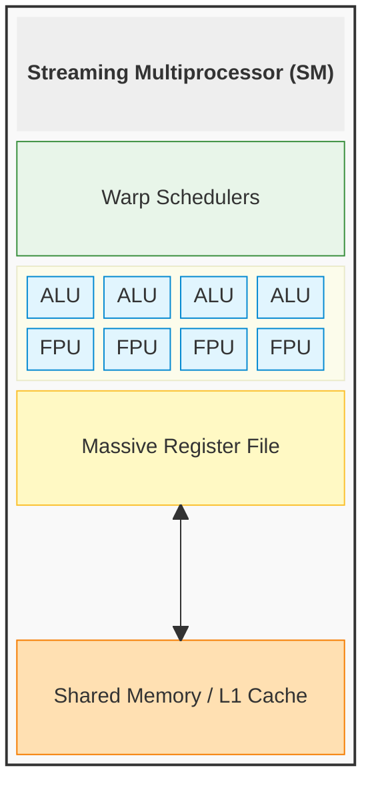
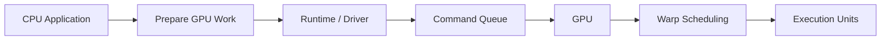

# GPU

A **GPU (Graphics Processing Unit)** is a throughput-oriented processor designed to apply the same mathematical operations across massive amounts of data in parallel. GPUs were originally developed to calculate geometry, lighting, and pixel colors for computer graphics, but the same architecture also maps naturally to scientific computing, video processing, and machine-learning workloads dominated by large amounts of vector and matrix math.

The fundamental difference between a CPU and a GPU is therefore not that one is universally faster than the other, but that they optimize for different goals. A CPU is designed primarily for **low-latency execution** of relatively small numbers of complicated instruction streams, so it dedicates substantial silicon to [Branch Prediction](04%20Inside%20The%20CPU.md#Branch%20Prediction%20&%20Speculative%20Execution), [deep cache hierarchies](04%20Inside%20The%20CPU.md#The%20Cache%20Hierarchy), sophisticated [instruction pipelines](04%20Inside%20The%20CPU.md#The%20Instruction%20Life%20Cycle%20&%20Pipelining), and other control machinery. A GPU instead prioritizes **high throughput**, dedicating much more of the chip to mathematical execution units so that enormous numbers of similar operations can proceed in parallel.

This trade-off means that a GPU is highly specialized rather than inherently faster. Workloads with large amounts of independent, repetitive computation can keep thousands of execution units busy and therefore benefit enormously from the architecture. Conversely, workloads dominated by sequential dependencies, irregular memory access, or unpredictable branching force much of the GPU's parallel hardware to remain idle and may execute more efficiently on a CPU.

> [!note] CPU vs. GPU
>
> A CPU primarily tries to minimize the latency of individual instruction streams, while a GPU primarily tries to maximize the total amount of work completed in parallel.
>
> Most of the architectural differences between them follow from this trade-off.

## Basic Components

A CPU core contains sophisticated machinery intended to keep a small number of instruction streams moving as quickly as possible. If a GPU replicated that entire structure thousands of times, however, enormous amounts of silicon would be consumed by control logic rather than computation. GPU architecture therefore moves in the opposite direction: it simplifies much of the per-thread control machinery and uses the reclaimed chip area to provide a much larger number of mathematical execution units.

These execution units are organized into groups called **Streaming Multiprocessors (SMs)**. Instead of treating every software thread as an independently scheduled hardware execution engine, each SM manages many threads collectively, keeps their execution state close to the computation hardware, and issues work to groups of threads whenever the required resources are available.



- **Streaming Multiprocessor (SM):** The main computational building block of the GPU. An SM contains many execution units together with Warp Schedulers, registers, local memory, and the control logic required to coordinate them. A complete GPU contains many SMs operating in parallel.
- **Warp Scheduler:** The hardware responsible for selecting which Warp should execute. GPU threads are grouped into fixed-size Warps, and the scheduler issues instructions for those groups rather than scheduling each thread as an independent hardware instruction stream.
- **Arithmetic Logic Units (ALUs):** Perform integer arithmetic and bitwise operations according to the same basic principles described in [Inside The CPU](04%20Inside%20The%20CPU.md). The important difference is scale: GPU hardware contains large numbers of execution units so similar calculations can occur across many elements simultaneously.
- **Floating-Point Units (FPUs):** Perform floating-point arithmetic. Because graphics, scientific simulation, and machine learning rely heavily on this kind of math, GPUs dedicate significant computational capacity to floating-point operations.
- **Registers:** Store the values and execution state actively used by GPU threads. GPU register files are large because an SM must keep the state of many threads resident at the same time.
- **Shared Memory / L1 Cache:** Low-latency SRAM located close to the execution units. In addition to normal caching behavior, Shared Memory can be explicitly managed by software so threads assigned to the same cooperative group can rapidly exchange and reuse data; in CUDA, this cooperation is scoped to a **Thread Block**.
- **Global Memory (VRAM):** The GPU's primary large-capacity memory. It provides much more storage than the on-chip memories but has substantially higher access latency, making efficient access patterns critical to performance.

## Single Instruction, Multiple Threads (SIMT)

GPUs obtain much of their parallel throughput through an execution model called **SIMT — Single Instruction, Multiple Threads**. SIMT is closely related to [SIMD](04%20Inside%20The%20CPU.md#Single%20Instruction,%20Multiple%20Data%20(SIMD)), but the two expose parallelism differently. CPU SIMD explicitly packs several values into a wide vector register and executes one vector operation against those values, while GPU SIMT presents the programmer with many logical software threads and lets the hardware group compatible threads together for execution.

This means GPU code can still be written using an ordinary scalar mental model: the programmer describes what one logical thread should do, launches many such threads, and lets the GPU map those logical executions onto its parallel hardware.

### GPU Threads

A **GPU thread** is a lightweight logical execution context representing one execution of a GPU kernel. It should not be confused with an operating-system thread: the OS does not independently schedule thousands of GPU threads onto CPU-like cores. Instead, a kernel launch creates many logical thread executions, and the GPU hardware later groups and schedules them collectively.

Each GPU thread conceptually has its own input identity and execution state, including its register values and local variables. This lets the same scalar kernel body operate on different pieces of data depending on which thread is executing it.

CUDA makes this model explicit. Consider a kernel that doubles every value in an array:

```cpp
__global__ void double_values(float *values, int count) {
    int thread_id = blockIdx.x * blockDim.x + threadIdx.x;

    if (thread_id < count) {
        values[thread_id] = values[thread_id] * 2;
    }
}
```

The function body describes the work performed by **one logical thread**. `threadIdx.x` identifies the thread inside its Thread Block, `blockIdx.x` identifies the block inside the kernel launch, and `blockDim.x` gives the number of threads in each block. Combining them produces a global index that lets each thread operate on a different array element.

CUDA launches a kernel using the syntax:

```cpp
kernel<<<number_of_blocks, threads_per_block>>>(...);
```

For example:

```cpp
double_values<<<4, 256>>>(values, 1024);
```

creates a grid containing **4 Thread Blocks with 256 threads each**, for a total of `4 × 256 = 1024` logical GPU threads. Every one of those threads executes the same `double_values()` kernel body, but each observes different values for its thread and block identifiers and therefore works on a different element.

A **Thread Block** is a programmer-visible group of threads that can cooperate through Shared Memory and synchronization. CUDA assigns each block to one SM for its lifetime, although an SM can keep multiple blocks resident at the same time when resources allow. The block abstraction therefore determines which threads can directly cooperate, while the hardware still performs instruction scheduling at a smaller granularity.

The important hierarchy is therefore: a kernel launch creates a **grid of Thread Blocks**, each block contains many **GPU threads**, and the hardware groups those threads into **Warps** for execution on Streaming Multiprocessors.

### Warps and Hardware Execution

Inside an SM, GPU threads are organized into fixed-size hardware execution groups called **Warps**. In NVIDIA CUDA hardware, a Warp contains 32 threads. The Warp Scheduler selects a ready Warp and issues an instruction for its active threads, which perform that operation on their respective data.

The programmer therefore sees many independent logical kernel executions, while the hardware sees groups of threads that can share instruction issue. If the threads in a Warp reach the same instruction together, the GPU can execute that instruction across many data elements in parallel rather than maintaining a completely independent instruction stream for every thread.

This is the central abstraction of SIMT: **the developer writes the logic of one scalar thread, launches many logical threads, and the GPU groups those threads into Warps for parallel execution**.

### GPU Occupancy

**Occupancy** describes how many Warps can remain active on a Streaming Multiprocessor relative to the maximum amount of execution state the SM can support. This matters because GPU execution frequently encounters operations that cannot immediately continue, especially accesses to high-latency VRAM. When one Warp is not ready, the Warp Scheduler benefits from having other resident Warps whose instructions are ready to issue.

The important detail is that these Warps already have their execution state resident on the SM. Their registers and other required resources have already been allocated, so selecting another ready Warp does not require an operating-system context switch or saving an entire process state to system RAM. The scheduler simply chooses another eligible Warp from the pool of resident work.

Occupancy is not unlimited because every resident thread consumes physical hardware resources. Registers, Shared Memory, thread slots, and other SM resources are finite, so a kernel that uses large amounts of these resources per thread or Thread Block can reduce the number of Warps that fit on the SM. If very few Warps are resident, a stall may leave the scheduler without any ready work to issue; with a larger pool, the scheduler has more opportunities to keep the execution units productive.

> [!note] Occupancy vs. Utilization
>
> **Occupancy** describes how much parallel execution state is resident on an SM, whereas **utilization** describes how busy the actual execution hardware is.
>
> Higher occupancy gives the scheduler more work to choose from, but maximum occupancy does not automatically mean maximum performance.

### Branch Divergence

SIMT works most efficiently when all active threads in a Warp follow the same instruction path. Conditional logic becomes expensive when different threads evaluate the same condition differently because the Warp cannot freely execute two unrelated instruction streams at the same time.

Consider:

```c
if (value > 0) {
    do_a();
} else {
    do_b();
}
```

If some threads take the `True` branch and others take the `False` branch, the hardware uses **masking**. It temporarily disables the threads that are not following the current path, executes one branch for the relevant threads, then changes the mask and executes the other path before reconverging the Warp.

```text
Warp
├── Threads 0–15  -> True branch
└── Threads 16–31 -> False branch

Execution:
1. Run True threads, mask False threads
2. Run False threads, mask True threads
3. Reconverge
```

The result remains logically correct, but some execution lanes are idle while each branch runs. This phenomenon is known as **Branch Divergence**, and it explains why highly irregular control flow can dramatically reduce SIMT efficiency. When all threads take the same path, the hardware remains fully aligned; as their paths diverge, execution becomes increasingly serialized.

## GPU Memory Hierarchy

Massive arithmetic capacity is useful only when data can reach the execution units quickly enough. For many GPU workloads, performance is therefore constrained less by the raw speed of mathematical operations than by the cost of **moving data** through the memory hierarchy.

Like the hierarchy described in [Memory Management](03%20Memory%20Management.md), GPU memory trades capacity for proximity and access latency. Registers and Shared Memory sit directly beside the execution hardware but have limited capacity, whereas Global Memory provides much more storage at substantially higher latency.
### Registers

Registers are the closest storage to the GPU execution units and contain the values actively manipulated by threads. Local variables, intermediate results, addresses, and other pieces of thread state can reside there while computation is taking place.

GPU register files are particularly large because the architecture must keep the state of many resident Warps available simultaneously. That large pool of on-chip state directly supports Occupancy: the more thread state the hardware can keep resident, the larger the set of Warps from which the scheduler can select work.

### Shared Memory / L1 Cache

**Shared Memory** is a small, low-latency memory space located on the SM and explicitly accessible by threads within a Thread Block. Because a Thread Block remains assigned to one SM for its lifetime, its threads can use that SM's Shared Memory to exchange and reuse data. Unlike an ordinary CPU or GPU cache, whose contents and eviction decisions are automatically managed by hardware, Shared Memory is managed by the program. Threads can cooperatively load data from VRAM into Shared Memory, synchronize, and then reuse or exchange those values without repeatedly accessing Global Memory.

On some GPU architectures, Shared Memory and the L1 cache use the same underlying on-chip SRAM, but they serve different logical roles: **L1 automatically caches memory accesses, while Shared Memory acts as a programmer-controlled scratchpad.**
### Global Memory / VRAM

**Global Memory**, commonly called **VRAM**, is the GPU's main high-capacity memory pool. Although it has much greater access latency than registers or Shared Memory, GPU memory systems compensate by providing very high **bandwidth**, allowing large amounts of data to move in parallel.

Technologies such as GDDR and HBM are designed around this need for bandwidth. However, simply having a wide memory interface is not enough; software must access that memory in patterns the hardware can combine efficiently. This makes the layout of data and the addresses requested by neighboring threads central to GPU performance.

### Memory Coalescing

Threads inside a Warp maintain independent logical contexts, so they are technically free to request unrelated addresses. If neighboring threads access neighboring data, however, the memory controller can combine those requests into a smaller number of large transfers. This optimization is known as **memory coalescing**.

A favorable pattern looks like:

```text
Thread 0  -> array[0]
Thread 1  -> array[1]
Thread 2  -> array[2]
...
Thread 31 -> array[31]
```

Because the requested addresses belong to a contiguous region, the memory hardware can service them efficiently. If the Warp instead accesses widely scattered addresses, the controller loses that opportunity and may need to perform many separate memory transactions.

```text
Thread 0 -> array[10]
Thread 1 -> array[9000]
Thread 2 -> array[31]
Thread 3 -> array[700000]
```

The program remains correct in both cases, but the second pattern makes much poorer use of the available memory bandwidth. In this sense, coalescing is closely related to [Spatial Locality](03%20Memory%20Management.md#Spatial%20Locality): both reward software for organizing related accesses close together, although the GPU applies the principle across the simultaneous memory requests of a Warp.

## Host Memory and the PCIe Bottleneck

A discrete GPU is not part of the CPU's normal system-memory path. It is a peripheral device connected to the host system, typically through PCIe, and it owns a separate VRAM address space. Consequently, using the GPU often requires data to cross a physical boundary before computation can begin.

This distinction is important because accelerating the computation itself does not eliminate the cost of reaching the device. An operation can execute extremely quickly once its input reaches the GPU and still perform poorly overall if moving that input and retrieving the result dominate total execution time.

### DMA and Pinned Memory

Large transfers between Host RAM and GPU memory use the same [Direct Memory Access (DMA)](03%20Memory%20Management.md#Direct%20Memory%20Access%20(DMA)) principles used by other high-speed peripherals. Instead of forcing the CPU to copy every byte through its own execution registers, the CPU and driver configure the transfer and the device handles the bulk movement.

DMA operates against physical memory, which introduces a problem because ordinary application memory is managed through virtual memory and may be moved, reclaimed, or swapped by the operating system. A device cannot safely continue writing to a physical location if the OS is free to repurpose the page during the transfer. For this reason, high-performance GPU transfers commonly use **Pinned (Page-Locked) Memory**, temporarily preventing those physical pages from moving.

If the application supplies ordinary pageable memory, the GPU driver may first need to copy it into a temporary pinned buffer before starting the DMA transfer. That additional step introduces another memory copy, which is why pinned memory matters for workloads that repeatedly move large amounts of data between the host and device.

### The Transfer Penalty

Because the PCIe transfer is part of the operation, GPU acceleration must be evaluated across the complete path rather than by comparing compute time alone. Consider a workload that spends `100 ms` transferring input to the GPU, performs the actual calculation in `2 ms`, and then spends another `20 ms` returning the result. Even though the computation itself may be dramatically faster on the GPU, the complete operation still takes `122 ms`.

```text
Host → GPU Transfer: 100 ms
GPU Computation:       2 ms
GPU → Host Transfer:  20 ms
```

The workload must therefore perform enough useful computation to justify the cost of moving data across the host/device boundary. Large operations that reuse data already present in VRAM can amortize this cost, whereas tiny operations that constantly shuttle inputs and outputs across PCIe may lose any advantage provided by the GPU.

> [!note] The Host/Device Rule
>
> GPU acceleration must account for:
>
> **Host → Device Transfer + GPU Computation + Device → Host Transfer**
>
> Fast mathematical execution cannot compensate for excessive data movement.

## Workload Alignment

The architectural trade-offs behind SIMT make a GPU extremely powerful for some workloads and poorly suited to others. A useful mental test is to ask whether **the same mathematical operation can be applied independently across a large number of data elements**. The more naturally a problem exposes that kind of parallel structure, the more effectively the hardware can keep its execution units occupied.

### Good GPU Workloads

**Matrix and vector computation** is one of the clearest examples because large numerical structures contain enormous numbers of repetitive operations that can be distributed across many threads. This property is also why GPU hardware maps naturally to machine learning, although the LLM-specific consequences—such as inference batching, KV caching, quantization, and serving trade-offs—belong in [LLM Processing Pipeline](../AI%20Engineering/LLM/LLM%20Processing%20Pipeline.md) rather than in this hardware note.

**3D rendering and ray tracing** expose similar parallelism because large numbers of pixels, vertices, fragments, or rays require related mathematical operations. **Scientific simulations** such as fluid dynamics, weather modeling, and molecular simulation likewise update enormous collections of particles or cells according to repeated mathematical rules, making them natural candidates for SIMT execution.

### Poor GPU Workloads

**Branch-heavy logic** works against the architecture because unpredictable control flow causes threads in the same Warp to take different paths. As Branch Divergence increases, the hardware repeatedly masks inactive threads and serializes portions of execution, reducing the parallelism that made the GPU attractive in the first place.

**Irregular pointer chasing** creates a similar problem in the memory system. Linked structures and irregular graph traversals repeatedly load an address and then jump to another unrelated location, causing threads within the same Warp to request scattered regions of VRAM. This prevents efficient memory coalescing and resembles the [Pointer Chasing](02%20The%20Anatomy%20of%20a%20Process.md#The%20OOP%20Penalty) problem described for CPUs, except that the GPU now has many threads generating irregular requests simultaneously.

**Tiny jobs** can also be a poor fit even when the computation itself is parallel. A small workload may occupy only a fraction of the available GPU hardware while still paying the fixed costs of preparing the work, submitting it to the device, transferring memory, synchronizing, and retrieving the result. In that situation, the overhead surrounding the computation can exceed the computation itself.

## GPU and the Operating System

A user-space application does not normally communicate directly with GPU hardware. Like other peripherals, the GPU is exposed through a software stack in which the application interacts with a runtime, the runtime communicates with a device driver, and the operating system controls the privileged path to the physical hardware.


This follows the general device-driver model introduced in [System Architecture Overview](00%20System%20Architecture%20Overview.md#Device%20Drivers). The application can request GPU work without needing to manipulate hardware registers or directly coordinate the device's physical resources, because those lower-level responsibilities are handled through the runtime and driver stack.

### Runtime and Driver Boundary

The **GPU Runtime** provides the higher-level interface used by application code, while the **Device Driver** controls the operating-system-facing interaction with the hardware. This division allows user-space software to request memory operations and computational work without receiving unrestricted access to a privileged peripheral.

Several concepts belong to this boundary:

- **User Space:** Where the application and much of the runtime execute.
- **Kernel Space:** Where privileged operating-system code mediates hardware access.
- **Device Driver:** The software responsible for controlling and communicating with the GPU.
- **Runtime:** The higher-level API through which applications request GPU operations.
- **Command Queue:** A mechanism used to submit work for later execution by the device.
- **Kernel Launch:** Submission of a computational function that will execute across GPU threads.

The important architectural principle is the same as with other devices: the application does not directly own the hardware. Access is mediated so multiple software components can safely interact with the GPU while the operating system remains responsible for privileged resource management.

## GPU Scheduling and Driver Orchestration

CPU scheduling and GPU scheduling use related language, but they refer to different layers of execution. The operating system's CPU scheduler decides which software threads run on CPU cores, whereas GPU work must first be prepared by the host application and submitted through the runtime and driver before the device schedules that work across its own hardware.



This separation allows host and device execution to overlap. After submitting work, the CPU may be able to continue performing independent operations while the GPU processes the command queue. The two processors only need to wait for each other when a dependency requires the result of one side before the other can continue.

### Synchronization

GPU work is commonly submitted **asynchronously**, meaning the CPU can enqueue an operation and continue executing without waiting for the GPU to finish it immediately. This allows the host and device to perform independent work at the same time instead of forcing one processor to remain idle whenever the other is busy.

Eventually, however, the CPU may reach an operation that depends on a result still being produced by the GPU. At that point, it must **synchronize** with the device: the CPU waits until the required GPU work has completed before continuing with the dependent operation.

The following timeline illustrates this relationship. The times are only illustrative:


During the first `20 ms`, the CPU prepares and submits the GPU operation. Once the GPU begins its computation, the CPU does not immediately wait; it spends the next `50 ms` performing unrelated work while the GPU executes in parallel. This overlap is useful because both processors are doing productive work during the same interval.

At `70 ms`, the CPU reaches code that requires the GPU's result, but the GPU is still computing. The CPU can no longer make progress on that dependency, so it synchronizes and waits for the remaining `30 ms`. Once the GPU finishes at `100 ms`, the synchronization condition is satisfied and the CPU can consume the result.

The important distinction is therefore between **submission** and **dependency**. An asynchronous launch allows CPU execution to continue after work has been submitted, while synchronization establishes the point at which the CPU is no longer allowed to continue until the required device work has completed.

Relevant concepts include:

- **Queue:** Submitted GPU operations waiting to execute.
- **Stream:** An ordered sequence of GPU operations whose execution and dependencies can be coordinated.
- **Asynchronous Launch:** The CPU submits GPU work and continues without immediately waiting for it.
- **Synchronization:** The CPU waits until required GPU work has completed.
- **Blocking:** The state in which the CPU cannot continue because it is waiting for a synchronization condition.
- **Context:** State associated with an application's use of the GPU.

The goal is not to eliminate synchronization, because dependencies eventually require coordination. Instead, efficient GPU programs try to **delay synchronization until the result is actually needed**, maximizing the amount of useful CPU and GPU work that can overlap.
