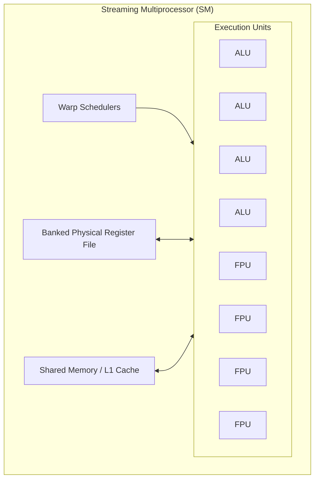

# GPU

A **GPU (Graphics Processing Unit)** is a throughput-oriented processor designed to apply the same mathematical operations across massive amounts of data in parallel. GPUs were originally developed to calculate geometry, lighting, and pixel colors for computer graphics, but the same architecture also maps naturally to scientific computing, video processing, and machine-learning workloads dominated by large amounts of vector and matrix math.

## CPU vs. GPU: Latency and Throughput

The fundamental difference between a CPU and a GPU is therefore not that one is universally faster than the other, but that they optimize for different goals. A CPU is designed primarily for **low-latency execution** of relatively small numbers of complicated instruction streams, so it dedicates substantial silicon to [Branch Prediction](04%20Inside%20The%20CPU.md#Branch%20Prediction%20&%20Speculative%20Execution), [deep cache hierarchies](04%20Inside%20The%20CPU.md#The%20Cache%20Hierarchy), sophisticated [instruction pipelines](04%20Inside%20The%20CPU.md#The%20Instruction%20Life%20Cycle%20&%20Pipelining), and other control machinery. A GPU instead prioritizes **high throughput**, dedicating much more of the chip to mathematical execution units so that enormous numbers of similar operations can proceed in parallel.

This trade-off means that a GPU is highly specialized rather than inherently faster. Workloads with large amounts of independent, repetitive computation can keep thousands of execution units busy and therefore benefit enormously from the architecture. Conversely, workloads dominated by sequential dependencies, irregular memory access, or unpredictable branching force much of the GPU's parallel hardware to remain idle and may execute more efficiently on a CPU.

Both architectures use parallelism and concurrency to keep execution resources busy. The distinction is what each spends hardware resources optimizing: CPUs invest more in making a relatively small number of complex instruction streams progress quickly, whereas GPUs devote more resources to keeping a much larger number of similar operations in flight. Most of their architectural differences follow from this trade-off.

## GPU Hardware Architecture

A CPU core contains sophisticated machinery intended to keep a small number of instruction streams moving as quickly as possible. If a GPU replicated that entire structure thousands of times, however, enormous amounts of silicon would be consumed by control logic rather than computation. GPU architecture therefore moves in the opposite direction: it simplifies much of the per-thread control machinery and uses the reclaimed chip area to provide a much larger number of mathematical execution units.

These execution units are organized into groups called **Streaming Multiprocessors (SMs)**. Instead of treating every software thread as an independently scheduled hardware execution engine, each SM manages many threads collectively and combines replicated execution units with Warp Schedulers, a large banked physical register file, Shared Memory / L1 Cache, and the control logic required to coordinate them. The ALUs and FPUs perform computation, while the register file acts as an SM-level storage subsystem that holds the private logical register state of many resident threads and supplies operands when Warp instructions execute.



- **Streaming Multiprocessor (SM):** The main computational building block of the GPU. An SM contains Warp Schedulers, many mathematical execution units, a large banked physical register file, Shared Memory / L1 Cache, and the control logic required to keep many Warps resident and coordinate their execution. A complete GPU contains many SMs operating in parallel.
- **Warp Scheduler:** The hardware responsible for selecting which Warp should execute. GPU threads are grouped into fixed-size Warps, and the scheduler issues instructions for those groups rather than scheduling each thread as an independent hardware instruction stream.
- **Arithmetic Logic Units (ALUs):** Perform integer arithmetic and bitwise operations using the same basic principles as [CPU execution units](04%20Inside%20The%20CPU.md). The important difference is scale: GPU hardware contains large numbers of execution units so similar calculations can occur across many elements simultaneously.
- **Floating-Point Units (FPUs):** Perform floating-point arithmetic. Because graphics, scientific simulation, and machine learning rely heavily on this kind of math, GPUs dedicate significant computational capacity to floating-point operations.
- **Registers:** An SM contains a large banked physical register file shared as a hardware resource among its resident threads. Each logical GPU thread has private register state, but those values physically occupy portions of this SM-level register capacity. When Warp instructions execute, operands are read from the register file and results are written back to it.
- **Shared Memory / L1 Cache:** Low-latency SRAM located close to the execution units. In addition to normal caching behavior, Shared Memory can be explicitly managed by software so threads assigned to the same cooperative group can rapidly exchange and reuse data; in CUDA, this cooperation is scoped to a **Thread Block**.
- **Global Memory (VRAM):** The GPU's primary large-capacity memory. It provides much more storage than the on-chip memories but has substantially higher access latency, making efficient access patterns critical to performance.

## GPU Execution Model

The hardware architecture describes the physical resources that perform computation, while the **GPU execution model** describes the logical abstractions through which software expresses parallel work. Streaming Multiprocessors, Warp Schedulers, execution units, registers, and caches are hardware resources; kernels, grids, Thread Blocks, and GPU threads describe the work that software asks the GPU to perform. The runtime and GPU hardware map these logical abstractions onto the physical resources during execution.

**CUDA terminology** provides a concrete representation of this hierarchy because CUDA exposes kernels, grids, Thread Blocks, threads, and Warps explicitly. Other GPU programming systems use related abstractions and may give them different names, but the same broad distinction between logical work and physical execution remains useful.

### Kernel and Kernel Launch

A **GPU kernel** is a function designed to execute across many GPU threads. The programmer writes the operation from the perspective of one logical thread, then launches the kernel across a larger collection of threads so the same code can operate on many pieces of data.

> [!note] GPU Kernel vs. OS Kernel
>
> In GPU programming, a **kernel** is computational code submitted to the GPU for parallel execution. This meaning is unrelated to the **operating-system kernel**, which is privileged system software responsible for managing processes, memory, devices, and other system resources.

CUDA marks a GPU kernel with `__global__`. For example, this kernel doubles one array element for each logical thread:

```cpp
__global__ void double_values(float *values, int count) {
    int thread_id = blockIdx.x * blockDim.x + threadIdx.x;

    if (thread_id < count) {
        values[thread_id] = values[thread_id] * 2;
    }
}
```

A **kernel launch** creates the logical work that will execute this function in parallel. CUDA expresses the launch configuration with:

```cpp
kernel<<<number_of_blocks, threads_per_block>>>(...);
```

The launch does not mean the GPU creates one heavyweight hardware execution engine for every thread. It defines a logical hierarchy of parallel work that is later mapped onto the available GPU hardware.

### Grid and Thread Blocks

A kernel launch creates a **Grid**, which is the complete collection of threads participating in that launch. The Grid is divided into **Thread Blocks**, and each Thread Block contains a fixed number of GPU threads chosen by the program.

For example:

```cpp
double_values<<<4, 256>>>(values, 1024);
```

creates one Grid containing **4 Thread Blocks with 256 threads each**, for a total of `4 × 256 = 1024` logical GPU threads.

A **Thread Block** is more than an organizational unit. Threads in the same block can cooperate through Shared Memory and block-level synchronization. CUDA assigns each block to one SM for its lifetime, although an SM can keep multiple blocks resident simultaneously when registers, Shared Memory, thread slots, and other resources permit it.

The Grid and Thread Block hierarchy therefore describes how a kernel launch partitions a large parallel computation into groups that the GPU can distribute across its SMs.

### GPU Threads

A **GPU thread** is the smallest programmer-visible execution context in this hierarchy. Each thread represents one logical execution of the kernel and conceptually has its own identifiers, register values, local variables, and instruction state.

GPU threads should not be confused with operating-system threads. The OS does not independently schedule thousands of GPU threads onto CPU-like cores. GPU threads are much lighter logical contexts that the GPU hardware later groups together for execution.

In the `double_values()` kernel, each thread computes its own global index:

```cpp
int thread_id = blockIdx.x * blockDim.x + threadIdx.x;
```

`threadIdx.x` identifies the thread within its Thread Block, `blockIdx.x` identifies the block within the Grid, and `blockDim.x` gives the number of threads in each block. Combining them gives each logical thread a different array index, so every thread can execute the same scalar kernel body while operating on a different element.

At the programming-model level, a **kernel launch creates a Grid, the Grid contains Thread Blocks, and each Thread Block contains GPU threads**. During execution, the hardware groups those logical threads into Warps.

### Warps and Their Lifecycle

When a Thread Block is assigned to an SM, the hardware allocates the resources required by that block, including registers, Shared Memory, and execution-state slots. The block's threads are then organized into fixed-size hardware execution groups called **Warps**. On NVIDIA CUDA hardware, each Warp contains 32 threads.

Once these resources have been allocated, the Warps are **resident** on the SM. Residency means that the hardware has enough state available to keep the Warp on the SM; it does not mean that the Warp is executing continuously or that its next instruction can necessarily execute immediately.

A resident Warp becomes **eligible** when its next instruction has no unresolved dependency preventing it from being issued. The Warp Scheduler chooses among eligible Warps, subject to the availability of the required execution pipeline, and issues instructions from them to the appropriate execution units. After an instruction is issued, the Warp may remain eligible for another instruction or become temporarily unable to continue.

A common reason for becoming ineligible is an unresolved data dependency. Consider:

```cpp
float value = values[thread_id];
float result = value * 2;
```

The multiplication depends on the value loaded by the first instruction. If the load must reach Global Memory, the requested data may take many cycles to arrive. During that time, the Warp remains resident on the SM, but it cannot issue the dependent multiplication and is therefore **stalled** or **ineligible**.

The hardware tracks dependencies between instructions and makes the Warp eligible again once the required result becomes available. Warps can similarly become ineligible while waiting for synchronization or other dependencies. Because their execution state remains resident throughout these stalls, changing to another eligible Warp does not require saving and restoring an operating-system-style thread context.

The main Warp states can therefore be understood as:

- **Resident:** Hardware resources and execution state have been allocated to the Warp on the SM.
- **Eligible:** The Warp is resident and its next instruction has no blocking dependency.
- **Selected:** A Warp Scheduler has chosen the Warp and issued its next instruction.
- **Stalled / Ineligible:** The Warp remains resident but cannot currently issue its next instruction because a required dependency is unresolved.
- **Completed:** The Warp has finished its execution.

A Warp can alternate between eligible and stalled states many times during its lifetime. Once all Warps belonging to a Thread Block have completed, the block's resources can be released and the SM can admit additional work.

### Single Instruction, Multiple Threads (SIMT)

Warps are the hardware execution groups through which GPUs implement **SIMT — Single Instruction, Multiple Threads**. SIMT is closely related to [SIMD](04%20Inside%20The%20CPU.md#Single%20Instruction,%20Multiple%20Data%20(SIMD)), but the programming model exposes parallelism differently. CPU SIMD explicitly packs several values into a wide vector register and applies one vector instruction to those values. GPU SIMT instead presents many logical scalar threads to the programmer and lets the hardware organize those threads into Warps.

When a Warp is eligible and selected by a Warp Scheduler, the scheduler issues an instruction for its active threads. Those threads execute the same instruction against their respective registers and data, allowing one instruction issue to drive parallel computation across many logical threads.

The programmer therefore describes many independent thread executions, while the GPU groups those threads into Warps, keeps many Warps resident on each SM, and repeatedly selects eligible Warps for execution. This ability to execute another Warp while one is stalled is one of the main mechanisms GPUs use to hide latency.

### GPU Occupancy

**Occupancy** describes how much of an SM's capacity for resident Warps is currently being used. It is commonly expressed as the ratio between the number of active resident Warps and the maximum number of Warps the SM can support.

The number of resident Warps is limited by physical resources. Every Thread Block and Warp consumes registers, Shared Memory, thread slots, and other execution-state resources. A kernel that requires more of these resources per thread or block leaves less capacity for additional Warps to remain resident.

For example, if an SM can support at most 64 resident Warps but a kernel's resource requirements allow only 32 Warps to be resident, its occupancy is `32 / 64 = 50%`.

Occupancy matters because a larger pool of resident Warps gives the Warp Scheduler more opportunities to find an **eligible** Warp when others are stalled. If only a few Warps are resident and all of them are waiting for memory or another dependency, the SM may have no useful instruction to issue even though its execution units are available.

Higher occupancy therefore helps with **latency hiding**, but maximum occupancy is not itself the goal. A kernel may achieve better performance with lower occupancy if, for example, each thread uses more registers to avoid expensive memory accesses or if the workload already provides enough eligible Warps to keep the execution units busy.

> [!note] Occupancy vs. Utilization
>
> **Occupancy** describes how much Warp execution state is resident on an SM, whereas **utilization** describes how busy the execution hardware actually is.
>
> High occupancy increases the amount of work available to the scheduler, but it does not guarantee high utilization or maximum performance.

### Branch Divergence

SIMT works most efficiently when all active threads in a Warp follow the same instruction path. Conditional logic becomes expensive when different threads evaluate the same condition differently because the Warp cannot freely execute two unrelated instruction streams at the same time.

Consider:

```c
if (value > 0) {
    do_a();
} else {
    do_b();
}
```

If some threads take the `True` branch and others take the `False` branch, the hardware uses **masking**. It temporarily disables the threads that are not following the current path, executes one branch for the relevant threads, then changes the mask and executes the other path before reconverging the Warp.

```text
Warp
├── Threads 0–15  -> True branch
└── Threads 16–31 -> False branch

Execution:
1. Run True threads, mask False threads
2. Run False threads, mask True threads
3. Reconverge
```

The result remains logically correct, but some execution lanes are idle while each branch runs. This phenomenon is known as **Branch Divergence**, and it explains why highly irregular control flow can dramatically reduce SIMT efficiency. When all threads take the same path, the hardware remains fully aligned; as their paths diverge, execution becomes increasingly serialized.

> [!note] When a Conditional Is Cheap
>
> A conditional does not necessarily cause a meaningful performance penalty. Branch divergence occurs only when active threads within the same Warp take different paths. If all threads in a Warp make the same decision, they remain aligned and there is no divergence penalty.
>
> The `if (thread_id < count)` bounds check in `double_values()` is usually inexpensive because `thread_id` increases consecutively. Almost every Warp evaluates the condition uniformly; only the Warp that crosses the `count` boundary may contain both threads that execute the body and threads that do not. For `count = 1000` with 1024 launched threads, only the final Warp diverges: threads `992–999` execute the body while threads `1000–1023` do not.
>
> Data-dependent conditions such as `if (values[thread_id] > 0)` are more likely to make threads diverge across many Warps and therefore have a larger performance impact.

## GPU Memory Hierarchy

Massive arithmetic capacity is useful only when data can reach the execution units quickly enough. For many GPU workloads, performance is therefore constrained less by the raw speed of mathematical operations than by the cost of **moving data** through the memory hierarchy.

GPU memory follows the same capacity-versus-latency trade-off as [CPU memory hierarchies](03%20Memory%20Management.md): Registers and Shared Memory sit directly beside the execution hardware but have limited capacity, whereas Global Memory provides much more storage at substantially higher latency.

### Registers

**Registers** are the fastest storage available to GPU threads and hold operands, addresses, intermediate results, and other values actively used during execution. Compiled GPU instructions ultimately read and write registers as operands, much like CPU machine instructions. Each logical thread has its own private register values, while the physical storage for those values comes from the SM's banked physical register file.

Before a Thread Block can become resident, the SM must have enough register-file capacity for the registers required by all of the block's threads. If a kernel requires 32 registers per thread and a block contains 256 threads, the conceptual requirement is `32 × 256 = 8192` register values. Real hardware allocates registers with architecture-specific granularity, but the basic constraint is the same: every resident thread consumes part of a finite SM-level register pool.

Register allocation is different from register initialization. The required register capacity must be reserved before the block becomes resident, but those registers do not all need to contain useful values at that moment. Values are produced and consumed incrementally as instructions execute. For example, when a load instruction eventually receives data from memory, it writes that result into a register whose storage has already been allocated to the thread; a later dependent instruction can then read that register.

The compiler determines a thread's **register demand** largely from the values that must remain simultaneously available during execution. Higher register demand per thread consumes more of the SM's finite register file and can therefore reduce how many Thread Blocks and Warps remain resident at the same time, lowering Occupancy.

If a thread's register demand cannot be satisfied by the available register allocation, some values may be **spilled into thread-private memory backed by slower levels of the GPU memory hierarchy**. These accesses may be served by caches, but can ultimately reach device memory and are therefore substantially more expensive than register accesses.

CUDA calls this thread-private address space **local memory**. Other GPU architectures and programming models expose the same general mechanism under different names, such as private or scratch memory.

### Shared Memory / L1 Cache

**Shared Memory** is a small, low-latency memory space located on the SM and explicitly accessible by threads within a Thread Block. Because a Thread Block remains assigned to one SM for its lifetime, its threads can use that SM's Shared Memory to exchange and reuse data. Unlike an ordinary CPU or GPU cache, whose contents and eviction decisions are automatically managed by hardware, Shared Memory is managed by the program. Threads can cooperatively load data from VRAM into Shared Memory, synchronize, and then reuse or exchange those values without repeatedly accessing Global Memory.

On some GPU architectures, Shared Memory and the L1 cache use the same underlying on-chip SRAM, but they serve different logical roles: **L1 automatically caches memory accesses, while Shared Memory acts as a programmer-controlled scratchpad.**

### Global Memory / VRAM

**Global Memory**, commonly called **VRAM**, is the GPU's main high-capacity memory pool. Although it has much greater access latency than registers or Shared Memory, GPU memory systems compensate by providing very high **bandwidth**, allowing large amounts of data to move in parallel.

Technologies such as GDDR and HBM are designed around this need for bandwidth. However, simply having a wide memory interface is not enough; software must access that memory in patterns the hardware can combine efficiently. This makes the layout of data and the addresses requested by neighboring threads central to GPU performance.

### Memory Coalescing

Threads inside a Warp maintain independent logical contexts, so they are technically free to request unrelated addresses. If neighboring threads access neighboring data, however, the memory controller can combine those requests into a smaller number of large transfers. This optimization is known as **memory coalescing**.

A favorable pattern looks like:

```text
Thread 0  -> array[0]
Thread 1  -> array[1]
Thread 2  -> array[2]
...
Thread 31 -> array[31]
```

Because the requested addresses belong to a contiguous region, the memory hardware can service them efficiently. If the Warp instead accesses widely scattered addresses, the controller loses that opportunity and may need to perform many separate memory transactions.

```text
Thread 0 -> array[10]
Thread 1 -> array[9000]
Thread 2 -> array[31]
Thread 3 -> array[700000]
```

The program remains correct in both cases, but the second pattern makes much poorer use of the available memory bandwidth. In this sense, coalescing is closely related to [Spatial Locality](03%20Memory%20Management.md#Spatial%20Locality): both reward software for organizing related accesses close together, although the GPU applies the principle across the simultaneous memory requests of a Warp.

## Host Memory and the PCIe Bottleneck

A discrete GPU and the CPU normally operate from different physical memory pools. The CPU primarily accesses system RAM, while the GPU primarily accesses its own VRAM. The two devices communicate through an interconnect such as PCIe, so data stored in system RAM may need to cross that interconnect before a GPU kernel can operate on it.

This cost is separate from the GPU's internal memory hierarchy. Registers, Shared Memory, caches, and VRAM determine how efficiently a running kernel accesses data already available to the GPU. Host-to-device transfers determine how expensive it is to place that data there in the first place.

Integrated GPUs differ because the CPU and GPU may share the same physical memory rather than maintaining separate RAM and VRAM pools. They can therefore avoid some explicit copies, although synchronization, cache coherence, and memory-access costs still remain.

### DMA and Pinned Memory

Large transfers between system RAM and GPU memory normally use [Direct Memory Access (DMA)](03%20Memory%20Management.md#Direct%20Memory%20Access%20(DMA)). Instead of making the CPU execute instructions that copy every byte through its own registers, the transfer is configured and the GPU or a dedicated copy engine performs the bulk data movement.

DMA requires the device to have stable access to the physical memory backing the transfer. Ordinary pageable memory does not provide that guarantee indefinitely because the operating system remains free to reclaim, swap, or migrate its backing pages.

**Pinned (Page-Locked) Memory** keeps the required pages resident and stable while the device accesses them. The GPU can then perform DMA against those pages without requiring the CPU to copy every byte itself.

If an application requests a transfer involving ordinary pageable memory, the runtime or driver may need additional preparation before DMA can proceed, such as temporarily pinning the pages or copying the data through an internal pinned staging buffer. These extra operations are one reason pinned memory can improve repeated high-throughput transfers.

Pinned memory also consumes a more constrained resource. Because pinned pages cannot be reclaimed as freely as ordinary pageable memory, pinning excessive amounts of RAM reduces the operating system's ability to respond to memory pressure.

### The Transfer Penalty

GPU acceleration must be evaluated across the complete operation rather than by comparing kernel execution time alone. Suppose transferring the input takes `100 ms`, GPU computation takes `2 ms`, and transferring the result back takes `20 ms`. The complete operation takes `122 ms`, even though the kernel itself executes in only `2 ms`.

A GPU therefore provides the greatest benefit when enough computation is performed to amortize the cost of reaching the device. Large workloads that move data once and reuse it repeatedly in VRAM can benefit substantially, while small operations that continually transfer inputs and outputs across PCIe may spend more time moving data than computing.

Keeping reusable data on the GPU can consequently be as important as optimizing the kernel itself. Eliminating an unnecessary host/device transfer may save more time than reducing an already-small kernel execution time.

## GPU and the Operating System

A GPU is a shared hardware resource whose ownership and protection are controlled by the operating system. An application running in [User Space](00%20System%20Architecture%20Overview.md#User%20Space%20vs%20Kernel%20Space) cannot freely manipulate privileged GPU state or grant itself unrestricted access to device resources because doing so could interfere with other processes or the operating system.

GPU software therefore commonly includes an application-facing runtime or API, user-space driver components, and a kernel-space [Device Driver](00%20System%20Architecture%20Overview.md#Device%20Drivers). The exact division depends on the operating system and GPU vendor. Operations that do not require privilege can remain in User Space, while the kernel driver controls operations that require authority over the physical device.

This division avoids placing every GPU operation behind a User Space / Kernel Space transition. Privileged software establishes a protected execution environment, after which user-space software and the GPU can perform large amounts of ordinary work without requiring the kernel to mediate every GPU instruction.

### GPU Contexts and Resource Ownership

When a process uses the GPU, the software stack creates a **GPU context** or equivalent execution state associated with that process. The context represents the process's use of GPU resources, including its address mappings, execution state, and other device-specific resources.

Contexts allow multiple processes to use the same physical GPU while retaining separate logical environments. One process can therefore submit kernels and allocate GPU memory without being given unrestricted access to the resources belonging to another process.

This resembles CPU process isolation, although the GPU maintains its own execution state rather than directly using the CPU's process context.

### GPU Virtual Memory

A CPU process operates within an isolated [virtual address space](02%20The%20Anatomy%20of%20a%20Process.md#Process%20Execution%20and%20State). Modern GPUs apply a similar principle to device-accessible memory.

GPU instructions generally use virtual addresses that GPU memory-management hardware translates into physical VRAM or other accessible memory. The driver establishes the mappings associated with each GPU context, allowing different processes to have independent GPU address spaces even while sharing the same physical device.

Two processes may therefore use the same numerical GPU virtual address while having it resolve to different physical memory, just as the same CPU virtual address can refer to different physical RAM in different processes.

These mappings also enforce protection. A kernel executing within one context can access memory mapped into that context but should not be able to freely address VRAM or other resources belonging to another process.

### User Space and Kernel Space

The kernel driver remains responsible for operations requiring privileged control of the GPU, such as creating protected contexts, establishing memory mappings, coordinating ownership among processes, handling hardware faults and interrupts, and resetting or recovering the device when necessary.

Higher-frequency work can remain in User Space once those protected resources have been established. Runtime and user-space driver code can prepare kernels, descriptors, commands, and other execution state without repeatedly requiring privileged access.

The same operating-system principle therefore applies to the GPU as to other hardware: **Kernel Space establishes and protects access to the device, while User Space performs ordinary work within the boundaries that the kernel has created.**

## GPU Work Submission and Scheduling

Preparing a valid GPU execution environment does not itself execute a kernel. The CPU must submit work to the GPU, after which the device uses its own scheduling mechanisms to execute that work independently.

This creates multiple scheduling layers. The operating system's CPU scheduler decides when the application's CPU threads execute. Those threads prepare and submit GPU work. The GPU then schedules the submitted work across its own hardware, eventually assigning Thread Blocks to SMs and selecting eligible Warps for instruction issue.

CPU scheduling and Warp scheduling are therefore separate mechanisms operating at different levels.

### Command Queues and Streams

GPU work is submitted as commands describing operations such as kernel launches, memory transfers, and synchronization points. Rather than requiring the CPU to directly initiate every low-level GPU action, these commands are placed into queues that the device can consume independently.

A **queue** represents submitted GPU operations waiting or ready to execute. Many GPU APIs also expose a concept such as a **stream**, which represents an ordered sequence of operations whose dependencies can be coordinated.

Ordering matters because some operations depend on previous results. A kernel that consumes data produced by an earlier memory transfer, for example, cannot safely execute before that transfer has completed. Independent operations, however, may be able to overlap when the hardware and programming model permit it.

Once a kernel reaches GPU execution, the scheduling hierarchy described earlier takes over: Thread Blocks are assigned to SMs, their Warps become resident, and Warp Schedulers repeatedly select eligible Warps for instruction issue.

### Asynchronous Execution

GPU submissions are commonly **asynchronous**. The CPU can enqueue work and continue executing without waiting for the GPU to finish immediately.

This independence allows CPU and GPU execution to overlap. While the GPU performs a long computation, the CPU may prepare another batch, process network requests, perform unrelated calculations, or submit additional GPU work.

Asynchronous submission does not remove dependencies. It merely delays the point at which the CPU must wait until a result is actually required.

### Synchronization

Suppose the CPU spends `20 ms` preparing and submitting GPU work. The GPU then requires `80 ms` to perform the computation, while the CPU has `50 ms` of unrelated work available.

```mermaid
gantt
    title Overlapping CPU and GPU Execution
    dateFormat x
    axisFormat %L ms
    tickInterval 20millisecond

    section CPU
    Prepare and submit     :cpu_prepare, 0, 20ms
    Independent CPU work   :cpu_work, 20, 50ms
    Synchronize / Wait     :crit, cpu_wait, 70, 30ms
    Consume GPU result     :cpu_result, 100, 20ms

    section GPU
    Waiting for submission :done, gpu_idle, 0, 20ms
    GPU computation        :gpu_work, 20, 80ms
```



The GPU begins computing at `20 ms`, while the CPU immediately proceeds with its independent work. Both processors therefore perform useful work simultaneously between `20 ms` and `70 ms`.

At `70 ms`, the CPU reaches an operation that requires the GPU's result. The GPU still has `30 ms` of computation remaining, so the CPU can no longer continue along that dependency and must **synchronize**.

Once the GPU completes at `100 ms`, the dependency is satisfied and the CPU can continue consuming the result.

The important distinction is between **submission and dependency**. Submission gives the GPU work to perform and allows the CPU to continue independently. Synchronization occurs only when one side reaches a dependency whose required work has not yet completed.

Efficient GPU programs therefore try to expose enough independent CPU and GPU work that execution can overlap, while postponing synchronization until the dependency actually requires it.

## GPU Programming APIs and Platforms

Applications do not normally target GPU execution units directly. They use a **programming API, runtime, or compute platform** that defines how kernels or shaders are written, how memory is managed, and how work is submitted to the GPU. These interfaces ultimately sit above the driver and hardware mechanisms described earlier, but they expose different abstractions and target different vendors and workloads.

The distinction between them is important because terms such as **CUDA**, **Vulkan**, and **Metal** refer to software interfaces rather than GPU architectures. The same underlying ideas—device memory, command queues, synchronization, kernels or shaders, and parallel execution—can be exposed through very different programming models.

### CUDA

**CUDA** is NVIDIA's GPU computing platform and programming model. It is designed primarily for general-purpose computation on NVIDIA GPUs and exposes concepts such as kernels, Grids, Thread Blocks, threads, Warps, streams, Shared Memory, and explicit device-memory management.

CUDA extends languages such as C and C++ with GPU-specific syntax:

```cpp
__global__ void double_values(float *values) {
    int i = blockIdx.x * blockDim.x + threadIdx.x;
    values[i] *= 2;
}

double_values<<<blocks, threads>>>(values);
```

The CUDA runtime translates these high-level operations into commands understood by the NVIDIA driver, which then submits them to the GPU.

CUDA exposes NVIDIA's hardware model relatively directly. Concepts such as **Warps** and **Thread Blocks** are specific to CUDA's terminology and do not appear under those names in every GPU API.

### Vulkan

**Vulkan** is a cross-vendor, low-level graphics and compute API maintained by the Khronos Group. Unlike CUDA, it is not primarily a general-purpose numerical-computing platform; it was designed to give applications explicit control over modern GPU rendering and compute workloads.

Vulkan exposes resources such as command buffers, queues, memory allocations, synchronization primitives, and compute pipelines. Compute work is normally expressed through **compute shaders**, which are compiled into an intermediate representation such as **SPIR-V** and submitted through the same general command infrastructure used for graphics operations.

Its programming model is intentionally explicit. The application performs much of the resource management and synchronization that higher-level runtimes might otherwise hide. This can reduce driver overhead and give the programmer more control, but it also increases implementation complexity.

### Metal

**Metal** is Apple's graphics and compute API for Apple GPUs. It serves a similar role to Vulkan or Direct3D within the Apple ecosystem, exposing graphics pipelines, compute kernels, command queues, buffers, textures, and synchronization through a relatively low-level interface.

Because Apple controls the operating system, GPU architecture, driver stack, and API, Metal can be tightly integrated with Apple hardware. On systems using unified memory, CPU and GPU data may also reside in the same physical memory rather than requiring the explicit RAM-to-VRAM copies typical of discrete GPUs.

Metal compute kernels use terminology that differs from CUDA, but the underlying execution concepts remain related: many logical threads execute the same kernel over different data and are grouped by the hardware for parallel execution.

### Other GPU Compute Interfaces

Several other interfaces expose similar capabilities with different portability and abstraction goals:

- **OpenCL** is a Khronos standard for heterogeneous computation across GPUs, CPUs, and other accelerators. It provides a vendor-neutral kernel and memory model, although it generally exposes less vendor-specific hardware detail than CUDA.
- **ROCm** is AMD's GPU computing software ecosystem. **HIP**, one of its programming interfaces, provides a CUDA-like C++ programming model and can make it easier to write code that targets AMD and NVIDIA GPUs.
- **Direct3D / DirectCompute** provide graphics and general compute capabilities through Microsoft's DirectX ecosystem on Windows. Compute shaders use the same GPU pipeline infrastructure as other Direct3D workloads.
- **SYCL** provides a higher-level C++ programming model for heterogeneous computing. Rather than targeting one GPU driver interface directly, SYCL implementations can map code onto backends such as CUDA, HIP, OpenCL, or other accelerator runtimes.

These systems differ in portability, supported hardware, language model, and degree of control, but they ultimately solve a similar problem: **transform programmer-defined parallel work into memory operations and commands that a GPU driver can submit to the device**.

CUDA therefore provides a useful concrete vocabulary for studying GPU execution, but concepts such as kernels, groups of cooperating threads, device memory, asynchronous queues, and synchronization are broader GPU-computing ideas that appear across multiple APIs under different names.

## Tensor Processing Units (TPUs)

A **TPU (Tensor Processing Unit)** is an application-specific integrated circuit (**ASIC**) developed by Google specifically for machine-learning workloads. While a CPU sacrifices computational density for general-purpose flexibility and a GPU sacrifices some of that flexibility to provide much larger parallel throughput, a TPU specializes further around the operations that dominate neural networks, especially **matrix multiplication and multiply-accumulate operations**.

This specialization allows a TPU to dedicate a much larger fraction of its hardware to tensor computation rather than implementing the more general execution machinery required by CPUs and GPUs.

### Matrix Multiplication Units

Consider the core computation in matrix multiplication:

```c
for (int row = 0; row < M; row++) {
    for (int col = 0; col < N; col++) {
        float sum = 0;

        for (int k = 0; k < K; k++) {
            sum += A[row][k] * B[k][col];
        }

        C[row][col] = sum;
    }
}
```

The innermost operation is repeatedly:

```c
sum += a * b;
```

This is a **multiply-accumulate (MAC)** operation. Neural networks perform enormous numbers of these operations when calculating matrix multiplications, convolutions, attention projections, and other tensor transformations.

A CPU executes these operations through general-purpose scalar or SIMD execution units. A GPU provides many more execution units and executes large numbers of related operations concurrently. A TPU goes further by constructing specialized **Matrix Multiply Units (MXUs)** containing large arrays of multiply-accumulate units physically connected to one another.

The important difference is not simply that the TPU has many multipliers. The way those multipliers are connected allows intermediate values to move directly between neighboring computational units rather than repeatedly returning to a general-purpose register file or memory hierarchy.

### Systolic Arrays

The MXU uses an architecture called a **systolic array**. Data enters an array of multiply-accumulate units and flows progressively through neighboring units. Each unit performs a small part of the matrix computation and forwards values or partial results to the next unit.

For matrix multiplication, this means that values loaded into the array can participate in many multiply-accumulate operations as they move through the hardware. The same data therefore receives substantial computational reuse without requiring an independent memory access for every multiplication.

This attacks one of the central limitations discussed throughout GPU execution: **moving operands can be as expensive as performing the arithmetic itself**. A GPU mitigates that problem with registers, caches, Shared Memory, coalescing, and high-bandwidth VRAM. A systolic array instead builds data reuse directly into the physical path through which the computation executes.

The trade-off is flexibility. A systolic array is extremely efficient when the computation matches its matrix-oriented structure, but it is not intended to efficiently execute arbitrary programs containing complicated branches, pointer chasing, system calls, or unrelated scalar operations.

### Matrix, Vector, and Scalar Execution

A TPU is not composed exclusively of matrix units. Modern TPU architectures contain several kinds of execution hardware with different responsibilities.

The **MXU** performs the dense matrix multiplications that account for much of the computational cost of neural networks. A **vector unit** handles operations that apply independently across vectors of values, such as activation functions, normalization, and other element-wise transformations. A **scalar unit** handles smaller scalar calculations, address generation, control flow, and supporting operations.

Some TPU generations also contain specialized hardware for workloads such as sparse embedding lookups.

This division resembles the broader CPU/GPU principle of assigning different operations to different execution units, but the balance is much more heavily biased toward machine-learning tensor operations.

> [!note] TPU TensorCore vs. NVIDIA Tensor Core
>
> Google uses **TensorCore** for a major computational component inside a TPU containing MXUs, vector units, and scalar units.
>
> This should not be confused with NVIDIA **Tensor Cores**, which are specialized matrix-multiplication execution units inside NVIDIA GPUs. The names are similar, but they refer to components in different architectures.

### Reduced Precision

Machine-learning workloads frequently do not require every multiplication to use full 32-bit floating-point precision. TPUs exploit this by providing very high throughput for lower-precision numerical formats.

For example, TPU matrix units commonly use formats such as **bfloat16** for multiplication while accumulating results with higher precision such as FP32. Lower-precision operands require less storage, less memory bandwidth, and less physical circuitry per operation, allowing more arithmetic to be performed in parallel.

This illustrates another form of specialization: instead of optimizing for arbitrary numerical software, the hardware is designed around the precision characteristics that neural-network training and inference can tolerate.

### Memory and Data Reuse

TPUs still require a memory hierarchy because model weights, activations, and intermediate tensors cannot all remain inside the MXU. Cloud TPU systems therefore use high-bandwidth memory (**HBM**) to hold large tensors close to the processor.

Performance depends on keeping the computational units supplied with enough data. A matrix operation that repeatedly waits for HBM cannot fully use the enormous arithmetic throughput of the MXU.

The systolic architecture helps by increasing **arithmetic intensity** after data reaches the matrix unit. Instead of loading two operands, performing one multiplication, storing a result, and repeating the entire memory process, values can flow through many multiply-accumulate units and participate in many operations before leaving the array.

This makes the same principle discussed for GPU matrix tiling even more central to TPU design: **the more useful computation performed for each value fetched from memory, the better the hardware can exploit its arithmetic capacity.**

### Compiler-Driven Execution

TPUs are usually programmed at a higher level than CUDA-style GPU kernels. A machine-learning program may express an operation simply as:

```python
C = A @ B
```

Frameworks such as JAX or PyTorch can represent that operation as part of a larger computational graph. The **XLA compiler** then transforms the graph into operations suitable for the TPU.

XLA can perform transformations such as operation fusion, memory-layout selection, and matrix tiling so computations fit the TPU's execution units efficiently. Rather than requiring the programmer to manually assign individual TPU execution units, the compiler maps high-level tensor operations onto the MXUs, vector units, memory system, and communication infrastructure.

This makes TPU performance strongly dependent on the ability of the compiler to see and optimize sufficiently large regions of computation. Operations with awkward tensor shapes, excessive reshaping, frequent host interaction, or computations dominated by non-matrix operations may fail to keep the MXUs fully utilized.

### Scaling Across TPU Chips

Large machine-learning models can exceed the computation and memory capacity of a single accelerator. Cloud TPU systems therefore connect multiple TPU chips using high-bandwidth inter-chip interconnects.

A collection of interconnected TPU chips can operate as a **TPU slice**, while much larger configurations can form part of a **TPU Pod**. Training can distribute tensors, model parameters, or batches across these chips so that a single computation uses many accelerators simultaneously.

At that scale, performance is determined not only by matrix-computation throughput but also by communication. If each chip frequently needs data produced by another chip, the interconnect can become part of the critical path in the same way that memory bandwidth or PCIe transfers can constrain a single accelerator.

### CPU vs. GPU vs. TPU

The three architectures represent progressively different points in the flexibility-versus-throughput trade-off:

- **CPU:** Optimized for quickly executing a relatively small number of complicated and irregular instruction streams. It provides the greatest general-purpose flexibility.
- **GPU:** Optimized for executing enormous numbers of similar operations concurrently while remaining sufficiently programmable for graphics, scientific computing, machine learning, and many other parallel workloads.
- **TPU:** Optimized much more specifically around tensor computation, particularly matrix multiplication and other operations common in machine-learning models.

A large neural-network matrix multiplication can therefore map efficiently to all three architectures at different scales: a CPU uses multiple cores and SIMD, a GPU distributes the computation across many parallel execution units and specialized matrix hardware, while a TPU maps much of the computation directly onto large systolic matrix units.

The increasing specialization also means that performance advantages are conditional. A TPU can provide enormous throughput when a workload spends most of its time in large tensor operations, but the same hardware is poorly suited to general operating-system workloads, branch-heavy application logic, irregular pointer chasing, or small computations that do not meaningfully use its matrix units.

A TPU is therefore not a universally faster processor. It is an example of **domain-specific architecture**: by restricting the kinds of computation the hardware is designed to perform efficiently, more chip area and power can be concentrated on the operations that matter most for that domain.

## Workload Alignment

Whether a GPU outperforms a CPU depends on how well the structure of the computation matches the hardware. GPUs benefit most when a large number of operations can execute independently, follow similar instruction paths, and access memory regularly. CPUs are generally stronger when execution contains sequential dependencies, unpredictable branches, irregular memory access, or too little work to amortize GPU submission and data-transfer overhead.

The distinction becomes clearer by comparing concrete workloads.

### Element-Wise Array Operations

Consider multiplying every element of an array by two:

```c
for (int i = 0; i < count; i++) {
    output[i] = input[i] * 2;
}
```

Every iteration is independent. Calculating `output[500]` does not depend on `output[499]`, and every iteration performs the same operation on neighboring memory locations.

A CPU can already exploit this using [SIMD](04%20Inside%20The%20CPU.md#Single%20Instruction,%20Multiple%20Data%20(SIMD)), processing several values with one vector instruction. Conceptually, an optimized CPU loop may behave like:

```c
for (int i = 0; i < count; i += SIMD_WIDTH) {
    vector x = load(&input[i]);
    vector y = x * 2;
    store(&output[i], y);
}
```

A GPU exposes much more parallelism by assigning different elements to different logical threads:

```cpp
__global__ void double_values(float *input, float *output, int count) {
    int i = blockIdx.x * blockDim.x + threadIdx.x;

    if (i < count) {
        output[i] = input[i] * 2;
    }
}
```

Thousands of these threads can be in flight simultaneously. Threads inside each Warp also access neighboring array elements, producing favorable memory coalescing.

For a sufficiently large array already present in GPU memory, this maps extremely well to the GPU. For an array containing only a few hundred elements, however, a CPU may finish the loop before the overhead of submitting GPU work becomes worthwhile.

### Matrix Multiplication

Matrix multiplication exposes much more computation per output value. For matrices `A`, `B`, and `C`, each element of `C` is calculated by combining one row of `A` with one column of `B`.

A straightforward CPU implementation is:

```c
for (int row = 0; row < M; row++) {
    for (int col = 0; col < N; col++) {
        float sum = 0;

        for (int k = 0; k < K; k++) {
            sum += A[row][k] * B[k][col];
        }

        C[row][col] = sum;
    }
}
```

There is a dependency inside the innermost loop because each addition contributes to the same `sum`, but different output elements are largely independent. `C[0][0]`, `C[0][1]`, `C[1][0]`, and thousands of other output elements can therefore be calculated concurrently.

A simple GPU mapping assigns one thread to each output element:

```cpp
__global__ void matmul(
    float *A,
    float *B,
    float *C,
    int M,
    int N,
    int K
) {
    int row = blockIdx.y * blockDim.y + threadIdx.y;
    int col = blockIdx.x * blockDim.x + threadIdx.x;

    if (row < M && col < N) {
        float sum = 0;

        for (int k = 0; k < K; k++) {
            sum += A[row * K + k] * B[k * N + col];
        }

        C[row * N + col] = sum;
    }
}
```

If `C` contains millions of elements, this creates millions of logical thread executions performing highly similar arithmetic.

Matrix multiplication also has high **arithmetic intensity**: each piece of data can participate in many arithmetic operations. Optimized implementations exploit this by loading tiles of the matrices into Shared Memory or caches and reusing them many times rather than repeatedly fetching the same values from VRAM.

This combination of massive independent work, predictable control flow, regular memory access, and high data reuse makes large matrix multiplication one of the strongest GPU workloads. Modern GPUs also contain specialized matrix hardware such as Tensor Cores that can increase this advantage further.

CPUs still perform matrix multiplication efficiently using SIMD, caches, multiple cores, and optimized libraries such as BLAS. The GPU advantage becomes strongest as the matrices become large enough to occupy substantial portions of the GPU and amortize any host/device transfer and submission costs.

### Reductions

A reduction combines many input values into a smaller result, such as calculating a sum:

```c
float sum = 0;

for (int i = 0; i < count; i++) {
    sum += values[i];
}
```

This appears sequential because every iteration updates `sum`. However, addition can be reorganized into independent partial sums. Different workers can sum different portions of the array and combine their results afterward.

A CPU can divide the array among cores:

```c
partial[0] = sum(values[0:250000]);
partial[1] = sum(values[250000:500000]);
partial[2] = sum(values[500000:750000]);
partial[3] = sum(values[750000:1000000]);

sum = partial[0] + partial[1] + partial[2] + partial[3];
```

A GPU can create a much larger number of partial reductions, combining values first within threads, then within Thread Blocks, and eventually across blocks.

The workload is therefore parallel, but less trivially parallel than element-wise operations because workers must eventually **synchronize and combine intermediate results**. GPUs can still perform large reductions extremely efficiently, but the synchronization and reduction stages prevent perfect independence.

For small reductions, CPU execution is often preferable because the available parallelism is insufficient to justify GPU overhead.

### Branch-Heavy Logic

Consider processing records whose behavior depends strongly on their contents:

```c
for (int i = 0; i < count; i++) {
    if (records[i].type == TYPE_A) {
        process_a(records[i]);
    } else if (records[i].type == TYPE_B) {
        process_b(records[i]);
    } else {
        process_other(records[i]);
    }
}
```

The iterations may technically be independent, but that alone does not make the workload ideal for a GPU.

If neighboring GPU threads encounter different record types, threads inside the same Warp follow different execution paths and cause Branch Divergence. Some execution lanes become inactive while the hardware processes the paths required by the other threads.

A CPU is built specifically to handle this kind of irregular execution. [Branch Prediction](04%20Inside%20The%20CPU.md#Branch%20Prediction%20&%20Speculative%20Execution), speculative execution, out-of-order execution, and large caches allow a CPU core to spend substantial hardware resources making a complicated instruction stream progress quickly.

The GPU has traded much of this sophisticated per-thread machinery for a much larger number of arithmetic execution units. Highly unpredictable control flow therefore attacks the exact trade-off on which GPU throughput depends.

### Pointer Chasing

Linked structures create another difficult GPU workload:

```c
Node *node = head;

while (node != NULL) {
    process(node->value);
    node = node->next;
}
```

The address of the next load is unknown until the current node has been loaded. The processor must first load the current node, obtain `node->next`, and only then issue the load for the next node. Future addresses therefore cannot all be requested in advance.

This creates a sequential memory dependency. The processor cannot simply issue all node accesses simultaneously because future addresses have not been discovered yet.

If thousands of GPU threads independently traverse unrelated linked structures, their addresses are also likely to be scattered throughout memory. Warps then lose memory coalescing and generate many unrelated memory transactions.

CPUs are generally better suited to this kind of latency-sensitive pointer chasing because they dedicate more hardware to cache hierarchies, speculative execution, out-of-order execution, and accelerating a relatively small number of irregular instruction streams.

The same problem appears in many tree traversals, graph algorithms, hash-table lookups, and object-heavy data structures.

### Large Batch vs. Single Request

The amount of available parallel work can be as important as the operation itself.

Suppose a model evaluates one input using a sequence of matrix operations. The computation may be mathematically suitable for a GPU, but a single small request may not expose enough work to use thousands of execution units efficiently.

If many inputs are combined into a batch:

```python
# One item
output = model(input)

# Many independent items
outputs = model(batch_of_inputs)
```

the underlying operations become larger matrix computations. The weights can be reused across many inputs, memory transfers can be amortized, and substantially more GPU execution units can remain occupied.

This is one reason GPU systems frequently rely on **batching**. The algorithm does not change; the amount of parallel work exposed to the hardware changes.

A latency-oriented CPU may therefore be preferable for isolated small requests, while the same computation becomes strongly GPU-oriented when requests are accumulated into sufficiently large batches.

### Small Workloads and Fixed Overhead

Even a perfectly parallel operation can be slower on a GPU when the workload is too small.

Consider adding two numbers:

```c
result = a + b;
```

A GPU can certainly perform the addition, but using it may require preparing a command, submitting work, scheduling a kernel, synchronizing, and potentially transferring data between host and device.

The CPU can execute the addition directly using a few instructions.

The same effect applies to somewhat larger workloads. A computation may eventually become faster on the GPU, but only after enough work accumulates to overcome the GPU's fixed overhead.

There is therefore usually a **crossover point** rather than a universal rule that one processor is faster.

### Practical CPU vs. GPU Comparison

The practical difference can be summarized by the kind of work presented to the processor:

- **Large matrix multiplication:** Usually strongly favors the GPU because it contains enormous amounts of regular, reusable arithmetic.
- **Large element-wise array operations:** Usually favor the GPU when the data is already on the device, although CPUs also exploit SIMD effectively.
- **Large reductions:** Often favor the GPU, but require synchronization and hierarchical combination of partial results.
- **Large batches of similar independent requests:** Favor the GPU because batching exposes more parallel work and amortizes fixed costs.
- **Complex branch-heavy business logic:** Usually favors the CPU because execution paths are irregular and difficult to keep aligned across Warps.
- **Linked lists, trees, and irregular pointer chasing:** Usually favor the CPU because accesses are dependent and difficult to coalesce.
- **Small computations:** Usually favor the CPU because GPU submission and transfer costs can exceed the computation itself.
