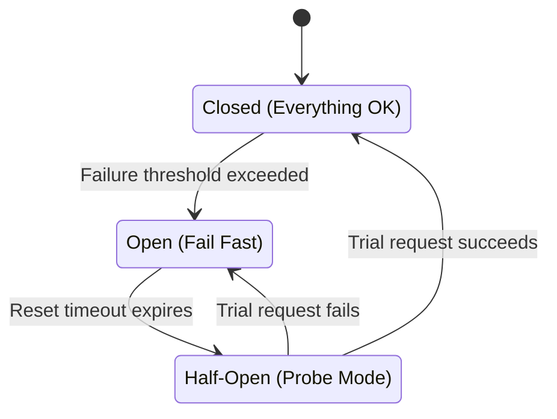

# Resilience

> Do not avoid failures. Embrace them!

According www.merriam-webster.com:

> **resilience**
>
> 1. the capability of a body to recover its size and shape after deformation caused especially by compressive stress
> 2. an ability to recover from or adjust easily to misfortune or change

In software development, resilience is the capacity of keep the software available, so it can deliver its business value.

$$\text{Availability} = \frac{\text{MTTF}}{\text{MTTF} + \text{MTTR}}$$

Where:

* $\text{MTTF}$: **M**ean **T**ime **T**o **F**ailure
  * The average between come up until it first failure is seen from outside
* $\text{MTTR}$: **M**ean **T**ime **T**o **R**ecovery
  * The average between the failure and its recovery

The closer the value is to 1, the better.

There is many types of failures:

* **crash failure**: the process halts and does nothing further. It does not recover on its own.
* **omission failure**: A process or communication channel fails to perform a required action.
  * Two common subtypes:
    - **Receive omission:** a message arrives but the process fails to receive it
    - **Send omission:** the process fails to send a message.
* **timing failure**: The process performs the correct action but outside the specified time bounds.
* **response failure**: The process responds, but the response is incorrect
  * This includes:
    * **Value failure**: the response value is wrong.
    * **State transition failure**: the process transitions to an incorrect state.

To increase the availability, there is two approaches:

* maximize \(\text{MTTF}\): clustered soluctions, redundancy

  * The catch is that this approach is limited on distruted system

    * > A distributed system is one in which the failure of a computer you didn't even know existed can render your own computer unusable.
      >
      > **Leslie Lamport**

    * Failures in today's complex, distruted and interconnected system are not the exception.

      * They are the normal case
      * They are not predictable
      * and it's getting "worse"
        * Cloud-based systems
        * microservices
        * zero downtime
        * IoT & Mobile
        * Social

    * So: Do not try to avoid failures. Embrace them.

* minimize \(\text{MTTR}\): if something goes wrong, you can recover it fast, or at least mitigate the problem.

  * this is resilience

In software development context:

> **resilience (IT)**
>
> the ability of a system to handle unexpected situations
>
> * without the user noticing it (best case scenario)
> * With a graceful degradation of service (worst case scenario)

## Patterns of resilience 

### Isolation

It is a high-level principle, to be used on the patterns

Isolation is:

* System must not fail as a whole
* Split system in parts and isolate parts against each other
* Avoid cascading failures
* Requires set of mesures to implement.

### Bulkheads

* Core isolation pattern
* a.k.a. "failures units" or "units of mitigation"
* Used as units of redundancy (and thus, also as units of scability)
  * notice that scalability can be understood as a form of successful resilience, since it reflects a system’s ability to handle an unexpectedly large increase in users.
* Pure design issue
  * it means that it is pure brain power, not framework could solve it

### Complete Paramter Checking

* As obvious as it sounds, yet often neglected

* Protections against broken or malicious data from both upstream and downstream calls.

  * Where
    * **Upstream**: Systems or clients that call your service. They send requests or input data into your component.
    * **Downstream**: Systems or services that your service calls. They return responses or data back to your component.
  * For example:
    * Database: do not blindly use data queried from database
      * the definition of "production database" is it's broken, that there is inconsistent records on it
      * normally, databases that have only consistent records is the test database. 

* Pay attention to Postel's law: "Be conservative in what you send, and liberal in what you accept."

  * in other words: "“Be conservative in what you do, and liberal in what you accept from others."

* Consider specific data types

  * Use the most precise data type available (e.g., separate enums, timestamps, IDs, flags) to reduce ambiguity and prevent invalid values.

  * Constrain ranges and formats to ensure only valid data is represented.

  * Avoid overly generic types (e.g., strings for everything), which increase the risk of malformed or unexpected data.

  * Validate type assumptions at boundaries to avoid downstream failures caused by incorrect or unexpected types.

  * ```java
    // How to design request parameters
    
    // Worst variant – requires tons of checks
    String buySomething(Map<String, String> params);
    
    // Still a bad variant – still a lot of checks required
    String buySomething(String customerId, String productId, int count);
    
    // Much better – only null checks required
    PurchaseStatus buySomething(Customer buyer, Article product, Quantity count);
    
    ```

### Loose Coupling

* Complements isolation

* Reduce coupling between failure units

* Avoid cascading failures

* Different approaches and patterns available

* Asynchrounous Communication

  * It's provides location transparency
    * Decouples sender from receiver
    * Sender does not need to know receiver's concrete location
    * Useful to implement redudancy and failover transparency 
    * Usually implemented using dispatchers or mappers.
  * Sender does not need to wait for receiver's response
  * Useful to prevent cascading failures due to failing/latent resources
  * Breaks up the call stack paradigm
  * It is not more complicated than synchrounous:
    * It’s difficult to understand the asynchronous communication flow and identify the producers and consumers, let alone figure out the entire communication network.
    * on synchrounous, you need timeouts, that when happens can be many things:
      * the call didn't reach the downstream resource.
      * it reached the downstream resource, but it broke.
      * it reached the downstream resource, and still processing
      * the response didn't reached the caller.
      * you starting to thinking things as retries, which makes it as complicated as asynchrounous communications.

  * There is two flavors of Asynchrounous Communication: Event-Driven and Message-Driven.

#### Event-Driven communication

The producer sends an event and does not track it further. Any interested consumers subscribe to the topic and receive the events.

* Without broker location depedency is reversed

  ```mermaid
  sequenceDiagram
      participant Sender
      participant Receiver
  
      Note over Sender,Sender: Sender contains the Topics
  
      Receiver-->>Sender: Subscribe to a Topic
  
      loop For each event published to the Topic
          Sender->>Sender: Publish event to the Topic
          Note right of Sender: Sender does not track the event further
          Sender-->>Receiver: Deliver event from the Topic
      end
  ```

* With broker location transparency is easily achieved

  ```mermaid
  sequenceDiagram
      participant Sender
      participant Broker
      participant Receiver
  
      Receiver-->>Broker: Subscribe to a Topic
  
      loop For each event published to the Topic
          Sender-->>Broker: Lookup
          Sender->>Broker: Send event
          Note right of Sender: Sender does not track the event further
          Broker-->>Receiver: Deliver event
      end
  ```

* Very different from request-response paradigm

  ```mermaid
  sequenceDiagram
      participant Client
      participant Server
  
      Client->>Server: Send request
      activate Client
      activate Server
  
      Note over Client,Client: Wait for the response
      Note over Server,Server: Process the request
  
      Server-->>Client: Return response
      deactivate Server
      deactivate Client
  ```

### Stateless

* Supports location transparency (amongst other patterns)
* Service relocation is hard with state
  * but you have to move the state
* Service failover is hard with state
  * but you have to replicate the state
* Scalability is hard you have to replicate the state across all the nodes
* Very fundamental resilience and scalability pattern
* Whenever possible, move state either upstream or downstream and keep the middle layer as stateless as you can.

### Relaxed Temporal Constraints

* Strict consistency requires tight coupling of the involved nodes
  * On stateful nodes, keeping strict consistency requires their replicated state to remain perfectly aligned at all times.
  * This eliminates temporal flexibility: stateful nodes cannot allow delayed updates, asynchronous propagation, or temporary divergence.
  * Enforcing this strict alignment forces tight coordination between the stateful nodes.
  * That tight coordination reduces availability because any delay or failure in one stateful node affects the others.

* Use a more relaxed consistency
  * Given the CAP theorem and the fact that partition tolerance is unavoidable in distributed systems, we must choose a trade-off between availability and consistency.
  * To maintain availability under partitions, consistency must often be relaxed.
  * Reconciling diverged state is unavoidable when partitions heal.
* The real world is not ACID, it is BASE (at best)
  * The physical world has no atomic, isolated, perfectly consistent transitions.
    * At best, real processes converge toward eventual consistency.
    * Often they remain temporarily or permanently inconsistent.

  * A common argument: “Consistency is so important that ACID transactions at all times are a business requirement. Eventual consistency isn’t an option.”
    * **Counter-argument**: “There isn’t any genuine business requirement for ACID transactions because the real world itself is not ACID. At best, real processes are eventually consistent; in many situations they’re simply inconsistent. So the business cannot logically require something reality doesn’t provide.”
    * **Counter-counter-argument**: “But take a bank account example: if I transfer money from one account to another, I absolutely need an ACID transaction.”
    * **Counter-counter-counter-argument**: “In the real world, when I transfer money, the amount disappears from my account immediately but only shows up in the recipient’s account hours or days later. There is no cross-bank ACID transaction happening — the system is inherently eventually consistent.”
      * PIX feels instantaneous, but it still isn’t a cross-bank ACID transaction — it just shrinks the eventual-consistency window to a few seconds, showing how high availability can create the illusion of strict consistency and seem to bend CAP.

  * ACID transactions have strong value, but as a programming model — not as a business requirement.
    * If eventual consistency makes the system too hard to build, choose ACID transactions — do it for your own sake, not because the business requires it.
    * Example: shopping cart
      * The business doesn’t require ACID for a shopping cart.
        * A cart can briefly show outdated or duplicated items without harming the business process.
          * The customer might see a product twice for a moment or see an old price until the page refreshes, but the business logic downstream—inventory reservation, payment, fulfillment—doesn’t break because of that momentary glitch.

        * Small inconsistencies don’t prevent the customer from completing an order.
          * Even if the cart takes a second to sync or correct itself, the customer can still check out, and the system can validate the final state before charging or shipping. The business cares about the order, not the intermediate flicker.

        * The workflow tolerates temporary mismatch because the final purchase is what matters.
          * What ultimately needs to be consistent is the submitted order, not every micro-update leading up to it. The cart is a preparatory workspace, not a financial ledger, so temporary inconsistencies don’t threaten business integrity.

      * Developers benefit enormously from using ACID anyway.
        * Treating cart updates as ACID transactions simplifies reasoning about state.
          * When every update is guaranteed to be atomic, you don’t have to juggle half-finished changes or wonder whether a user action finished before another one started. The mental model becomes: “each change happens cleanly, one at a time,” which dramatically reduces cognitive load.

        * You avoid partial writes, half-updated carts, and compensating logic.
          * Without ACID, you might need to detect and fix broken states—like a cart that updated the item quantity but failed to update the total price. ACID removes the need for all that defensive repair work because the whole update succeeds or fails as a unit.

        * The codebase stays cleaner and less error-prone, even though the business didn’t demand atomicity.
          * Engineers don’t have to build elaborate reconciliation paths or recovery workflows. Fewer edge cases means fewer bugs, easier testing, and more predictable behavior. ACID becomes a strategic simplifier for the development team, not a hard requirement from the business side.


### Idempotency

Idempotency means you can make the same call repeatedly and always get the same result, with no additional side effects from subsequent calls.

For example

1. `increase(1)` — not idempotent
 This one says: “Add one more coin to your hoard.”
    Call it once: value goes from 10 → 11.
    Call it again: 11 → 12.
    And again: 12 → 13.
    The same call keeps changing the state. The outcome depends on how many times you run it. That's the opposite of idempotent behavior. Each repetition amplifies the effect.

2. `set(5)` — idempotent
 This one says: “Your value *is* 5 now.”
    Call it once: variable becomes 5.
    Call it again: still 5.
    Call it a thousand times: still 5.
    The first call changes state, but every subsequent call leaves things unchanged. Repetition doesn’t compound anything.

Idempotency is important for resilience because:

* Non-idempotency is complicated to handle in distributed systems.
  * (Usually) increases coupling between participating parties
  * If you don’t get a response from a non-idempotent endpoint, you can’t blindly retry the call because you might accidentally trigger the operation twice.
* Use idempotent actions to reduce coupling between nodes
  * you can retry a idempotent endpoint
* Very fundamental resilence and scalability pattern.
* Turn a non-idempotent operation into an idempotent one by attaching a **unique request token** to each call, which the server checks before executing:
  - The client generates a fresh, collision-resistant token for every intended operation.
  - The server stores the token the first time it processes the request.
  - If the server receives the same token again—whether because of retries, network ghosts, or cosmic mischief—it recognizes the duplicate and skips re-execution.
    - the usual practice is to return the exact same response that was sent for the original request.
  - The client is then free to retry safely, since the token guards against accidental repetition.
  - In HTTP, this is often implemented by sending the token via a header such as `Idempotency-Key`, allowing intermediaries and the server to consistently identify repeated attempts.
    - Some APIs do add a hint header—for example, `Idempotency-Replayed: true`

### Self-Containment

* Services are self-contained deployment units
  * When a service bundles everything it needs to run, you cut out entire classes of failure. There’s no scrambling for missing libraries, conflicting versions, or environment drift between machines.
  * Fewer external assumptions → fewer runtime surprises.
* No dependencies to other runtime infrastructure components
  * If your service needs external runtime pieces (shared frameworks, local agents, legacy runtime services), every one of those becomes a single point of failure. Removing those dependencies simplifies the operational graph.
  * Fewer external dependencies → fewer cascading failures when something upstream breaks.
* Reduces coupling at deployment time
  * Deployment-time coupling is a quiet killer.
    * If Service A must wait for Service B’s environment, library update, or host configuration, you introduce coordinated deployment risk.
    * Self-containment lets each service deploy on its own schedule.
  * Independent deployability → faster recovery from failures, safer rollbacks, less downtime during releases.
* Improves isolation and flexibility
  * Isolation is central to resilience. If a service is insulated — its binaries, configs, runtime — it can fail without polluting neighbors. It also gains flexibility in scaling or relocating.
  * Stronger failure isolation and more options for remediation (move it, restart it, scale it, replicate it).

### Latency Control

* complements isolation
* detection and handling of non-timely responses
* avoid cascading temporal failures
* Different approachs and patterns available.

#### timeouts

* Preserve responsiveness indepedent of downstream latency
* Measure response time of downstream calls
* Stop waiting after a predetermined timeout
* Take alternative action if timeout was reached.
  * it is a business decision
    * is it ok to just delay the web server page?
    * is it so critical that you need to queue the request so they can be processed when the downstream service is back.

#### circuit breaker

* Probably most often cited resilience pattern
* Extension of the timeout pattern
* Takes downstream unit ofilline if calls fail multiple times 
* Specific variant of the fail fast pattern.
* The goal is:
  * Limit the impact of a failing or slow downstream service.
  * Fail fast instead of waiting on repeated timeouts.
  * Protect the caller’s resources (threads, connections, CPU).
  * Give the downstream service time to recover without being flooded.
  * Reduce the overall blast radius in a distributed system.
* This prevents
  * Thread pools getting saturated by blocked or waiting calls.
  * Latency spikes caused by repeated retries and long timeouts.
  * Cascading failures across dependent microservices.Unnecessary load on already-degraded downstream systems.
  * Systemwide instability when one component becomes unreliable.

##### How it works

It behaves like a **state machine** with three states:

*  **Closed (Everything OK)**
  * Calls flow normally to the external service.
  * Circuit breaker tracks failures.
  * If failures exceed a threshold (e.g., 5 errors in 30s), it flips to **Open**.
* **Open (Fail Fast)**
  * All calls fail immediately without contacting the dependency.
  * A timer starts (the “cool-down” or “reset timeout”).
* **Half-Open (Probe Mode)**
  * When the timeout expires:
    - Breaker allows a limited number of trial requests through.
    - If a request succeeds → breaker closes (normal state again).
    - If a request fails → breaker returns to Open immediately.



### Fail Fast

> "If you know you're going to fail, you better fail fast"

What it is:

- Detects invalid states, bad inputs, or wrong assumptions immediately.
- Stops execution early instead of continuing under uncertain or corrupted conditions.
- Surfaces errors clearly and loudly at the moment they occur.
- Prevents faulty data or logic from propagating deeper into the system.
- Common mechanisms: assertions, input validation, design-by-contract, boundary guards.

Benefits for resilience:

- Keeps failures predictable and contained, reducing blast radius.
- Prevents small defects from cascading into larger, harder-to-debug failures.
- Improves observability through explicit early errors, enabling faster root-cause analysis.
- Shortens the feedback loop, speeding up correction, adaptation, and iteration.
- Maintains internal system stability by rejecting invalid conditions at boundaries.
- Reduces silent degradation, helping the system recover faster and behave consistently under stress.

### Fan out & quickest reply

* Send request to multiple workers
* Use quickest reply and discard all other responses
* Reduces probability of latent responses
* Tradeoff is "waste" of resources

### Bounded Queues

* Limit request queue sizes in front of highly utilized resources
  * if the queue is full, simply don't accept any request anymore (backpressure).
* Avoid latency due to overloaded resources
  * longer the queue, longer will be the latency
* Introduces pushback ont he callers
* Another variant of the fail fast pattern

### Shed Load

* upstream isolation pattern
* avoid becoming overloaded due to too many requests.
* Install a gatekeeper in front of the resource
* Shed requests based on resource load

### Supervision

* Most patterns aim to make individual components resilient and capable of operating independently, even when other parts of the system fail or behave unpredictably.
* The ultimate goal is to keep the entire system functioning as a cohesive whole.
* Effective supervision must:
  - Provide failure handling that goes beyond what a single failure unit can manage
  - Detect unit-level failures
  - Support controlled error escalation

There are different approaches and patterns available 

#### Monitor

- Observe unit behavior and interactions from the outside
- Automatically respond to detected failures
  - Simply notifying an administrator is insufficient—failures are routine and constant.
  - Don’t drive operators to burnout; embed self-healing behavior directly into the system.
- Part of the system – complex failure handling strategies possible
- Outside the system – more robust against system-level failures
See [05 Observability](05%20Observability.md)
#### Error Handler

* Units often don’t have enough time or information to handle errors

  * Operational components—services, actors, functions—are typically optimized for throughput and responsiveness.
  * They lack broader system context or sufficient processing time to diagnose and resolve errors.
  * For resilience, don't overload these components with error-handling complexity.

* Separate business logic and error handling

  * Mixing domain logic with error-recovery logic creates brittle code and increases cognitive load.
  * A resilient system isolates error-handling responsibilities so failures are addressed consistently and predictably, without contaminating normal execution paths.

* Business logic just focuses on getting the task done (quickly)

  * Your core components should do one thing: process requests efficiently.
  * They shouldn’t get bogged down figuring out what to do during edge cases or failures.
  * This keeps latency low and behavior predictable under load.

* Error handler has sufficient time and information to handle errors

  * A dedicated error-handling component—supervisor, controller, retry engine, orchestrator—can take a broader view.
  * It can analyze context, apply rules, schedule retries, escalate, or restart units.
  * Because it isn't tied to request latency constraints, it can make deliberate, system-level decisions that increase resilience.

* A common pattern for erro handling is escalation

  * An escalation peer with broader context and more time is required to handle unresolved problems.

  * Escalation commonly forms multi-level hierarchies separate from normal control and data flow.

  * Distributed systems cannot rely on propagating exceptions back to the caller; the caller neither understands nor can act on internal failure details.

    * Callers should only receive actionable outcomes (e.g., success, failure, retry later) — not stack traces or internal diagnostics.

  * Escalated errors must be routed to a supervisor or dedicated component designed to handle them.

    * Supervisors decide recovery actions (restart, backoff, replacement, shutdown) while keeping callers shielded from internal complexity.

  * Often multi-level hierachies

    ```mermaid
    graph LR
      %% Workers (flow / process, left to right)
      W1([W]) --> W2([W]) --> W3([W]) --> W4([W]) --> W5([W]) --> W6([W]) --> W7([W])
    
      %% First-level supervisors
      S1((S))
      S2((S))
      S3((S))
    
      %% Second-level supervisors
      S4((S))
      S5((S))
    
      %% Top supervisor
      S6((S))
    
      %% Supervision relations (escalation upwards)
      W1 --- S1
      W2 --- S1
      W3 --- S2
      W4 --- S2
      W5 --- S3
      W6 --- S3
      W7 --- S3
    
      S1 --> S4
      S2 --> S4
      S3 --> S5
      S4 --> S6
      S5 --> S6
    ```


## Sources

* [Patterns of resilience - the untold stories of robust software design by Uwe Friedrichsen](https://www.youtube.com/watch?v=T9MPDmw6MNI)


To study:

* https://youtu.be/gm6Y4vPlOLg?si=U-ppS0ix77-kuTj2
* https://youtu.be/FjsrxNjnCWM?si=_Kd4w9SkMM87nq9I
