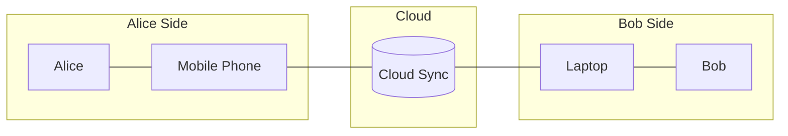

# Risk Management and Threat Modeling

A project's architecture is a model of that project; in essence, an overall understanding of its mechanisms. Thus, the former is as lively and dynamic as the latter. To visualize this: given the project as a three-dimensional object, the architecture is a two-dimensional projection whose angle varies depending on the viewpoint (e.g., the user, the developer, the compliance auditor, or the attacker).

## Vulnerabilities

In Information Security, the primary viewpoint is the attacker's perspective: the attack surface, which is the set of all points and elements that could contain vulnerabilities.

A vulnerability is a flaw or weakness in the project's architecture that can be exploited by a threat. From the attacker's perspective, it is a 'gap' that allows unauthorized access or action.

To identify vulnerabilities, you must analyze each element of your architecture and ask: 'Is this element weak?' or 'Is this element more vulnerable than others?'

To ground the discussion, consider a simple communication flow between Alice, a cloud synchronization service, and Bob. This example is only an introduction for threat modeling here; the same scenario also appears in [network protection controls](../05%20Architecture%20and%20Infrastructure%20Security/Network%20Security/01%20Network%20Security.md).

Alice Side

* "Is this a BYOD (Bring Your Own Device) scenario or a managed corporate device?"
* "How secure are the authentication methods on her phone?"
* "Does the Alice possess adequate security awareness to protect their device?"
  * **Human Factor**: Vulnerabilities do not only exist in hardware and software; they can also exist in human behavior.

Cloud

* "Is the physical location of the infrastructure secure?"
* "Are the authentication methods for administrative accounts secure (e.g., is MFA enabled)?"

Communication

* "Is the communication encrypted in transit?"
* "Can the attacker launch an availability attack (e.g. DDoS) on the network link?"
* "Can the attacker reroute the communication, to spoof the cloud?"

IoT devices can materially expand this kind of [attack surface](../05%20Architecture%20and%20Infrastructure%20Security/IoT%20Security.md).
### Causes of Vulnerability

Vulnerabilities can originate from a wide variety of sources, ranging from software flaws to human behavior. An organization's cybersecurity leaders must strive to maintain maximum visibility and control over these potentially vulnerable vectors.

Common causes of vulnerability include:

- **Complex Systems:** Highly complex network and system architectures increase the probability of misconfigurations, unseen flaws, or unintended access pathways.
- **Familiarity:** Attackers are often highly familiar with common, widely used codebases, operating systems, hardware, and software. This familiarity allows them to easily exploit known, unpatched vulnerabilities.
- **Connectivity:** Highly connected networks and devices (such as IoT devices) present a larger attack surface, making them more prone to exposure and vulnerabilities.
- **Poor Password Management:** The use of weak, default, or reused passwords can easily turn a single compromised account into a massive, widespread data breach.
- **Operating System Flaws:** Operating systems can contain inherent flaws. Furthermore, OSs that are not configured to be secure by default might grant users unnecessary administrative privileges, making the entire system a prime target for malware.
- **Internet Exposure:** The internet is rife with malicious elements, such as spyware and adware, which can exploit browser or network vulnerabilities to install themselves automatically on unprotected machines.
- **Software Bugs:** During development, programmers may accidentally leave coding errors, logic flaws, or exploitable bugs within the software.
- **Unverified User Input:** If a software application or website blindly assumes that all user input is safe without properly validating and sanitizing it, it becomes highly susceptible to execution attacks, such as unintended SQL Injections (SQLi).
- **People (Human Factor):** Humans are consistently one of the greatest causes of vulnerability. Because technical controls can often be bypassed by tricking an authorized user, social engineering remains the single largest threat to most organizations.
### **Common Security Vulnerabilities**

Vulnerabilities are weaknesses within an organization's control. By employing the right tools and procedures, these can be managed and mitigated before they are exploited.

#### **Technical & Architectural Gaps**

- **System Configuration Errors:** Disparate security controls or vulnerable settings create gaps. Attackers actively probe networks specifically looking for these misconfigurations.
- **Insecure APIs:** Since APIs often have public IP addresses and act as the digital interface for application communication, they are high-priority targets. Failure to secure these endpoints provides an easy entry point into the network.
- **Poor Encryption:** Missing or weak encryption allows adversaries to intercept communications, extract sensitive data, and even inject false information into servers.
- **Outdated Software:** Hackers target unpatched systems. Implementing a rigorous patch management schedule—applying updates as soon as they are released—is the primary defense against these "easy targets."
#### **Access & Identity Risks**

- **Weak Authentication:** Brute force attacks and credential guessing are common. Beyond technical enforcement, employee education on password hygiene is essential to prevent exploitation. 
- **Unauthorized Access:** Granting more permissions than necessary expands the "blast radius" of a breach. Organizations should enforce the **Principle of Least Privilege (PoLP)**, ensuring users have only the access required for their specific tasks.
- **Malicious Insider Threats:** Employees with legitimate access can intentionally or accidentally compromise a network. Combating this requires network segmentation based on role and expertise, as well as robust access control solutions.
#### **The Cloud Context**

- **Shared Responsibility Model:** In cloud environments, the provider secures the underlying infrastructure, but the organization is responsible for the operating system, applications, and data. Misunderstanding these boundaries often leads to runtime threats and exposed data.
### Vulnerability Assessment

Risk management depends on a repeatable way to identify, validate, and prioritize weaknesses before they become incidents. The dedicated note [Vulnerability Assessment](05%20Vulnerability%20Assessment.md) covers the assessment process, common assessment types, the vulnerability-management lifecycle, and how **CVSS** helps classify severity for remediation planning.
## Threats

Threats are factors or actions capable of compromising at least one of the [tenets](01%20Security%20Principles.md#The%20tenets).
* Threat Actor is the entity who launches the threat.
* Threat Vector is is the means by which an attacker exploits a vulnerability.

For example, given the architecture aforementioned:

* **Vulnerability:** Lack of encryption on the network link.
* **Threat:** Eavesdropping / Interception of sensitive data.
* **Threat Actor**: Charlie - the attacker
* **Threat Vector**: Alice’s unsecured or poorly protected Wi-Fi network.

Another example:

- **Vulnerability**: An unpatched API on the Cloud server.
- **Threat:** Data breach / SQL Injection.
- **Threat Actor:** A malicious script kiddie.
- **Threat Vector:** The **Public Internet** (the web-facing interface).

While the security risks for Bob's side mirror Alice's, the attack vectors differ due to the nature of the device (Laptop vs. Mobile):

| **Feature**           | **Alice's Side (Phone)**                         | **Bob's Side (Laptop)**                                      |
| --------------------- | ------------------------------------------------ | ------------------------------------------------------------ |
| **OS Environment**    | Usually "Walled Garden" (App Store/Play Store).  | Open environment (can install anything from the web).        |
| **Physical Security** | High risk of being **lost/stolen** in public.    | Risk of **unauthorized peripherals** (e.g., malicious USB/Rubber Ducky). |
| **Connectivity**      | Often on 5G/LTE (more secure than public Wi-Fi). | Often on **Public Wi-Fi** (higher risk of MitM attacks).     |
| **Software**          | Harder to run "unsigned" scripts.                | Easy to execute **malicious scripts/binaries** (.exe, .sh).  |

### Threat Modeling Framework: STRIDE

To systematically identify threats within an architecture rather than guessing, security teams often utilize the **STRIDE** methodology. Developed by Microsoft, STRIDE breaks down threats into six distinct categories based on the attacker's objective:

| **Threat Category** | **Security Tenet Violated** | **Description & Example** |
| :--- | :--- | :--- |
| **S**poofing | Authenticity / Identity | Pretending to be something or someone else.  *Example: An attacker spoofing the Cloud Sync server to intercept Alice's data.* |
| **T**ampering | Integrity | Maliciously modifying data in transit or at rest.  *Example: Altering the contents of a file during synchronization.* |
| **R**epudiation | Non-repudiation | Claiming an action or transaction didn't happen because of poor logging.  *Example: A user deleting a critical cloud backup and denying they did it.* |
| **I**nformation Disclosure | Confidentiality | Exposing sensitive data to unauthorized parties.  *Example: Sniffing Alice's unencrypted data over public Wi-Fi.* |
| **D**enial of Service | Availability | Booting legitimate users off a system or crashing services.  *Example: Launching a DDoS attack on the Cloud Sync infrastructure.* |
| **E**levation of Privilege | Authorization | Gaining a higher level of access than permitted.  *Example: Exploiting an unpatched API flaw to gain admin control over the Cloud server.* |

By mapping your architecture's data flows against these six categories, you can uncover hidden vulnerabilities before they are exploited.

## Risk

Risk is the likelihood that a threat will exploit a vulnerability, resulting in a negative impact or loss. Given the 3D object analogy of a project, if a vulnerability is a "gap" in your architectural projection and a threat is the force seeking it, risk is the calculation of how likely they are to meet and how much damage that encounter would cause:

$$Risk = Likelihood \times Impact$$

Where impact is is typically measured in terms of [the tenets](01%20Security%20Principles.md#The%20tenets), while likelihood is assessed through attacker modeling.

Attacker Modeling is an exercise of putting yourself in the attacker's shoes. You can build a threat actor profile based on three pillars (often called the M.O.C. Triangle):

- **Capability (Means)**: The level of skill, tools, and resources (e.g., a "script kiddie" vs. a "state-sponsored actor").
- **Motivation (Motive)**: The "why" behind the attack (e.g., financial gain, social status/ego, hacktivism, disgruntled employees, or corporate espionage/sabotage).
- **Opportunity**: The existence of a vulnerability and the "window" to exploit it without being detected.

Attacker modeling will always be inherently incomplete; nonetheless, it is essential because it enables risk prioritization.

### Risk Assessment and Identification

A formal risk assessment identifies the sources, causes, and consequences of potential security events. It requires prioritizing IT assets that are essential to business objectives.

**Key elements include:**

- **Asset Mapping:** Documenting critical digital assets (systems, data, and processes) most likely to be targeted.
- **Threat Intelligence:** Maintaining a knowledge base of global cyber threats to understand the current threat landscape.
- **Impact Evaluation:** Measuring potential losses across financial and operational dimensions.
- **Residual Risk:** Identifying risks for which no mitigation strategy currently exists, requiring them to be escalated or accepted.

### The Risk Management Process

Effective management is not a one-time event but a continuous four-step cycle:

1. **Identification:** Evaluating the environment to find current or potential risks.
2. **Assessment:** Analyzing the likelihood and potential impact of those risks.
3. **Control:** Defining the methods, technologies, or procedures (like endpoint access controls) to mitigate them.
4. **Review:** Continually evaluating the effectiveness of these controls and adjusting them as the environment changes.
### Risk Treatment Strategies

There are four primary ways to handle an identified risk:

- **Avoid:** Stop the activity that creates the risk (e.g., disabling a high-risk legacy feature).
- **Mitigate:** Take action to reduce the impact or likelihood (e.g., implementing robust authentication or training staff).
- **Transfer:** Shift the responsibility to another party, often through cybersecurity insurance or outsourcing.
- **Accept:** Acknowledge the risk when it cannot be avoided, mitigated, or transferred, ensuring the potential outcomes are understood and documented.
### Establishing a Management Plan

A robust plan documents how risks will be assessed, who is responsible, and the frequency of reviews.

- **Assigning Roles:** Typically led by a **Chief Information Security Officer (CISO)** or a dedicated risk committee.
- **Awareness and Training:** Ensuring staff across all departments can recognize threats like social engineering.
- **Documentation:** The entire plan must be documented and presented to senior leadership to ensure cross-departmental alignment and commitment.
