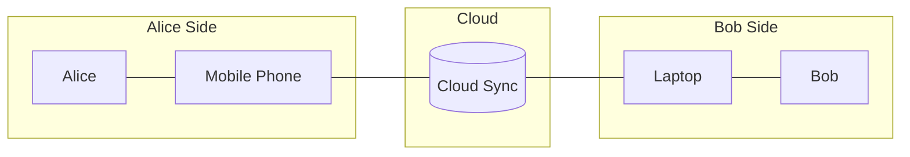

# Risk Management and Threat Modeling

A project's architecture is a model of that project; in essence, an overall understanding of its mechanisms. Thus, the former is as lively and dynamic as the latter. To visualize this: given the project as a three-dimensional object, the architecture is a two-dimensional projection whose angle varies depending on the viewpoint (e.g., the user, the developer, the compliance auditor, or the attacker).

### Vulnerabilities

In Information Security, the primary viewpoint is the attacker's perspective: the attack surface, which is the set of all points and elements that could contain vulnerabilities.

A vulnerability is a flaw or weakness in the project's architecture that can be exploited by a threat. From the attacker's perspective, it is a 'gap' that allows unauthorized access or action.

To identify vulnerabilities, you must analyze each element of your architecture and ask: 'Is this element weak?' or 'Is this element more vulnerable than others?'

Alice Side

* "Is this a BYOD (Bring Your Own Device) scenario or a managed corporate device?"
* "How secure are the authentication methods on her phone?"
* "Does the Alice possess adequate security awareness to protect their device?"
  * **Human Factor**: Vulnerabilities do not only exist in hardware and software; they can also exist in human behavior.

Cloud

* "Is the physical location of the infrastructure secure?"
* "Are the authentication methods for administrative accounts secure (e.g., is MFA enabled)?"

Communication

* "Is the communication encrypted in transit?"
* "Can the attacker launch an availability attack (e.g. DDoS) on the network link?"
* "Can the attacker reroute the communication, to spoof the cloud?"

**Remark:**

> **The IoT (Internet of Things) Factor**: IoT devices often represent the "weakest link" in an architecture. They significantly expand the attack surface because they are frequently designed with limited computational resources, making robust encryption and complex authentication difficult to implement. Furthermore, many IoT devices ship with **hardcoded default credentials** and lack a streamlined mechanism for firmware updates, leaving known vulnerabilities unpatched for years. In the provided architecture, an insecure smart device on Alice’s network could serve as an entry point for an attacker to move laterally toward her phone or the cloud.

### Threats

Threats are factors or actions capable of compromising at least one of the [security tenets](./01 Security Principles.md#the-tenets).

* Threat Actor is the entity who lauches the threat.
* Threat Vector is is the means by which an attacker exploits a vulnerability.

For example, given the architecture aforementioned:

* **Vulnerability:** Lack of encryption on the network link.
* **Threat:** Eavesdropping / Interception of sensitive data.
* **Threat Actor**: Charlie - the attacker
* **Threat Vector**: Alice’s unsecured or poorly protected Wi-Fi network.

Another example:

- **Vulnerability**: An unpatched API on the Cloud server.
- **Threat:** Data breach / SQL Injection.
- **Threat Actor:** A malicious script kiddie.
- **Threat Vector:** The **Public Internet** (the web-facing interface).

While the security risks for Bob's side mirror Alice's, the attack vectors differ due to the nature of the device (Laptop vs. Mobile):

| **Feature**           | **Alice's Side (Phone)**                         | **Bob's Side (Laptop)**                                      |
| --------------------- | ------------------------------------------------ | ------------------------------------------------------------ |
| **OS Environment**    | Usually "Walled Garden" (App Store/Play Store).  | Open environment (can install anything from the web).        |
| **Physical Security** | High risk of being **lost/stolen** in public.    | Risk of **unauthorized peripherals** (e.g., malicious USB/Rubber Ducky). |
| **Connectivity**      | Often on 5G/LTE (more secure than public Wi-Fi). | Often on **Public Wi-Fi** (higher risk of MitM attacks).     |
| **Software**          | Harder to run "unsigned" scripts.                | Easy to execute **malicious scripts/binaries** (.exe, .sh).  |

### Risk

Risk is the likelihood that a threat will exploit a vulnerability, resulting in a negative impact or loss. Given the 3D object analogy of a project, if a vulnerability is a "gap" in your architectural projection and a threat is the force seeking it, risk is the calculation of how likely they are to meet and how much damage that encounter would cause:

$$Risk = Likelihood \times Impact$$

Where impact is is typically measured in terms of the [security tenets](./01 Security Principles.md#the-tenets), while likelihood is assessed through attacker modeling.

Attacker Modeling is an exercise of putting yourself in the attacker's shoes. You can build a threat actor profile based on three pillars (often called the M.O.C. Triangle):

- Capability (Means): The level of skill, tools, and resources (e.g., a "script kiddie" vs. a "state-sponsored actor").

- Motivation (Motive): The "why" behind the attack (e.g., financial gain, social status/ego, hacktivism, disgruntled employees, or corporate espionage/sabotage).

- Opportunity: The existence of a vulnerability and the "window" to exploit it without being detected.

Attacker modeling will always be inherently incomplete; nonetheless, it is essential because it enables risk prioritization.
