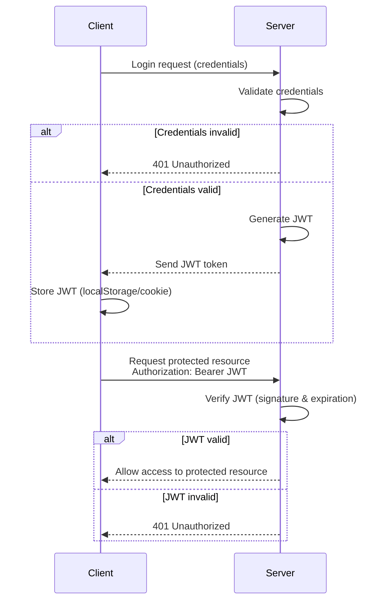
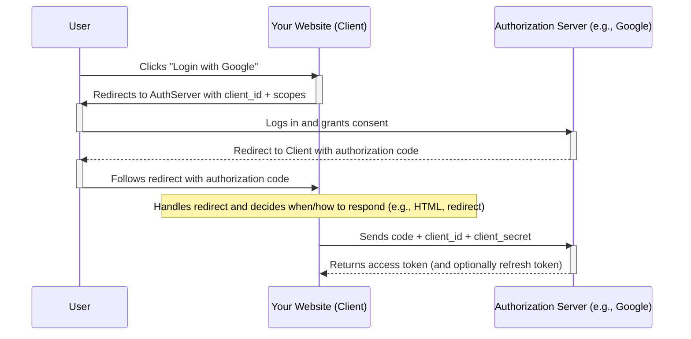

# Authentication

At its core, **authentication** is the process of verifying that a user or system is who they claim to be. While "identification" is the act of presenting an identity (like a username), authentication is the "proof" phase—the digital equivalent of a security guard checking your ID card against your face to ensure a match.

## The Five Factors of Authentication
Security professionals categorize authentication methods into three classic categories and two modern, context-based factors. No single factor is foolproof. Understanding the weaknesses of each is critical for designing a robust security posture.

### Classic Factors
* **Knowledge (Something you know):** Information the user remembers, such as a password, PIN, or the answer to a security question.
  * **Examples**: Passwords, PINs
  * **Primary Vulnerabilities**: Phishing, brute-force attacks, and social engineering.

* **Possession (Something you have):** A physical or digital object, such as a smartphone (for SMS codes), a hardware token (YubiKey), or an access card.
  * **Examples**: Key fobs, Smartcards
  * **Primary Vulnerabilities**: Physical theft, loss, or digital cloning/interception.

* **Inherence (Something you are):** Biological traits unique to the individual, such as fingerprints, retina scans, or facial recognition.
  * **Examples**: Biometrics
  * **Primary Vulnerabilities**: Spoofing (deepfakes/silicone prints).
    * **High Impact:** Biometric data cannot be "reset" if compromised.


### Modern Factors
* **Location (Somewhere you are):** Utilizing GPS coordinates or IP addresses to ensure the login attempt is coming from a trusted or expected geographic area.
  * **Examples**: Geofencing, IP
  * **Primary Vulnerabilities**: Can be bypassed using VPNs, proxies, or GPS spoofing apps.

* **Behavior (Something you do):** Analyzing patterns like typing speed (keystroke dynamics), mouse movement, or gait.
  * **Examples**: Keystroke dynamics
  * **Primary Vulnerabilities**: High false-rejection rates if the user is tired, injured, or using new hardware.

## Strengthening Security
Because every individual factor has a "breaking point," modern security relies on layered defense strategies.

### Multi-Factor Authentication (MFA)
To achieve the highest level of assurance, organizations combine two or more independent factors. For example, requiring a **Password** (Knowledge) and a **Mobile Push Notification** (Possession). This ensures that even if a password is stolen, the attacker cannot gain access without the physical device.

### Adaptive (Risk-Based) Authentication
In dynamic environments, **Adaptive Authentication** provides a balance between security and user experience. Instead of challenging the user every time, the system evaluates the context of the login.
> **Example:** If a employee logs in from their usual office desktop, they may only need a password. However, if they suddenly attempt to log in from a different country at 3:00 AM, the system "steps up" the security, demanding a biometric scan or a hardware token to proceed.

## Methods

This section details the technical protocols and frameworks selected to handle identity verification and authorization within the system. To ensure a robust security architecture, we utilize a tiered approach that scales from simple credential exchange to complex delegated authorization.

This is a solid technical breakdown. To make it more professional and readable, I’ve refined the terminology (specifically distinguishing between **encoding** and **encryption**) and organized the flow to better highlight the "Challenge-Response" mechanism.

### API Key & Secret

While usernames and passwords are designed for human memory, **API Keys and Secrets** are designed for system-to-system (M2M) communication. They allow applications to interact securely without human intervention.

#### The Components

An API credential set typically consists of two distinct parts:

- **API Key (The Identifier):** This acts as a public "username" for the application. It tells the server *which* project or client is making the request.
  - *Also known as:* Client ID, Public Key, App ID.
- **API Secret (The Proof):** This acts as the "password." It is a long, cryptographically strong string that should never be shared or exposed in client-side code (like HTML or JavaScript).
  - *Also known as:* Client Secret, Private Key, Secret Token.

#### Implementation Strategies

As you noted, "API Key/Secret" isn't a single protocol but a concept that can be implemented in several ways:

* **Basic Authentication**: The Client ID and Secret are sent in the `Authorization` header as a Base64 string.
* **Custom Headers**: Credentials are sent via proprietary headers, such as `X-API-KEY: [key]` and `X-API-SECRET: [secret]`.
* **Digital Signatures (HMAC)**: The secret is **never sent** over the wire. Instead, the client uses the secret to "sign" the request data. The server performs the same calculation; if the signatures match, the request is authentic.
* **Token Exchange**: The client exchanges the Key and Secret for a temporary **JWT** or **OAuth Token**, which is then used for subsequent requests.

#### Security Best Practices

Because these strings are long and random, they are highly resistant to brute-force attacks, but they are still vulnerable if mishandled.

- **Encryption at Rest:** Secrets should be stored in a dedicated Secret Manager (like AWS Secrets Manager or HashiCorp Vault), never hard-coded in the source code.
- **Principle of Least Privilege:** An API key should only have access to the specific resources it needs (Scopes).
- **Rotation:** Unlike human passwords, API secrets should be rotated automatically every 30–90 days to minimize the impact of a potential leak.
- **Secret vs. Signature:** Be careful with terminology:
  - An **API Secret** is a static string.
  - A **Digital Signature** is a dynamic piece of data generated *using* that secret. Using signatures is much more secure because the secret itself is never transmitted.

#### Example: API Key in a Request

If you were using custom headers, a request might look like this:

```http
GET /v1/data HTTP/1.1
Host: api.provider.com
X-Client-ID: app_987654321
X-Client-Secret: shhh_dont_share_this_secret
```

### Basic Authentication

Basic Authentication is the simplest method for a client to provide credentials to a server. While it is easy to implement, its simplicity comes with significant security trade-offs that require careful handling.

#### How It Works

The authentication process follows a specific header-based exchange:

1. **The Header:** The client includes an `Authorization` header in its request.
2. **The Value:** The header value is formatted as `Basic [encoded]`.
3. **The Encoding:** The `[encoded]` string is a **Base64** representation of `username:password`.
   - *Example:* `admin:p@ssword123` becomes `YWRtaW46cEBzc3dvcmQxMjM=`.
4. **The Response:**
   * **Success:** The server validates the credentials and returns a `200 OK`.
   * **Failure:** The server returns a `401 Unauthorized`.

#### The Challenge-Response Mechanism

If a client attempts to access a protected resource without credentials, the server "challenges" the client:

- **Status Code:** `401 Unauthorized`.
- **Header:** `WWW-Authenticate: Basic realm="[string]"`.
  - **The Realm:** The `realm` (e.g., "Prometheus Login") is a string that identifies the protected area, which the browser typically displays in the login prompt.


**Example: Nginx Configuration**

```nginx
location /metrics {
    auth_basic           "Prometheus Login";
    auth_basic_user_file /etc/nginx/.htpasswd;
}
```

If the user visits `/metrics` without a header, Nginx sends the `401` challenge, triggering the browser's native login pop-up.

#### Critical Vulnerabilities & Limitations

* **No Encryption**: Base64 is **encoding, not encryption**. Anyone intercepting the traffic can trivially decode the string. 
  * **Mandatory:** Only use Basic Auth over **HTTPS**.
* **Credential Exposure**: The client must send the username and password with *every single request*. This increases the "surface area" for credential theft.
* **State vs. REST**: While sending credentials every time is technically "stateless" (aligning with REST principles), it is inefficient. If the server starts storing session data to avoid re-verifying, it violates pure REST architecture.
* **Logout Issues**: There is no standard "logout" button for Basic Auth; the browser caches the credentials until the session is closed or cleared manually.

This is a great addition to your documentation. You've correctly identified that API keys and secrets are essentially "passwords for machines."

To improve this, I’ve refined the distinction between **identification** and **authentication**, and clarified how a "secret" differs from a "digital signature"—as they are often used together but aren't exactly the same thing.

### HMAC

It is one of the most secure ways to use an API Secret because, unlike Basic Auth, **the secret itself is never sent over the network.** HMAC is not meant to hide your data; it’s meant to prove the data is legitimate.
* Developers call HMAC a "Digital Signature" because the *workflow* is the same: you take data + a secret, run it through a function, and attach the result to the header, however, HMAC (Hash-based Message Authentication Code) is technically a Message Authentication Code (MAC). 

#### The Core Concept: Signing, Not Sending
The fundamental problem with sending an API Secret (like in Basic Auth) is that if the connection is intercepted, the secret is stolen. HMAC solves this by using the secret as a "key" to create a unique mathematical fingerprint (a signature) of the request.

Instead of sending the secret, the client sends:
1.  **The Message:** The data they want to send (URL, timestamp, body).
2.  **The Signature:** A hash generated by combining the message with the secret. [See more](../03 Cryptography and Data Protection/01 Cryptography.md#keyed-hashing-hmac).

#### How the HMAC Handshake Works
Think of it like a wax seal on a letter. Only the sender and receiver have the unique ring (the secret) to create or verify that specific seal.

1. **Preparation:** The client identifies the data to be signed (e.g., the HTTP method, the URI, and a timestamp).

2. **Hashing:** The client uses a hashing algorithm (like **SHA-256**) and their **API Secret** to calculate the HMAC.

3. **Transmission:** The client sends the request, including their **API Key** (to tell the server who they are) and the **Signature**, but *not* the Secret.

   * It uses [Keyed-Hashing](../03 Cryptography and Data Protection/01 Cryptography.md#keyed-hashing-hmac).
   * Encryption should not replace a digital signature; the latter ensures **authenticity** and **integrity**, whereas encryption does not. For example, without a signature, an attacker could replay or concatenate encrypted blobs to impersonate a legitimate party.

4. **Verification:** The server looks up the Secret associated with that API Key. It performs the exact same hash calculation on the incoming request data.

5. **Validation:** If the server’s calculated signature matches the one sent by the client, the request is authentic. If even one character in the message was changed, the signatures won't match.

#### Why Use HMAC?

* **Integrity**: Ensures the message wasn't tampered with during transit. If a hacker changes the "amount" in a transaction, the signature becomes invalid.
* **Authenticity**: Proves the request came from someone who possesses the secret.
* **Replay Protection**: By including a **timestamp** or a **nonce** (a random one-time number) in the signature, you can ensure that an intercepted request cannot be "replayed" by an attacker later.
* **Secret Privacy**: The secret never leaves the sender's or receiver's environment.

#### Implementation Example
In a real-world API, the request headers might look like this:

```http
GET /api/v1/account/balance HTTP/1.1
Host: secure-bank.com
X-API-Key: app_12345
X-Timestamp: 2026-04-12T17:30:00Z
X-Signature: 7e9b234a6d... (The result of hashing the request + secret)
```

#### Digital Signature vs. HMAC
It is important to note the technical difference for your documentation:
* **HMAC (Symmetric):** Uses a **single private key** known by both the sender and the receiver. It is fast and efficient for APIs.
* **Digital Signature (Asymmetric):** Uses a **Private Key** to sign and a **Public Key** to verify (like RSA). This is common in JWTs and SSL/TLS certificates.

### JSON Web Tokens (JWT)

At its core, a JSON Web Token (JWT) is a mechanism that contains all the necessary data a server needs to authenticate a user. Instead of maintaining stateful sessions on the backend, the server issues a JWT to the client, which the client then presents to prove its identity and access protected resources.

#### The Anatomy of a JWT

A standard JWT is transmitted as a single string consisting of three distinct parts separated by dots (`.`). The token is constructed using the following formula:

```scss
Base64UrlEncode(header) + "." + Base64UrlEncode(payload) + "." + Base64UrlEncode(signature)
```

- **The Header:** This JSON object typically dictates two things: the type of token (which is "JWT") and the signing algorithm being used, such as HMAC SHA256 (HS256).
  ```json
  {
    "alg": "HS256",
    "typ": "JWT"
  }
  ```
- **The Payload:** This section contains the core data regarding the user, which are referred to as "claims".
  ```json
  {
    "sub": "1234567890",
    "name": "John Doe",
    "admin": true,
    "iat": 1516239022
  }
  ```
- **The Signature:** This critical component verifies that the token was not altered in transit. It is generated by taking the encoded header, the encoded payload, and signing them together using a secret (or a private key)—a process utilizing [Keyed-Hashing-based](../03 Cryptography and Data Protection/01 Cryptography.md#keyed-hashing-hmac) on the algorithm specified in the header. While this acts similarly to a digital signature by ensuring integrity and authenticity, it is important to remember that the payload itself is only Base64 encoded, not encrypted.

#### Understanding Payload Claims

The payload carries the claims, which are declarative statements about an entity (typically the user) alongside metadata. There are three primary classifications for these claims:

1. **Registered Claims:** These are a set of optional but highly recommended fields defined by the JWT RFC 7519 specification to provide standardized, interoperable data points. Common examples include:
   - `iss` (issuer) Identifies who created and signed the token. It helps verify the token came from a trusted source.
   - `sub` (subject) Identifies the subject of the token — usually a user ID or username. It tells *who* the token is about.
   - `aud` (audience) Specifies the intended recipient(s) of the token. The app or service using the token should check this.
   - `exp` (expiration time) Defines when the token will expire. After this time, it should no longer be accepted.
   - `iat` (issued at) Indicates when the token was created. Useful for determining token age.
   - `nbf`  (not before) Sets a time before which the token is not valid. The token becomes valid only after this time.
2. **Public Claims:** Maintained by organizations like IANA, [these claims](https://www.iana.org/assignments/jwt/jwt.xhtml#claims) have universally understood meanings across different systems and products. Standard examples include `name`, `given_name`, `email`, and `email_verified`.
3. **Private Claims:** These are non-standard, custom claims created to share specific information between agreeing parties.
   - **Best Practice:** To prevent naming collisions—especially when a JWT is utilized across multiple APIs—it is strongly recommended to prefix private claims with a domain identifier (e.g., `"https://billing.mycompany.com/tier": "gold"` vs `"https://yourcompany.com/userTier": "gold"`).
     - It is recommended to use `https://` as suffix because many system (as OpenID Connect) uses it to work. Also it helps identify that it is  specific a domain and not a generic or reserved claim.

#### The Authentication Workflow

The lifecycle of a JWT operates on a seamless challenge-and-response loop between the client and server:

1. **Authentication Request:** The client initiates the process by sending user credentials (such as a username and password) to the server to request a login.
2. **Token Generation:** The server validates those credentials. If successful, it generates a JWT containing the relevant user claims, signs it, and transmits the token back to the client.
3. **Client Storage:** The client receives the JWT and securely stores it locally (commonly in `localStorage` or a cookie).
4. **Resource Request:** For all subsequent requests to access protected resources, the client must include the token. The standard convention is to attach it in the HTTP headers using the format: `Authorization: Bearer <JWT token>`.
5. **Server Verification:** Upon receiving the request, the server extracts the JWT and verifies both its cryptographic signature and its expiration (`exp`) claim. If the token is valid, the server allows access and processes the request; if it is invalid, tampered with, or expired, the server denies access and returns a `401 Unauthorized` response.



### OAuth 2.0

A protocol for access delegation

OAuth 2.0 allows users to authorize a third-party application (your website) to access their data stored on a trusted provider (like Google, Facebook, or GitHub) without sharing their password.

* Flexible Authorization framework
* Uses different types of tokens
* Describes 5 methods (grants) for acquiring access token
* End user in control of their data (scope)
* Application/Client needs a API key and secret

#### Key Concepts:

* **Resource Owner**: The user who owns the data.
* **Client**: Your application or website.
* **Authorization Server**: The trusted provider (e.g. Google).
* **Resource Server**: The API that holds the user’s data (often the same as the Authorization Server).
* **Client ID and Client Secret**: Credentials identifying your application to the provider.

#### The Authorization Code Flow (most common):

1. User initiates login on your website (the client).
2. Client redirects the user to the Authorization Server (e.g., Google) with its `client_id` and the requested scopes (permissions).
3. User logs in (if not already) and consents to the requested access.
4. Authorization Server redirects the user back to the client with an authorization code.
5. Client exchanges the authorization code for an access token by sending a request to the Authorization Server (with `client_id`, `client_secret`, and the code).
6. Authorization Server returns an access token (and optionally a refresh token).
7. Client uses the access token to request user data from the Resource Server.
8. Resource Server responds with user data, based on the granted permissions.



#### Notes:

* The user never sees the client secret.
* The client should not trust the access token without validation.
* For SPAs or mobile apps, other flows like Implicit Flow or PKCE are used, since they can't safely store the client secret.
* There are many libraries and frameworks that handle the OAuth 2.0 flow for you—especially in popular languages like Node.js and Python—making integration with providers like Google or GitHub much simpler and more secure.
* The authorization code is a JWT.

## Identity Federation and Single Sign-On (SSO)

Identity Federation enables organizations to manage user identities across multiple systems and domains while maintaining security and user convenience. It represents a shift from isolated, application-specific identity stores to centralized identity management that can span organizational boundaries.

### **Identity Federation Concepts**

Identity Federation creates trust relationships between different security domains, allowing users to access resources across organizational boundaries using a single set of credentials.

- **Identity Providers (IdP):** Organizations that maintain and validate user identities, such as corporate Active Directory or cloud identity services.
- **Service Providers (SP):** Applications or services that rely on external identity providers for user authentication.
- **Trust Relationships:** Formal agreements and technical configurations that allow IdPs and SPs to exchange identity information securely.
- **Federated Identity:** A single digital identity that can be recognized and accepted across multiple organizations or security domains.

### **Single Sign-On (SSO) Implementation**

SSO allows users to authenticate once and gain access to multiple applications without repeated login prompts:

- **Session Management:** Centralized management of user sessions across multiple applications and services.
- **Token Propagation:** Secure transmission of authentication tokens between applications to maintain single sign-on state.
- **Universal Logout:** Capability to terminate user sessions across all connected applications with a single logout action.
- **Cross-Domain Authentication:** Technical mechanisms to maintain authentication state across different domains and applications.

### **SAML (Security Assertion Markup Language)**

SAML is a standard for exchanging authentication and authorization data between parties, particularly between identity providers and service providers:

- **SAML Assertions:** XML-based statements that provide information about user authentication, attributes, and authorization decisions.
- **SAML Protocol:** Standardized request and response mechanisms for exchanging assertions between parties.
- **Identity Provider (IdP) Initiated:** SSO flow where users start their session at the identity provider and are directed to service providers.
- **Service Provider (SP) Initiated:** SSO flow where users start at a service provider and are redirected to the identity provider for authentication.

### **OpenID Connect (OIDC)**

OpenID Connect builds on OAuth 2.0 to provide standardized identity layer:

- **ID Tokens:** JWT tokens that contain user identity information in a standardized format.
- **UserInfo Endpoint:** Standardized API endpoint for retrieving additional user profile information.
- **Discovery Mechanism:** Automated configuration discovery to simplify integration between clients and providers.
- **Claim-based Identity:** Structured approach to representing user attributes and permissions.

### **Identity Provider Selection and Management**

Organizations must carefully evaluate and manage their identity provider relationships:

- **Provider Trust Assessment:** Evaluation of identity provider security posture, reliability, and compliance capabilities.
- **Multi-Provider Strategies:** Using multiple identity providers to avoid vendor lock-in and provide user choice.
- **Fallback Mechanisms:** Backup authentication methods in case primary identity providers become unavailable.
- **Provider Integration:** Technical and organizational processes for integrating with new identity providers.

### **Privileged Access Management (PAM)**

PAM provides specialized identity and access management for high-privilege accounts:

- **Just-in-Time (JIT) Access:** Temporary elevation of privileges for specific tasks, automatically revoked after completion.
- **Privileged Session Management:** Recording and monitoring of all privileged user activities for security and compliance.
- **Password Vaulting:** Secure storage and automatic rotation of privileged account passwords.
- **Break-Glass Procedures:** Emergency access procedures for critical situations when normal authentication systems fail.

### **Access Governance and Compliance**

Comprehensive management of identity and access rights throughout their lifecycle:

- **Identity Lifecycle Management:** Automated processes for provisioning, modifying, and deprovisioning user accounts and access rights.
- **Access Reviews and Certification:** Periodic validation that users have appropriate access rights and that unused access is removed.
- **Segregation of Duties (SoD):** Ensuring that no single individual has access to complete sensitive business processes independently.
- **Compliance Reporting:** Automated generation of access reports for regulatory compliance and audit purposes.

### **Modern Identity Trends**

- **Passwordless Authentication:** Moving beyond traditional passwords using biometrics, hardware tokens, and cryptographic keys.
- **Decentralized Identity:** Blockchain and distributed ledger approaches to identity management that give users more control.
- **Context-Aware Authentication:** Dynamic authentication requirements based on risk assessment and environmental factors.
- **Identity-as-a-Service (IDaaS):** Cloud-based identity management services that provide scalable, managed identity infrastructure.

Identity Federation and SSO represent critical components of modern enterprise security architecture, enabling organizations to maintain security while providing seamless user experiences across complex, distributed environments.

## Implementation Examples

Authentication methods are implemented across different platforms and environments:

**Platform-Specific Implementations:**
- **Windows:** [Credential Guard and Azure AD](../05 Architecture and Infrastructure Security/Windows Endpoint Security.md#windows-defender-credential-guard) - Windows identity protection and enterprise SSO
- **Linux:** [SSH Key Management](../05 Architecture and Infrastructure Security/Linux Endpoint Security.md#ssh-secure-shell-protection) - Public key authentication and access control
- **Cloud Services:** Cloud identity providers and federated authentication systems

**Related Security Concepts:**
- [Zero Trust Architecture](./03 Zero Trust Architecture.md) - Identity-centric security framework requiring continuous authentication
- [Cryptography](../03 Cryptography and Data Protection/01 Cryptography.md) - Digital signatures and certificates used in authentication
- [Access Control Models](./02 Authorization and Access Control.md) - RBAC, ABAC, and ACL systems for authorization
