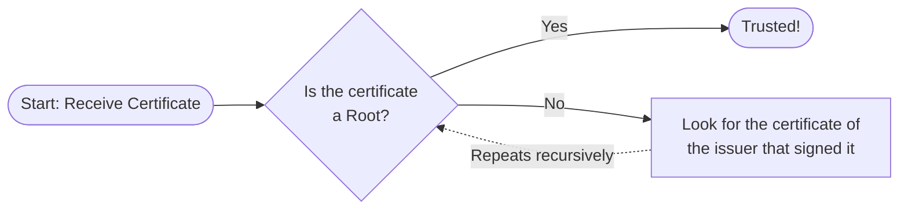

# Cryptography

## 1. Classic Cryptography and Core Concepts

At its simplest, cryptography is the science that studies techniques to transform data into codes that can only be deciphered by someone who possesses the correct access key.

The word originates from Greek:
* **Kryptós (crypto):** secret.
* **gráphein (graphy):** writing.

### Cryptography vs. Steganography

While both are used to protect information, cryptography and steganography take entirely different approaches.

- **Steganography** is the practice of concealing a secret message within an ordinary, non-secret file so that no one even suspects it exists. There is no mathematical transformation of the data; instead, it is hidden in plain sight. For example, a secret text file can be embedded into the pixels of a standard digital photograph or the background noise of an audio file. To an outside observer, the file looks and acts completely normal. The goal is pure invisibility: if an interceptor doesn't know a secret message is there, they won't try to extract it.
- **Cryptography**, on the other hand, does not try to hide the _existence_ of the message; it hides the _meaning_. It transforms and scrambles the data into an unreadable format. If a file is intercepted, the attacker can clearly see that a secret message is being transmitted, but they cannot decipher it without the correct key.

The true strength of cryptography lies entirely in the complexity of its key. However, this is also its primary fragility: if the key is discovered or compromised, decryption becomes a simple process, instantly revealing the information in its pure format. Conversely, steganography's primary fragility is discovery—once an attacker realizes a message is hidden inside a file, extracting it is often trivial.

### The Components of Cryptography

* **Plaintext (Mensagem limpa):** The readable message before it is encrypted.
* **Cryptographic Technique:** The specific method or algorithm used to encrypt.
* **Key:** The agent utilized by the technique to encrypt and decrypt the data.
* **Ciphertext (Mensagem criptografada):** The encrypted, unreadable message sent from the sender to the receiver.

### Historical vs. Computational Examples

* **Non-computational:** Writing, languages (understood only by those who know them), and the Enigma Machine.
* **Computational Algorithms:** Digital certification, DES (Data Encryption Standard), 3DES, and Blowfish.

## 2. Symmetric vs. Asymmetric Encryption

This is the most fundamental distinction in Information Security. In modern systems, we rarely choose just one; instead, we use a **Hybrid Encryption** approach. We use Asymmetric encryption to safely exchange a secret key across the network, and then use Symmetric encryption for the actual data transfer because it is significantly more efficient.

* **Keys:**
    * **Symmetric Encryption:** Uses **one shared secret key** for both encryption and decryption.
    * **Asymmetric Encryption:** Uses a **pair of keys**: one **Public** and one **Private**.
* **Mathematical Mechanism:**
    * **Symmetric Encryption:** Performs simple **bit-wise XOR operations** on the content and the key.
    * **Asymmetric Encryption:** Relies on complex **exponential mathematical operations**.
* **Speed:**
    * **Symmetric Encryption:** **Very fast** due to its low computational overhead.
    * **Asymmetric Encryption:** **Much slower** and more computationally expensive.
* **Security Foundation:**
    * **Symmetric Encryption:** Both client and server **must possess the exact same key**.
    * **Asymmetric Encryption:** Both parties can have their own unique public keys.
* **Key Generation:**
    * **Symmetric Encryption:** N/A.
    * **Asymmetric Encryption:** You can generate a public key using a private one, but you **cannot** derive a private key from a public one.
* **Primary Use Case:**
    * **Symmetric Encryption:** **Data at Rest** (hard drives/databases) and bulk data transmission.
    * **Asymmetric Encryption:** **Key Exchange**, SSL/TLS handshakes, and Digital Signatures.

### The Logic of Asymmetric Key Pairs

The security goal of an asymmetric system changes depending on which key is used for encryption:

* **Encrypt with Public $\rightarrow$ Decrypt with Private:**
    * **Goal:** Confidentiality and Receiver Authenticity.
    * **Logic:** Since only the owner of the Private Key can decrypt the message, the sender is guaranteed that only the intended authorized party can access the data.
* **Encrypt with Private $\rightarrow$ Decrypt with Public:**
    * **Goal:** Sender Authenticity and Integrity (Digital Signature).
    * **Logic:** Since only the corresponding Public Key can decrypt it, the receiver is certain that only the owner of the Private Key could have signed the document. This ensures nobody has tampered with the content during transit.

### Common Encryption Algorithms

#### Symmetric Algorithms

* **AES (Advanced Encryption Standard):** The current global standard. **AES-256** is approved for top-secret data. It is incredibly fast on hardware with AES-NI acceleration.
* **ChaCha20:** A modern stream cipher that is often faster than AES on devices without hardware acceleration (mobile/IoT) and is highly resistant to certain side-channel attacks.
* **DES / 3DES:** Older computational algorithms. DES is insecure; 3DES is an evolution that applies DES three times but is mostly replaced by AES.

#### Asymmetric Algorithms

* **RSA:** Traditionally used for handshakes and digital signatures. It relies on the difficulty of factoring large prime numbers.
* **ECC (Elliptic Curve Cryptography):** A modern alternative to RSA. A 256-bit ECC key provides security equivalent to a 3072-bit RSA key, making it much more efficient for mobile devices and high-traffic servers.
* **Diffie-Hellman (DH):** A key exchange protocol where two parties establish a shared secret over an insecure channel using their own private keys and a common public key.

## 3. The States of Encryption

Data must be protected differently depending on its current state:

* **Encryption in Transit:** Protects data moving through a network (e.g., **TLS/SSL** for web traffic). This prevents eavesdropping and data tampering during transmission between a web browser and a server, and is also used in instant messaging and emails.
* **Encryption at Rest (File Encryption):** Protects data stored on physical media. File encryption encodes confidential information to protect it from unauthorized access using a secret key or encryption algorithm. Decoding the files can only be done with the correct key or password, making it a critical defense for privacy.
* **End-to-End Encryption (E2EE):** If Alice sends a message without E2EE, the middleman (Cloud) can read it. With E2EE, the communication is encrypted with Bob's Public Key on Alice's phone and can only be decrypted by Bob's Private Key on his laptop.

## 4. Hashing: The "One-Way" Trap

Many people confuse Hashing with Encryption, but they are **not** the same thing.

* **Encryption** is a two-way street (Plaintext <-> Ciphertext) designed to ensure **Confidentiality**.
* **Hashing** is a one-way mathematical function (Data -> Fingerprint) designed to ensure **Integrity** and authenticity. You cannot "un-hash" a value.

### How Hash Algorithms Work

Math is closely related to cryptography. A hash algorithm converts input data of *variable* size into a *fixed-size* sequence of alphanumeric characters (often represented in hexadecimal), called a hash or digest. Didactically, it relates to basic mathematical functions (injective, surjective, and bijective).

* **Uniqueness:** The main property of a hash is that two different sets of input data will *always* generate different hash values. Furthermore, any minor alteration to the input data will produce a completely different hash value.
* **Data Verification:** When a large file is transmitted over the internet, the recipient can quickly and efficiently verify if the file was corrupted by comparing the hash of the downloaded file with the original hash provided by the sender.
* **Password Storage:** We encrypt messages, but we *hash* passwords. If a database leaks, attackers only see the hash fingerprints, not the actual passwords.

Here is the improved version of your notes, fully formatted in standard Markdown and using a Mermaid diagram to visualize the salting process.

### Password Hashing Defenses: Rainbow Tables, Salt, and Pepper

Password hashing is only safe when the stored hash is expensive to attack **and** difficult to reuse across many accounts. The underlying problem is that passwords are usually weak, predictable, and drawn from a small human-generated search space.

If a system stores `hash(password)` with no additional defenses, an attacker doesn't need to "decrypt" anything—they just need to guess likely passwords and hash them until a guess matches the stored value.

When many users are stored with fast, unsalted password hashes, the attacker can target the whole database as _one_ problem instead of many independent ones.

#### The Password-Storage Threat Model

- **Defender goal:** Store enough information to verify a password later _without_ storing the password itself.
- **Attacker goal:** Turn stolen hashes back into likely passwords, or at least test guesses offline until they find matches.
- **Core constraint:** Hash functions are deterministic. The same input always produces the same output unless extra per-password variation is added.
- **Scaling risk:** If many accounts use the same algorithm and no salt, one computation strategy can be reused across all of them.

#### Slow Hashing: Raising the Cost of Every Guess

A **slow hashing function** for passwords is a hash deliberately designed to consume noticeable CPU time, memory, or both for each password guess. The system pays that cost during account creation and login verification so an attacker is forced to pay it too during offline cracking.

This exists because general-purpose hash functions such as `MD5`, `SHA-1`, `SHA-256`, and `SHA-512` were built to be **fast**. That is ideal for file integrity checks and digital signatures, but it is the wrong property for password storage. If one guess is cheap, an attacker can try billions of guesses quickly on GPUs, ASICs, or large cloud fleets.

The design goal is not to make the password unrecoverable in an absolute sense. The goal is to make each guess expensive enough that large-scale guessing stops being economically attractive.

**Mental model:** Salt breaks the attacker's ability to reuse one result across many accounts. Slow hashing makes each remaining per-account guess expensive.

**How verification still works:**

1. During registration, the system generates a random salt.
2. It runs a password-hashing algorithm such as `bcrypt`, `scrypt`, `PBKDF2`, or `Argon2` with the password, the salt, and a cost configuration.
3. It stores the resulting hash together with the salt and the algorithm parameters.
4. During login, the system reads those stored values and runs the same algorithm again on the submitted password.
5. If the recomputed hash matches the stored hash, the password is accepted.

The password is never decrypted. Verification works by **recomputing** the same expensive function and checking whether the output matches.

**Why dedicated password hashers are different from normal hash functions:**

- **`bcrypt`:** Repeats an expensive internal key-setup process. It is mainly CPU-hard and exposes a tunable work factor.
- **`scrypt`:** Adds strong memory pressure so parallel cracking hardware becomes less efficient.
- **`Argon2`:** Modern password hashing that lets the defender tune time cost, memory cost, and parallelism. `Argon2id` is commonly preferred because it balances GPU resistance and side-channel considerations.
- **`PBKDF2`:** Repeats a pseudorandom function many times. It is older and widely supported, but it is more GPU-friendly than memory-hard designs such as `scrypt` or `Argon2`.

**What changes operationally:**

- **For defenders:** Login becomes slightly more expensive, so the work factor must stay high enough to slow attackers but low enough to keep authentication responsive.
- **For attackers:** Offline cracking throughput drops from "as many hashes per second as the hardware can stream" to "as many full password-hash evaluations as the hardware can afford."
- **For the database schema:** The stored record usually includes the algorithm name, the salt, and the cost parameters because verification must replay the exact same computation later.

This creates a predictable escalation between attackers and defenders:

1. **Unsalted Hashes:** System stores passwords as plain, unsalted hashes.
2. **Database Theft:** Attacker steals the database containing the hashes.
3. **Bulk Recovery:** Attacker uses precomputed data (Rainbow Tables) or fast offline guessing to recover many passwords instantly.
4. **Salting Introduced:** System adds unique, random salts so each stored hash becomes account-specific, breaking bulk recovery.
5. **Slow Hashing Introduced:** System replaces general-purpose hashes with adaptive password hashers so each individual guess now consumes real time, compute, and sometimes memory.
6. **Pepper Introduced:** System adds a pepper so the database alone is no longer sufficient for verification.

#### Rainbow Tables: The Attacker's Bulk Tool

A **Rainbow Table** is a precomputed lookup table mapping likely plaintext values (common passwords, dictionary words) to their corresponding hash outputs. It exploits the deterministic nature of general-purpose hash functions.

**How the attack works:**

1. The attacker chooses a predictable input space (e.g., the top 10 million most common passwords).
2. They hash each candidate in advance and store the results.
3. Upon stealing an unsalted database, they compare each stolen hash against their table.
4. A match instantly reveals the original password without requiring on-the-spot computation.

The attacker isn't "breaking" the math; they are exploiting human predictability and trading storage space for incredibly fast recovery times.

#### Salting: Breaking the Economics of Precomputation

**Salting** destroys the attacker's ability to reuse one precomputed table across many password hashes. It turns one global lookup problem into millions of separate, per-account guessing problems.

During account creation, a unique random value (the salt) is generated, combined with the password, and hashed. The salt is then stored in plaintext right next to the hash.

> [!info] The Cooking Metaphor
> Salt changes the final result without replacing the main ingredient. It "seasons" the password so that two identical passwords no longer produce identical hashes. The goal is _unique variation_, not hiding the input.

**Why this works even if the attacker sees the salt:**

- **Without salt:** One table attacks every database using that hash function.
- **With salt:** The attacker needs a different Rainbow Table for _every single distinct salt_, making precomputation mathematically and economically impossible.
- **State ownership shift:** The stored hash now depends on both user input (password) and database-specific state (salt). Two users with the password "hunter2" will have completely different hashes.

_Note: Salting does not make a weak password strong, but it forces the attacker to guess passwords account-by-account rather than reversing the whole database at once._

**Why Salt Length Matters**

A logical question arises when looking at salting: _If a database is large enough, won't multiple users randomly end up with the exact same salt?_

If they did, an attacker could group those users together, build a Rainbow Table just for that specific shared salt, and attack that "salt group" in bulk. In theory, this attack is perfectly valid. In practice, it is defeated by **salt length**.

If a poorly designed system uses a short salt (e.g., a 16-bit number, which only has 65,536 possible variations), a database of 10 million users would have roughly 150 users sharing every single salt. The attacker could easily generate 65,536 Rainbow Tables and crack the database in bulk groups.

To prevent this, modern hashing algorithms (like `bcrypt` or `Argon2`) enforce a cryptographically secure salt length, typically **128 bits** (16 bytes).

- **The Math:** A 128-bit salt provides $2ˆ{128}$ (over 340 undecillion) unique possibilities.
- **The Probability:** Due to the sheer size of this space, the mathematical probability of even _two_ users generating the same salt—even in a database of 100 billion users—is effectively zero.
- **The Result:** Because salt collisions are statistically impossible, there are no "salt groups" to exploit. Every user remains a group of one, forcing the attacker to compute guesses individually for every single account.
#### Pepper: Defense-in-Depth

A **pepper** is an additional secret value mixed into the password hashing process. Unlike a salt, **a pepper is never stored in the database.** It is a shared secret managed separately (e.g., in application configuration, a secret manager, or a hardware security module).

**The failure model changes:**

- **If only the database leaks:** The attacker gets the hashes and the salts, but without the pepper, offline guessing is effectively impossible.
- **If both the database AND the app secrets leak:** The pepper is compromised, and the attacker can resume standard offline dictionary attacks (though they are still slowed down by salts and slow-hashing algorithms).
- **The tradeoff:** Peppering creates a strict secret-management burden. If the company loses the pepper, they can never verify user passwords again, effectively locking everyone out.

**Why Naive Concatenation is Cryptographically Dangerous**

It is tempting for developers to implement a pepper by simply gluing strings together, such as `hash(pepper + password + salt)`. However, inventing custom cryptographic constructions is a well-known anti-pattern that introduces severe vulnerabilities:

1. **Length-Extension Attacks:** Because many standard hash functions (like SHA-1 and the SHA-2 family) rely on the **Merkle-Damgård construction**, they process data in sequential blocks. This makes simple concatenation (`hash(secret + data)`) vulnerable to length-extension attacks. If an attacker intercepts the hash output and knows the length of the secret, they can use the hash's mathematical state to append their own malicious data to the string and generate a valid new hash—all without ever knowing the secret pepper itself.
2. **Algorithm Truncation Limits (The `bcrypt` problem):** Modern slow-hashing algorithms have strict memory and input limits. For example, `bcrypt` will silently truncate any input longer than 72 bytes. If a developer prepends a secure 32-byte pepper to a user's password, any user with a password longer than 40 characters will have the end of their password chopped off before hashing. This silently destroys the entropy of long passphrases and increases the risk of collisions.
3. **Boundary Ambiguity:** If strings are concatenated without strict delimiters, the hashing function cannot distinguish where the pepper ends and the password begins. If the pepper is `A` and the password is `BC`, the input is `ABC`. If the pepper is later rotated to `AB` and the password is `C`, the input is still `ABC`, causing a collision that standard cryptographic methods avoid.

**Secure Implementation Formulas**

Instead of concatenating strings, modern systems implement peppers using standard, mathematically proven cryptographic key mechanisms. There are two industry-standard ways to achieve this:

- **Option A: Pre-Hash [HMAC](#Keyed-Hashing%20HMAC) (The Application Approach)**: The system uses the pepper as the secret key in an HMAC function, and uses the user's plaintext password as the message. The resulting HMAC output (which is now a fixed-length, mathematically secure representation) is then passed into the slow hashing function (like `bcrypt`).
	- **Formula:** `bcrypt( HMAC(key=pepper, message=password), salt )`
	- **Why it works:** HMAC is specifically immune to length-extension attacks, and the fixed-length output guarantees you will never hit `bcrypt`'s 72-byte truncation limit.
- **Option B: Post-Hash Encryption (The Database Approach)**: The system fully hashes the password and salt using a slow algorithm. Then, it encrypts the resulting hash using a symmetric cipher (like AES-256) where the pepper acts as the encryption key.
	- **Formula:** `AES_Encrypt(key=pepper, data=bcrypt(password, salt))`
	- **Why it works:** The database never stores the raw hash. If the database is stolen, the attacker only gets useless ciphertext. They cannot even begin offline cracking until they compromise the Key Management Service (KMS) to get the AES key (the pepper).
### Common Hash Algorithms

#### Obsolete/Vulnerable Algorithms

These algorithms have been cryptographically broken due to collision vulnerabilities, meaning attackers can intentionally create two different inputs that produce the exact same hash output.

* **MD5 (Message Digest 5):**
    * **Background:** Created in 1991 by MIT Professor Ronald Rivest. It uses the Merkle-Damgård construction and produces a 128-bit (16-byte) hash value, which is typically represented as a sequence of 32 hexadecimal digits.
    * **Vulnerabilities:** MD5 is considered catastrophically vulnerable and cryptographically broken. Current collision-finding techniques are so advanced that an attacker can create two different files with the exact same prefix that generate identical MD5 checksums within seconds using off-the-shelf hardware.
    * **Impact:** In 2008, the CMU Software Engineering Institute formally concluded that MD5 was "unsuitable for further use". Its weaknesses were famously exploited in the wild by the Flame malware in 2012.
* **SHA-1 (Secure Hash Algorithm 1):**
    * **Background:** Designed by the United States National Security Agency (NSA) and released in 1995. It takes an input and produces a 160-bit (20-byte) hash value, usually rendered as 40 hexadecimal digits.
    * **Vulnerabilities:** Like MD5, SHA-1 is based on the Merkle-Damgård construction and is vulnerable to collision attacks. In 2017, researchers from Google and the CWI Institute demonstrated a practical collision attack (known as "SHAttered") by successfully generating two completely different PDF documents that produced the exact same SHA-1 hash value.
    * **Impact:** NIST formally deprecated the use of SHA-1 in 2011 and disallowed its use for digital signatures by the end of 2013. By 2017, all major web browser vendors ceased accepting SHA-1 SSL certificates.

#### Strong/Recommended Algorithms

These algorithms are currently considered highly secure, offering robust mathematical resistance against brute-force and collision attacks.

* **SHA-2 Family (SHA-256 and SHA-512):**
    * **SHA-256:** Generates a 256-bit hash. It is the industry standard for many applications, including modern SSL certificates, digital signatures, file integrity verification, and blockchain environments like Bitcoin. Architecturally, it generally performs more efficiently on 32-bit systems.
    * **SHA-512:** Generates a longer 512-bit hash. Because of its larger output space, brute-force collision finding becomes exponentially more difficult, making it a strong contender for systems handling extremely sensitive data. Furthermore, because it is designed to process 64-bit words natively, SHA-512 generally outperforms SHA-256 on 64-bit hardware architectures (which are standard in modern servers).
* **SHA-3:**
    * **Background:** Released by NIST on August 5, 2015, SHA-3 is the latest member of the Secure Hash Algorithm standard. It was developed by a team of researchers who designed the broader cryptographic primitive family known as Keccak.
    * **Architectural Difference:** Unlike MD5, SHA-1, and SHA-2, which rely on the older Merkle-Damgård construction, SHA-3 uses a unique mathematical approach called the "sponge construction".
    * **How it Works:** In the sponge construction, input data is "absorbed" into the system's state through XOR operations and block permutations, and then the final hash result is "squeezed" out.
    * **Purpose:** Because of the successful attacks on older algorithms, NIST selected SHA-3 to serve as a highly secure, structurally dissimilar alternative. This ensures that if a foundational flaw is ever discovered in the SHA-2 architecture, SHA-3 can be directly substituted into current applications to maintain security.

### Keyed-Hashing: HMAC

While a standard hash ensures **Integrity**, it does not prove **Authenticity** because anyone with the data can generate the same hash. To solve this, we use **HMAC** (Hash-based Message Authentication Code), which incorporates a **secret key** into the hashing process.

* **Mechanism:** HMAC combines a cryptographic hash function (like SHA-256) with a secret key known only to the sender and the receiver.
* **Security Tenets:** Unlike simple hashing, HMAC addresses both **Integrity** (the message hasn't changed) and **Authenticity** (the message must have come from someone with the secret key).
* **Use Case:** HMAC is commonly used in API authentication and **JSON Web Tokens (JWTs)**. Even if an attacker intercepts the message and modifies it, they cannot generate a valid HMAC to match the changes because they lack the secret key.
* **Comparison:**
    * **Standard Hash:** Integrity only (detects accidental corruption).
    * **HMAC:** Integrity + Authenticity (detects malicious tampering and verifies the sender).

## 5. Applications of Asymmetric Cryptography

In an asymmetric system (Public/Private key pair), the logic changes entirely depending on your security goal:

* **A. For Confidentiality (Encryption):**
    * **Action:** You encrypt data using the **recipient's Public Key**.
    * **Result:** Only the recipient can decrypt it with their **Private Key**.
    * **Goal:** Ensuring that only authorized parties can read the data.
* **B. For Authenticity & Non-repudiation (Digital Signatures):**
    * **Action:** You "encrypt" (sign) a hash of a message using **your own Private Key**.
    * **Result:** Anyone can verify the signature using your **Public Key**.
    * **Goal:** Proving that you are the true author (**Authenticity**) and providing undeniable proof of the transaction (**Non-repudiation**).

## 6. Digital Certificates and PKI

A primary challenge in secure communications is proving authenticity—for example, proving that a website name actually belongs to the legitimate owner. To solve this, we use Digital Certificates and a Public Key Infrastructure (PKI).

A digital certificate is an electronic document containing identity information about a person, company, or institution. It functions as an electronic ID card, allowing for secure digital transactions, user authentication in systems, electronic signing of documents, and sending encrypted messages. Today, the universal standard for these certificates is **X.509**.

### The Certificate Creation Process

The lifecycle of creating a trusted certificate generally follows these steps:
1. **Generate a Key Pair:** The applicant generates a pair of public and private keys.
2. **Identity Verification:** A trusted third party, known as a Certificate Authority (CA), rigorously verifies the identity of the applicant using personal identification documents and proof of address.
3. **Draft the Certificate:** The applicant's public key is placed into the certificate document along with their identity information.
4. **Sign the Certificate:** The CA signs the certificate using its own private key, officially attesting to the authenticity of the holder's identity.

### The Trust Chain

Certificates can sign "other certificates," which creates a hierarchical **Trust Chain**. Every certificate has an "Issuer Name" that dictates exactly who issued and signed it.

* **Root Certificates:** Ultimately, every trust chain leads back to a Root Certificate. Root certificates are always "self-signed" and are implicitly trusted by everyone.
* **Certificate Stores:** These trusted root certificates are pre-installed in a big list within the Operating System's root certificate store. However, some systems (like web browsers) maintain their own independent certificate stores so they do not have to rely solely on the OS's list.
* **Self-Signed Certificates (Untrusted):** Anyone can create a self-signed certificate (where the private key signing the cert belongs to the public key inside it). Unless it is a recognized Root Certificate, a self-signed certificate is usually untrusted by default and is primarily used only for local development or testing.

### The Validation Process

When a client (like a browser) receives a certificate, it must determine if it can trust it. It does this by evaluating the trust chain recursively:

> **Network Engineering Note:** During a connection, servers will often send the **full chain** of certificates to the client. This is because clients might not have all the intermediate certificate authorities cached in their local store. By sending the full chain, the server ensures it can support more clients and establish trust seamlessly, even though it requires transferring slightly more data during the handshake.

## 7. Key Management Lifecycle

Effective cryptographic security depends not only on strong algorithms but also on proper management of cryptographic keys throughout their entire lifecycle. Poor key management can render even the strongest encryption useless.

### Key Generation

The foundation of cryptographic security begins with proper key generation:

* **Entropy Requirements:** Keys must be generated using cryptographically secure random number generators (CSRNGs) with sufficient entropy.
* **Key Length Standards:** Follow current industry standards for key lengths (e.g., AES-256, RSA-3072, ECC-256).
* **Hardware Security Modules (HSMs):** For high-security environments, key generation should occur within tamper-resistant hardware.
* **Initial Distribution:** Secure delivery of keys to authorized parties using out-of-band methods or pre-established secure channels.

### Key Storage and Protection

Protecting keys when not in active use is critical to maintaining security:

* **Key Escrow:** Secure backup of keys to prevent data loss while maintaining access controls.
* **Access Controls:** Strict authentication and authorization for key access, following the principle of least privilege.
* **Physical Security:** Secure storage locations with appropriate environmental and access controls.
* **Encryption at Rest:** Keys should be encrypted when stored, using separate key-encryption-keys (KEKs).

### Key Distribution and Exchange

Secure methods for sharing keys between authorized parties:

* **Key Exchange Protocols:** Use established protocols like Diffie-Hellman for secure key establishment.
* **Certificate-Based Distribution:** Leveraging PKI infrastructure for secure key distribution.
* **Key Wrapping:** Encrypting keys with other keys for secure transport and storage.
* **Out-of-Band Verification:** Confirming key integrity through separate communication channels.

### Key Usage and Monitoring

Proper management during the active use phase:

* **Usage Policies:** Clear policies defining when, how, and by whom keys may be used.
* **Audit Logging:** Comprehensive logging of all key usage activities for security monitoring and compliance.
* **Performance Monitoring:** Tracking key usage patterns to identify potential security issues or system problems.
* **Separation of Duties:** Multiple people required for sensitive key operations to prevent insider threats.

### Key Rotation and Renewal

Regular replacement of cryptographic keys to maintain security:

* **Rotation Schedules:** Predetermined schedules for key replacement based on security policies and risk assessment.
* **Automatic Rotation:** Automated systems that handle routine key rotation without service disruption.
* **Emergency Rotation:** Procedures for immediate key replacement in case of suspected compromise.
* **Backward Compatibility:** Managing transitions to new keys while maintaining access to data encrypted with old keys.

### Key Revocation and Destruction

Secure termination of key lifecycle:

* **Revocation Procedures:** Immediate invalidation of compromised or no-longer-needed keys.
* **Certificate Revocation Lists (CRLs):** Public lists of revoked certificates for PKI environments.
* **Secure Deletion:** Cryptographically secure methods for destroying key material to prevent recovery.
* **Audit Trails:** Maintaining records of key destruction for compliance and forensic purposes.

### Backup and Recovery

Ensuring business continuity while maintaining security:

* **Recovery Procedures:** Well-documented processes for key recovery in case of loss or corruption.
* **Split Knowledge:** Dividing key recovery authority among multiple trusted individuals.
* **Geographic Distribution:** Storing key backups in multiple secure locations to prevent single points of failure.
* **Regular Testing:** Periodic testing of backup and recovery procedures to ensure they work when needed.

### Compliance and Governance

Meeting regulatory and organizational requirements:

* **Policy Framework:** Comprehensive key management policies aligned with organizational security requirements.
* **Regulatory Compliance:** Adherence to industry standards (FIPS 140-2, Common Criteria) and regulatory requirements.
* **Risk Assessment:** Regular evaluation of key management risks and implementation of appropriate controls.
* **Training and Awareness:** Ensuring personnel understand their key management responsibilities and procedures.

Key management is often considered the most challenging aspect of implementing cryptographic solutions, requiring careful balance between security, usability, and operational requirements.

## Implementation Examples

Cryptographic concepts are implemented across different platforms and environments:

**Platform-Specific Implementations:**
* **Windows:** [BitLocker](Windows%20Security.md#BitLocker%20Drive%20Encryption%20Integration) - Windows encryption technologies and certificate management
* **Linux:** [SSH and LUKS](../05%20Architecture%20and%20Infrastructure%20Security/Linux%20Endpoint%20Security.md#SSH%20%28Secure%20Shell%29%20Protection) - SSH key management and disk encryption
* **Cloud Services:** Cloud-native key management services and hardware security modules

**Authentication Integration:**
* [HMAC Authentication](../02%20Identity%20and%20Access/01%20Authentication.md#HMAC) - Using cryptographic signatures for API security
* [JWT Tokens](../02%20Identity%20and%20Access/01%20Authentication.md#JSON%20Web%20Tokens%20%28JWT%29) - Digital signatures for stateless authentication
* [Digital Certificates](../05%20Architecture%20and%20Infrastructure%20Security/02%20Endpoint%20Security.md) - PKI implementation in endpoint security

**Related Security Frameworks:**
* [Zero Trust Architecture](../02%20Identity%20and%20Access/03%20Zero%20Trust%20Architecture.md) - Identity-centric security requiring strong cryptographic foundations
