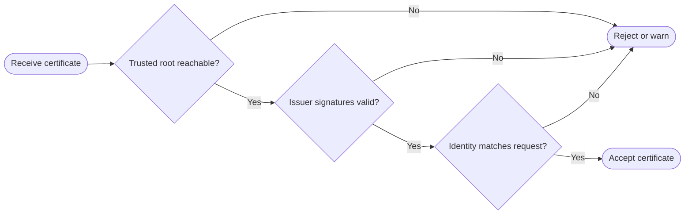

# Digital Certificates and PKI

A public key by itself does not answer the most important trust question: **whose key is this?** Digital certificates exist to bind an identity to a public key in a form that other systems can validate.

That identity-binding job matters because asymmetric cryptography only helps when the verifier can trust the remote party's public key. If an attacker can substitute their own public key during the exchange, the mathematics still works but the trust model collapses.

**Public Key Infrastructure (PKI)** is the surrounding system of certificate authorities, trust stores, issuance rules, and validation logic that makes those bindings usable at scale.

## What a Certificate Does

A digital certificate is an electronic document that carries:

- identity information about a person, service, company, or device;
- a public key;
- metadata about who issued the certificate; and
- a signature from the issuer that attests to the binding.

In practice, the common certificate format is **X.509**.

## Certificate Issuance Flow

Certificate issuance is a trust-establishment process, not just a file-generation step.

1. The applicant generates a public/private key pair.
2. A trusted issuer, typically a **Certificate Authority (CA)**, verifies the applicant's identity according to its policies.
3. The applicant's public key and identity information are assembled into the certificate.
4. The CA signs the certificate with its own private key.

The result is a portable statement that says, in effect, "this public key belongs to this identity, and the issuer vouches for that claim."

## Trust Chains

PKI scales by chaining trust instead of requiring every verifier to know every end entity directly.

- **Leaf certificate:** The certificate presented by the website, device, or user.
- **Intermediate CA certificate:** A certificate that can sign other certificates.
- **Root certificate:** A trust anchor that is typically self-signed and preloaded into a trust store.

When a verifier already trusts the root, it can also trust certificates properly signed beneath that root.

### Why servers often send the full chain

Clients may already trust the root certificate but not have every intermediate cached locally. Sending the chain helps the client reconstruct the path without having to fetch missing intermediates during the handshake.

## Validation Flow

Certificate validation answers a sequence of questions.

1. Is the certificate syntactically valid and within its validity period?
2. Who issued it?
3. Can the verifier build a chain from this certificate to a trusted root?
4. Does each signature in that chain verify correctly?
5. Does the certificate match the identity being requested, such as the expected hostname or device identity?

If any step fails, the certificate may still be mathematically well-formed but should not be trusted for that connection.

## Trust Stores and Self-Signed Certificates

Trust stores are the local lists of root certificates that an operating system, browser, or runtime already trusts.

- **Operating system trust stores:** Shared by many applications on the host.
- **Browser-specific stores:** Some browsers maintain their own root set instead of delegating entirely to the operating system.

A **self-signed certificate** is signed by the same key whose public key it contains. That is acceptable for a root certificate only because the environment explicitly trusts it in advance. Outside that trust-anchor role, self-signed certificates are usually suitable only for local development, testing, or tightly controlled internal environments.

## Practical Consequences and Failure Modes

- **A certificate does not replace private-key protection:** If the private key leaks, the certificate-backed identity is compromised.
- **A valid chain can still represent the wrong service if hostname or identity checks are skipped.**
- **Trust stores become powerful control points:** Adding or removing a root certificate changes what the machine can trust.
- **Certificate management is operational work:** Issuance, renewal, revocation, and replacement all depend on the broader [Key Management Lifecycle](Key%20Management%20Lifecycle.md).
