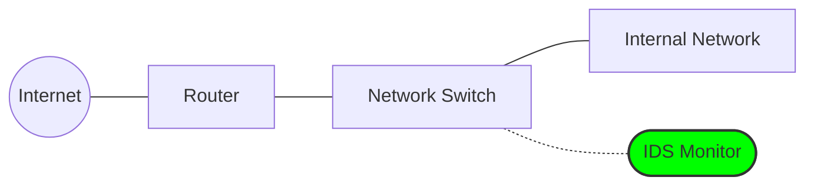

# Intrusion Detection and Prevention

Even when perimeter defenses like firewalls and authentication are successful, a threat actor may still manage to operate within the system using legitimate credentials. Intrusion detection and prevention systems add a monitoring and response layer that watches activity for malicious behavior, policy violations, or signs of compromise.

**Detecting the "Insider" Threat:** The primary strength of anomaly detection is its ability to detect an attacker even when they possess correct credentials. By identifying that a specific user's behavior has become highly irregular, the system can trigger alerts or automated responses to mitigate the impact of a potential breach.

It is a common misconception that Intrusion Detection Systems (IDS) and Intrusion Prevention Systems (IPS) use different methods to find threats. In reality, both systems share the exact same "brain"—they utilize the identical set of core detection engines to monitor the network:

- **Behavioral and Anomaly Detection:** Instead of just checking "keys," the system analyzes behavior. It establishes a baseline of "normal" activity and flags deviations that could indicate an intruder impersonating a legitimate user. Key indicators include:  
	- **Access Patterns:** Identifying logins at unusual times or from unexpected sequences of internal systems.  
	- **Unusual Web Traffic:** Monitoring access to suspicious or non-standard websites that could indicate a "Command and Control" (C2) connection.  
	- **Frequency Anomalies:** Detecting access rates, such as API calls or login attempts, that far exceed standard user behavior.  
	- **File Integrity and Activity:** Flagging the **unusual access, modification, or deletion** of files—actions often associated with data exfiltration or ransomware.  
- **Signature-Based Detection:** Identifying known attack patterns and malicious traffic signatures.  
- **Protocol Analysis:** Deep inspection of network protocols to identify violations, malformed traffic, or attack techniques that abuse legitimate protocols.  
- **Threat Intelligence Integration:** To optimize threat recognition, IDS/IPS platforms receive continuous updates from Threat Intelligence feeds provided by manufacturers, security vendors, or open sources such as **OSINT — Open Source Intelligence**.
	- These feeds help identify known malicious infrastructure and allow the system to detect or reject connections from low-reputation IP addresses, suspicious domains, and known Command and Control endpoints.  
- **Operational Tuning and False Positive Management:** Both IDS and IPS deployments require continuous monitoring, analysis, and tuning due to the possibility of false positives.
	- In an IDS, excessive or poorly calibrated alerts can overwhelm analysts and obscure real threats.
	- In an IPS, overly restrictive blocking rules can actively disrupt legitimate traffic from internal organizational systems or prevent access to essential external platforms, such as government portals. 
	- For this reason, qualified analysts must regularly review alerts, validate detections, refine detection thresholds, and adjust blocking policies to maintain an effective balance between security and operational continuity.
The crucial difference between the two systems is not _how_ they detect the threat, but _what they do_ once the anomaly or signature is found. The difference is entirely in the response model and how they are physically or logically deployed on the network:

## Intrusion Detection System (IDS)

An IDS (/ˌaɪ.diːˈɛs/) operates passively, meaning the network traffic flows **"on the side"** rather than through it.

It observes traffic and raises alerts, functioning like a security camera. It monitors and records everything that happens but does not prevent offensive actions. In other words, if a theft occurs, we can check the footage to identify the culprit. It won't stop the crime, but it will help solve it.

- **How it works:** The IDS is connected to a switch port configured for "Port Mirroring" (or SPAN) or uses a physical network tap. As legitimate traffic flows through the switch to its destination, the switch sends an exact _copy_ of those packets to the IDS. The IDS analyzes these copies offline.
- **Pros & Cons:** Because it only looks at copies, an IDS introduces zero latency to the network. If the IDS crashes, network traffic continues completely unaffected. However, because it is not in the direct path of the traffic, it cannot stop a packet that has already been sent.
## Intrusion Prevention System (IPS)

An IPS (/ˌaɪ.piːˈɛs/) operates inline, meaning the network traffic physically flows **"through"** the device.

It can actively block or interrupt detected threats via automated responses. It functions like a security camera with someone watching the feed 24/7. The moment someone steals an item, the guard sees it and alerts security at the door to intercept the individual, preventing them from leaving with the product.

- **How it works:** The IPS sits directly in the communication path (often positioned right behind the firewall, or integrated directly into a Next-Generation Firewall). Every single packet must enter the IPS interface, be held in memory, inspected, and explicitly permitted before it is allowed to exit the other side toward the internal network.
- **Pros & Cons:** Because it sits in the middle of the traffic stream, it can instantly drop malicious packets, reset TCP connections, or block an attacker's IP address on the spot. The trade-off is that an IPS must be incredibly fast to avoid adding latency to the network, and if the IPS hardware fails, it could potentially block all network traffic.