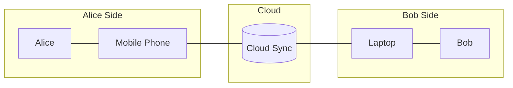

# Information Security

## The tenets

**Confidentiality:** The principle of preventing unauthorized **disclosure** of information during transmission between A and B. In other words, it is the principle of ensuring that only authorized parties can access the data.

**Integrity:** The principle of preventing unauthorized **modification** of information during transmission between A and B. In other words, it is the principle of ensuring that the information received by B is identical to the information sent by A.

**Availability**: The principle of preventing unauthorized disruption of access to information. In other words, it is the principle of ensuring that systems and data are accessible to authorized users when needed.

**Authenticity**: The principle of preventing spoofing/impersonation. In other words, it is the principle of ensuring that all entities (or parties) involved in a communication are who they claim to be.

**Non-repudiation:** The principle of preventing an entity from denying the origin or validity of a message or transaction. In other words, it provides admissible proof to a third party (e.g., the legal system) that the sender is the author and that the message was indeed sent.

## **Risk Management** 

A project's architecture is a model of that project; in essence, an overall understanding of its mechanisms. Thus, the former is as lively and dynamic as the latter. To visualize this: given the project as a three-dimensional object, the architecture is a two-dimensional projection whose angle varies depending on the viewpoint (e.g., the user, the developer, the compliance auditor, or the attacker).

### Vulnerabilities

In Information Security, the primary viewpoint is the attacker's perspective: the attack surface, which is the set of all points and elements that could contain vulnerabilities.

A vulnerability is a flaw or weakness in the project's architecture that can be exploited by a threat. From the attacker's perspective, it is a 'gap' that allows unauthorized access or action.

To identify vulnerabilities, you must analyze each element of your architecture and ask: 'Is this element weak?' or 'Is this element more vulnerable than others?'

Alice Side

* "Is this a BYOD (Bring Your Own Device) scenario or a managed corporate device?"
* "How secure are the authentication methods on her phone?"
* "Does the Alice possess adequate security awareness to protect their device?"
  * **Human Factor**: Vulnerabilities do not only exist in hardware and software; they can also exist in human behavior.

Cloud

* "Is the physical location of the infrastructure secure?"
* "Are the authentication methods for administrative accounts secure (e.g., is MFA enabled)?"

Communication

* "Is the communication encrypted in transit?"
* "Can the attacker launch an availability attack (e.g. DDoS) on the network link?"
* "Can the attacker reroute the communication, to spoof the cloud?"

**Remark:**

> **The IoT (Internet of Things) Factor**: IoT devices often represent the "weakest link" in an architecture. They significantly expand the attack surface because they are frequently designed with limited computational resources, making robust encryption and complex authentication difficult to implement. Furthermore, many IoT devices ship with **hardcoded default credentials** and lack a streamlined mechanism for firmware updates, leaving known vulnerabilities unpatched for years. In the provided architecture, an insecure smart device on Alice’s network could serve as an entry point for an attacker to move laterally toward her phone or the cloud.

### Threats

Threats are factors or actions capable of compromising at least one of the [security tenets](#the-tenets).

* Threat Actor is the entity who lauches the threat.
* Threat Vector is is the means by which an attacker exploits a vulnerability.

For example, given the architecture aforementioned:

* **Vulnerability:** Lack of encryption on the network link.
* **Threat:** Eavesdropping / Interception of sensitive data.
* **Threat Actor**: Charlie - the attacker
* **Threat Vector**: Alice’s unsecured or poorly protected Wi-Fi network.

Another example:

- **Vulnerability**: An unpatched API on the Cloud server.
- **Threat:** Data breach / SQL Injection.
- **Threat Actor:** A malicious script kiddie.
- **Threat Vector:** The **Public Internet** (the web-facing interface).

While the security risks for Bob's side mirror Alice's, the attack vectors differ due to the nature of the device (Laptop vs. Mobile):

| **Feature**           | **Alice's Side (Phone)**                         | **Bob's Side (Laptop)**                                      |
| --------------------- | ------------------------------------------------ | ------------------------------------------------------------ |
| **OS Environment**    | Usually "Walled Garden" (App Store/Play Store).  | Open environment (can install anything from the web).        |
| **Physical Security** | High risk of being **lost/stolen** in public.    | Risk of **unauthorized peripherals** (e.g., malicious USB/Rubber Ducky). |
| **Connectivity**      | Often on 5G/LTE (more secure than public Wi-Fi). | Often on **Public Wi-Fi** (higher risk of MitM attacks).     |
| **Software**          | Harder to run "unsigned" scripts.                | Easy to execute **malicious scripts/binaries** (.exe, .sh).  |

### Risk

Risk is the likelihood that a threat will exploit a vulnerability, resulting in a negative impact or loss. Given the 3D object analogy of a project, if a vulnerability is a "gap" in your architectural projection and a threat is the force seeking it, risk is the calculation of how likely they are to meet and how much damage that encounter would cause:

$$Risk = Likelihood \times Impact$$

Where impact is is typically measured in terms of the [security tenets](#the-tenets), while likelihood is assessed through attacker modeling.

Attacker Modeling is an exercise of putting yourself in the attacker's shoes. You can build a threat actor profile based on three pillars (often called the M.O.C. Triangle):

- Capability (Means): The level of skill, tools, and resources (e.g., a "script kiddie" vs. a "state-sponsored actor").

- Motivation (Motive): The "why" behind the attack (e.g., financial gain, social status/ego, hacktivism, disgruntled employees, or corporate espionage/sabotage).

- Opportunity: The existence of a vulnerability and the "window" to exploit it without being detected.

Attacker modeling will always be inherently incomplete; nonetheless, it is essential because it enables risk prioritization.

## Network, server, and application security controls.

### Authentication

There are three classic factors of authentication:

- **Something you know** (e.g., a password).
- **Something you have** (e.g., **an** access card).
- **Something you are** (e.g., biometrics like facial recognition).

Modern security now includes:

- **Somewhere you are** (Geolocation/IP filtering).
- **Something you do** (Behavioral Biometrics/Keystroke Dynamics).

**Each factor has its own vulnerabilities:**

- A password can be compromised via brute force or stolen via phishing.
- An access card can be lost, stolen, or cloned.
- Biometrics can be spoofed. This has the highest impact because, unlike other factors, biometric data cannot be revoked or changed if compromised.

Therefore, to achieve the highest level of security, **it is best** to combine multiple factors (**Multi-Factor Authentication - MFA**).

In modern environments, it is common to use multiple factors conditionally. This is known as Adaptive Authentication: the system prompts the user for an access token (Something you have) only if the login attempt is deemed anomalous or originates from an unusual location (Somewhere you are).

### Encryption

Encryption is the process of transforming readable data (**plaintext**) into an unreadable format (**ciphertext**) using an algorithm and a **key**. Only those with the correct key can revert the process (**decryption**).

#### Symmetric vs. Asymmetric Encryption

This is the most fundamental distinction in InfoSec. Think of it as the difference between a house key and a mailbox.

| **Feature**  | **Symmetric Encryption**                    | **Asymmetric Encryption**                                    |
| ------------ | ------------------------------------------- | ------------------------------------------------------------ |
| **Keys**     | One shared secret key.                      | A pair: **Public Key** and **Private Key**.                  |
| **Speed**    | Very fast.                                  | Slower (computationally expensive).                          |
| **Use Case** | **Data at Rest** (Hard drives, databases).  | **Key Exchange** and Digital Signatures.                     |
| **Analogy**  | A safe with one key that both parties have. | A mailbox where anyone can drop a letter (Public), but only you can open it (Private). |

> **Tech Note:** In the real world, we use **Hybrid Encryption**. We use Asymmetric to exchange a secret key, and then use Symmetric for the actual communication because it's faster.

#### The Two States of Encryption

As we discussed before, the "where" matters:

- **Encryption in Transit:** Protects data moving through a network (e.g., **TLS/SSL** for web traffic). This prevents **Eavesdropping** on your "network link".
- **Encryption at Rest:** Protects data stored on physical media (e.g., **AES-256** on Bob's laptop or Alice's phone). This prevents data theft if the device is lost or stolen.

#### Hashing: The "One-Way" Trap

**Warning:** Many people confuse Hashing with Encryption. They are **not** the same thing!

- **Encryption** is a two-way street: $Plaintext \leftrightarrow Ciphertext$. Its goal is **Confidentiality**.
- **Hashing** is a one-way street: $Data \rightarrow Fingerprint$. You cannot "un-hash" something. Its goal is **Integrity**.

> **Pro Tip:** We **encrypt** messages, but we **hash** passwords. If a database is leaked, the attacker only sees the "fingerprint" (hash), not the actual password.

#### Encryption in your Architecture (Alice & Bob)

Applying this to your diagram:

- If Alice sends a message without **End-to-End Encryption (E2EE)**, the Cloud (the "middleman") can read it.
- With **E2EE**, the communication is encrypted with Bob's **Public Key** on Alice's phone and can only be decrypted by Bob's **Private Key** on his laptop.

#### **Asymmetric Encryption: The Two Sides of the Coin**

In an asymmetric system (Public/Private key pair), the logic changes depending on your security goal:

##### **A. For Confidentiality (Encryption)**

- **Action:** You encrypt with the **recipient's Public Key**.
- **Result:** Only the recipient can decrypt it with their **Private Key**.
- **Goal:** Ensuring that only the authorized party can access the data.

##### **B. For Authenticity & Non-repudiation (Digital Signature)**

- **Action:** You "encrypt" (sign) a hash of the message with **your own Private Key**.
- **Result:** Anyone can verify it using your **Public Key**.
- **Goal:** Proving that you are the author (**Authenticity**) and providing proof that cannot be denied (**Non-repudiation**).

> **Technical Insight:** When you sign a message with your private key, you create **Non-repudiation**. Since the private key is unique to you, you cannot later deny the origin or validity of the transaction to a third party.

### **Firewalls**

A firewall is a network security mechanism designed to protect a communication channel by restricting access based on predefined security rules. It serves as a critical defense layer, particularly for ensuring Availability—a tenet that Authentication and Encryption alone do not guarantee.

In a communication utilizing the **TCP/IP protocol**, entities often have static IP addresses provided by their Internet Service Providers (ISPs). A firewall can be configured to allow traffic only from specific, authorized addresses—a process known as **whitelisting**.

Considering the architecture aforementioned, we can apply firewall rules to protect the link between Alice, the Cloud, and Bob:

- **Authorized Access:** Alice and Bob are assigned static IP addresses **X** and **Y**, respectively. The firewall is configured to permit only these addresses to access the communication channel.
- **Unauthorized Access:** If Charlie attempts to access the channel from IP address **Z**, the firewall will identify him as unauthorized and block the connection.

### **Intrusion Detection Systems (IDS)** 

Even when perimeter defenses like firewalls and authentication are successful, a threat actor may still manage to operate within the system using legitimate credentials. An **Intrusion Detection System (IDS - /ˌaɪ.diːˈɛs/)** acts as a surveillance layer that monitors system activity for malicious behavior or policy violations.

**Behavioral and Anomaly Detection**: Instead of just checking "keys," an IDS analyzes behavior. It establishes a baseline of "normal" activity and flags deviations that could indicate an intruder impersonating a legitimate user. Key indicators include:

- **Access Patterns**: Identifying logins at unusual times or from unexpected sequences of internal systems.

- **Unusual Web Traffic**: Monitoring access to suspicious or non-standard websites that could indicate a "Command and Control" (C2) connection.

- **Frequency Anomalies**: Detecting access rates (e.g., API calls or login attempts) that far exceed standard user behavior.

- **File Integrity and Activity**: Flagging the **unusual access, modification, or deletion** of files—actions often associated with data exfiltration or ransomware.

**Detecting the "Insider" Threat**:  The primary strength of an IDS is its ability to detect an attacker even when they possess correct credentials. By identifying that a specific user's behavior has become highly irregular, the system can trigger alerts or automated responses to mitigate the impact of a potential breach.

> **Analogy:** If a Firewall is the locked front door, and Authentication is the ID check, an **IDS** is the security camera and motion sensor inside the building that notices someone walking through the halls at 3 AM opening drawers they shouldn't.

**Remark**

> **Device Profiling and IoT Baselines**: Unlike human users, IoT devices typically have highly predictable and "narrow" communication patterns (e.g., a smart light bulb only communicates with a specific controller at fixed intervals). An IDS is essential for identifying compromised IoT devices by flagging any deviation from this baseline—such as a thermostat suddenly performing an internal network scan or attempting to access a laptop's file system. This behavioral detection allows for the immediate isolation of the device, preventing an initial foothold from turning into a full-scale breach.

### **Incident Response and Recovery**

Because threat actors are increasingly sophisticated and new threats emerge constantly, it is imperative to establish a formal plan of action to handle active attacks and mitigate damage. Security is not only about prevention but also about **resilience** and the ability to recover.

#### **1. Containment and Isolation**

When an attack is detected, a primary strategy is to **isolate** the affected component of the system. In this scenario, a clear understanding of the **project's architecture** becomes highly valuable, as it allows security teams to identify trust boundaries and "cut off" the compromised segment to protect the rest of the infrastructure.

#### **2. Diagnostic and Standardized Procedures**

Effective recovery requires a calculated approach, even under the pressure of an active breach:

- **Standardized Procedures**: Following pre-defined, step-by-step playbooks ensures that the response is organized and reduces human error during high-stress situations.
- **Diagnostic Tools**: These tools are essential for visibility; it is impossible to isolate or recover a system without first understanding which specific part is under attack and how the breach occurred.

#### **3. Backup and Recovery Strategy**

Restoring operations safely depends on robust backup mechanisms:

- **Offsite Backups**: Data should be backed up regularly, preferably on a separate server or environment, to ensure it remains unaffected by an attack on the main production system.
- **Root Cause Analysis**: During the recovery process, it is vital to ensure that the original vulnerability is patched. Simply restoring a system without addressing the "gap" will likely lead to a re-incidence of the same attack.

#### **4. Post-Incident Review and Continuous Improvement**

The recovery process is only complete when the organization ensures that the same vulnerability cannot be exploited again. This stage turns a security failure into a learning opportunity to strengthen the system's resilience.

- **Root Cause Analysis (RCA)**: After the immediate threat is neutralized, a deep-dive investigation must be conducted to identify the exact "gap" that was exploited. Without finding the root cause, any recovery effort is merely temporary.
- **Post-Mortem Analysis**: This involves a standardized review of the incident response itself. By analyzing what worked and what failed during the "heat of the moment," the team can refine their procedures and diagnostic tools for future scenarios.
- **Preventing Re-incidence**: Before a system is fully brought back online, it must be patched or reconfigured to eliminate the original vulnerability. This ensures that the restoration process does not inadvertently recreate the same flawed environment that led to the attack in the first place.
- **Updating the Architectural Model**: Every attack provides a new "viewpoint" on the project's 3D object. The architecture must be updated to reflect this new understanding, ensuring that the two-dimensional projection used for risk management remains as accurate and dynamic as the project itself.

A critical challenge during an incident is the tension between stopping the attack and preserving the data necessary to understand it. While a "hard shutdown" (unplugging the server) might stop data exfiltration, it can also destroy the most valuable evidence.

- **Volatile Data Loss**: Much of an attacker's footprint—such as active network connections, running processes, and decrypted encryption keys—exists only in the system's **RAM (Volatile Memory)**. If the server is turned off, this information is lost forever, making a full "Root Cause Analysis" nearly impossible.
- **The Trap of Self-Sabotage**: Shutting down prematurely can leave the security team "blind." Without the ability to perform **Live Forensics**, you may be unable to determine how the attacker got in, what other systems they touched (Lateral Movement), or if they left a "backdoor" for a future return.
- **Forensic Integrity**: Before any destructive action is taken, teams should attempt to perform **Memory Imaging** (capturing a snapshot of the RAM) and collect logs. The goal is to maintain a **Chain of Custody** that allows for a reliable post-mortem analysis.
- **Balanced Response**: The decision to shut down must be calculated. If the immediate risk (e.g., total data destruction) outweighs the need for evidence, isolation (via firewall or network disconnection) is often a better middle ground than a full power-off, as it stops the "leak" while keeping the "crime scene" intact for diagnostics.

## **Authorization**

Authorization is the process of granting or denying specific permissions to an authenticated entity. It is governed by the **Principle of Least Privilege (PoLP)**, which states that a user or system should only have the minimum levels of access—or permissions—necessary to perform its intended function.

### **Access Control Models**

To implement authorization effectively, different models can be used depending on the complexity of the architecture:

- **ACL (Access Control List):** /ˌeɪ.siːˈɛl/
  - **Definition:** A simple list attached to a specific object (like a file or a network folder) that specifies which users or system processes are granted access and what operations are allowed (Read, Write, Execute).
  - **Use Case:** Ideal for simple, object-level security. In our architecture, a cloud folder might have an ACL allowing only Alice's UID to "Write" data.
- **RBAC (Role-Based Access Control): **/ˌɑːr.biːˈeɪ.siː/
  - **Definition:** Permissions are assigned to specific **roles** (e.g., "Manager," "Editor," "Administrator") rather than individual users. Users are then assigned to one or more roles.
  - **Benefit:** Highly scalable and easier to manage in large organizations. If Bob is promoted to an "Administrator" role, his permissions update automatically across the entire system.
- **ABAC (Attribute-Based Access Control):** /ˌeɪ.biːˈeɪ.siː/
  - **Definition:** The most flexible and complex model. Access is granted based on a combination of **attributes**:
    - **User attributes** (e.g., job title, department).
    - **Resource attributes** (e.g., file sensitivity level).
    - **Environmental attributes** (e.g., time of day, current location).
  - **Connection to Adaptive Auth:** ABAC is often used in the "Adaptive Authentication" scenarios we discussed. For example: *"Allow Bob to access sensitive files (Resource) ONLY IF he is in the office (Environment) during business hours (Time)."*

### **Credential Lifecycle Management**

Managing credentials—such as passwords, API keys, and digital certificates—is a continuous process. A failure at any stage of the lifecycle can compromise the entire architecture, regardless of how strong the individual authentication factors are.

1. **Provisioning (Birth)**: The first stage involves creating the identity and assigning the necessary permissions (based on **RBAC** or **ABAC**).

   - **Secure Delivery**: Temporary credentials must be sent through secure channels and forced to change upon first use.

   - **Verification**: The identity must be thoroughly vetted before a credential is issued to ensure **Authenticity**.

2. **Maintenance and Rotation (Life)**: Credentials should not be static. The longer a credential remains unchanged, the higher the risk of it being compromised through slow-burning attacks like brute force or credential stuffing.

   - **Rotation Policies**: Regularly changing passwords or rotating API keys reduces the "window of opportunity" for a threat actor.

   - **Complexity Requirements**: Enforcing strong entropy (length and variety of characters) to mitigate the risk of automated cracking.

3. **Monitoring and Auditing**: As discussed in the **IDS** section, credentials must be monitored for anomalous behavior.

   - **Audit Logs**: Keeping a record of when and where a credential was used provides the necessary diagnostics for **Incident Response**.

   - **Privilege Creep**: Regular reviews are necessary to ensure users haven't accumulated more permissions than they need over time.

4. **Revocation and Deprovisioning (Death)**: This is often the most overlooked stage. When a user leaves an organization or a project (offboarding), their access must be terminated immediately.

   - **Zombie Accounts**: Accounts that remain active after a user has left are prime targets for attackers, as their activity is rarely monitored.

   - **Centralized Management**: Using a Single Sign-On (SSO) system allows for "one-click" revocation across all integrated applications, ensuring **Availability** is not compromised by unauthorized former users.

Examples:

* **Insider Threat**: If Bob is fired and his credentials are not immediately revoked, he may become an insider threat, using his lingering access to compromise the system's Integrity or Confidentiality.
* **Password Rotation**: If Alice has been using the same password for years, the likelihood that Charlie will eventually crack it increases. Implementing a password rotation policy (e.g., every 90 days) significantly reduces this risk by limiting the attacker's "window of opportunity".

Based on the provided materials, here is the section "Proper Procedures for Data Availability and Confidentiality" in English for your documentation.

## Proper Procedures for Data Availability and Confidentiality

In the "Data Era," information is considered the "new gold," and ensuring its availability and secrecy is vital for strategic business decision-making. Effective security mechanisms are required to overcome barriers related to privacy and information security.

### Availability in the Data Era

Availability ensures that systems and data are accessible to authorized users whenever needed. Technologies such as Big Data, Artificial Intelligence, and the Internet of Things (IoT) rely on the successful and continuous collection of data from the physical and digital worlds.

- **Firewalls:** This mechanism protects communication channels by restricting network access to specific, authorized IP addresses. For instance, a firewall can whitelist IP addresses X and Y; if a threat actor attempts access from IP Z, they are blocked even if they possess valid credentials.
- **Backups:** To mitigate the impact of cyberattacks and reduce downtime, data copies should be maintained on separate machines, networks, or even different cloud providers. This redundancy ensures that if one environment is compromised, the data remains available for recovery.
- **Stateful Services Replication:** Unlike backups, which are static "at-rest" copies used for recovery, replication maintains active, running instances of a service across different nodes. This provides a higher level of availability because it allows for an immediate transition if the primary system fails, avoiding the delay required to restore and "wake up" a passive backup.

### Confidentiality in the Data Era

Confidentiality ensures that sensitive information is accessible only to legitimate users and the specific parties involved in the communication.

- **Encryption Models:** **Symmetric encryption** is faster and more lightweight but requires a shared key. **Asymmetric encryption** provides high security for data exchange but involves a higher computational cost regarding processing and memory.
- **End-to-End Encryption (E2EE):** This ensures that only the sender and recipient can access the content of a message. Because the platform does not have access to the users' cryptographic keys, it cannot read the plaintext data.

Developing this subsection adds a vital "Regulatory Viewpoint" to your architecture. In the Data Era, information is often considered "the new gold," making its protection a legal necessity rather than just a technical choice.

Here is an expanded version of the **Legal Frameworks** subsection for your notes:

### 3. Legal Frameworks: LGPD and GDPR

Modern information systems must comply with regulatory requirements that define how personal and sensitive data is handled. These laws turn the security tenets of **Confidentiality** and **Integrity** into mandatory legal obligations to protect user privacy.

#### **LGPD (Lei Geral de Proteção de Dados - Brazil)**

The LGPD emphasizes the protection of user data through several key requirements:

- **Sensitive Data Definition:** It specifically categorizes "sensitive data," which requires a higher level of protection and confidentiality.
- **User Consent:** Platforms are legally required to obtain explicit consent from users before collecting their data.
- **Transparency of Purpose:** Organizations must clearly state the specific purpose behind the collection of every piece of data.
- **Data Portability:** Users have the right to request and receive a complete copy of all data the platform has collected about them.

#### **GDPR (General Data Protection Regulation - European Union)**

The GDPR is often considered the global standard for privacy and introduces rigorous rights for individuals:

- **The Right to be Informed:** This goes beyond simple consent; systems and platforms must be entirely transparent regarding exactly what data they use and for what specific purposes.
- **The Right to be Forgotten (Deletion):** Users have the legal right to request that a platform permanently delete all their data.
- **Architectural Challenges:** Implementing the "right to be forgotten" is technically complex. Data is often distributed across various systems or hidden within long-term **backups** (designed for availability), making complete erasure a significant engineering hurdle.

#### **Data Management Policies**

To practically apply these legal concepts, a platform must maintain a formal **Data Management Policy**. This document serves as the bridge between the law and the system's architecture by detailing:

1. **Transparency:** Exactly what data is collected and why.
2. **User Agency:** How users can provide consent or exercise their rights to access and delete their information.
3. **Technical Guardrails:** Which specific mechanisms—such as **Firewalls** for availability and **Encryption** for secrecy—are employed to fulfill these legal promises.

Here are the study notes based on the provided content, organized by the lesson titles from your image:

## Emerging Technologies and Security Challenges

### Security Challenges in Machine Learning

- **Data Dependency**: Machine Learning systems rely heavily on the availability of data, which raises significant concerns regarding information privacy and security.
- **Protection Mechanisms**: It is crucial to implement security tools such as firewalls, backups, and encryption to safeguard data against unauthorized access and ensure confidentiality.
- **Granular Access Control**: Implementing detailed access control is essential to ensure that only authorized users can interact with the data and the resulting analyses.

### Security Challenges in Internet of Things (IoT)

- **Expanded Attack Surface**: The proliferation of connected devices significantly increases the potential points of attack, requiring specialized security attention.
- **Symmetric Encryption**: This model is often chosen for IoT because it requires fewer computational resources.
- **Resource Constraints**: The use of symmetric encryption is justified by the limited power, processing, and memory typical of many IoT devices.

### Security Challenges in Cloud Computing

- **Flexibility vs. Risk**: While cloud computing offers scalability and flexibility, it requires a rigorous analysis of security configurations.
- **Ransomware Vulnerability**: Without robust security measures, cloud migration can make companies more susceptible to ransomware attacks.
- **Configuration Management**: It is fundamental to ensure that access controls and other security measures are correctly implemented to prevent unauthorized data access.

### Security Challenges in Quantum Computing

- **Cryptographic Threat**: Quantum computing poses a major challenge to current encryption standards, particularly the asymmetric algorithms widely used today.
- **Algorithmic Obsolescence**: The immense processing power of quantum computers may render existing encryption algorithms obsolete.
- **Quantum-Resistant Solutions**: The industry must develop new cryptographic solutions that can resist quantum attacks, necessitating a reevaluation of all current security practices.

### Trade-off between Security and Usability

- **User Experience (UX)**: Implementing complex or intrusive security measures can damage the user experience, making systems difficult to manage and use.
- **Friction Points**: For example, Multi-Factor Authentication (MFA) increases security but can be inconvenient for the user, while rigid access controls might accidentally block legitimate resource access.
- **Holistic Approach**: The key to modern information security is finding a balance through critical thinking—analyzing the risks and benefits of each technology while ensuring systems remain usable and efficient.