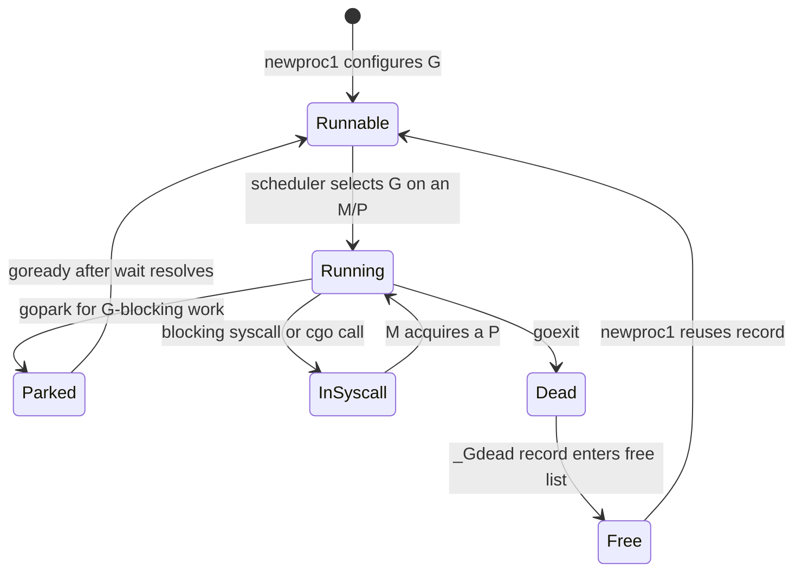
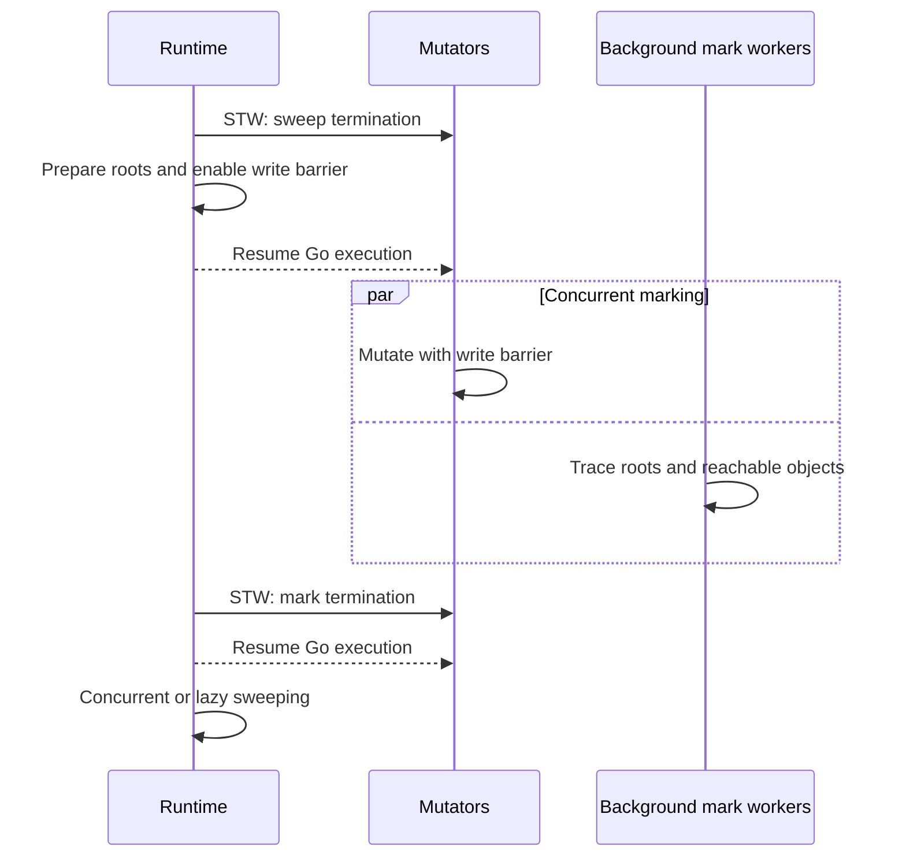
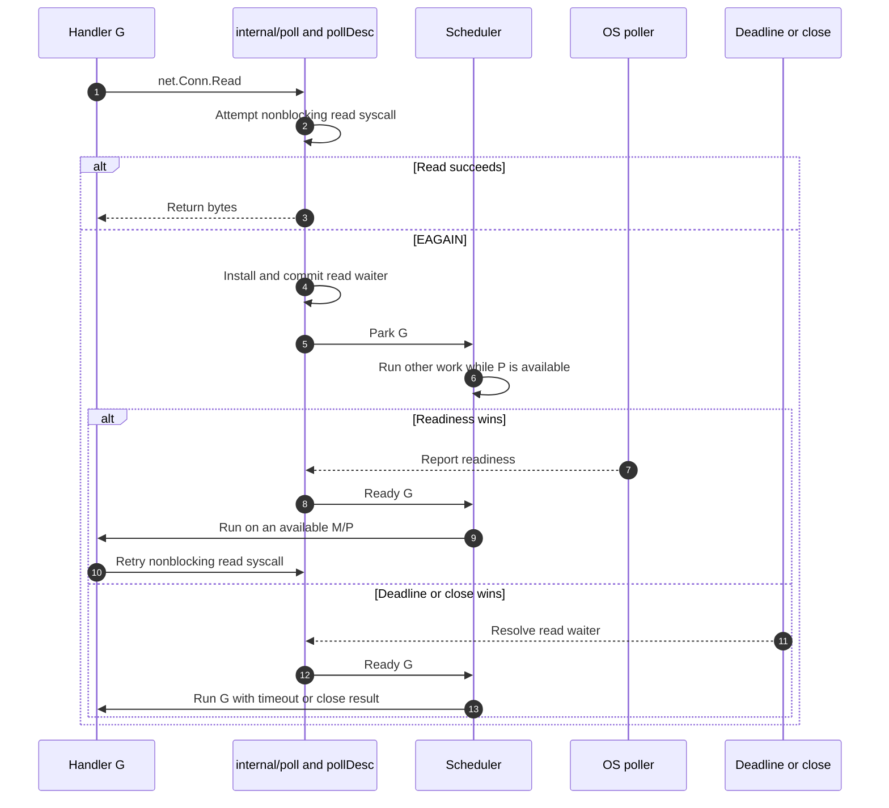

# Go Runtime Internals

## Scope and implementation baseline

The Go runtime is implementation-provided code and state linked into a Go executable. After the operating system loads the process and transfers control to its entry point, the runtime initializes Go-specific state and ultimately invokes `main.main`. It remains active while the program runs, supplying mechanisms required beyond the program's compiled instructions.

The runtime operates inside an operating-system process; it is neither the operating system nor an interpreter or virtual machine. Go code is compiled to native instructions, while the runtime coordinates those instructions with [operating-system threads](../../../Operating%20Systems/05%20Process%20Management.md#Processes%20vs.%20Threads), memory, timers, signals, and I/O. In particular, it schedules [goroutines](../../../Operating%20Systems/05%20Process%20Management.md#User-Space%20Threads%20%28Green%20Threads%20%26%20Coroutines%29), manages their movable stacks and heap allocation, performs garbage collection, parks and readies blocked work, and integrates pollable network I/O with scheduling. These mechanisms make lightweight concurrency and automatic memory management practical without changing Go's language-level semantics.

The implementation details below are pinned to the upstream `gc` compiler and runtime in Go 1.26.6, at commit `1ea5a71ad8ceb7b9f16b4b6f8ea4739a4327dd6e`. Internal layouts, scheduling policies, and performance heuristics are implementation details. Programs rely on the Go specification and documented APIs; language-level guarantees are identified separately where they matter.

## Compiler contracts consumed by the runtime

### SSA lowering and executable metadata

The compiler lowers typed Go through static single assignment (SSA), an intermediate representation in which each computed value is assigned once, into machine code. Alongside instructions, it emits metadata that maps program counters and stack locations to live Go pointers and identifies safe points where execution state is inspectable. The linker combines package code with the runtime and preserves the resulting function, pointer-map, stack-map, and relocation metadata. The resulting executable relies on object-file, loader, and [ABI mechanics](../../../Operating%20Systems/Compilers%2C%20Linkers%2C%20and%20Program%20Loading.md#ABI%20and%20Separate%20Compilation).

That metadata lets the runtime find pointers, copy stacks, unwind panics, construct profiles, and print stack traces without treating arbitrary machine words as pointers. The broader [language-runtime model](../../../Operating%20Systems/Compilers%2C%20Linkers%2C%20and%20Program%20Loading.md#Runtime%20Environments) separates this responsibility from the standard library and the operating system.

### Internal ABI and call metadata

An ABI specifies how separately compiled code agrees on calls, including argument and result placement. Go functions normally use the register-based `ABIInternal`; assembly and compatibility boundaries use `ABI0`, with compiler-generated wrappers bridging them. The internal ABI is deliberately unstable.

## Runtime bootstrap and execution model

### Runtime startup

Startup follows this Go-specific sequence:

1. A platform entry stub transfers control to the runtime.
2. The runtime establishes initial execution state, scheduler state, the allocator, garbage collector, signal machinery, and required bootstrap threads.
3. Package initialization runs in dependency order.
4. Control reaches `main.main`.

### Runtime execution model

The scheduler maps many goroutines onto operating-system threads through the following execution-state components.

#### G, M, and P

The components have distinct responsibilities rather than being analogues of OS process structures.

- **G — goroutine:** A goroutine's execution state: stack bounds, status, saved scheduling context such as [SP](../../../Operating%20Systems/02%20The%20Anatomy%20of%20a%20Process.md#Stack%20Pointer%20%28sp%29) and [PC](../../../Operating%20Systems/04%20Inside%20The%20CPU.md#Registers), waiting reason, and links to structures on which it waits. A `g` is not a [PCB](../../../Operating%20Systems/05%20Process%20Management.md#The%20Process%20Control%20Block%20%28PCB%29) or a complete architectural register file.
- **M — machine:** An OS thread plus runtime state. Each M has a system stack represented by `g0`; `gsignal` is a separate runtime G and stack used while that M handles a delivered signal.
- **P — logical processor:** Permission and per-processor runtime state needed to execute ordinary Go code: a run queue, allocator cache, timers, GC-worker state, and related caches. A P is neither a CPU nor permanently attached to one.

During bootstrap, the runtime creates the initial M (`m0`), its system G (`g0`), and the initial Ps before it can schedule ordinary Go code.

An M needs a P to execute ordinary Go code, and a P executes at most one G at a time. An M can exist without a P while it blocks in a syscall or performs runtime or foreign work. `GOMAXPROCS` limits the number of Ps that execute Go code concurrently, not the number of goroutines or OS threads. On Linux, Go 1.25's defaults can account for [cgroup CPU-bandwidth limits](../../../Operating%20Systems/10%20Virtualization%20and%20Containerization.md#Cgroups:%20Resource%20Governance) and update as limits change; configuration can override that default, and the policy does not create CPU affinity.

#### Runtime scheduler control paths

The scheduler uses internal runtime functions to make these execution-state transitions explicit. They are implementation details rather than public Go APIs, so their names, signatures, and scheduling policies are not language guarantees.

- **`newproc` and `newproc1`:** Configure a G to start a new goroutine and make it runnable.
- **`goexit`:** Handles the current G's exit when its goroutine function returns.
- **`gopark`:** Changes a G from running to waiting and returns its M to the scheduler through `g0`.
- **`goready`:** Changes a waiting G back to runnable work.
- **`findRunnable`:** Locates work for an M/P to execute according to the scheduler's work-discovery policy.
- **`wakep`:** Arranges for an M to execute runnable work when the scheduler needs another worker.

#### Goroutine creation and G reuse

A finished [G](#G%2C%20M%2C%20and%20P) enters the terminal `_Gdead` state before its record is put on a free list for reuse; it no longer represents executing work. Each [P](#G%2C%20M%2C%20and%20P) keeps a local free cache of `_Gdead` records. If that cache is empty and the shared global free cache has records, the runtime refills the local cache in a batch. If neither cache supplies a record, it allocates a new G.

A [`go` statement](../01%20Essentials/09%20Concurrency.md#Goroutine) is lowered to `newproc`, which calls the lower-level helper `newproc1`. It obtains a reusable G or allocates one, supplies a starting stack, and configures its initial execution context. When the goroutine function returns, that context continues through `goexit`, the runtime's goroutine-exit path. For an ordinary `go` statement, `newproc1` returns the configured G in the runnable state.

#### Runnable queues and work discovery

`newproc` preferentially places a new [G](#G%2C%20M%2C%20and%20P) in `runnext`, the current [P](#G%2C%20M%2C%20and%20P)'s single-G priority slot. Otherwise it enters that P's regular local run queue. `wakep` may arrange for another [M](#G%2C%20M%2C%20and%20P) to execute runnable work. `runnext` reduces handoff latency; it does not promise immediate execution.

Each P has its own `runnext` slot and a local run queue whose current capacity is 256. `runnext` and the regular queue are separate: a G placed in an empty `runnext` slot does not consume a regular-queue entry. When a `runnext` placement replaces an existing G, the displaced G is enqueued on the regular queue instead.

When a regular local queue overflows, the runtime removes half of its existing work, combines it with the incoming G, and publishes the batch to the shared global runnable queue rather than sending only the incoming G. With a capacity of 256, the batch contains 128 existing Gs plus the incoming G.

While the owner P prepares this transfer, another P that cannot find local or global runnable work can steal Gs from the same local queue. The owner atomically commits its half-queue removal; if the steal already changed the queue, that commit fails and the runtime retries the enqueue path. Batching amortizes synchronization and makes work available to idle Ps.

- **Full regular queue:** The owner P attempts to enqueue a G and observes that all 256 entries are occupied.
- **Enqueue sources:** The incoming G can originate from a `go` statement, a readying operation, or displacement from `runnext`.
- **Non-triggers:** An idle P or a G becoming runnable does not itself trigger the transfer.

Work discovery is a repeated, conditional policy rather than a fixed sequence. `findRunnable` considers several sources of work:

- **Timers and runtime work:** It checks early timers and scheduler work such as tracing or GC.
- **Fairness sampling:** It periodically samples the shared global runnable queue.
- **Immediately runnable work:** It favors available local or global runnable work.
- **Network events:** It polls nonblocking network events.
- **Work stealing:** When a P cannot find local or global runnable work, it selects another P as a victim and takes a bounded batch from that victim's local queue. Atomic queue updates prevent concurrent scheduler operations from taking the same Gs.

Some checks restart the search when they make work available. A local-queue overflow transfers roughly half of its work together with the incoming G; victim work stealing normally transfers a batch, which is a distinct policy. Idle Ms may briefly spin to avoid wake-up latency, but the runtime limits spinning Ms to avoid needless CPU and OS-thread consumption.

#### Parking, readying, syscalls, and timers

Parking is the common transition for a [G](#G%2C%20M%2C%20and%20P) that cannot proceed. It records a wait state and calls `gopark`; the [M](#G%2C%20M%2C%20and%20P) switches through `g0` to the scheduler, and the [P](#G%2C%20M%2C%20and%20P) can run another G. The responsible subsystem later uses a readying path such as `goready`, which makes the G runnable. A ready G need not resume immediately, on the same M, or on the same P.

- **G-blocking operations:** A channel wait, contended mutex, or pollable socket operation parks a G while leaving the P available.
- **M-blocking operations:** Many syscalls, cgo calls, and some file operations block the M. cgo is the generated Go/C boundary, including its ABI and stack transitions. On a blocking [syscall](../../../Operating%20Systems/09%20Kernel%20and%20User%20Space.md#System%20Calls), the runtime detaches or hands off the P so another M can execute Go work; the returning M must acquire a P before returning to ordinary Go code.

Per-P timer structures make work runnable at expiry. Scheduler sleep decisions and netpoll waits account for the next deadline.

#### Preemption and safe points

Safe points are places where the runtime can account for a [G](#G%2C%20M%2C%20and%20P)'s state. They support fairness, stack scanning, stop-the-world coordination, stack growth, and runtime bookkeeping.

- **Blocked safe points:** A parked G no longer executes user instructions and has an inspectable state.
- **Synchronous safe points:** Compiler-generated checks, including stack-growth checks, provide places where a running G can enter runtime control.
- **Asynchronous safe points:** Instructions whose interrupted state the runtime can safely recover.

`sysmon` is a dedicated monitor in the `gc` runtime. It executes on an [M](#G%2C%20M%2C%20and%20P) without a [P](#G%2C%20M%2C%20and%20P), so it does not run ordinary Go code. It periodically observes scheduler state to reclaim a P from an M stalled in a syscall, request preemption after a P has made no scheduling progress for a time slice, and perform related runtime maintenance such as network polling and force-GC checks.

Preemption then proceeds as follows:

1. **Request:** When a P's scheduling tick does not advance for a time slice, `sysmon` requests preemption of its running G. The current `forcePreemptNS` value is 10 ms, but it is a best-effort scheduling target, not a latency SLA.
2. **Synchronous path:** The request marks the G, and a later stack check takes the preemption path.
3. **Asynchronous path:** Go 1.14 added asynchronous preemption, so a tight loop need not wait for a [function-prologue](../../../Operating%20Systems/02%20The%20Anatomy%20of%20a%20Process.md#Function%20Prologue%20and%20Epilogue) check. On Unix-like platforms, this may use a [delivered signal](../../../Operating%20Systems/05%20Process%20Management.md#POSIX%20Signals) such as `SIGURG`; the runtime uses it as an internal interruption mechanism rather than for socket urgent-data handling by the Go program. The exact interruption mechanism is platform-specific and not a language contract.
4. **Fallback and pointer handling:** An asynchronous interruption succeeds only at an asynchronous safe point. The runtime preserves the interrupted context and may conservatively treat register or stack contents as possible pointers when precise compiler-map positions are unavailable. Otherwise, the pending synchronous request remains effective.

## Synchronization and wait records

The language defines [channels](../01%20Essentials/09%20Concurrency.md#Channel) and synchronization semantics; the following data structures and transitions are upstream `gc` implementation details. A blocked G must become visible to a future waker before it parks, without holding the lock that waker needs. The runtime first places a reusable wait record on the relevant queue, then uses a parking commit routine to release that queue's lock as the G parks.

### Channel state and wait records

A non-nil channel value refers to an `hchan`, the runtime's channel state. Its buffer and waiter queues describe one synchronized object; they are not separate synchronization mechanisms.

#### `hchan` state

An `hchan` has two places where unfinished communication is represented: `buf` retains values that have been sent but not received, while its waiter queues retain blocked operations that have no immediate transfer path. The buffer holds elements; the queues hold `sudog` records that identify participating Gs and their source or destination locations.

Fixed metadata describes how to copy and clear each element. The buffer's occupancy, queue membership, and closed state change under one channel lock, keeping storage and waiting operations consistent as a value moves directly between goroutines, enters or leaves the buffer, or resolves a blocked operation.

- **Element metadata:** `elemtype` and `elemsize` describe one channel element so the runtime can copy and clear values correctly.
- **Buffer shape:** `dataqsiz` is the fixed buffer capacity and `buf` is its storage. A capacity of zero gives an unbuffered channel, which has no data slots.
- **Buffer occupancy:** `qcount` is the number of buffered elements, from zero through `dataqsiz`. `sendx` identifies the next slot to fill and `recvx` identifies the next slot to drain. Both wrap at the capacity.
- **Lifecycle state:** `closed` records the irreversible transition made by `close`; it does not remove values already buffered.
- **Waiter queues:** `recvq` is the FIFO queue of receivers that could not obtain a value, and `sendq` is the FIFO queue of senders that could not supply a value. The queues hold wait records, not channel elements.
- **Channel lock:** A private runtime mutex serializes channel state transitions and protects channel-related fields in blocked wait records. It is distinct from a program-level mutex.

The buffer is a circular FIFO queue, not a collection of independently synchronized slots. A buffered channel with `qcount > 0` has no blocked receivers, and one with `qcount < dataqsiz` has no blocked senders. At least one of `recvq` and `sendq` is empty, except that a [`select`](../01%20Essentials/09%20Concurrency.md#Select) can register several operations for the same G and place unbuffered-channel cases in both queues.

#### `sudog` wait records

A `sudog` is a reusable runtime record for one G's participation in a channel or another runtime synchronization wait. It is not the G itself. For a channel operation, it links the waiting G into `recvq` or `sendq`, identifies the channel, and records either the destination for a receive or the source for a send. It also records whether a communication succeeded or the channel was closed. A `select` creates one such queue participation for each blocking case.

The record's element address can point into the waiting G's stack. The channel lock therefore protects both queue membership and the parts of the record that a [stack copy](#Stack%20growth%2C%20copying%2C%20pointer%20adjustment%2C%20and%20shrinking) must inspect or adjust. This connection lets goroutine stacks remain movable while another G completes a channel transfer.

### Unbuffered and buffered channel operations

The runtime first decides whether an operation can complete immediately. A sender gives an already waiting receiver priority over buffer insertion; a receiver can similarly complete a waiting sender's operation. The channel lock makes that decision and its state changes one critical section, so a completion path cannot race with a competing send, receive, or close.

#### Immediate completion paths

- **Send to a waiting receiver:** The runtime removes a record from `recvq`, copies the sender's element directly to the receiver's destination, releases the channel lock, and readies the receiver. This direct handoff bypasses the buffer even when the channel has capacity.
- **Send into a buffer:** When no receiver waits and `qcount < dataqsiz`, the runtime copies the element to the slot at `sendx`, advances `sendx` modulo the capacity, and increments `qcount`.
- **Receive from a waiting sender:** For an unbuffered channel, the runtime copies the waiting sender's element directly to the receiver's destination. For a buffered channel, a sender waits only after the buffer is full: the receiver copies the oldest buffered element from `recvx`, then copies the sender's element into that same slot. The receiver observes FIFO order while the sender fills the slot it vacated.
- **Receive from a buffer:** When no sender waits and `qcount > 0`, the runtime copies the element at `recvx` to the receiver, clears the buffer slot, advances `recvx` modulo the capacity, and decrements `qcount`. Clearing the slot releases any pointer-bearing element stored there for garbage collection.
- **Closed channel:** A send detects the closed state under the lock and panics. A receive drains buffered elements first; only a closed, empty channel produces the element type's zero value and a false comma-ok result.

Together, these updates preserve FIFO ordering: `sendx`, `recvx`, and `qcount` remain one queue state under the channel lock. An unbuffered channel has no data slots, so each value transfer pairs a sender and receiver.

#### Blocking and nonblocking paths

A nil-channel send or receive blocks indefinitely. For a non-nil channel, an operation that cannot take an immediate path either reports that it was not selected (for example, a `select` case with `default`) or parks its G. The runtime's lock-free fast paths only prove a nonblocking operation cannot proceed; a successful operation, a close observation, and queue mutation use the locked path.

To block, the current G acquires a `sudog`, records either the address of its send value or the address that will receive a value, and enqueues that record on `sendq` or `recvq` while holding the channel lock. `gopark` uses a commit function that records the G's channel-stack state and releases the lock as it parks. A competing operation can therefore either see the queued record and complete it or see that the G has not yet become a waiter; it cannot miss a waiter between those states.

The goroutine that completes the operation removes the `sudog`, performs the transfer or close resolution, marks the result, releases the channel lock, and calls `goready`. The parked G later resumes, releases its wait record, and either returns normally or observes the close outcome. Being readied only makes the G runnable; the scheduler does not guarantee that it resumes immediately or on the same M or P.

#### Direct transfer and movable stacks

Direct handoff copies between memory owned by two goroutines, so a `sudog` can temporarily point into a parked goroutine's stack. The runtime performs the copy while holding the channel lock and uses type-aware barrier work for the transfer. Its [stack-copying machinery](#Stack%20growth%2C%20copying%2C%20pointer%20adjustment%2C%20and%20shrinking) uses the same wait-record and channel-lock coordination before it adjusts such pointers. This preserves both the element transfer and the garbage collector's view of pointer-containing values while goroutine stacks move.

### Runtime semaphore parking

The runtime semaphore is an address-keyed wait and wake protocol used by runtime and standard-library synchronization code. It is not a POSIX semaphore and does not by itself define mutex ownership or a public synchronization API. Its associated synchronization object stores a 32-bit availability count.

- **Uncontended acquire:** An acquire atomically decrements a positive count and continues without allocating a wait record or parking.
- **Contended acquire:** A G obtains a `sudog`, locates the wait-queue root (`semaRoot`) selected by a hash of the count's address, increments that root's waiter count, and retries the atomic acquire while holding the root lock. The retry closes the race in which a release occurred before the G was fully registered as a waiter. If the count remains unavailable, the root queues the record and the G parks while releasing the root lock.
- **Release:** A release increments the availability count before checking the root's waiter count. A nonzero count causes a lookup for a waiter on that exact address; if one exists, the runtime removes its record and readies its G after dropping the root lock.
- **Shared roots:** A `semaRoot` serves many semaphore addresses. It keeps a randomized balanced search tree of addresses, with a waiter list for each address, so a release cannot wake a G waiting on a different synchronization object that happened to hash to the same root.

The waiter count makes release and park compose correctly: once an acquirer has incremented it and rechecked availability, a later release either leaves a count for some acquirer to consume or finds a registered waiter to ready. This is the semaphore counterpart of the channel parking commit protocol.

### Close and `select` queue resolution

[Closing a channel](09%20Concurrency.md#Closing%20channels) takes its lock, rejects an already closed channel, and marks the channel closed. Buffered elements remain in `buf`, so later receives drain them before observing closure. The runtime then removes every waiting receiver and sender from the respective queues while still holding the channel lock.

- **Waiting receivers:** Their destinations are cleared to the element type's zero value, and they resume with an unsuccessful communication result.
- **Waiting senders:** Their values are not inserted; they resume and the send path panics because the channel is closed.
- **Readying:** The runtime drops the channel lock before calling `goready` for either group. It must not change another G's status while holding that lock because the readying and stack-management paths can otherwise deadlock.

A [`select`](../01%20Essentials/09%20Concurrency.md#Select) first polls its cases in a randomized order, avoiding deterministic preference when several cases are ready. When no case is immediately selectable and there is no `default`, it locks the participating channels in a stable address order, creates a `sudog` for each blocking case, and queues those records. A send or receive that completes one case claims the G's select state before it readies the G. When the G resumes, it removes the records for every losing case before continuing with the winning case. Stable lock ordering prevents two overlapping selects from deadlocking while they register or remove their queue records.

### Language-level ordering guarantees

The language-level ordering does not depend on `hchan`. These are [Go memory-model](https://go.dev/ref/mem) guarantees:

- **Matching send and receive:** A send happens before completion of its matching receive.
- **Close observation:** Closing a channel happens before a receive that observes the closed state.
- **Buffered channels:** For capacity `C`, the kth receive happens before completion of the k+Cth send.
- **Unbuffered channels:** A receive happens before completion of its matching send.

### Mutex fast paths, spinning, parking, and starvation

[`sync.Mutex`](../01%20Essentials/09%20Concurrency.md#Mutex) maintains an internal state word with lock, wake, starvation, and waiter-count bits. Its uncontended `Lock` path atomically changes an unlocked state to locked. When that change fails, the slow path decides whether to spin, join the semaphore wait queue, or accept a direct handoff; the runtime semaphore supplies the park/wake mechanics but does not decide mutex ownership.

- **Bounded spinning:** A contender may use bounded active [spinning](../../../Backend%20Engineering/Concurrency/01%20Concurrency%20Fundamentals.md#Spinlocks) before parking when the mutex is locked but not starving. A spinning G can mark itself as woken, preventing `Unlock` from waking another waiter unnecessarily.
- **Normal mode:** A woken waiter competes with newly arriving goroutines for the lock. This favors throughput because an already-running goroutine can acquire the mutex without a scheduler handoff, but a waiter that repeatedly loses requeues near the front.
- **Starvation mode:** A sufficiently delayed waiter switches the mutex into starvation mode. `Unlock` then uses a semaphore handoff to transfer ownership to the waiter at the front; new arrivals neither spin nor acquire an apparently unlocked mutex ahead of it. The mutex returns to normal mode when the handoff no longer has a long-waiting queue to protect.

These policies are runtime heuristics, not API guarantees.

## Stack and control-flow machinery

### Goroutine stacks

#### Goroutine stack allocation and adaptive starting size

Goroutine stacks are contiguous and movable, unlike segmented stacks, which grow by chaining separately allocated stack segments. `stackMin` is 2 KiB, and `fixedStack` adds and rounds platform-specific overhead; it is the minimum allocation model, not a fixed initial size. With adaptive stack starts enabled, `startingStackSize` is recomputed from scanned stack use after GC and can exceed that minimum.

Stacks use dedicated allocation pools and a stack-specific path rather than ordinary `mcache.alloc` size-class spans. The per-P stack cache is nevertheless held in `mcache`, the P-local runtime cache structure that also supplies small-object allocation.

#### Stack growth, copying, pointer adjustment, and shrinking

When a function prologue finds insufficient stack space, growth follows this sequence:

1. The prologue compares the stack pointer with a guard and transfers through `morestack` on the system stack.
2. The runtime allocates a larger contiguous stack and copies live frames.
3. It adjusts pointers into the old stack.
4. It returns the old storage to stack pools.

Stacks can also shrink, commonly during GC-related stack processing. Stack copying preserves these constraints:

- **Pointer maps:** Compiler pointer maps identify pointer-containing stack slots.
- **External stack references:** `sudog` records and other runtime state containing pointers into a copied stack must be adjusted.
- **Coordination:** Arbitrary concurrent access to another G's stack would break this invariant, so channel handoff and stack copying coordinate through channel locks and `sudog` metadata.
- **`//go:nosplit`:** Marks runtime paths that cannot safely start ordinary stack growth.

Goroutine stacks therefore provide dynamically resizable backing for function frames. They do not decide which values belong in those frames: the compiler separately determines whether each value can remain in a stack frame or requires heap storage.

### Defer implementation

The compiler does not universally implement [`defer`](../01%20Essentials/09%20Concurrency.md#Defer) as a heap list of [closures](../01%20Essentials/08%20Functions%20Deep%20Dive.md#Closure).

- **Open-coded defers:** Eligible functions use function-local state and metadata.
- **Record-based defers:** Other paths use stack-allocated records or heap-backed records when lifetime or control flow requires them.

The compiler emits enough metadata for panic unwinding to discover open-coded defers. Deferred arguments and receivers are evaluated when the `defer` statement executes, and normal return invokes defers in reverse registration order.

### Panic unwinding and recovery

Panic handling proceeds in the current G:

1. The runtime constructs or obtains panic state and associates it with the G.
2. It walks that goroutine's frames and executes applicable deferred functions.
3. It continues unwinding unless a valid recovery succeeds.
4. An unhandled panic prints diagnostic information and terminates the process.

The following constraints determine where recovery applies and how termination differs:

- **Goroutine scope:** A [`panic`](../01%20Essentials/09%20Concurrency.md#panic) unwinds only its originating goroutine; other goroutines do not receive it, even though an unhandled panic later ends the process.
- **Valid recovery:** `recover` is meaningful only when called by a deferred function while that goroutine unwinds the corresponding panic.
- **Other contexts:** Calls outside that context, including indirect calls that fail the required boundary, return `nil`.
- **Recovery effect:** Successful recovery stops unwinding and follows the language's return semantics; it does not jump back to the panicking statement.
- **Non-panic termination:** A runtime fatal error or `throw` is an unrecoverable process fault, and `os.Exit` terminates without running defers.

## Object placement and memory allocation

### Escape analysis and object placement

Escape analysis is compile-time dataflow analysis over aliases, assignments, calls, closures, [interfaces](../01%20Essentials/06%20Interfaces%20and%20Generic%20Code.md#Interface), and lifetimes. It makes a placement decision: a value can reside in a goroutine's movable stack frame only when the compiler proves that its lifetime and references fit there safely. Stack-resident locals occupy space described by the compiled frame layout; ordinary locals do not make a general runtime allocation call analogous to a heap allocation.

When that proof fails or heap storage is otherwise required, generated code requests storage from the runtime allocator. Taking an address alone does not force a heap allocation; returned or stored references, captured variables, interface conversions, indirect calls, dynamically sized values, inlining, and interprocedural analysis can all affect the result. Inlining substitutes a call's body at a call site; interprocedural analysis follows facts across call boundaries.

Escape decisions are compiler- and version-dependent. `go build -gcflags=-m` reports decisions for a build, but it is a diagnostic rather than a language contract.

### Heap allocator and storage hierarchy

The runtime allocator supplies heap storage dynamically. Its layers cooperate to move from a P-local fast path toward runtime-wide page management; they are allocator state and coordination layers, not separate kinds of memory.

- **`mcache`:** Per-P fast-path allocation state that supplies small-object slots from current spans. It is not per-thread or per-core state: it reduces allocator contention but cannot promise [L1/L2 residency](../../../Operating%20Systems/04%20Inside%20The%20CPU.md#The%20Cache%20Hierarchy), because Ms and Ps move across CPUs.
- **`mcentral`:** Shared span supply for a size class. It refills an `mcache` when its current span cannot satisfy another small allocation.
- **`mheap`:** The runtime-wide heap manager. It manages heap pages and spans, supplies and reclaims spans, and tracks their allocation and mark metadata.

Heap storage has a nested physical-and-logical relationship: an object occupies a slot; a slot belongs to a span; a span consists of heap pages; and the runtime manages those pages through virtual-memory operations ultimately implemented by the OS. An arena is a runtime-managed partition of the Go heap address space. `mheap` uses the platform-memory abstraction to reserve address space and obtain or release physical backing, so reserved virtual address space does not necessarily have physical backing yet; committed or otherwise physically backed pages are usable for allocations.

> [!note] Go Heap Arenas and the Arena Pattern
> An [arena pattern](../../../Operating%20Systems/02%20The%20Anatomy%20of%20a%20Process.md#The%20Arena%20Pattern) is an application allocation strategy: a program reserves a region, allocates from it—often by advancing a bump pointer—and reuses or discards the region as one lifetime unit. A Go heap arena instead partitions the runtime-managed heap. Although `mheap` acquires and releases physical backing through [mapping and unmapping pages](../../../Operating%20Systems/03%20Memory%20Management.md#Mapping%20and%20Unmapping%20Pages), the application neither resets a Go heap arena nor frees its objects as a unit; the runtime allocates through spans and reclaims unreachable objects through garbage collection.

For small objects, a size class rounds a request to a reusable slot size, and a scan class distinguishes spans whose objects contain heap pointers from noscan spans whose objects do not. A span is a contiguous allocator unit: it provides equal-sized slots for one size and scan class, or it backs a large object. This span-and-size-class design is [slab-like](../../../Operating%20Systems/03%20Memory%20Management.md#Slab%20Allocation), but unlike a classical type-specific slab cache, Go classifies slots primarily by allocation size and pointer-scanning requirements.

### Tiny, small, and large allocation paths

The runtime chooses an allocation path from the request's size and pointer properties. Common small allocations remain on the `mcache` fast path; refills move through `mcentral` to `mheap` only when necessary.

- **Tiny objects:** Pointer-free objects below the tiny threshold can share a tiny allocation block. This path advances a bump offset within that block, reducing fragmentation and metadata overhead.
- **Small objects:** A request maps to a scan or noscan size class. A P's `mcache` uses allocation bits, an allocation cache, and a free index to consume a free slot from the current span. When that span has no free slot, the cache refills from `mcentral`, which obtains spans from `mheap`.
- **Large objects:** These bypass the normal small-object `mcache`/`mcentral` path and obtain a suitably sized span from `mheap`. `mheap` can reuse reserved and committed free heap pages, so a large allocation does not inherently issue a new OS mapping.

The allocator zeroes storage as required and maintains pointer metadata so the collector can trace the heap correctly. A heap allocation therefore consumes reusable runtime-managed storage; it does not by itself imply a fresh OS mapping. When the object later becomes unreachable, garbage collection returns its slots or spans to this allocator before scavenging separately considers unused pages for release toward the OS.

## Garbage collection and object lifetime

Heap allocation occupies a slot until the object becomes unreachable. Marking establishes which objects remain live, then sweeping makes dead slots and spans reusable by the allocator. This reclamation path is distinct from scavenging: scavenging releases physical backing of unused heap pages toward the OS.

### Object graph, roots, and reachability

The collector follows the object graph formed by heap pointers. Roots are pointers directly known to the runtime, including globals, goroutine stacks, and runtime data structures. An object is reachable when tracing from those roots reaches it; unreachable objects are eligible for reclamation. A mutator is application or runtime code that changes this graph while collection runs.

Reachability is not lexical scope. The compiler can treat a value as dead before its surrounding function returns once it proves no later use; references in stacks, globals, runtime structures, or finalizer state can also extend lifetime.

### Collector properties

The `gc` runtime uses a precise, type-aware tracing collector.

- **Concurrent and parallel marking:** Background workers trace reachable objects while the program runs.
- **Non-generational collection:** The collector does not divide objects into generations.
- **Non-compacting heap objects:** The collector does not relocate heap objects to reclaim space.
- **Mark-and-sweep reclamation:** Tracing identifies unreachable objects, and sweeping makes their storage reusable.
- **Write barrier during concurrent marking:** Pointer updates preserve reachability while tracing proceeds.

> [!NOTE] Go 1.26
> Green Tea is the default garbage-collector implementation in Go 1.26. It changes marking and scanning implementation, not language reachability semantics or the broad model of a concurrent, tracing, non-generational, non-compacting collector.

### Mark cycle and stop-the-world transitions

The GC pacer is the runtime controller that chooses cycle trigger points and balances expected background work with mutator assists. Collection can be selected by the pacer, allocation pressure, a memory limit, or explicit collection; it is neither continuous nor pause-free.

A stop-the-world (STW) transition temporarily prevents mutators from executing Go code so the runtime can establish a global collector state. A mark cycle has these stages:

1. Sweep termination performs a short STW transition into marking.
2. The runtime prepares roots and enables the write barrier.
3. Background workers trace globals, stacks, and reachable heap objects concurrently with mutators.
4. Mark termination performs another short STW transition.
5. Concurrent or lazy sweeping makes dead slots and spans reusable.

Tricolor marking is a correctness model: white objects are not yet discovered, gray objects await scanning, and black objects have been scanned. It does not require breadth-first traversal. The runtime uses distributed work structures; in Go 1.26, Green Tea changes marking and scanning to improve locality and scalability, particularly for small objects. On Intel Ice Lake and AMD Zen 4 or newer amd64 platforms, vector instructions can assist scanning.

### Write barrier and GC assists

The hybrid deletion/insertion write barrier preserves the tricolor invariant while a mutator changes pointers during tracing. It ensures that changing a pointer cannot make a reachable object invisible to the collector.

During marking, black allocation marks a newly allocated object so it does not need to be rediscovered as white. An allocation can also incur GC assist work when the mutator has incurred more allocation debt than the pacer planned. Assists let allocation pressure contribute tracing work rather than leaving all progress to background workers.

### Pacing, `GOGC`, and `GOMEMLIMIT`

Live heap is the storage found reachable at the end of marking. The pacer uses `GOGC` to control the heap-growth target relative to live heap and roots: a larger value trades memory for less frequent GC work. `GOMEMLIMIT` is a soft limit for the runtime's memory use, not a hard heap cap. An excessively restrictive limit can cause GC thrashing and high CPU use.

### Sweeping and scavenging

Sweeping makes dead object slots and spans reusable by Go's allocator. Scavenging releases the physical backing of unused heap pages to the OS. Free heap memory can therefore remain mapped and reusable without remaining resident.

- **Heap in use:** Memory assigned to spans, including free slots in those spans.
- **Reserved heap:** Address space retained by the runtime.
- **Process RSS:** Physical memory currently resident.

Go has background and allocation-time scavenging paths.

### Finalizers and cleanups

A finalizer becomes eligible only after the runtime determines that its object is unreachable. It runs asynchronously in a runtime-managed goroutine, has no prompt-execution guarantee, and may never run before process termination. It can resurrect an object by making it reachable again, and cycles involving finalizers complicate reachability. Finalizers are therefore unsuitable for correctness-critical release of files, locks, transactions, or network resources.

`runtime.AddCleanup`, introduced in Go 1.24, provides a separate cleanup mechanism rather than finalizer-equivalent semantics. Cleanups run after an object becomes unreachable, can run concurrently, and have their own documented caveats and lifecycle constraints. They still do not provide prompt or guaranteed release, so explicit resource management remains necessary.

### Pointer liveness and `runtime.KeepAlive`

`unsafe.Pointer` is a pointer representation subject to Go's pointer rules; an ordinary [Go pointer](../01%20Essentials/04%20Understanding%20Pointers.md#Creating%20a%20pointer) keeps its reachable object alive. By contrast, `uintptr` is an integer and not a GC-visible reference. Converting a pointer to `uintptr`, retaining it, and later converting it back can lose liveness and violate pointer rules. Some conversions are valid only within one expression because the compiler and runtime recognize that pattern.

Pointers into goroutine stacks require additional care because [stack copying](#Stack%20growth%2C%20copying%2C%20pointer%20adjustment%2C%20and%20shrinking) changes their addresses. The current heap is non-moving, but that implementation detail does not grant unrestricted pointer use as a language guarantee. `checkptr` detects selected invalid pointer arithmetic and conversions but cannot prove arbitrary unsafe code correct.

The required liveness boundary for a foreign call is:

1. The program performs its final foreign or syscall use of an object.
2. The compiler might otherwise regard that object as dead before function return.
3. `runtime.KeepAlive(obj)` after the operation establishes the required liveness point.
4. This prevents premature cleanup or finalization; it does not synchronize ordinary shared-memory access.

These restrictions make syscall argument liveness, finalizers and cleanups, foreign-memory ownership, cgo pointer passing, and GC pointer metadata compatible with a movable-stack runtime.

## Runtime representations of Go values

Representation affects copying, aliasing, scanning, and escape decisions. It does not alter language-level behavior promised by the specification.

### Strings

A string is conceptually a descriptor containing a pointer to immutable bytes and a length. Assignment copies that descriptor, not the bytes, and slicing normally creates another descriptor into the same backing storage. A small substring can therefore retain a much larger allocation. String bytes contain no heap pointers, so their storage is noscan memory.

Converting between `string` and `[]byte` normally needs distinct immutable or mutable storage, though the compiler can eliminate copies in selected contexts. Unsynchronized concurrent assignment to or access of a string is a [data race](../../../Backend%20Engineering/Concurrency/01%20Concurrency%20Fundamentals.md#Race%20Conditions). Because the descriptor has multiple words, an ordinary concurrent assignment can also be observed inconsistently.

### Slices

A [slice](../01%20Essentials/07%20Arrays%2C%20Slices%20and%20Maps.md#Slices) descriptor has a backing-array pointer, length, and capacity. Passing it copies the descriptor rather than its elements, so two slices can alias one array. A zero-length slice can still retain a large backing array.

`append` follows this sequence:

1. If capacity remains, it extends the view and writes into the existing array.
2. Otherwise, it chooses a new capacity with an implementation growth heuristic.
3. It allocates an appropriately rounded backing array, copies the live prefix, and returns a new descriptor.

An append that reallocates breaks that particular backing-array relationship. Pointer-containing arrays require write barriers and GC scanning, while pointer-free arrays can use noscan spans. Capacity growth is not a guaranteed doubling rule.

### Interfaces, boxing, and type metadata

An empty interface records a dynamic type and data. A non-empty interface associates the dynamic type with method-dispatch metadata, commonly an `itab`. Depending on representation, an interface assignment may store a value indirectly. Boxing is the representation or allocation of a concrete value so it can be carried through an interface; converting a concrete value to an interface does not inherently require allocation because escape analysis and boxing requirements decide.

Interface equality first compares dynamic types and then uses type-specific equality; comparison panics when the dynamic value is not comparable. Compiler- and runtime-generated type metadata and caches support method dispatch and type assertions. These descriptors also connect ABI metadata, pointer maps, reflection, and dynamic dispatch.

### Reflection and runtime type metadata

The executable includes runtime type descriptors. They support:

- **Interface conversion and assertion:** Runtime type relationships used at dynamic-interface boundaries.
- **Equality and hashing:** Type-specific comparison and hashing operations.
- **GC pointer maps:** Identification of pointer-containing data.
- **Reflection and map operations:** Dynamic inspection and runtime map behavior.
- **Allocation size and alignment:** Object layout decisions.
- **Method lookup and panic formatting:** Dynamic dispatch and diagnostic rendering.

Reflection therefore exposes compiler/linker-generated metadata rather than being merely a source-level library abstraction.

Dynamic inspection and calls can inhibit compiler optimization, interface conversion can require boxing, and constructing reflected values can allocate. Some reflection operations only inspect metadata and need not allocate.

### Maps

The language-level behavior of [maps](../01%20Essentials/07%20Arrays%2C%20Slices%20and%20Maps.md#Maps) does not depend on their layout. The following Swiss-table design is an upstream `gc` Go 1.26.6 implementation detail, replacing the older bucket-and-overflow-bucket representation, and is documented by the pinned [`internal/runtime/maps/map.go`](https://github.com/golang/go/blob/go1.26.6/src/internal/runtime/maps/map.go).

#### Swiss-table groups and lookup

A group has eight key/value slots and an eight-byte control word. A hash divides into H1 and H2: H1 chooses a starting group and probe sequence, while H2 occupies control bytes that filter a group with word-level operations before full key comparison. Quadratic probing searches later groups with increasing offsets.

#### Deletion and growth

Deleted entries can remain tombstones because turning them into empty slots could incorrectly terminate a later probe.

- **Small maps:** A small map fits in one group.
- **Larger maps:** Multiple tables are selected through a directory resembling extendible hashing, in which hash-prefix partitions index tables.
- **Growth:** Can replace a table or split it in two, bounding the size of an individual growth operation.

#### Iteration semantics

Iteration order is deliberately unspecified and randomized.

- **Unseen deletion:** Deleting an unseen entry prevents its return.
- **Insertion:** A new entry may or may not be observed.
- **Modification:** A returned modified entry exposes its latest value.
- **Growth:** The iterator avoids duplicate entries while consulting replacement tables for current values.

#### Stack placement and concurrent access

A map and its backing storage can remain stack-resident when escape analysis proves that safe; stack copying adjusts the contained safe stack pointers. If a map may outlive a frame, escape analysis moves its storage or required referents to the heap.

Unsynchronized concurrent map writes are invalid; runtime detection of some such operations is diagnostic behavior, not synchronization.

## Operating-system and foreign-code integration

### cgo, ABI transitions, and pointer passing

cgo crosses Go and platform ABIs and stacks. A blocking C call blocks an M rather than necessarily a P, and a callback from C requires the runtime to recover or establish Go execution state. [Go's pointer-passing rules](https://pkg.go.dev/cmd/cgo#hdr-Passing_pointers) constrain Go pointers and lifetime while C retains access: retention beyond a call requires appropriately pinned Go memory for the required duration, and pointer-containing Go memory has further restrictions.

### OS-thread affinity

`runtime.LockOSThread` is required when state must remain associated with an OS thread, for example for some GUI, namespace, or foreign-runtime APIs. A locked goroutine reduces scheduling flexibility and can increase OS-thread use.

### Signal handling

The kernel delivers [POSIX signals](../../../Operating%20Systems/05%20Process%20Management.md#POSIX%20Signals). The runtime owns in-process handling machinery: it installs or cooperates with handlers, classifies a delivered signal, and consumes, translates, forwards, or mediates it. It may use signals for asynchronous preemption, CPU profiling, synchronous-fault conversion, process-control behavior, diagnostics, or platform-specific coordination.

Each M has signal-related state, and `gsignal` supplies a runtime-controlled stack for signal handling. A handler must preserve interrupted register state and determine whether interruption occurred in Go, runtime, or foreign code; it cannot run arbitrary normal Go code. Synchronous faults such as invalid memory access can become Go panics when they correspond to recoverable Go behavior. Faults in runtime-critical or foreign code can instead be fatal or delegated.

`os/signal.Notify` requests mediated notification; it does not replace handlers the runtime needs, and some signals remain special, synchronous, or uncatchable. With cgo, handler installation, callbacks on foreign threads, and per-thread signal state must cooperate: the alternate signal stack is where a handler runs, and an inherited signal mask controls which signals the thread blocks.

### Network polling and I/O

#### Netpoll abstraction

Netpoll is a runtime abstraction, not a synonym for [`epoll`](../../../Operating%20Systems/07%20Socket%20Management.md#epoll%20Readiness%20Cycle) or a dedicated thread. Its implementations use OS facilities such as epoll, [kqueue](../../../Operating%20Systems/07%20Socket%20Management.md#kqueue%20Readiness%20Cycle), event ports, AIX polling, and Windows mechanisms. Scheduler paths and `sysmon` participate in polling and injecting ready work.

A `pollDesc` is runtime state associated with a pollable [file descriptor](../../../Operating%20Systems/07%20Socket%20Management.md#Sockets%20as%20Kernel%20Objects). It maintains independent read and write waiter state, plus state used to arbitrate readiness, deadlines, and closure; it is not the kernel descriptor itself. Descriptor closure, deadlines, timeout timers, and readiness race to resolve the corresponding waiter state.

#### Unix readiness-based read path

On Unix readiness-based ports, a pollable `net.Conn.Read` follows this path:

1. `net.Conn.Read` reaches `internal/poll`; the runtime prepares the read waiter state and attempts a nonblocking read syscall.
2. A successful read returns directly. `EAGAIN` means that this Unix read would block; it is not a cross-platform completion result.
3. On Linux, epoll interest is registered when the descriptor is opened. After `EAGAIN`, `pollDesc` installs and commits the read waiter unless readiness, timeout, or close has already won the race.
4. The OS poller reports readiness, and the runtime transitions the read-waiter state and readies the G.
5. The G retries the syscall because readiness is neither completion nor a durable promise that data remains available.

Linux currently uses edge-triggered epoll and an internal wake-up descriptor, but those are platform-specific implementation details.

#### Windows completion-based boundary

Windows networking uses overlapped I/O and completion machinery rather than the Unix `EAGAIN` readiness loop. The scheduler-level consequence remains the same: a G can park while its P executes other Go work and become runnable when the I/O operation's completion machinery resolves it.

#### Regular files, DNS, and TLS boundaries

- **Regular files:** A readiness facility does not make regular-file I/O asynchronously complete, so blocking filesystem operations can block an M.
- **DNS:** DNS can use pure-Go or cgo/system-resolver paths with different blocking behavior.
- **TLS:** TLS is primarily userspace computation over pollable network I/O.

#### HTTP connections and listener topology

- **Connection goroutines:** When a [`net/http`](../02%20Built-in%20libraries/HTTP%20Server.md) connection goroutine waits on pollable I/O, netpoll parks it and later makes it runnable for the scheduler. Its [shared listening socket topology](../../../Backend%20Engineering/Concurrency/02%20Application%20Server%20Concurrency.md#Multiple%20Workers%2C%20Single%20Shared%20Listening%20Socket) and HTTP-specific connection and request handling are application and protocol concerns.
- **Listener topology:** Multiple goroutines may call `Accept` on one `net.Listener`. `SO_REUSEPORT` instead distributes incoming connections among separately bound sockets.

## Diagnostics and failure detection

### Runtime traces, metrics, profiles, and compiler evidence

Runtime tools expose evidence about mechanisms, but each measures a particular signal rather than proving a causal explanation by itself.

- **Scheduler traces:** `GODEBUG=schedtrace` reports scheduler state snapshots, not end-to-end request latency.
- **GC and scavenger traces:** Runtime debug traces show cycle and scavenging activity, not an application's complete memory ownership graph.
- **`runtime/metrics`:** Supplies runtime-defined measurements whose units and meanings must be read with the selected Go version.
- **Profiles:** CPU, heap, goroutine, block, and mutex profiles sample or record different costs; none alone proves a root cause.
- **Execution tracing:** Trace and scheduler-latency views reveal runtime events and ordering. Go 1.25's `runtime/trace.FlightRecorder` maintains an in-memory window of recent trace events.
- **Compiler evidence:** Escape output, disassembly, and SSA diagnostics show build-specific compiler decisions.
- **Race detection:** `-race` instruments code and uses runtime support.

Interpreting [runtime evidence](../../../Backend%20Engineering/05%20Observability.md#Symptoms%20vs%20causes) requires telemetry design beyond these runtime-specific signals.

### Global deadlock detection

The runtime can identify a restricted global deadlock condition: no runnable goroutines, no executing Go work capable of progress, and no relevant timers, network events, or runtime work expected to make a G runnable. It can then report that all goroutines are asleep.

- A spinning or continuously runnable G can conceal a logical deadlock.
- The runtime cannot generally know whether an external system will respond.
- A G blocked forever while unrelated Gs continue is a leak, not a global deadlock.
- Cyclic application dependencies can remain invisible when foreign calls or external events participate.

### Experimental goroutine-leak profiling

Go 1.26 has an experimental goroutine-leak profile, enabled with `GOEXPERIMENT=goroutineleakprofile` and exposed through a `pprof` endpoint. It uses reachability relationships between blocked Gs and synchronization objects to identify some Gs that cannot be awakened.

- **Coverage:** It cannot detect every leak, including cases where a synchronization object remains reachable through globals or runnable G state.
- **Availability:** As of Go 1.26, the Go team aims to enable the feature by default in Go 1.27; this is not a compatibility promise.

### Race detector internals

Building with `-race` causes compiler instrumentation around memory accesses and synchronization. The linked runtime uses ThreadSanitizer-derived machinery to record access histories and happens-before edges, and standard synchronization operations include hooks it understands. Reports identify conflicting accesses and relevant goroutine-creation stacks.

Data-race-free sequential consistency (DRF-SC) means that a program without data races behaves as though its synchronization-consistent executions are sequentially consistent; the definition belongs to the [Go memory model](https://go.dev/ref/mem).

- **Instrumentation effects:** Instrumentation changes timing, memory use, binary size, and scheduler behavior.
- **Clean run:** The absence of a report establishes only that no detectable race occurred in the executions tested.
- **Coverage limits:** Unsafe code, assembly, cgo, and unsupported platforms can reduce coverage.

Race consequences follow from unsynchronized conflicting access.

## Scheduler, GC, and netpoll in one trace

The runtime's subsystems meet in a handler that reads from a network connection on a Unix readiness-based port:

1. The handler G runs on M1 with P0 and allocates through P0's `mcache`.
2. Allocation debt can make that G perform GC assist work.
3. A nonblocking socket read returns `EAGAIN`, so `pollDesc` installs and commits the read waiter before parking the G unless another event resolves the race.
4. M1 returns through `g0` to the scheduler, which selects another runnable G for P0.
5. The OS poller reports the descriptor ready and netpoll changes the waiter state, injecting the G into runnable work.
6. Another M/P can execute the G; resumption has no M or CPU affinity.
7. A deadline timer can race with readiness to produce a timeout, while a concurrent GC can scan the safely parked G.
8. On resumption, the G retries the read because readiness did not guarantee successful consumption.
