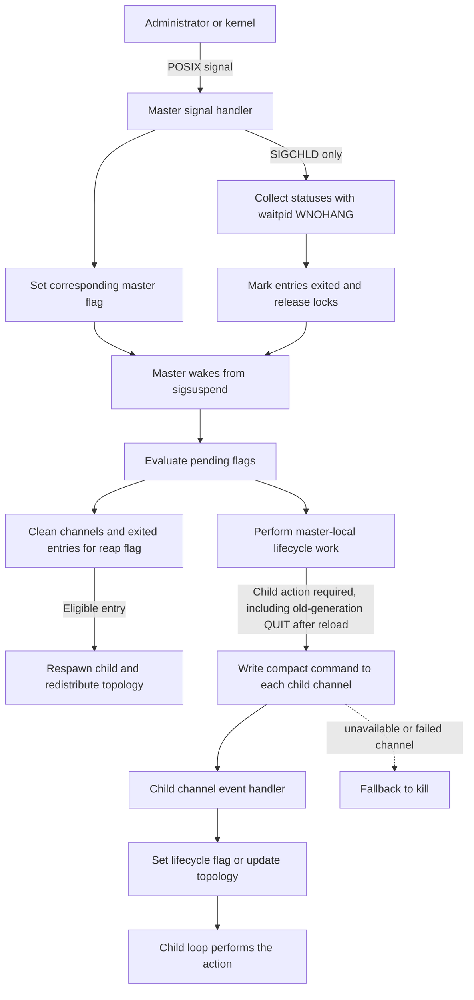
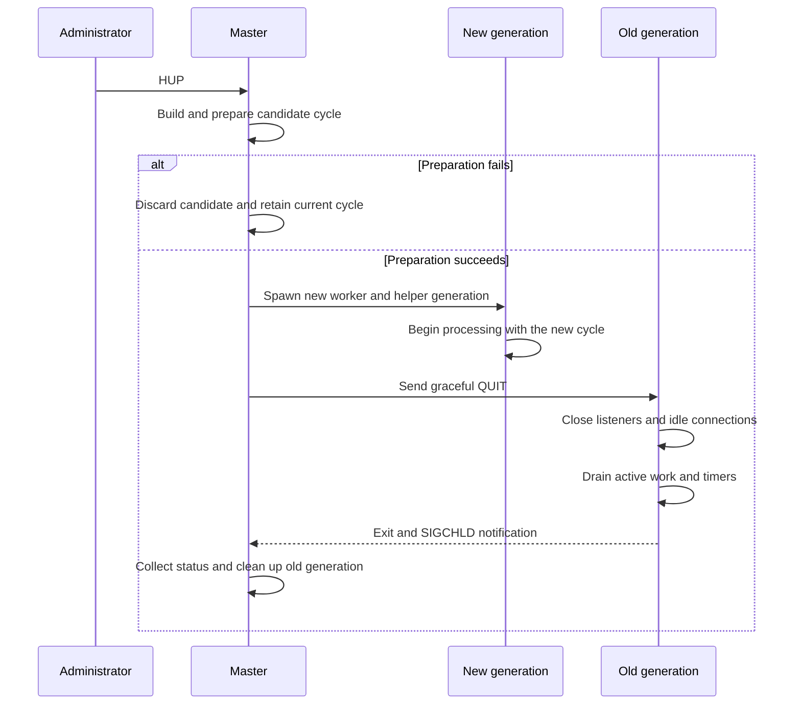
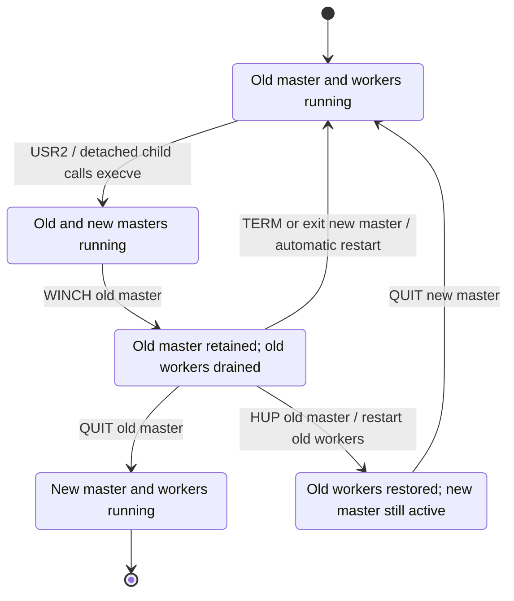

# NGINX Internals

NGINX combines a [multi-process execution model](../../Backend%20Engineering/Concurrency/02%20Application%20Server%20Concurrency.md#Multi-Process) with [event-driven connection handling](../../Backend%20Engineering/Concurrency/02%20Application%20Server%20Concurrency.md#Event-Driven%20Connection%20Handling). Worker processes provide CPU parallelism across cores, while each worker's event loop coordinates many network connections without creating one thread per connection.

This architecture separates two paths. Client and upstream traffic flows through listening and connected sockets owned by workers. Process-control messages flow between the master and its children so the master can change the process topology without carrying request data itself.

## The Worker Process Model

An NGINX instance normally consists of one master process and one or more worker processes. Some features also create helper processes, such as cache manager and cache loader processes.

- **Master process:** Reads configuration, prepares a configuration cycle, creates child processes, and coordinates their lifecycle. It does not process client traffic.
- **Worker processes:** Accept connections and advance client, upstream, timer, and protocol state through event handlers. A worker is primarily single-threaded and event-driven.
- **Helper processes:** Perform feature-specific background work that does not belong in the request-processing path.
- **Thread pools:** Offload selected operations that would otherwise block a worker. They supplement the event loop rather than replace the process model.

The configured worker count determines how much worker-level CPU parallelism is available. The default is one worker process; when `worker_processes auto` is configured, NGINX attempts to detect the number of available processors. Matching workers to available processors is a starting point rather than an invariant because the appropriate count also depends on the workload and surrounding resources.

## Startup and Worker Creation

Startup establishes the resources and relationships that the workers later use to process traffic:

1. The master reads the configuration and builds a configuration cycle containing module configuration, listening definitions, paths, and other runtime state.
2. It prepares shared resources such as log files and the listening sockets required by the configured listener architecture.
3. On Unix, before [`fork()`](../../Operating%20Systems/05%20Process%20Management.md#POSIX%20Process-Control%20Interface) creates a non-detached child, NGINX creates a [`socketpair(AF_UNIX, SOCK_STREAM, ...)`](../../Operating%20Systems/08%20Inter-Process%20Communication.md#Unix-Domain%20Sockets%20and%20Socket%20Pairs). The parent and child retain opposite endpoints as an internal control channel.
4. The child inherits the descriptors and state made available through process creation, then initializes the event-processing environment for its process type.
5. Worker processes enter their event loops and begin handling events for the listening sockets and connections assigned to them.

Because the master creates each child and its socket pair, the control endpoints require no pathname, listener, or later connection handshake.

## Connection Acceptance and Socket Management

The kernel maintains the [queues associated with each listening socket](../../Operating%20Systems/07%20Socket%20Management.md#Pending%20and%20Established%20Connection%20Queues). When a connection becomes available, a worker accepts it and receives a new connected socket. That worker then owns the client-side transport I/O until the connection is closed, although it may also coordinate separate upstream connections while processing the client's request.

NGINX supports two listener-ownership models. They differ in how the kernel and workers select the worker that will accept a new connection.

### Shared Listening Socket

Several workers can inherit references to one [shared listening socket](../../Operating%20Systems/07%20Socket%20Management.md#Shared%20Listening%20Socket) and call `accept()` themselves. Only one worker receives a given connected socket, but several workers may observe activity on the shared listener.

NGINX and the operating system can coordinate this accept path in different ways. An enabled `accept_mutex` serializes acceptance among workers. On supported systems, wake-up behavior such as `EPOLLEXCLUSIVE` reduces unnecessary competition without that mutex. The available behavior therefore depends on the event method, platform, version, and configuration rather than solely on the fact that the listener is shared.

### Per-Worker Listeners with `reuseport`

When a `listen` directive enables [`reuseport`](../../Operating%20Systems/07%20Socket%20Management.md#Multiple%20Listeners%20with%20SO_REUSEPORT) on a supported platform, NGINX creates an independent listening socket for each worker while binding those sockets to the same local address and port. The kernel assigns incoming traffic among the sockets, so workers do not coordinate access to one shared accept path.

Separate listeners reduce accept-path contention, but kernel distribution operates on transport traffic rather than the amount of application work that each connection will produce. Connections can therefore be distributed evenly while CPU, memory, or request-processing work remains uneven.

| Dimension | Shared listener | Per-worker `reuseport` listeners |
| --- | --- | --- |
| Listener ownership | Several workers reference one socket | Each worker owns an independent socket |
| Accept queue | Shared by the workers | Separate queue for each listener |
| Initial distribution | Workers coordinate acceptance | Kernel selects a listener |
| Main limitation | Contention or unnecessary wake-ups can occur | Transport distribution may not balance application work |

> [!note] Version boundary
> The `reuseport` parameter became available in NGINX 1.9.1. It introduced an optional listener architecture rather than replacing the shared-listener model for every later deployment.

## Worker Event Loop and Connection Lifecycle

A worker uses an operating-system event method such as `epoll` or `kqueue` to observe many resources through [readiness-based I/O](../../Operating%20Systems/07%20Socket%20Management.md#Readiness-Based%20I%2FO). Readiness means that an operation may make progress; the corresponding handler still performs the `accept()`, `read()`, or `write()` operation and updates the resource's state.

Each event-loop iteration follows an ordered cycle:

1. Find the timer nearest to expiration and use it to bound the next wait.
2. Ask the configured event module to wait for I/O events.
3. Dispatch handlers for resources reported as ready.
4. Expire elapsed timers and invoke their handlers.
5. Process events that handlers deferred to the posted-events queue.

The handlers advance connections incrementally rather than completing one connection before considering another:

1. A readiness event on a listener causes the worker to accept a client connection and allocate connection state for the resulting socket.
2. The selected protocol handler initializes the connection, including any required proxy-protocol parsing or TLS handshake.
3. Later read and write events advance request parsing, response transmission, or bidirectional stream forwarding.
4. Reverse proxying adds an upstream connection whose connect, read, write, and timeout events are coordinated by the same worker event loop.
5. After processing finishes, NGINX either waits for another request on a reusable connection or closes the connection and releases its state.

When one connection is waiting for network readiness, the worker continues dispatching ready events for other connections. This is the mechanism that produces high I/O concurrency within a single worker; the multiple worker processes separately provide CPU parallelism.

## Blocking Work and Thread-Pool Offload

Nonblocking network waits do not suspend the worker on behalf of one connection. The event loop records the required state, stops advancing that connection, and handles other ready work. If no events are ready, the worker sleeps inside the operating system's event-wait operation until I/O or the next timer wakes it.

A blocking system call or long CPU-bound handler has a different effect: it occupies the worker's event-loop thread, so the worker cannot advance its other connections until that operation returns. NGINX modules must therefore avoid blocking work in event handlers or arrange an appropriate offload mechanism.

NGINX thread pools provide bounded offload for selected operations, including supported file I/O. A worker submits a task, continues processing events, and later handles the task's completion. This interface is not a general-purpose threaded request model: most NGINX functions are not thread-safe, so an offloaded task must restrict itself to supported system calls or thread-safe library work.

## Master Process and Worker Control

On Unix, the master owns the control plane for its workers and helper processes. Administrative and kernel signals first change master state; the master then translates the requested action into process creation, reaping, or compact commands sent over per-child Unix-domain channels. These channels carry lifecycle metadata, not the request or upstream payloads transported by [listening and connected sockets](../../Operating%20Systems/07%20Socket%20Management.md#Listening%20Socket%20vs.%20Connected%20Socket).

### Signal Reception and Command Dispatch

The master process runs a control loop for worker and helper lifecycle management; it does not run the client-I/O event loop. That loop normally waits in `sigsuspend()` until a signal wakes it, then evaluates the recorded control state and performs the required lifecycle work.

[POSIX signals](../../Operating%20Systems/05%20Process%20Management.md#POSIX%20Signals) change that control state; they do not cause the signal handler to perform shutdown, reload, or worker-management work directly.

Most master signal handlers only set the flag associated with the received signal. `SIGCHLD` also begins nonblocking status collection:

1. Its handler sets the reap flag and calls `ngx_process_get_status()`.
2. That function loops over `waitpid(..., WNOHANG)`, records each collected status, marks the matching process entry as exited, and releases locks held by the dead process.
3. The master loop later observes the reap flag and completes the lifecycle transition.

External signals and internal channel commands form separate control tiers. The master interprets the external signal, then sends a compact command to an existing child when the requested action belongs in that child. It normally maps `QUIT`, `TERM` or `INT`, and `USR1` to `QUIT`, `TERMINATE`, and `REOPEN`, respectively. If a child has no usable channel or the channel write fails, the master falls back to `kill()` with the corresponding signal.

During initialization, each child registers its channel endpoint with its event mechanism. The channel handler records lifecycle commands as flags for the worker or helper loop to process at a safe point, while topology commands update the local process table and descriptor set.

| Signal | Master action | Child command | Result |
| --- | --- | --- | --- |
| `QUIT` | Begin graceful shutdown | `QUIT` | Workers drain; helpers exit according to their role loop |
| `TERM` / `INT` | Begin fast shutdown and escalate if needed | `TERMINATE` | Children exit without draining |
| `HUP` | Build a candidate cycle and, on success, start new children | `QUIT` to the old generation | Failure preserves the old cycle; success replaces the generation |
| `USR1` | Reopen files and notify children | `REOPEN` | Log descriptors are replaced after rotation |
| `USR2` | Prepare PID and environment state, then start a detached child that calls `execve()` | None | Old and new masters coexist during upgrade |
| `WINCH` | Gracefully stop the current worker and helper set | `QUIT` | Master remains available without active children |
| `SIGCHLD` | Collect status nonblocking, then clean exited entries in the master loop | None | Channels close and eligible children respawn |

### Process Channels and Topology Updates

Before each non-detached child is created with `fork()`, the master creates a Unix `SOCK_STREAM` socket pair and records its endpoints in a process-table slot with the child's PID. The master retains one endpoint and the child uses the opposite endpoint as its control channel. During initialization, the child closes unused inherited opposite endpoints so that it does not keep unrelated channel ends alive accidentally.

<!-- TODO: Review the rationale and scope of the full process-channel topology against current upstream NGINX. NGINX really synchronizes later-created channel[0] descriptors to already-running processes with OPEN_CHANNEL/SCM_RIGHTS, but current core lifecycle messages are ordinarily sent from the master to children. Explain the broader process-channel table as maintained infrastructure without implying that W1 needs W2's descriptor for ordinary master→worker control. Also revisit the later claim that these channels "do not form a data path between workers": distinguish current protocol usage from what the bidirectional topology could support. -->

Process creation makes channel knowledge asymmetric. A new child inherits master-side endpoints for children whose channels already existed at its `fork()`, but earlier children cannot inherit a descriptor created later. NGINX repairs that asymmetry by distributing topology changes:

- **Open a channel:**
    1. The master creates the pair, forks the child, and assigns its process-table slot and PID.
    2. It sends `OPEN_CHANNEL` records containing the slot, PID, and the new [channel descriptor](../../Operating%20Systems/08%20Inter-Process%20Communication.md#Explicit%20Descriptor%20Passing) to already-running children. `SCM_RIGHTS` transfers the descriptor with the record.
    3. Each receiver installs its own process-local descriptor for that endpoint and records it under the supplied slot and PID. The receiver's descriptor number need not match the sender's number.
- **Close a channel:**
    1. After a child exits, the master removes its channel from the active process entry and sends `CLOSE_CHANNEL` with the former slot and PID.
    2. Each receiver uses the trusted slot directly, then checks that its recorded descriptor is present and its PID still matches before closing and clearing the descriptor. The PID check prevents a stale close message from affecting a slot that has been reused.

The socket pairs are bidirectional IPC primitives, although NGINX's lifecycle protocol uses them primarily for commands from the master to its children. They distribute process-control state; they do not form a data path between workers.

### Child Exit and Respawn

The `SIGCHLD` handler performs nonblocking status collection through `ngx_process_get_status()`, but it does not complete the lifecycle transition. After the master wakes and observes the reap flag, `ngx_reap_children()` processes entries already marked as exited: it closes master-side channel endpoints, distributes `CLOSE_CHANNEL`, applies respawn policy, and repairs binary-upgrade and PID-file state when a new-binary transition ends or fails.

A child marked as respawnable remains eligible for replacement unless it exited with fatal status code `2`, the master is terminating, or that child generation is already exiting. A replacement receives a new socket pair and process-table entry, and the master redistributes the resulting channel topology with `OPEN_CHANNEL`. This preserves supervision after an unexpected worker exit without reviving workers that were deliberately drained during reload or shutdown.

Workers and helper processes share this spawning, channel, and reaping infrastructure. Their respawn policies differ by process role, so use of the common mechanism does not imply that every helper is restarted under the same conditions as a worker.
### Configuration Reload and Worker Generations

When the master receives a [reload signal](../../Operating%20Systems/05%20Process%20Management.md#POSIX%20Process-Control%20Interface), it builds and validates a candidate configuration cycle before disturbing the running generation. The preparation step opens resources required by the candidate and reuses compatible resources from the current cycle; it does not blindly reopen every listener, file, or shared object.

1. The master parses the candidate configuration and prepares its logs, listening sockets, shared state, and other cycle resources.
2. If preparation fails, it discards the candidate and leaves the old cycle and workers running.
3. If preparation succeeds, it commits the new cycle and starts a new worker and helper generation.
4. Only after starting the new generation does it send graceful `QUIT` commands to the old generation.
5. Old workers [close their listening sockets](../../Operating%20Systems/07%20Socket%20Management.md#Socket%20Lifetime%20and%20Closure), close idle connections, stop accepting new connections, and drain active work and outstanding timers.
6. Drained workers exit, and the master cleans up their process entries without respawning that exiting generation.

When `worker_shutdown_timeout` is configured, its expiration triggers attempts to close connections that remain open, placing a configured bound on graceful worker shutdown rather than allowing an indefinite drain.

### Shutdown and Log Reopening

The `WINCH` no-accept behavior and live-upgrade sequence assume normal daemonized master-process mode. The documented non-stop executable upgrade is unavailable with `daemon off`.

- **Graceful shutdown (`QUIT`):** The master sends `QUIT`. Workers stop accepting new connections, close idle connections, drain active work, and exit. Helper processes receive the same command but exit according to their own loop; the current cache manager and loader loops exit immediately rather than draining client work. The master exits after all child entries have been cleaned up.
- **Fast shutdown (`TERM` or `INT`):** The master sends `TERMINATE`, so children exit without a graceful drain. If children remain after repeated termination attempts, the master escalates to `SIGKILL`.
- **Worker stop (`WINCH`):** The master gracefully stops the current worker and helper set while continuing to run. Because the master remains alive with its cycle and listening descriptors, it can later start workers again.
- **Log reopening (`USR1`):** The master reopens configured files and adjusts ownership of the reopened files where its configuration requires it, then sends `REOPEN` to the children. Each child independently reopens the files it uses and replaces its old descriptors, allowing externally rotated log files to be released.

### Executable Upgrade and Rollback

`USR2` starts an executable upgrade rather than replacing the running master in place. The old master renames its PID file with the `.oldbin` suffix, prepares an environment variable named `NGINX` containing the inherited listening-descriptor numbers, and starts a detached child process. That child calls `execve()` and becomes the new master, which reconstructs access to the inherited listeners and starts its own workers while the old master and its workers continue to exist.

This overlap creates a rollback boundary. Sending `WINCH` to the old master gracefully drains its workers but leaves that master and its listening descriptors available. After the new generation proves healthy, `QUIT` retires the old master. To roll back after draining the old workers, `HUP` first makes the old master restart them; the new master can then be retired. Alternatively, terminating the new master—or its independent exit—causes the old master to restart its workers automatically when they had previously been drained.

