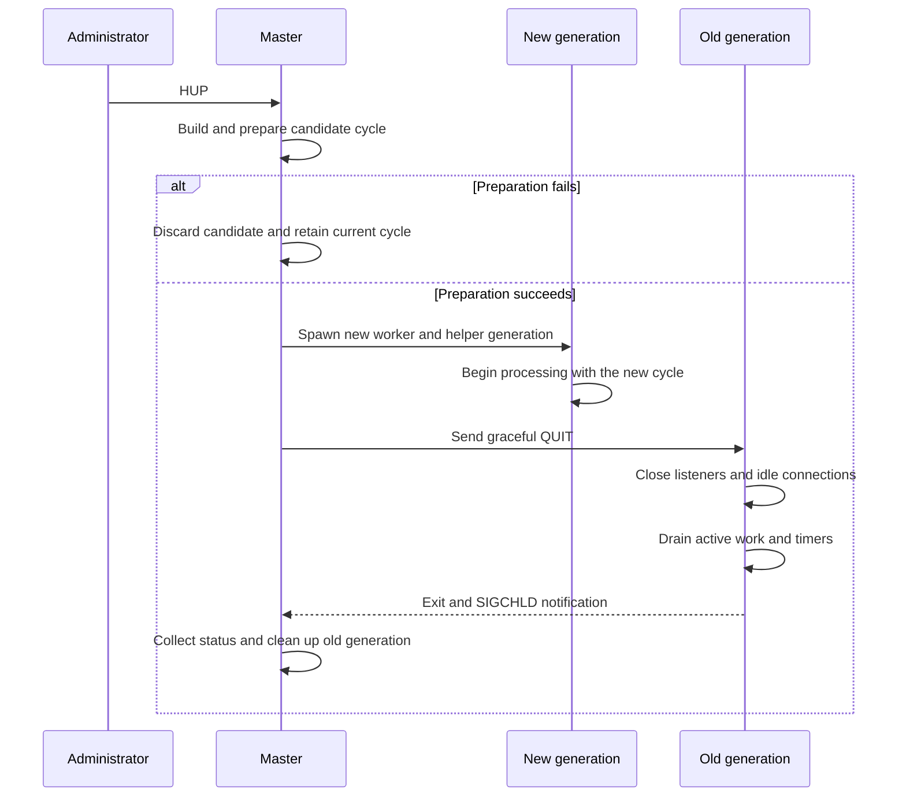
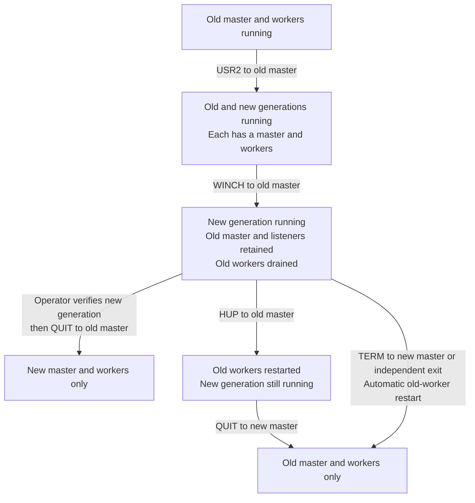

# NGINX Internals

NGINX combines a [multi-process execution model](../../Backend%20Engineering/Concurrency/02%20Application%20Server%20Concurrency.md#Multi-Process) with [event-driven connection handling](../../Backend%20Engineering/Concurrency/02%20Application%20Server%20Concurrency.md#Event-Driven%20Connection%20Handling). Workers provide CPU parallelism across processes, while each worker coordinates many network connections without creating one thread per connection.

The architecture separates a data plane from a control plane. Workers accept and process client and upstream traffic through listening and connected sockets. The master changes process topology and lifecycle without carrying request payloads itself.

## Architecture and Startup

### Process Roles

An NGINX instance normally consists of one master process and one or more worker processes. Some features also create helper processes, such as the cache manager and cache loader.

- **Master process:** Reads configuration, prepares configuration cycles, creates children, and coordinates their lifecycle. It does not process client traffic.
- **Worker processes:** Accept connections and advance client, upstream, timer, and protocol state through event handlers. A worker is primarily single-threaded and event-driven.
- **Helper processes:** Perform feature-specific background work outside the request-processing path.

The worker count sets the available worker-level CPU parallelism. The default is one worker process; `worker_processes auto` attempts to detect the available processors. Matching workers to processors is a starting point, not an invariant, because workload and surrounding resources also affect the appropriate count.

NGINX request-processing workers are primarily single-threaded, not because [threads cannot execute in parallel on different CPU cores](../../Operating%20Systems/05%20Process%20Management.md#Threads), but because separate worker processes provide both parallelism and isolation. Each worker owns private request state, so concurrent request handlers within that worker do not need to coordinate ordinary mutable state. If a worker exits unexpectedly, its failure does not directly overwrite sibling workers' private state, and the master can create a replacement. In contrast, threads share one address space: shared mutable state requires synchronization, memory corruption can affect other threads, and a process-fatal fault in one thread normally terminates the entire process. This isolation costs duplicated per-process state and explicit coordination for state that workers must share.

### Configuration Cycle, Runtime Resources, and Child Creation

Startup constructs the state that workers later use to process traffic:

1. The master reads the configuration and builds a configuration cycle containing module configuration, listening definitions, paths, and other runtime state.
2. It prepares shared resources, including log files and the listening sockets required by the selected listener architecture.
3. It creates workers and any configured helper processes. A managed, non-detached Unix child receives inherited descriptors and state, then initializes the event-processing environment for its process type.
4. Workers enter their event loops and begin handling events for their listening sockets and connections.

A managed child uses a control channel created by the master; its Unix socket-pair mechanics and lifecycle are described in [Process Control Channels](#Process%20Control%20Channels). The detached child used for a binary upgrade follows a different creation path.

### Reverse-Proxy Cache Helper Processes

When reverse-proxy caching is configured, NGINX creates two helpers that maintain cache state outside the request path.

- **Cache loader:** Starts after NGINX and incrementally scans existing cache files to rebuild shared-memory metadata. It loads the index, not every response body into RAM.
- **Cache manager:** Removes inactive entries and applies [`max_size` or `min_free` pressure](03%20Nginx%20Configuration.md#Reverse-Proxy%20Caching) through bounded iterations.

## Worker Data Plane

### Listener Ownership and Connection Acceptance

When a connection becomes available, a worker accepts it and receives a connected socket. That worker owns the client-side transport I/O until the connection closes, although it can coordinate separate upstream connections while processing a request.

NGINX uses either [multiple workers sharing one listener](../../Backend%20Engineering/Concurrency/02%20Application%20Server%20Concurrency.md#Multiple%20Workers%2C%20Single%20Shared%20Listening%20Socket) or [multiple listeners with `SO_REUSEPORT`](../../Backend%20Engineering/Concurrency/02%20Application%20Server%20Concurrency.md#Multiple%20Listeners%20with%20%60SO_REUSEPORT%60). Its NGINX-specific controls are:

- **`accept_mutex`:** Serializes acceptance among workers sharing a listener. It has been off by default since NGINX 1.11.3 and is unnecessary on systems that support `EPOLLEXCLUSIVE` or when `reuseport` is in use.
- **`reuseport`:** A `listen` directive with this parameter creates one independent listener per worker. It was introduced in NGINX 1.9.1 and requires operating-system support.

### Event Loop and Connection Lifecycle

A worker advances connections through three event sources: [readiness-based I/O](../../Operating%20Systems/07%20Socket%20Management.md#Readiness-Based%20I%2FO), timer expirations, and posted events deferred by a handler. [Timeout directives](03%20Nginx%20Configuration.md#Timeout%20Boundaries) choose deadlines for connection and request phases; the event loop stores the resulting active timer events in a timer tree and schedules their handlers. A timer measures a deadline independently of socket readiness—it does not inspect a receive buffer.

Each event-loop iteration follows this ordered cycle:

1. Find the nearest timer expiration and use its remaining duration as the maximum I/O wait.
2. Ask the configured event module to wait for I/O events. If I/O arrives first, it marks the corresponding events ready and runs their handlers.
3. Expire every elapsed timer and run its handler. If no I/O arrives first, reaching the nearest deadline ends the wait and leads to this step.
4. Process posted events after the I/O and timer handlers. A posted handler may defer work without running it recursively in the current handler's call stack.

Connection handlers change state incrementally instead of completing one connection before considering another:

1. A listener handler accepts a client connection and allocates state for its socket.
2. The selected protocol handler initializes that connection, including configured PROXY protocol parsing or a TLS handshake.
3. Later read and write handlers advance request parsing, response transmission, or bidirectional stream forwarding.
4. Reverse proxying adds an upstream connection whose connect, read, write, and timeout events the same worker event loop coordinates.
5. After processing finishes, NGINX waits for another request on a reusable connection or closes the connection and releases its state.

Each handler returns when its connection must wait for a later event, allowing the worker to advance other ready connections. This produces high I/O concurrency within a worker; separate worker processes provide CPU parallelism.

### Reverse-Proxy Cache Execution

For a [cache-enabled proxy request](03%20Nginx%20Configuration.md#Reverse-Proxy%20Caching), the worker evaluates the configured cache key, hashes it with MD5, and derives the cache-file path from that digest and the configured directory levels. The shared zone provides a mutex-protected, [slab-allocated](../../Operating%20Systems/03%20Memory%20Management.md#Slab%20Allocation) metadata index.

- **Red-black tree:** The upstream implementation uses a red-black tree to find cache entries from their MD5 digests. Each node represents one known entry: its tree key stores part of the digest, and the node retains the remainder together with file-existence, validity, error, active-use, update, body-offset, and file-size metadata.
- **Maintenance queue:** An ordered queue connects nodes for expiration and least-recently-used (LRU)-oriented work. It keeps recently used nodes near its front, so cleanup can consider the least recently used nodes first when reclaiming cache space.
- **Cache file:** The node and cache file divide the entry's state: the file holds the response body and the header that verifies the original configured key; neither is stored in the shared-memory node.

With that metadata and file layout, a request follows this path:

1. **Lookup:** The worker consults shared metadata and opens the corresponding file when an entry is eligible. The file begins with an NGINX cache header containing validity times, body offset, ETag and `Vary` data, and key-verification fields. NGINX verifies the header version and original key rather than trusting the MD5 filename alone.
2. **Hit:** A valid entry is served from the cache file without creating an upstream request.
3. **Miss:** The worker follows the normal reverse-proxy path to obtain the upstream response. With proxy buffering enabled, it can stream data toward the client while writing a temporary cache file.
4. **Publication:** After the response completes, NGINX renames the temporary file to its final MD5-derived path. Keeping temporary files and the cache directory on the same filesystem makes this a rename rather than a cross-filesystem copy; `use_temp_path=off` places temporary files in the cache directory.

During a coordinated cache fill, a worker briefly locks shared metadata, marks one node as updating, then releases the mutex. Equivalent requests wait through event timers instead of blocking the event-loop thread while a conventional mutex is held.

The response cache and the [page cache](../../Operating%20Systems/06%20Storage%20Management.md#Caching) operate in sequence but answer different questions. NGINX first decides whether an HTTP response is usable from its key, freshness, `Vary`, authorization policy, and upstream state. If it is usable, NGINX reads the response body from its cache file. The kernel then decides whether the required file pages are already in RAM or must be read from storage. A valid NGINX cache hit therefore does not guarantee a RAM-only read: the response can remain fresh in NGINX after the kernel has evicted its file pages.

During a cache fill, NGINX normally writes the temporary cache file through buffered I/O. The kernel first holds those bytes as dirty page-cache pages and persists them later through writeback. After NGINX receives the complete upstream response, `rename()` publishes the file under its final cache pathname, making it available to later cache lookups. That publication does not force dirty bytes to storage, because the cache is reconstructible performance state rather than a database recovery protocol with an [`fsync()`-style durability boundary](../../Operating%20Systems/06%20Storage%20Management.md#Write%20Durability%20and%20Synchronization).

### Blocking Work and Thread-Pool Offload

While a network operation awaits readiness, the worker can progress other ready connections. A blocking system call or long CPU-bound handler instead occupies the event-loop thread, preventing it from advancing other connections until the operation returns. Modules must avoid blocking event handlers or arrange an appropriate offload mechanism.

NGINX thread pools provide bounded offload for selected operations, including supported file I/O. A worker submits a task, continues processing events, and later handles its completion. Thread pools are not a threaded request model: offloaded work must not use NGINX objects that are confined to the event-loop thread.

Cache files are regular files, so a cold file read can occupy a worker unless an applicable asynchronous-I/O or thread-pool path is configured. `aio threads` offloads supported file reads.

### Direct I/O for Large Static Files

The static-file handler normally uses buffered I/O, allowing the kernel [page cache](../../Operating%20Systems/06%20Storage%20Management.md#Caching) to retain reusable file pages. With `directio` configured, NGINX uses a platform-specific direct-I/O mechanism for static files at or above the configured threshold—`O_DIRECT` on Linux, for example. This bypasses or minimizes page-cache use for that transfer, which prevents a large, low-reuse file from evicting more useful cached pages. The trade-off is that repeated reads of the same file no longer benefit from ordinary page-cache reuse.

- **Suitable workload:** A large download or media file that a client reads once is unlikely to be reused soon. Keeping its pages in RAM after the transfer offers little benefit, while it can displace hot pages belonging to more frequently requested files. Direct I/O avoids that cache-pollution trade-off.
- **Poor fit:** A frequently requested static file benefits when its first buffered read leaves file pages in the page cache for later requests. Direct I/O removes that ordinary reuse path, so repeated requests must use the direct-I/O path again instead of reusing hot kernel pages.

Direct I/O applies to static-file serving rather than to the reverse-proxy response cache. It changes the file-data path, not durability: [direct-I/O semantics](../../Operating%20Systems/06%20Storage%20Management.md#Direct%20I%2FO%20%28%60O_DIRECT%60%29) do not make writes persistent or replace `fsync()`.

On Linux, native AIO and NGINX's thread-pool I/O follow different paths.

- **Native AIO:** `aio on` requires `directio` for nonblocking file reads.
- **Selection with `sendfile`:** When `aio on`, `sendfile on`, and `directio` are configured together, NGINX uses AIO for files at or above the direct-I/O threshold and `sendfile` for smaller files. Direct I/O disables `sendfile` for an affected request.
- **Alignment:** Direct-I/O reads must meet alignment requirements. NGINX documents 512-byte alignment in general and 4 KiB on XFS; unaligned file ends and byte ranges are read in blocking mode.
- **Thread-pool I/O:** `aio threads` is a separate path for supported file reads and sends, and does not require Direct I/O.

## Master Control Plane

The master coordinates workers and helpers through process lifecycle state and compact control messages. Those messages are distinct from the request and upstream payloads carried by [listening and connected sockets](../../Operating%20Systems/07%20Socket%20Management.md#Listening%20Socket%20vs.%20Connected%20Socket).

### Process Control Channels

For each managed, non-detached Unix child, the master creates a [`socketpair(AF_UNIX, SOCK_STREAM, ...)`](../../Operating%20Systems/08%20Inter-Process%20Communication.md#Unix-Domain%20Sockets%20and%20Socket%20Pairs) before [`fork()`](../../Operating%20Systems/05%20Process%20Management.md#POSIX%20Process-Control%20Interface). The parent and child retain opposite endpoints. During initialization, the child registers its endpoint with the event loop, allowing the master to send lifecycle commands to that child.

Current lifecycle messages flow from the master to its children. These channels carry process-control commands rather than client requests or upstream payloads.

### Signal Reception and Command Dispatch

The master runs a control loop for worker and helper lifecycle management rather than the client-I/O event loop. It normally waits in `sigsuspend()` until a signal wakes it, then evaluates the recorded control state and performs the required lifecycle work.

[POSIX signals](../../Operating%20Systems/05%20Process%20Management.md#POSIX%20Signals) change that state; the signal handler does not perform reload, shutdown, or worker-management work directly. Most handlers only set the associated flag. `SIGCHLD` also starts nonblocking status collection:

1. Its handler sets the reap flag and calls `ngx_process_get_status()`.
2. That function loops over `waitpid(..., WNOHANG)`, records collected status, marks matching process entries as exited, and releases locks held by dead processes.
3. The master loop observes the reap flag and completes the lifecycle transition.

External signals and internal channel commands are separate control tiers. The master interprets an external signal, then sends a compact command to an existing child when that action belongs in the child. When a channel command is unavailable or its write fails, including where platform limitations prevent using the channel path, the master falls back to `kill()` with the corresponding signal.

The channel handler records lifecycle commands as flags for the worker or helper loop to process at a safe point.

| Signal         | Master action                                                                        | Child command                | Result                                                           |
| -------------- | ------------------------------------------------------------------------------------ | ---------------------------- | ---------------------------------------------------------------- |
| `QUIT`         | Begin graceful shutdown                                                              | `QUIT`                       | Workers drain; helpers exit according to their role loop         |
| `TERM` / `INT` | Begin fast shutdown and escalate if needed                                           | `TERMINATE`                  | Children exit without draining                                   |
| `HUP`          | [Reload configuration](#Configuration%20Reload%20and%20Worker%20Generations)         | `QUIT` to the old generation | Failure preserves the old cycle; success replaces the generation |
| `USR1`         | Reopen files and notify children                                                     | `REOPEN`                     | Log descriptors are replaced after rotation                      |
| `USR2`         | Prepare PID and environment state, then start a detached child that calls `execve()` | None                         | Old and new masters coexist during upgrade                       |
| `WINCH`        | Gracefully stop the current worker and helper set                                    | `QUIT`                       | Master remains available without active children                 |
| `SIGCHLD`      | Collect status nonblocking, then clean exited entries in the master loop             | None                         | Channels close and eligible children respawn                     |

> [!note] `SIGWINCH` in NGINX
> [`SIGWINCH`](../../Operating%20Systems/05%20Process%20Management.md#POSIX%20Signals) conventionally reports a terminal window-size change and defaults to being ignored. NGINX catches it and repurposes it as a no-accept command: the master remains running while it gracefully stops its current workers and helpers.

### Child Exit and Respawn

The `SIGCHLD` handler collects status through `ngx_process_get_status()`, but it does not complete the lifecycle transition. When the master observes the reap flag, `ngx_reap_children()` cleans up entries already marked as exited, applies respawn policy, and repairs binary-upgrade and PID-file state when a new-binary transition ends or fails.

A respawnable child remains eligible for replacement unless it exited with fatal status code `2`, the master is terminating, or its generation is already exiting. A replacement receives a fresh control channel. This maintains master supervision after an unexpected worker exit without reviving workers deliberately drained during reload or shutdown.

Workers and helper processes share spawning, channel, and reaping infrastructure, but their respawn policies differ by role. The common mechanism therefore does not mean every helper restarts under the same conditions as a worker.

## Operational Lifecycle Transitions

### Configuration Reload and Worker Generations

On a [reload signal](../../Operating%20Systems/05%20Process%20Management.md#POSIX%20Process-Control%20Interface), the master builds and validates a candidate configuration cycle before disturbing the running generation. Preparation opens resources required by the candidate and reuses compatible resources from the current cycle; it does not blindly reopen every listener, file, or shared object.

1. The master parses the candidate configuration and prepares its logs, listening sockets, shared state, and other cycle resources.
2. If preparation fails, it discards the candidate and leaves the old cycle and workers running.
3. If preparation succeeds, it commits the new cycle and starts a new worker and helper generation.
4. Only after starting the new generation does it send graceful `QUIT` commands to the old generation.
5. Old workers [close their listening sockets](../../Operating%20Systems/07%20Socket%20Management.md#Shutdown%20and%20Descriptor%20Closure), close idle connections, stop accepting new connections, and drain active work and outstanding timers.
6. Drained workers exit, and the master cleans up their process entries without respawning that exiting generation.

When `worker_shutdown_timeout` is configured, its expiration triggers attempts to close connections that remain open. It bounds graceful worker shutdown instead of allowing an indefinite drain.

### Shutdown, Worker Stop, and Log Reopening

The `WINCH` no-accept behavior and live-upgrade sequence assume normal daemonized master-process mode. The documented non-stop executable upgrade is unavailable with `daemon off`.

- **Graceful shutdown (`QUIT`):** The master sends `QUIT`. Workers stop accepting new connections, close idle connections, drain active work, and exit. Helper processes receive the same command but exit according to their own loop; the cache manager and loader exit immediately rather than draining client work. The master exits after all child entries have been cleaned up.
- **Fast shutdown (`TERM` or `INT`):** The master sends `TERMINATE`, so children exit without a graceful drain. If children remain after repeated termination attempts, the master escalates to `SIGKILL`.
- **Worker stop (`WINCH`):** The master gracefully stops the current worker and helper set while continuing to run. Because it retains its cycle and listening descriptors, it can later start workers again.
- **Log reopening (`USR1`):** The master reopens configured files and adjusts ownership of reopened files where configuration requires it, then sends `REOPEN` to children. Each child reopens the files it uses and replaces old descriptors, allowing externally rotated log files to be released.

### Executable Upgrade and Rollback

#### Operator-Controlled Procedure

NGINX cannot decide whether a new executable is acceptable. A human operator—or operational automation assigned that policy—must choose whether to complete the upgrade or roll it back. Treated as a black box, the procedure is:

1. Replace the executable file, then send `USR2` to the old master. NGINX starts the new generation while the old generation continues to serve requests.
2. Send `WINCH` to the old master. Its workers stop accepting new connections and drain, leaving the new generation to serve requests while retaining a rollback path.
3. Verify the new generation and choose an outcome:
    - **Complete the upgrade:** Send `QUIT` to the old master to retire it.
    - **Roll back explicitly:** Send `HUP` to the old master to restore its workers, then send `QUIT` to the new master to retire the new generation.
    - **Recover after a new-generation failure:** Send `TERM` to the new master, or let it exit independently. The old master then restarts the workers drained by `WINCH` automatically.

#### Process Continuity and Rollback State

`USR2` starts a new executable alongside the old generation rather than replacing the running master in place. Sending it to the old master initiates this sequence:

1. The old master renames its [PID file](../../Operating%20Systems/05%20Process%20Management.md#PID%20Files) with the `.oldbin` suffix and prepares the `NGINX` environment variable with inherited listening-descriptor numbers.
2. It starts a detached child, which calls `execve()` and becomes the new master.
3. The new master reconstructs access to the inherited listeners and starts its workers. The old master and workers continue to exist alongside them.

The old master retains its listening descriptors after `WINCH` drains its workers. Stopping those workers therefore does not remove the rollback path: `HUP` can start workers from the old master again, and the old master restarts them automatically when the new master exits.

