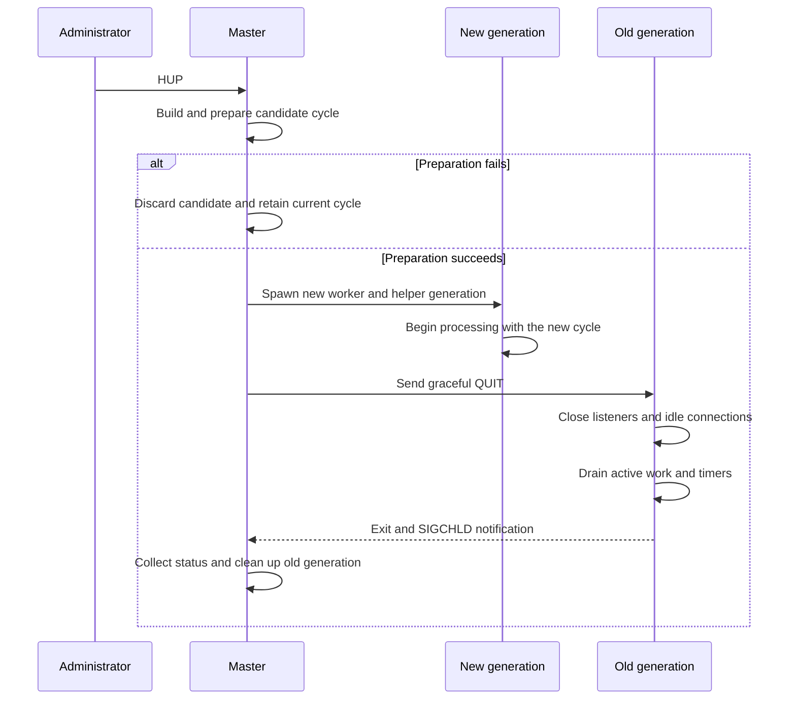
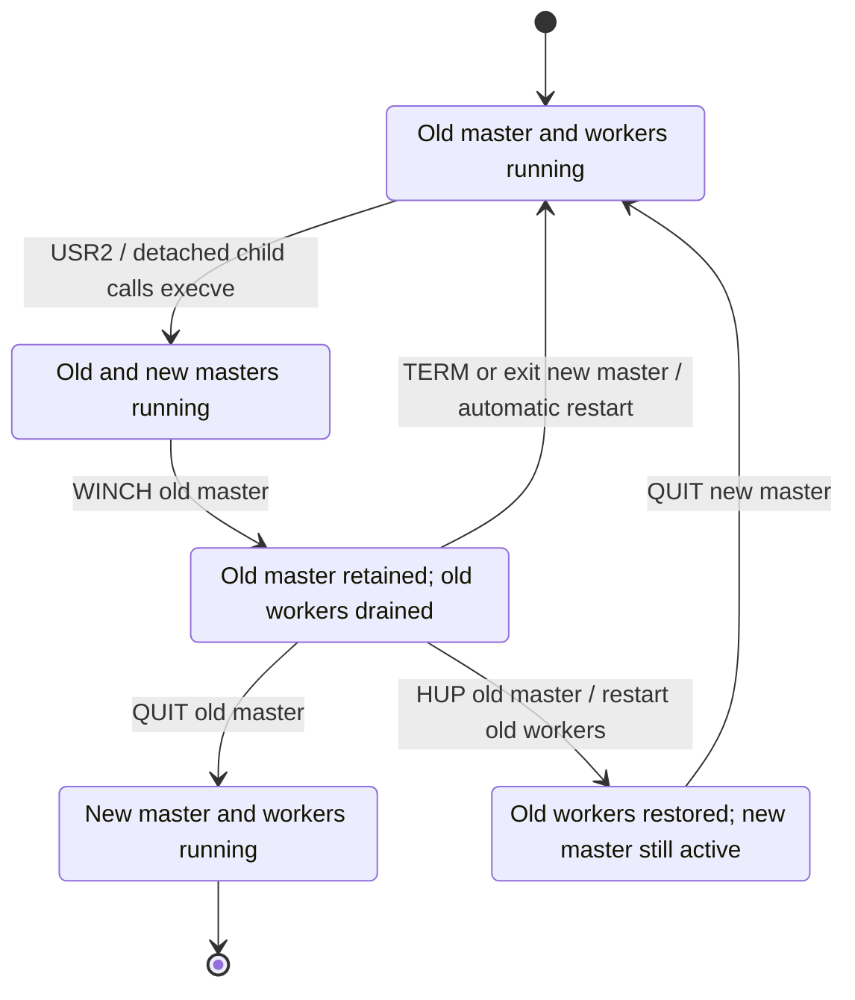

# NGINX Internals

NGINX combines a [multi-process execution model](../../Backend%20Engineering/Concurrency/02%20Application%20Server%20Concurrency.md#Multi-Process) with [event-driven connection handling](../../Backend%20Engineering/Concurrency/02%20Application%20Server%20Concurrency.md#Event-Driven%20Connection%20Handling). Workers provide CPU parallelism across processes, while each worker coordinates many network connections without creating one thread per connection.

The architecture separates a data plane from a control plane. Workers accept and process client and upstream traffic through listening and connected sockets. The master changes process topology and lifecycle without carrying request payloads itself.

## Architecture and Startup

### Process Roles

An NGINX instance normally consists of one master process and one or more worker processes. Some features also create helper processes, such as the cache manager and cache loader.

- **Master process:** Reads configuration, prepares configuration cycles, creates children, and coordinates their lifecycle. It does not process client traffic.
- **Worker processes:** Accept connections and advance client, upstream, timer, and protocol state through event handlers. A worker is primarily single-threaded and event-driven.
- **Helper processes:** Perform feature-specific background work outside the request-processing path.

The worker count sets the available worker-level CPU parallelism. The default is one worker process; `worker_processes auto` attempts to detect the available processors. Matching workers to processors is a starting point, not an invariant, because workload and surrounding resources also affect the appropriate count.

### Configuration Cycle, Runtime Resources, and Child Creation

Startup constructs the state that workers later use to process traffic:

1. The master reads the configuration and builds a configuration cycle containing module configuration, listening definitions, paths, and other runtime state.
2. It prepares shared resources, including log files and the listening sockets required by the selected listener architecture.
3. It creates workers and any configured helper processes. A managed, non-detached Unix child receives inherited descriptors and state, then initializes the event-processing environment for its process type.
4. Workers enter their event loops and begin handling events for their listening sockets and connections.

A managed child uses a control channel created by the master; its Unix socket-pair mechanics and lifecycle are described in [Process Channels and Topology Updates](#Process%20Channels%20and%20Topology%20Updates). The detached child used for a binary upgrade follows a different creation path.

## Worker Data Plane

### Listener Ownership and Connection Acceptance

The kernel maintains the [queues associated with each listening socket](../../Operating%20Systems/07%20Socket%20Management.md#Pending%20and%20Established%20Connection%20Queues). When a connection becomes available, a worker accepts it and receives a new connected socket. That worker owns the client-side transport I/O until the connection closes, although it can coordinate separate upstream connections while processing a request.

NGINX supports two listener-ownership models. They differ in how workers and the kernel select the worker that accepts a new connection.

- **Shared listener:** Several workers inherit references to one [shared listening socket](../../Operating%20Systems/07%20Socket%20Management.md#Shared%20Listening%20Socket) and call `accept()`. One worker receives each connected socket, but several workers can observe activity on the same listener. An enabled `accept_mutex` serializes acceptance among workers. It has been off by default since NGINX 1.11.3. Enabling it is unnecessary on systems that support `EPOLLEXCLUSIVE` or when `reuseport` is in use; the applicable behavior still depends on the event method, platform, version, and configuration.
- **Per-worker `reuseport` listeners:** When a `listen` directive enables [`reuseport`](../../Operating%20Systems/07%20Socket%20Management.md#Multiple%20Listeners%20with%20SO_REUSEPORT) on a supported platform, NGINX creates one independent listening socket per worker, bound to the same local address and port. The kernel selects a listener, so workers do not coordinate one shared accept path.

Separate `reuseport` listeners reduce accept-path contention, but the kernel distributes transport traffic rather than the application work each connection produces. Connections can be evenly distributed while CPU, memory, or request-processing work remains uneven.

| Dimension | Shared listener | Per-worker `reuseport` listeners |
| --- | --- | --- |
| Listener ownership | Several workers reference one socket | Each worker owns an independent socket |
| Accept queue | Shared by the workers | Separate queue for each listener |
| Initial distribution | Workers coordinate acceptance | Kernel selects a listener |
| Main limitation | Contention or unnecessary wake-ups can occur | Transport distribution does not balance application work |

> [!note] Version and platform boundary
> The `reuseport` parameter became available in NGINX 1.9.1. It is an optional listener architecture, not a replacement for the shared-listener model, and it requires operating-system support.

### Event Loop and Connection Lifecycle

A worker uses an operating-system event method such as `epoll` or `kqueue` to observe many resources through [readiness-based I/O](../../Operating%20Systems/07%20Socket%20Management.md#Readiness-Based%20I%2FO). Readiness means an operation may make progress; the handler still performs `accept()`, `read()`, or `write()` and updates resource state.

Each event-loop iteration follows this ordered cycle:

1. Find the timer nearest to expiration and use it to bound the next wait.
2. Ask the configured event module to wait for I/O events.
3. Dispatch handlers for resources reported as ready.
4. Expire elapsed timers and invoke their handlers.
5. Process events that handlers deferred to the posted-events queue.

Handlers advance a connection incrementally instead of completing one connection before considering another:

1. A listener readiness event causes the worker to accept a client connection and allocate state for the resulting socket.
2. The selected protocol handler initializes the connection, including any required PROXY protocol parsing or TLS handshake.
3. Later read and write events advance request parsing, response transmission, or bidirectional stream forwarding.
4. Reverse proxying adds an upstream connection whose connect, read, write, and timeout events the same worker event loop coordinates.
5. After processing finishes, NGINX waits for another request on a reusable connection or closes the connection and releases its state.

When one connection waits for network readiness, the worker continues dispatching ready events for others. This produces high I/O concurrency within a worker; the worker processes separately provide CPU parallelism.

### Blocking Work and Thread-Pool Offload

Nonblocking network waits do not suspend a worker on behalf of one connection. The event loop records the required state, stops advancing that connection, and handles other ready work. If no events are ready, it sleeps in the operating system's event-wait operation until I/O or the next timer wakes it.

A blocking system call or long CPU-bound handler occupies the worker's event-loop thread, preventing it from advancing its other connections until the operation returns. Modules must avoid blocking event handlers or arrange an appropriate offload mechanism.

NGINX thread pools provide bounded offload for selected operations, including supported file I/O. A worker submits a task, continues processing events, and later handles its completion. Thread pools are not a threaded request model: offloaded work must not use NGINX objects that are confined to the event-loop thread.

## Master Control Plane

The master coordinates workers and helpers through process lifecycle state and compact control messages. Those messages are distinct from the request and upstream payloads carried by [listening and connected sockets](../../Operating%20Systems/07%20Socket%20Management.md#Listening%20Socket%20vs.%20Connected%20Socket).

### Process Channels and Topology Updates

For a managed, non-detached Unix child, the master creates a [`socketpair(AF_UNIX, SOCK_STREAM, ...)`](../../Operating%20Systems/08%20Inter-Process%20Communication.md#Unix-Domain%20Sockets%20and%20Socket%20Pairs) before [`fork()`](../../Operating%20Systems/05%20Process%20Management.md#POSIX%20Process-Control%20Interface). The parent retains one endpoint and the child retains the other as a control channel. The child closes inherited endpoints that do not belong to it, preventing unrelated channel references from extending their lifetime.

Current NGINX lifecycle messages travel from the master to its children; workers do not use these channels as a worker-to-worker control or data path. The process table nevertheless tracks channel topology because children created at different times inherit different descriptor sets.

When a channel is created after some children already run, the master sends those children an `OPEN_CHANNEL` record with the new process slot and PID. On Unix, it passes the required descriptor with `SCM_RIGHTS`; each receiver installs a process-local descriptor, whose number need not match the sender's [channel descriptor](../../Operating%20Systems/08%20Inter-Process%20Communication.md#Explicit%20Descriptor%20Passing). After a child exits, the master sends `CLOSE_CHANNEL` with its former slot and PID. A receiver checks that the slot still records that PID before closing its descriptor, preventing a stale close from affecting a reused slot.

### Signal Reception and Command Dispatch

The master runs a control loop for worker and helper lifecycle management rather than the client-I/O event loop. It normally waits in `sigsuspend()` until a signal wakes it, then evaluates the recorded control state and performs the required lifecycle work.

[POSIX signals](../../Operating%20Systems/05%20Process%20Management.md#POSIX%20Signals) change that state; the signal handler does not perform reload, shutdown, or worker-management work directly. Most handlers only set the associated flag. `SIGCHLD` also starts nonblocking status collection:

1. Its handler sets the reap flag and calls `ngx_process_get_status()`.
2. That function loops over `waitpid(..., WNOHANG)`, records collected status, marks matching process entries as exited, and releases locks held by dead processes.
3. The master loop observes the reap flag and completes the lifecycle transition.

External signals and internal channel commands are separate control tiers. The master interprets an external signal, then sends a compact command to an existing child when that action belongs in the child. It maps `QUIT`, `TERM` or `INT`, and `USR1` to `QUIT`, `TERMINATE`, and `REOPEN`, respectively. When a channel command is unavailable or its write fails, including where platform limitations prevent using the channel path, the master falls back to `kill()` with the corresponding signal.

During initialization, each child registers its control-channel endpoint with its event mechanism. The channel handler records lifecycle commands as flags for the worker or helper loop to process at a safe point; topology commands update that process's local table and descriptor set.

| Signal | Master action | Child command | Result |
| --- | --- | --- | --- |
| `QUIT` | Begin graceful shutdown | `QUIT` | Workers drain; helpers exit according to their role loop |
| `TERM` / `INT` | Begin fast shutdown and escalate if needed | `TERMINATE` | Children exit without draining |
| `HUP` | Build a candidate cycle and, on success, start new children | `QUIT` to the old generation | Failure preserves the old cycle; success replaces the generation |
| `USR1` | Reopen files and notify children | `REOPEN` | Log descriptors are replaced after rotation |
| `USR2` | Prepare PID and environment state, then start a detached child that calls `execve()` | None | Old and new masters coexist during upgrade |
| `WINCH` | Gracefully stop the current worker and helper set | `QUIT` | Master remains available without active children |
| `SIGCHLD` | Collect status nonblocking, then clean exited entries in the master loop | None | Channels close and eligible children respawn |

### Child Exit and Respawn

The `SIGCHLD` handler collects status through `ngx_process_get_status()`, but it does not complete the lifecycle transition. When the master observes the reap flag, `ngx_reap_children()` processes entries already marked as exited: it closes master-side channel endpoints, distributes `CLOSE_CHANNEL`, applies respawn policy, and repairs binary-upgrade and PID-file state when a new-binary transition ends or fails.

A respawnable child remains eligible for replacement unless it exited with fatal status code `2`, the master is terminating, or its generation is already exiting. A replacement receives a new socket pair and process-table entry, and the master distributes the resulting topology with `OPEN_CHANNEL`. This maintains supervision after an unexpected worker exit without reviving workers deliberately drained during reload or shutdown.

Workers and helper processes share spawning, channel, and reaping infrastructure, but their respawn policies differ by role. The common mechanism therefore does not mean every helper restarts under the same conditions as a worker.

## Operational Lifecycle Transitions

### Configuration Reload and Worker Generations

On a [reload signal](../../Operating%20Systems/05%20Process%20Management.md#POSIX%20Process-Control%20Interface), the master builds and validates a candidate configuration cycle before disturbing the running generation. Preparation opens resources required by the candidate and reuses compatible resources from the current cycle; it does not blindly reopen every listener, file, or shared object.

1. The master parses the candidate configuration and prepares its logs, listening sockets, shared state, and other cycle resources.
2. If preparation fails, it discards the candidate and leaves the old cycle and workers running.
3. If preparation succeeds, it commits the new cycle and starts a new worker and helper generation.
4. Only after starting the new generation does it send graceful `QUIT` commands to the old generation.
5. Old workers [close their listening sockets](../../Operating%20Systems/07%20Socket%20Management.md#Shutdown%20and%20Descriptor%20Closure), close idle connections, stop accepting new connections, and drain active work and outstanding timers.
6. Drained workers exit, and the master cleans up their process entries without respawning that exiting generation.

When `worker_shutdown_timeout` is configured, its expiration triggers attempts to close connections that remain open. It bounds graceful worker shutdown instead of allowing an indefinite drain.

### Shutdown, Worker Stop, and Log Reopening

The `WINCH` no-accept behavior and live-upgrade sequence assume normal daemonized master-process mode. The documented non-stop executable upgrade is unavailable with `daemon off`.

- **Graceful shutdown (`QUIT`):** The master sends `QUIT`. Workers stop accepting new connections, close idle connections, drain active work, and exit. Helper processes receive the same command but exit according to their own loop; the cache manager and loader exit immediately rather than draining client work. The master exits after all child entries have been cleaned up.
- **Fast shutdown (`TERM` or `INT`):** The master sends `TERMINATE`, so children exit without a graceful drain. If children remain after repeated termination attempts, the master escalates to `SIGKILL`.
- **Worker stop (`WINCH`):** The master gracefully stops the current worker and helper set while continuing to run. Because it retains its cycle and listening descriptors, it can later start workers again.
- **Log reopening (`USR1`):** The master reopens configured files and adjusts ownership of reopened files where configuration requires it, then sends `REOPEN` to children. Each child reopens the files it uses and replaces old descriptors, allowing externally rotated log files to be released.

### Executable Upgrade and Rollback

`USR2` starts an executable upgrade rather than replacing the running master in place. The old master renames its PID file with the `.oldbin` suffix, prepares the `NGINX` environment variable with inherited listening-descriptor numbers, and starts a detached child. That child calls `execve()` and becomes the new master, which reconstructs access to inherited listeners and starts its workers while the old master and workers continue to exist.

This overlap creates a rollback boundary. `WINCH` sent to the old master gracefully drains its workers but leaves that master and its listening descriptors available. Operators, not NGINX, must verify the new generation before sending `QUIT` to retire the old master. To roll back after draining the old workers, `HUP` first makes the old master restart them; the new master can then be retired. Alternatively, terminating the new master—or its independent exit—causes the old master to restart workers that were previously drained.

