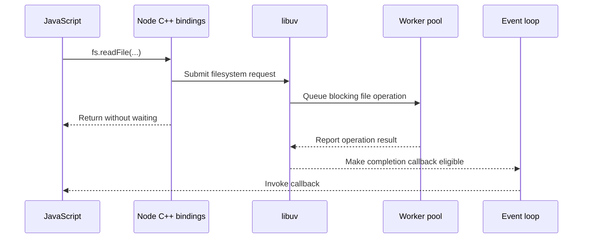
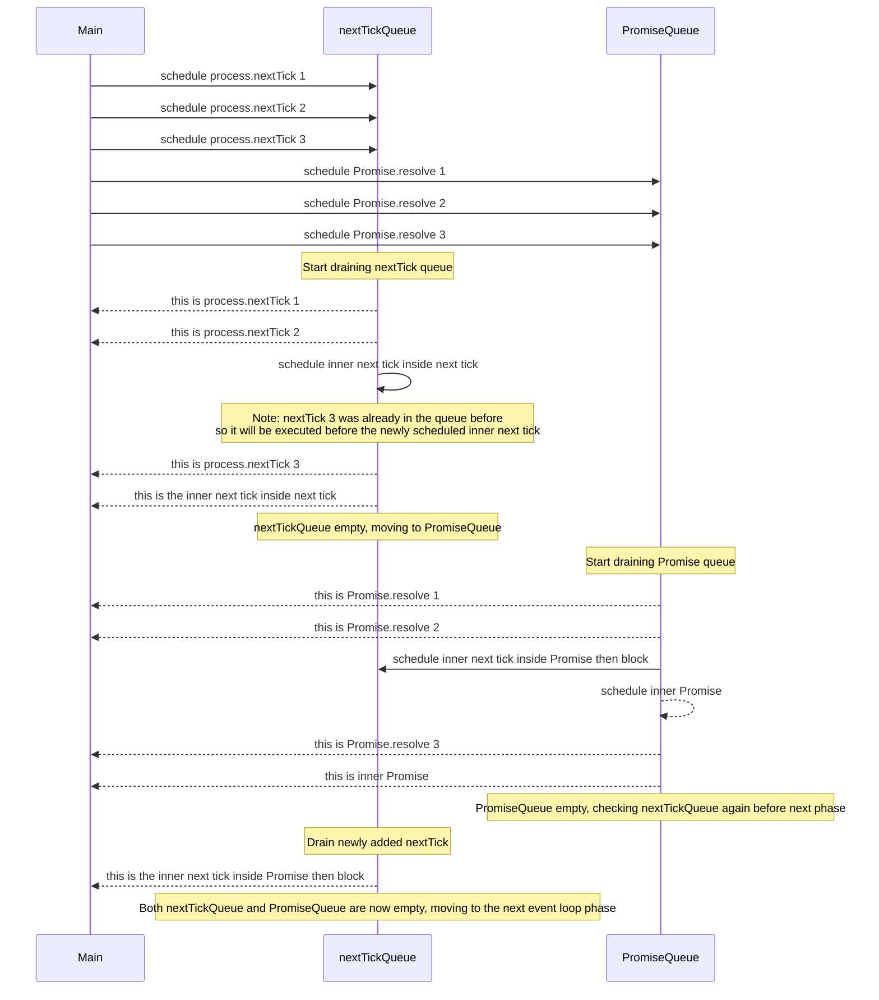

# Internals

## libuv

libuv is a cross-platform C library that supplies Node.js with an event loop, non-blocking networking, a worker pool, and abstractions over several operating-system facilities. Node uses it beneath many system-facing asynchronous APIs, but libuv does not implement every form of asynchronous JavaScript execution.

- **Node Boundary:** Node's JavaScript and C++ layers translate operations such as opening a TCP server or reading a file into libuv work. Promise reactions and `process.nextTick()` use Node and V8 scheduling rather than libuv socket I/O.
- **Event Loop:** A `uv_loop_t` coordinates I/O, timers, process events, signals, and callbacks. Each loop is associated with one thread, and APIs involving that loop are not thread-safe unless documented otherwise.
- **Handles:** Long-lived `uv_handle_t` objects represent resources that produce events over time. A TCP server or connected TCP stream is represented by a `uv_tcp_t` handle.
- **Requests:** Short-lived `uv_req_t` objects represent individual operations. Connect, write, shutdown, filesystem, and address-resolution requests carry the state needed to report one operation's result.
- **Other Event Sources:** Timers, filesystem-change notifications, signals, child-process management, and cross-thread notifications also feed work into the loop through their corresponding libuv abstractions.

### Network I/O

libuv performs network I/O through [non-blocking sockets](../../../Operating%20Systems/07%20Socket%20Management.md#Blocking%20and%20Non-Blocking%20Sockets) and delegates waiting to the operating system. One event-loop thread can therefore coordinate many sockets without blocking one thread for every connection.

A socket operation moves through the following path:

1. A Node binding creates or reuses a libuv handle and starts an operation such as listening, connecting, reading, or writing.
2. Libuv configures the socket as non-blocking and records the resource, requested activity, and callback state.
3. The platform backend either registers an interest in socket readiness or submits an asynchronous operation.
4. The event loop waits through that backend while the thread has no callbacks ready to execute.
5. Libuv translates the returned readiness event or completion into its handle/request model and invokes the associated callback on the loop thread.
6. The callback consumes the result, updates application state, and starts later work when the connection should continue.

The kernel interaction depends on the platform:

- **Linux — `epoll`:** The backend waits for socket readiness. When a descriptor becomes readable or writable, libuv performs or continues the relevant non-blocking operation.
- **macOS and BSD-Derived Systems — `kqueue`:** The backend uses persistent event registrations to learn which sockets can make progress.
- **Solaris — Event Ports:** The backend associates sockets with event sources and consumes the resulting notifications.
- **Windows — IOCP:** Libuv uses overlapped socket operations and receives their results through an I/O completion port.

These backends span both [readiness and completion](../../../Operating%20Systems/07%20Socket%20Management.md#Readiness%20and%20Completion%20Compared), yet libuv presents a broadly consistent callback-oriented execution model. A callback that reports a completed read or write therefore does not imply that every platform used a completion-based kernel interface internally. Socket stream semantics also remain unchanged: reads and writes can be partial, buffers are finite, and backpressure still has to propagate through the application.

> [!note] `io_uring` and libuv Networking
> `io_uring` is not libuv's general Linux network backend. Libuv documents an optional `io_uring` loop configuration for filesystem operations; its ordinary Linux socket path remains based on non-blocking sockets and `epoll`.

### Thread Pool

[Regular-file readiness](../../../Operating%20Systems/06%20Storage%20Management.md#Readiness%20and%20Completion%20for%20Regular%20Files) does not reveal whether a read or write will wait for storage. Libuv therefore uses worker-thread offload for operations that cannot be integrated with the loop through non-blocking socket readiness.

- **Internal Users:** Libuv uses the pool for filesystem operations, `getaddrinfo()`, `getnameinfo()`, and work submitted through `uv_queue_work()`.
- **Node Users:** Node routes asynchronous filesystem APIs and selected DNS, cryptographic, and compression work through this facility.
- **Shared Capacity:** The pool is global and shared by all libuv loops in the process. Unrelated operations can therefore contend for the same workers.
- **Default Size:** The pool contains four workers by default.
- **Startup Configuration:** `UV_THREADPOOL_SIZE` changes the configured size and should be set before Node starts so no earlier operation initializes the pool with another value.
- **Scaling Trade-off:** More workers can increase concurrency when tasks spend time waiting, but they also consume more memory. CPU-bound throughput remains constrained by available CPU time, and excessive workers can add scheduling and contention costs.
- **Saturation:** Offload keeps the event-loop thread available, but requests still queue when every worker is occupied.

For example, `fs.readFile()` submits filesystem work and returns without waiting for the read to finish:

```javascript
const fs = require('node:fs');

fs.readFile('example.txt', 'utf8', (error, data) => {
  if (error) {
    console.error(error);
    return;
  }

  console.log(data);
});

console.log('The event-loop thread remains available.');
```



Configure the pool at process startup when a measured workload requires a different size:

```bash
UV_THREADPOOL_SIZE=8 node server.js
```

### Event loop

The event loop repeatedly waits for events and dispatches the callbacks associated with them. Libuv provides the native loop and platform polling backend; Node integrates that loop with JavaScript callback execution, `process.nextTick()`, and V8's microtask processing.

- **I/O Concurrency:** The loop can wait for activity across many sockets while executing JavaScript on one application thread.
- **Application Execution:** Each JavaScript callback runs synchronously until it returns. A long callback therefore delays every other callback assigned to that loop, which is the central trade-off of a [single-threaded application execution model](../../../Backend%20Engineering/Concurrency/02%20Application%20Server%20Concurrency.md#Single-Threaded%20Process).
- **Callback Boundaries:** After a JavaScript callback returns, Node processes `process.nextTick()` callbacks and V8 microtasks before allowing the native loop to continue. These queues are not libuv phases.
- **Loop Lifetime:** The default loop continues while it has active referenced handles, active requests, or handles that are still closing.

The visible loop phases have distinct responsibilities:

- **Timers:** Run callbacks whose `setTimeout()` or `setInterval()` thresholds have elapsed. A threshold makes a callback eligible; it does not guarantee an exact execution time.
- **Pending Callbacks:** Run selected I/O callbacks that were deferred from the previous iteration, including some platform-specific error reporting.
- **Idle and Prepare:** Run internal libuv callbacks immediately before the loop calculates how long it can wait for I/O.
- **Poll:** Wait for new I/O when appropriate and process available I/O events. The loop avoids blocking when timers, `setImmediate()` callbacks, or other conditions require it to continue.
- **Check:** Run `setImmediate()` callbacks after the poll phase.
- **Close Callbacks:** Run callbacks associated with handles whose closure must be reported asynchronously.

Within a phase, callbacks are processed in FIFO order until the queue is exhausted or an implementation-specific callback limit is reached. Node processes tick and microtask queues at JavaScript callback boundaries rather than treating them as another pair of libuv phases.

#### Process

One current libuv iteration follows this high-level sequence:

1. Run pending callbacks, followed by active idle and prepare callbacks.
2. Calculate a poll timeout from the nearest timer and from whether other work requires the loop to remain non-blocking.
3. Wait for I/O through the platform backend and dispatch callbacks for the returned events.
4. Run check callbacks and then close callbacks.
5. Update the loop's cached time and run timers whose thresholds have elapsed.
6. Start another iteration while active work keeps the loop alive; otherwise return from the loop.

> [!note] Timer Ordering in Node 20+
> Starting with libuv 1.45, used by Node.js 20, the per-iteration timer pass occurs after the poll phase. Earlier versions ran timers before polling. Libuv still performs an initial timer pass before entering the loop, so examples that depend on exact timer-versus-I/O ordering must state their Node/libuv version and runtime conditions.

#### Microtask Queues

##### nextTick queue

```javascript
process.nextTick(() => {
    console.log("this is process.nextTick 1")
})
```

This schedules the callback in Node's next-tick queue. Node processes that queue after the current operation completes and before the event loop continues.

##### promise queue

```javascript
Promise.resolve().then(() => {
    console.log("this is Promise.resolve 1")
})
```

This schedules a Promise reaction in V8's microtask queue. Promise microtasks and next-tick callbacks both run between event-loop callbacks, but Node gives the next-tick queue priority at the start of that processing boundary.

##### Experiment

Consider the following scheduling experiment:

```javascript
process.nextTick(() => console.log("this is process.nextTick 1"));
process.nextTick(() => {
    console.log("this is process.nextTick 2");
    process.nextTick(() =>
        console.log("this is the inner next tick inside next tick")
    );
});
process.nextTick(() => console.log("this is process.nextTick 3"));

Promise.resolve().then(() => console.log("this is Promise.resolve 1"));
Promise.resolve().then(() => {
    console.log("this is Promise.resolve 2");
    process.nextTick(() =>
        console.log("this is the inner next tick inside Promise then block")
    );
    Promise.resolve().then(() => console.log("this is inner Promise"));
});
Promise.resolve().then(() => console.log("this is Promise.resolve 3"));

```

The callbacks run in this order:

```text
this is process.nextTick 1
this is process.nextTick 2
this is process.nextTick 3
this is the inner next tick inside next tick
this is Promise.resolve 1
this is Promise.resolve 2
this is Promise.resolve 3
this is inner Promise
this is the inner next tick inside Promise then block
```

The ordering follows this sequence:



#### Timer Callbacks

Timers are organized by their eligibility thresholds rather than as one unconditional FIFO callback queue. Once a threshold has elapsed, the corresponding callback becomes eligible to run in the timers phase; other callbacks and operating-system scheduling can still delay its execution.

```javascript
setTimeout(() => console.log("this is setTimeout"), 0)
```

##### Experiment 1

```javascript
setTimeout(() => {
  console.log('timer 1');
  process.nextTick(() => console.log('microtask inside timer 1'))
});

setTimeout(() => {
  console.log('timer 2');
}, 0);
```

results in:

```text
timer 1
microtask inside timer 1
timer 2
```

##### Experiment 2

```javascript
setTimeout(() =>  console.log('timer 1'), 1000);
setTimeout(() =>  console.log('timer 2'), 500);
setTimeout(() =>  console.log('timer 3'), 0);
```

results in:

```text
timer 3
timer 2
timer 1
```

#### Poll and Pending I/O Callbacks

Callbacks for many completed I/O operations become eligible through the poll or pending-callback machinery, but not every asynchronous Node API follows this path. Timers, `setImmediate()`, `process.nextTick()`, and Promise reactions use distinct scheduling mechanisms.

```javascript
fs.readFile(__filename, () => {
    console.log("this is readFile 1")
})
```

##### Experiment 3

The code

```javascript
const fs = require("fs");

setTimeout(() => console.log("this is setTimeout1"), 0);
fs.readFile(__filename, () => console.log("this is readFile1"))
```

Repeated executions can produce either ordering:

```bash

$ node index.js 
this is readFile1
this is setTimeout1
$ node index.js 
this is readFile1
this is setTimeout1
$ node index.js 
this is readFile1
this is setTimeout1
$ node index.js 
this is setTimeout1
this is readFile1
```

The relative order is not guaranteed because the two callbacks become eligible through independent mechanisms:

- **Timer Threshold:** A delay of `0` creates a minimum timer threshold; it does not execute the callback immediately.
- **Filesystem Completion:** `fs.readFile()` finishes on the worker pool and becomes eligible only after its completion is reported to the loop.
- **Runtime Timing:** Startup work, filesystem latency, operating-system scheduling, and the Node/libuv version affect which callback is ready when the loop reaches the relevant phase.

Adding synchronous work before the event loop starts gives the timer threshold more time to elapse, so the timer is more likely to run first. It does not guarantee the relative order because the filesystem operation still completes independently.

```javascript
const fs = require("fs");

setTimeout(() => console.log("this is setTimeout1"), 0);
fs.readFile(__filename, () => console.log("this is readFile1"))

for(let i = 0; i < 2e6; i++) {}
```

```bash
$ node index.js 
this is setTimeout1
this is readFile1
$ node index.js 
this is setTimeout1
this is readFile1
$ node index.js 
this is setTimeout1
this is readFile1
```

#### Check Queue

```javascript
setImmediate(() => console.log("this is setImmediate 1"))
```

##### Experiment 4

```javascript
const fs = require("fs");

fs.readFile(__filename, () => console.log("this is readFile1"))
setImmediate(() => console.log("this is setImmediate 1"))

for(let i = 0; i < 2e6; i++) {}
```

One possible result is:

```bash
$ node index.js 
this is setImmediate 1
this is readFile1
```

This ordering occurs when the filesystem request is not ready when the loop reaches poll. Because `setImmediate()` is already queued, poll does not wait indefinitely and the loop advances to check. If the filesystem completion becomes eligible at another point, the observed order can differ; the top-level example does not establish a general ordering guarantee.

#### Close Callbacks

```javascript
const fs = require("fs");

const readableStream = fs.createReadStream(__filename);
readableStream.close();

readableStream.on("close", () => {
  console.log("this is from readableStream close event callback");
});
```
