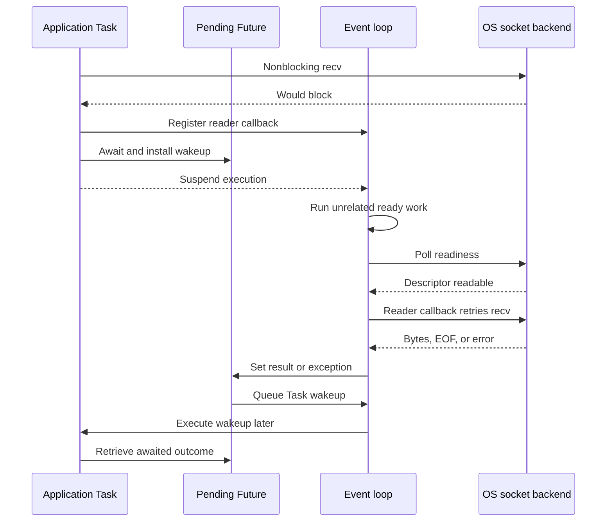

# Python Internals

CPython is a native program that compiles Python source into code objects and executes their bytecode. Its evaluator runs inside [operating-system threads](../../Operating%20Systems/05%20Process%20Management.md#Threads), manipulates Python objects, and cooperates with allocators, garbage collection, native extensions, and I/O libraries. An asynchronous HTTP request still uses this machinery: the server schedules application execution, a coroutine preserves its state while waiting, and an I/O completion makes that execution runnable again.

The implementation baseline is **CPython 3.15.0**, released on October 9, 2026, at commit `d220409a13b77de7a6c30abe16ea90db01528edc`. The normal **GIL-enabled build** is the starting model; free threading and other optional execution paths are distinguished where they change it. Private structures, bytecode, allocation policies, and scheduling heuristics are implementation details, not Python language guarantees. [Release baseline](https://www.python.org/downloads/release/python-3150/), [pinned source](https://github.com/python/cpython/tree/v3.15.0).

The server mechanisms use Gunicorn 26.2.2 and Uvicorn 0.54.0; framework dispatch examples use Flask 3.1.3, FastAPI 0.143.2, Starlette 1.8.0, and Django 6.1.2. These identify the implementations being explained, not a runtime-tested compatibility matrix.

## Runtime state and program startup

### Process, interpreter, thread, and frame

The CPU executes CPython's machine instructions. Python bytecode is data consumed by those instructions; calling a native extension transfers into other machine code rather than another bytecode body.

Several kinds of state coexist inside that native process:

- **Runtime state:** `_PyRuntimeState` holds process-wide coordination, the interpreter list, initialization/finalization state, allocator infrastructure, signals, and selected shared objects.
- **Interpreter state:** `PyInterpreterState` holds an interpreter's module/import state, `sys` and builtins namespaces, execution configuration, thread-state list, GC state, and GIL association. Normal startup creates the main interpreter; another interpreter does not create another process.
- **Thread state:** `PyThreadState` connects a native thread to an interpreter and records its current Python frame, exception state, recursion accounting, context, and tracing state. A thread needs the appropriate **attached** thread state to execute Python or use attachment-requiring C APIs. In the normal build, attached execution also requires that interpreter's GIL.
- **Evaluation frame:** `_PyInterpreterFrame` is one activation of compiled code: instruction position, local/closure bindings, and temporary operands. Repeated or recursive calls to one function have distinct frames.
- **Suspendable execution object:** A generator or coroutine retains a frame that survives suspension. It is not an OS thread and does not require a dedicated native stack while waiting.

The implementation follows `thread state → interpreter state → runtime state`; the active frame chain hangs off thread state. Objects and frames live in the [process's address space](../../Operating%20Systems/03%20Memory%20Management.md#Virtual%20Memory), but interpreter association constrains how Python state is used. This distinction later separates thread sharing, subinterpreter isolation, process isolation, and coroutine scheduling. [Runtime structures](https://github.com/python/cpython/blob/v3.15.0/Include/internal/pycore_runtime_structs.h), [interpreter structures](https://github.com/python/cpython/blob/v3.15.0/Include/internal/pycore_interp_structs.h), [thread state](https://github.com/python/cpython/blob/v3.15.0/Include/cpython/pystate.h).

### Initialization and entry execution

After the operating system [loads CPython and its native dependencies](../../Operating%20Systems/Compilers%2C%20Linkers%2C%20and%20Program%20Loading.md#Executable%20Formats%20and%20Program%20Loading), startup progressively creates the services needed to execute Python:

1. **Enter the launcher.** Platform entry code reaches `Py_Main` or `Py_BytesMain`. An embedding application instead owns native startup and initializes CPython through its C API.
2. **Preconfigure.** Early allocator, locale, and encoding decisions precede configuration work that depends on them. Normal configuration incorporates relevant arguments and environment; isolated configuration limits those inputs but is not a security sandbox.
3. **Configure and create the interpreter.** `Py_InitializeFromConfig` establishes the main interpreter, its allocation state, the initial thread state, and the normal build's GIL.
4. **Bootstrap Python services.** Core types, exceptions, builtins, `sys`, and initial import machinery become usable. Full initialization adds external import paths, codecs, standard streams, signal handling, `__main__`, and `site` when enabled. Some of this bootstrap executes Python code; initialization is not merely reserving a VM structure.
5. **Select entry code.** The launcher chooses a script, `-c` command, `-m` module, stdin, or interactive execution. Module execution uses `runpy`; entry modes differ in discovery and namespace setup, not in needing compiled code and evaluation state.
6. **Run and finalize.** `Py_RunMain` executes the entry point and finalizes the interpreter before returning an exit status. Embedders can use a different lifetime under host control.

Startup imports, extension initialization, and configured startup hooks can perform filesystem access, allocate objects, start threads, or fail before application code begins. A server's application-loading phase therefore has real execution and resource consequences. [Launcher](https://github.com/python/cpython/blob/v3.15.0/Modules/main.c), [interpreter lifecycle](https://github.com/python/cpython/blob/v3.15.0/Python/pylifecycle.c).

## Compilation and evaluation

### Source to code object

CPython compiles a source unit before evaluating it. Compilation transforms representations because syntax, bindings, control flow, and final instruction layout require different information:

1. **Decode and tokenize:** Source bytes become text and tokens representing names, literals, operators, indentation, and other syntax.
2. **Parse:** The generated PEG parser consumes tokens according to the grammar and builds an abstract syntax tree, or **AST**. The AST represents program structure, not live values or calls.
3. **Preprocess:** AST preprocessing performs syntax-related checks and transformations, including supported constant folding, under compiler/future flags and optimization settings.
4. **Analyze symbols:** Whole-scope analysis classifies local, global, nonlocal, cell, and free bindings. An enclosing function's captured binding becomes a cell; nested code refers to that cell as a free variable. Ordinary module globals and class-namespace entries do not all become closure cells.
5. **Generate an instruction sequence:** Code-generation visitors emit bytecode-like operations, labels, locations, and pseudo-instructions. Nested executable units produce separate code objects.
6. **Optimize control flow:** The sequence becomes a control-flow graph of basic blocks. Optimizations simplify applicable operations and branches; subsequent processing determines stack depth and local-slot layout.
7. **Assemble:** Labels become instruction offsets, pseudo-instructions become executable instructions or metadata, and assembly produces bytecode, inline-cache space, constants, names, source locations, and exception tables inside a `PyCodeObject`.

Symbol analysis explains why an ordinary function-local access uses an indexed slot rather than searching dictionaries. It also explains why a binding decision applies to the entire function scope, even before an assignment executes. `-O` and `-OO` alter selected compilation behavior; they do not turn arbitrary Python into ahead-of-time optimized native code. [Compiler coordination](https://github.com/python/cpython/blob/v3.15.0/Python/compile.c), [AST preprocessing](https://github.com/python/cpython/blob/v3.15.0/Python/ast_preprocess.c), [symbol analysis](https://github.com/python/cpython/blob/v3.15.0/Python/symtable.c), [CFG and assembly design](https://github.com/python/cpython/blob/v3.15.0/InternalDocs/compiler.md).

### Code, function, and activation

Compilation does not create the complete state of every future call. Three entities separate reusable instructions from environment and execution:

- **Code object:** Compiled instructions and metadata: constants, names, argument/slot information, stack requirements, source locations, and exception tables. Its Python-facing attributes are immutable, while private adaptive instructions, caches, and optimizer executors change during execution.
- **Function object:** Code bound to globals, builtins, defaults, closure cells, names, annotation machinery, and a calling entry point. Executing `def` creates the function; it does not execute its body.
- **Frame:** The state of one invocation, including its current instruction, bindings, and evaluation stack. A call creates an activation; a generator/coroutine call creates suspendable execution whose frame is retained by its execution object.

A factory that executes the same nested `def` repeatedly produces different function objects sharing compiled code. Each returned function captures its own relevant cells. A cell stores a shared binding, so rebinding is visible to closures that reference that cell; it is not a frozen copy of all outer locals. [Code layout](https://github.com/python/cpython/blob/v3.15.0/Include/cpython/code.h), [function and closure layout](https://github.com/python/cpython/blob/v3.15.0/Include/cpython/funcobject.h).

### Frames, operands, and calls

The evaluator is a stack machine: instructions consume temporary operands and produce results on a frame's **evaluation stack**. This is different from the Python frame chain and from the native C call stack.

In this baseline, internal local and operand slots use `_PyStackRef`, a private reference representation supporting ownership optimizations. They still represent Python values, not a universal array of unboxed machine integers. Frame storage follows its required lifetime:

- **Ordinary activation:** Most frames occupy contiguous space in per-thread, heap-backed data-stack chunks, amortizing allocation and [improving locality](../../Operating%20Systems/03%20Memory%20Management.md#Spatial%20Locality).
- **Suspended activation:** Generators, coroutines, and asynchronous generators embed their interpreter frame, keeping locals and operands alive without preserving a dedicated native stack.
- **Exposed frame:** Introspection and tracebacks materialize a `PyFrameObject` when needed. If it outlives the activation's original storage, surviving frame state transfers into frame-object-owned storage.

Most Python-to-Python calls stay inside the evaluator rather than recursively entering it through a fresh native call chain:

1. Resolve the callable and prepare arguments, including receiver binding where applicable.
2. Bind positional/keyword arguments, defaults, and variadic parameters; reject invalid combinations. Specialized paths skip generic work only after validating their assumptions.
3. Initialize a callee frame and argument/local slots; save the caller's stack position and return offset.
4. Link the callee as current frame and dispatch its instructions.
5. On return, clear/pop the callee, restore the caller, and place the result on the caller's evaluation stack. Releasing callee references can destroy objects.

Native functions take another path: **vectorcall**-compatible callables receive an argument array and keyword-name information without mandatory temporary argument tuples/dictionaries. The native function then runs on the calling OS thread. It can reenter Python through a callback, adding native stack depth as well as Python frames. Avoiding recursive C evaluation for ordinary Python calls is not Python tail-call elimination. [Actual frame structures](https://github.com/python/cpython/blob/v3.15.0/Include/internal/pycore_interpframe_structs.h), [frame lifetime](https://github.com/python/cpython/blob/v3.15.0/InternalDocs/frames.md), [call and return instructions](https://github.com/python/cpython/blob/v3.15.0/Python/bytecodes.c).

Name access uses the environment appropriate to its compiled binding:

- **Fast locals:** Direct indices into frame slots, with unbound checks where required.
- **Closure variables:** Cell/free-variable slots provide shared binding indirection.
- **Globals:** The function's globals namespace, then builtins when the global name is absent.
- **Mapping-based scopes:** Module, class, and dynamic execution use relevant namespace mappings and specialized lookup rules.

Ordinary local access therefore does not require a locals dictionary lookup. Conversely, a frame's optimized slots do not eliminate dynamic global/attribute lookup or user-defined behavior.

### Dispatch, exceptions, and runtime checkpoints

Bytecode uses 16-bit code units containing opcode and argument bytes. Extended arguments and inline caches occupy additional units; cache words are not independent ordinary instructions. Generated evaluator code implements the operations defined in `Python/bytecodes.c`. Dispatch uses computed gotos, a switch fallback, or an optional tail-calling interpreter according to build/compiler support. Tail calls between native opcode handlers do not remove Python frames or change Python recursion semantics.

An operation that raises records exception state and enters evaluator error handling. The code object's **exception table** maps protected instruction ranges to handler targets and required stack depths:

1. Find a handler covering the failing instruction.
2. Release temporary operands down to the recorded depth and preserve the original instruction position when required.
3. Transfer exception state to handler bytecode and continue there.
4. Without a local handler, clear/unwind this activation and inspect the caller's call site. Traceback state records the unwound frames.

This metadata avoids maintaining the old per-`try` runtime block stack on successful execution. “Zero-cost exceptions” describes that fast-path strategy, not free raising, traceback construction, or cleanup. `finally` and context-manager cleanup follow compiled control flow. Exception cause/context links are separate from traceback links, and all can retain object graphs. Native C APIs instead use documented error sentinels such as `NULL` with the thread-state exception set; a Python exception does not generally unwind C as a C++ throw. [Evaluator](https://github.com/python/cpython/blob/v3.15.0/Python/ceval.c), [exception-table mechanism](https://github.com/python/cpython/blob/v3.15.0/InternalDocs/exception_handling.md).

Evaluator checkpoints also service an **eval breaker** indicating pending runtime work: signals, GIL-drop requests, pending calls, GC, and build-specific coordination. They are not an asyncio ready queue or a guaranteed interruption after every opcode. Long native work without appropriate checks or detachment delays this servicing.

### Specialization and optional native compilation

Repeated dynamic operations often see stable operand types or namespace layouts. CPython exploits that feedback without changing their semantics:

1. A specializable instruction maintains counters and family-specific inline-cache entries.
2. Feedback selects a narrower opcode, such as a type-specific binary operation or a module-global lookup using a cached entry index.
3. Guards check relevant operand types, dictionary-key versions, type layouts, function versions, or other assumptions.
4. Compatible executions avoid portions of generic dispatch/lookup. Failed assumptions cause fallback, backoff, or respecialization.

Caches are not universally cached values: a location/version guard can accelerate access while preserving a namespace's changing contents. Different instruction families use different invalidation mechanisms. Warm-up, guard work, cache storage, and polymorphic workloads affect the benefit. `dis` exposes supported adaptive/cache views; its default bytecode view need not be the warmed stream currently executed. [Specialization implementation](https://github.com/python/cpython/blob/v3.15.0/Python/specialize.c), [instruction families](https://github.com/python/cpython/blob/v3.15.0/Python/bytecodes.c).

The **experimental JIT** adds optimization across sequences of operations rather than only individual sites. On a JIT-capable, enabled build:

1. Hot execution triggers a recording mode that follows the **actual executed path** and translates it into micro-operations.
2. Analysis simplifies the trace, removes safe redundant work, and constructs an executor.
3. Copy-and-patch emission combines machine-code stencils generated at build time and fills runtime values/targets. LLVM is needed for stencil generation during the build, not as an installed per-request runtime compiler.
4. Execution enters the native executor; guards, side exits, and dependency invalidation return control to an appropriate interpreter/executor path when needed.

A micro-operation interpreter configuration also exists for development; it is not evidence that native JIT code is active. Availability, enablement, and current execution are different states. JIT compilation is neither whole-program compilation nor removal of GIL/object semantics, and it promises no universal server speedup. [Pinned JIT design](https://github.com/python/cpython/blob/v3.15.0/InternalDocs/jit.md), [optimizer](https://github.com/python/cpython/blob/v3.15.0/Python/optimizer.c), [code emission](https://github.com/python/cpython/blob/v3.15.0/Python/jit.c).

### Imports as executable initialization

An ordinary eager import locates and executes a module, rather than merely making declarations visible:

1. Check the interpreter's `sys.modules` for an initialized module.
2. Find a module specification and loader through the import machinery.
3. Coordinate initialization, create the module, and insert it into `sys.modules` **before** executing its body.
4. Obtain code and execute top-level initialization. A valid `.pyc` avoids source parsing/compilation, not module execution in a new interpreter.
5. Complete initialization and bind submodules into their parent package. On initial-load failure, remove the failing new module entry; successful side-effect imports and external side effects are not rolled back.

Early insertion explains circular imports observing partially initialized modules. Module-specific locking coordinates concurrent initialization without globally serializing every module body. Reload executes in an existing namespace; it does not replace every reference previously imported elsewhere. `.pyc` validation concerns serialized code freshness/version, whereas `sys.modules` reuses live execution results within an interpreter. [Import coordination](https://github.com/python/cpython/blob/v3.15.0/Lib/importlib/_bootstrap.py), [bytecode-cache loader](https://github.com/python/cpython/blob/v3.15.0/Lib/importlib/_bootstrap_external.py).

Python 3.15's explicit **lazy imports** defer actual loading through placeholders resolved when the imported binding is used. They shift initialization cost, errors, and side effects to first use; they do not load modules on a background thread. Ordinary imports remain eager under the default mode unless marked/configured lazy. A first-use import on an event-loop thread can still block it. [Lazy-import implementation](https://github.com/python/cpython/blob/v3.15.0/Objects/lazyimportobject.c), [PEP 810](https://peps.python.org/pep-0810/).

Native extensions replace source evaluation with [dynamic-library loading](../../Operating%20Systems/Compilers%2C%20Linkers%2C%20and%20Program%20Loading.md#Dynamic%20Linking) and an initialization/export hook. Conventional `PyInit_...` initialization remains supported; 3.15 also recognizes `PyModExport_...`. Multi-phase initialization separates module creation from execution and supports per-module state. Separate Python module dictionaries do not isolate C statics or prove no-GIL safety; interpreter compatibility and free-threading compatibility are distinct requirements. [Export resolution](https://github.com/python/cpython/blob/v3.15.0/Python/importdl.c), [module initialization contract](https://github.com/python/cpython/blob/v3.15.0/Doc/c-api/module.rst).

## Objects, types, and storage representations

### Dynamic behavior through type metadata

A Python binding refers to an object with identity, type, and value. CPython's common `PyObject` header carries reference-count/flag bookkeeping and a pointer to its `PyTypeObject`; payload lives in type-specific fields or backing allocations. `PyVarObject` adds size metadata for types using that representation, not a universal layout for every variable-length value. Header layout differs across builds, so the familiar conceptual header is not a portable C-structure offset contract.

The type is itself an object. Its metadata connects syntax to behavior:

- **Representation:** Instance size, variable-size rules, allocation/deallocation, and instance storage layout.
- **Operation dispatch:** Numeric, sequence, mapping, call, iterator, asynchronous, and buffer operations.
- **Attribute behavior:** Type dictionary, bases/MRO, attribute lookup, and descriptor hooks.
- **Lifetime support:** Traversal, reference clearing, finalization, and weak-reference capability.

Builtins implement many slots directly in native code; user-defined special methods connect through slot machinery. Implicit special-method dispatch looks on the type rather than simply repeating an ordinary instance-dictionary lookup. Heap-created types, descriptors, and class metadata also consume memory beyond each instance's payload. [Object header](https://github.com/python/cpython/blob/v3.15.0/Include/object.h), [type metadata](https://github.com/python/cpython/blob/v3.15.0/Include/cpython/object.h), [generic operations](https://github.com/python/cpython/blob/v3.15.0/Objects/object.c).

### Class construction and attribute lookup

A normal class statement resolves bases/selects a metaclass, prepares a namespace, executes the compiled class body in it, and calls the metaclass. Default `type` construction computes the method-resolution order and layout, installs slot descriptors, and runs applicable `__set_name__`/`__init_subclass__` hooks. Creating an instance is a different operation: normal type calling obtains it through `__new__` and initializes it through `__init__` when applicable. Custom metaclasses and hooks change these paths.

A **descriptor** is an object whose type supplies attribute-binding behavior. Under default instance lookup:

1. Search the type's MRO for the name. A **data descriptor** with a getter and setting/deletion capability takes precedence over instance storage during reading.
2. Otherwise check the instance's stored value.
3. Use a class attribute or invoke its **non-data descriptor** getter when appropriate.
4. Normal lookup failure raises `AttributeError`; the surrounding attribute machinery invokes `__getattr__` if defined.

An overridden `__getattribute__` replaces the ordinary path. Class-object lookup additionally involves the metaclass, so it is not identical to instance lookup. A function is a non-data descriptor: instance access binds function plus receiver, while optimized method calls pass them separately without necessarily allocating a bound-method object.

Instance storage is not invariably a complete separately allocated dictionary. Managed dictionaries, inline values, and shared class keys reduce duplicated metadata. `__slots__` supplies fixed-offset descriptors for reference fields; it does not turn ordinary attributes into unboxed typed scalars, and inherited/requested dictionaries or subclasses change its storage effect. These layouts also supply assumptions for guarded attribute specialization. [Class and instance construction](https://github.com/python/cpython/blob/v3.15.0/Objects/typeobject.c), [attribute lookup](https://github.com/python/cpython/blob/v3.15.0/Objects/object.c).

### Built-in representations and locality

Python's uniform object interface does not imply uniform storage:

- **Integers and floats:** An integer has sign/digit-count metadata and a variable array of power-of-two digits; arithmetic cost depends on digit counts and the operation, rather than universally being one machine instruction. A float boxes a native double with object metadata. A list of numbers therefore differs from a native scalar array even when every value fits a machine word.
- **Strings:** Flexible Unicode storage selects one-, two-, or four-byte code units for the represented range, with compact/ASCII paths and an applicable UTF-8 cache. A `str` is not universally a UTF-8 byte array.
- **Bytes and bytearrays:** Store byte payloads rather than one separately boxed Python object per byte. Their mutability and resizing contracts differ; exported buffers constrain safe resizing/lifetime.
- **Lists:** A list header holds length/capacity and a separately allocated contiguous reference array. Growth overallocates to amortize appends; replacing that array does not change the list's identity.
- **Tuples:** Store a fixed array of references within the tuple allocation. Structural immutability does not make referenced objects immutable or contiguous.
- **Dictionaries:** Compact hash-probe indices refer to entries retaining key/value references. Combined tables and shared-key split instance tables organize values differently; insertion order comes from entry/order state, not sorted hashes. Hashing/equality can invoke Python code.
- **Sets and frozensets:** Hash tables retain element references and cached hashes, using embedded small storage or larger allocations. They do not acquire dictionary insertion-order guarantees.

A contiguous list reference array only makes the **references** adjacent. Following them reaches separately represented payloads, adding headers, reference-accounting work, pointer chasing, and dynamic operations. Native homogeneous buffers reduce per-element boxing and support native loops, but conversion and ownership costs remain. Neither pointer indirection nor a compact representation alone proves a particular cache miss rate or speedup. [Numeric representation](https://github.com/python/cpython/blob/v3.15.0/Include/cpython/longintrepr.h), [Unicode](https://github.com/python/cpython/blob/v3.15.0/Include/cpython/unicodeobject.h), [list](https://github.com/python/cpython/blob/v3.15.0/Objects/listobject.c), [tuple](https://github.com/python/cpython/blob/v3.15.0/Include/cpython/tupleobject.h), [dictionary](https://github.com/python/cpython/blob/v3.15.0/Objects/dictobject.c), [set](https://github.com/python/cpython/blob/v3.15.0/Include/cpython/setobject.h).

### Interning and immortality

`is` compares identity; `==` performs value comparison. CPython's address-valued identity is stable during an object's lifetime, but freed addresses can be reused. Equal hashable values must have equal hashes, collisions remain possible, and mapping/set keys must retain suitable equality/hash behavior while stored.

**Interning** reuses selected equal strings. **Immortality** suppresses ordinary reference-count updates/reclamation for selected objects, including core singletons. These mechanisms intersect but are not synonyms: ordinary-build `sys.intern()` does not promise every interned string remains immortal; free-threaded interned strings and code constants receive additional immortalization in this baseline.

Avoiding shared refcount writes reduces contention and writes to inherited pre-fork pages. It does not guarantee cache residency or RSS savings. Neither interning nor cached integer objects justifies comparing arbitrary strings/numbers with `is`; use their value semantics. [Interning design](https://github.com/python/cpython/blob/v3.15.0/InternalDocs/string_interning.md), [reference operations](https://github.com/python/cpython/blob/v3.15.0/Include/refcount.h).

## Object lifetime, allocation, and resident memory

### Ownership and reference-count destruction

Python variables, container entries, frames, closures, Tasks, and extension owners form a graph of references. `del` removes the specified binding/item/attribute; it is not a command to destroy the referent or release pages.

At C boundaries, ownership states determine obligations:

- **Strong/new reference:** Keeps the object alive and must eventually be released or transferred.
- **Borrowed reference:** Acquires no independent lifetime; mutation or reentrant Python execution can invalidate the underlying ownership assumption.
- **Stolen reference:** Transfers an existing obligation according to the receiving API's contract, including its error rules.

In the normal build, acquiring/releasing strong ownership increments/decrements a mortal object's reference-count bookkeeping, expressed at C API boundaries through `Py_INCREF`/`Py_DECREF`. This changes ownership accounting, not the object's payload; obtaining another reference does not copy the object.

Terminal release to zero enters a mortal acyclic object's type deallocator, subject to finalization/resurrection and type-specific deferral. Destroying a container releases its elements, potentially causing cascading destruction. A trashcan mechanism bounds native recursion in supported deep deallocation paths. Immortals and optimized/internal reference handling prevent treating every pointer as one naive visible refcount increment.

Decrementing a reference can execute arbitrary Python through finalizers. An extension must restore data-structure invariants before a decrement that permits reentry. A traceback retained for diagnostics similarly retains frames and their objects; leaving a lexical scope does not prove those objects died. [Reference ownership](https://github.com/python/cpython/blob/v3.15.0/Doc/c-api/refcounting.rst), [type lifecycle](https://github.com/python/cpython/blob/v3.15.0/Doc/c-api/lifecycle.rst).

### Cycles, tracking, and finalization

Reference counting cannot by itself reclaim an unreachable cycle whose members own one another. CPython supplements it with a cyclic collector over **tracked**, reference-carrying objects. Tracked does not mean “currently garbage”: acyclic tracked objects still normally die through reference counting.

The normal-build collector uses three generations, 0 through 2. New tracked objects start young; survivors promote. Allocation/deallocation activity and policy schedule collections, not a background thread continuously scanning the heap. A collection of a generation includes relevant younger generations:

1. Select candidate containers. Their `tp_traverse` exposes cycle-relevant outgoing references.
2. Copy candidate counts into temporary bookkeeping and subtract references originating inside that candidate set.
3. Positive external counts identify reachable seeds; traverse from them to preserve their reachable candidates. Zero adjusted count alone does not prove garbage.
4. The isolated remainder undergoes weak-reference processing and finalization while objects remain structurally usable.
5. Recheck reachability because a finalizer can **resurrect** an object by publishing a new reference.
6. For still-unreachable objects, clear appropriate links through `tp_clear`; resulting reference-count destruction releases their storage.

GC-capable objects are tracked only once traversable state is safe. Integers and strings do not need container-graph traversal; exact tuples have conservative untracking optimizations. Dictionaries remain tracked in this 3.15 baseline—older atomic-only-dictionary examples are misleading here. Full collections also clear applicable type free lists, not every process allocation. [Collector implementation](https://github.com/python/cpython/blob/v3.15.0/Python/gc.c), [GC design](https://github.com/python/cpython/blob/v3.15.0/InternalDocs/garbage_collector.md).

Weak references observe without owning the referent. Calling a valid weakref obtains its referent or `None` after clearing; callbacks do not receive a usable dead object and require the weakref itself to remain alive. Finalization and weakref ordering depend on the path: cyclic-isolate cleanup clears eligible weakrefs/calls callbacks before finalizers and resurrection checks, whereas reference-count deallocation follows the type's own ordering. Do not apply one universal sequence to every death. GC-capable resurrected objects retain their finalized mark in this baseline, so later death does not promise a second finalizer invocation.

Modern Python cycles containing `__del__` are not automatically uncollectable. Legacy extension finalizers, incorrect traversal/clearing, or deliberate debug retention remain exceptions; `gc.DEBUG_SAVEALL` retains objects by choice. Finalizer exceptions without a caller propagation route are unraisable. Context managers and explicit `close()` establish external-resource ownership more reliably than GC or interpreter shutdown timing. [Weakref contract](https://github.com/python/cpython/blob/v3.15.0/Doc/library/weakref.rst), [finalization paths](https://github.com/python/cpython/blob/v3.15.0/Objects/typeobject.c).

### Storage allocation and reuse

Object lifetime sits above allocator lifetime. CPython exposes three allocation domains:

- **Raw:** Low-level allocation APIs usable without an attached thread state.
- **Mem:** Python-managed non-object storage with attachment requirements.
- **Object:** Python object storage with attachment requirements. Free-threaded builds require Python objects to use this domain and non-object storage to use another appropriate domain.

Match allocation and free families even when their current backends coincide. Custom allocators, debug hooks, build options, and `PYTHONMALLOC` alter routing; “Raw” is not a universal promise of libc `malloc`.

In the normal default configuration, `pymalloc` organizes reusable **blocks** into **pools**, each serving one size class at a time. Pools occupy an **arena** acquired from lower memory machinery; ordinary 64-bit arenas are 1 MiB, not one OS page. This is a storage hierarchy, not a fresh OS allocation sequence for every object.

- **Small requests:** Requests up to 512 bytes map to a size class and consume a suitable reusable block, obtaining pool/arena capacity when necessary.
- **Large requests and fallback:** Larger requests use lower allocation machinery; small-request failures can also fall back. A small object header's large separate backing array follows the array's request size, not the header's route.

On reclamation, freed blocks return to pool reuse and empty pools can change size class. Entirely unused arenas become releasable under policy, with a free arena retained to avoid thrashing.

Selected types add **free lists** above these allocators: dead object storage is cached for reinitialization, not retained as the old live object with its old elements. These lists are bounded/type-specific; ordinary-build free lists are interpreter-local, while free-threaded versions use thread-local state. [Allocator contracts](https://github.com/python/cpython/blob/v3.15.0/Doc/c-api/memory.rst), [pymalloc implementation](https://github.com/python/cpython/blob/v3.15.0/Objects/obmalloc.c), [active layout constants](https://github.com/python/cpython/blob/v3.15.0/Include/internal/pycore_obmalloc.h), [free lists](https://github.com/python/cpython/blob/v3.15.0/Include/internal/pycore_freelist.h).

Sparse survivors keep pools/arenas partly occupied. The collector does not compact living objects to empty them, so removing most objects need not free the containing mappings. Lower allocators and native libraries also retain storage according to their own policies.

### One object lifecycle, five different endings

Consider a request-local list that temporarily contains itself:

1. List creation obtains a header through a free list or object/GC allocation path, initializes it, and establishes tracking. Appending allocates/resizes its separate reference vector.
2. A local binding and the self-edge point to the same list. Passing another reference does not copy its payload.
3. Deleting the last external binding makes it **unreachable**, but the self-edge keeps its ordinary reference count nonzero.
4. A collection covering it identifies the isolated cycle, performs applicable finalization/resurrection checks, and clears the edge. Deallocation ends the object's life and releases its vector/references.
5. Header/vector storage becomes **reusable** through free-list/allocator paths. An acyclic version instead reaches this path directly on terminal release, without waiting for cycle discovery.
6. Only suitable empty allocator units return storage **downward** to lower layers; some allocations remain retained or fragmented.
7. Unmapping, decommit, or OS reclamation determines whether physical pages stop contributing to **resident memory**. This is not the same event as destruction or allocator reuse.

Thus unreachable, destroyed, reusable, returned to a lower allocator, and no longer resident are distinct states. RSS also includes native allocations, stacks, code, shared mappings, and mapped files. Falling `tracemalloc` totals with flat RSS is compatible with normal retention; flat RSS alone establishes neither a leak nor its absence. `sys.getsizeof` is shallow, GC counts tracked objects rather than bytes, and neither replaces process-memory accounting.

## Native threads and parallel execution

### The GIL coordinates interpreter access

`threading.Thread` creates a native OS thread. Its bootstrap allocates/binds a thread state, attaches it, calls the Python callable, and eventually clears the state and records completion. The OS schedules the thread; the GIL determines whether it can execute in a protected interpreter.

GIL acquisition and switching use lock/condition coordination:

1. A contender waits while another thread holds the GIL.
2. After a switch-request interval without progress, a waiter marks a drop request in the holder's eval breaker.
3. At an evaluator checkpoint, the holder services the request by detaching/dropping the GIL.
4. Another waiter gets an opportunity to attach and execute; the old holder later reacquires before returning to Python execution.

`sys.setswitchinterval()` influences this request interval, not a hard CPU timeslice or maximum callback duration. Native code holding the GIL can delay checkpoints. The GIL protects runtime machinery while held, not arbitrary application transactions: [multi-step reads/updates](../../Backend%20Engineering/Concurrency/01%20Concurrency%20Fundamentals.md#Critical%20Sections) still require synchronization, and operations can invoke user code or release the lock. [Thread bootstrap](https://github.com/python/cpython/blob/v3.15.0/Modules/_threadmodule.c), [GIL coordination and pending work](https://github.com/python/cpython/blob/v3.15.0/Python/ceval_gil.c).

### Blocking operations and native boundaries

Extensions deliberately detach/save thread state around work that does not require Python access, then restore/reattach before producing Python objects or invoking callbacks. In the normal build this releases/reacquires the GIL. Socket operations use such native boundaries around applicable waits/syscalls; not every system call or extension releases it automatically.

The resulting distinctions matter:

- **Blocking I/O in another thread:** Can overlap waits while Python runs on other threads, provided the implementation releases the GIL around that wait.
- **Native CPU kernel with GIL released:** Can execute simultaneously on multiple cores, subject to its own threading/ownership rules.
- **Pure Python CPU work in one GIL-enabled interpreter:** Threads interleave but do not evaluate Python simultaneously on multiple cores.
- **Blocking operation on the event-loop thread:** Still stops that loop, even if its native implementation releases the GIL. A different OS thread's ability to run does not let the blocked loop thread process callbacks.

A thread pool amortizes thread creation and bounds active work, but queue capacity, external pools, and shared-state contention remain separate limits. Cancelling a caller does not forcibly kill an already-running native thread operation. [Native thread-state contract](https://github.com/python/cpython/blob/v3.15.0/Doc/c-api/threads.rst), [socket boundary](https://github.com/python/cpython/blob/v3.15.0/Modules/socketmodule.c).

Foreign-created threads must attach state for the **correct interpreter** before callbacks. Detached code must keep native buffers alive and synchronized without ordinary Python-object manipulation. CPython 3.15 adds protected interpreter views/guards and attachment facilities to coordinate concurrent finalization; legacy `PyGILState_*` is soft-deprecated, not removed. Correct attachment does not itself establish ownership of arbitrary native memory, and a compatibility declaration does not synchronize extension globals. [Attachment and finalization APIs](https://github.com/python/cpython/blob/v3.15.0/Doc/c-api/threads.rst).

### Processes and subinterpreters

Separate processes have separate runtimes, ordinary heaps, and GILs, enabling CPU parallelism and address-space fault isolation. Crossing that boundary costs startup, [serialization/IPC](../../Operating%20Systems/08%20Inter-Process%20Communication.md#Process%20Boundaries%20and%20Communication), or explicit shared-memory coordination. A crash does not undo external side effects or recover the lost request.

Python's process start methods establish different initial state:

- **Spawn:** Starts a fresh interpreter and reconstructs/imports required definitions. It is the default on Windows/macOS; importable entry code and serialized task boundaries matter.
- **Fork:** Inherits a process snapshot with only the calling thread surviving. [Copy-on-write initially shares eligible physical pages](../../Operating%20Systems/02%20The%20Anatomy%20of%20a%20Process.md#Shared%20and%20Private%20Mapping%20Visibility), not coherent mutable Python objects. Locks/native state left by vanished threads make arbitrary multithreaded fork unsafe.
- **Forkserver:** Requests children from a separate server's ancestry rather than the busy application's current heap. It is the default on supported non-Darwin POSIX systems in this baseline; its server must also avoid problematic thread-creating preload state.

These are multiprocessing policies, not universal rules for HTTP servers. Process pools serialize submitted work/results; ordinary pickle commonly identifies callables by importable name rather than transporting a live closure. `Queue.put` can return before its feeder serializes the object, so it is not necessarily a completed mutable-payload snapshot. Shared memory supplies bytes/layout, not valid cross-process Python pointers/headers/refcounts. Never unpickle untrusted input. [Start methods](https://github.com/python/cpython/blob/v3.15.0/Lib/multiprocessing/context.py), [queue implementation](https://github.com/python/cpython/blob/v3.15.0/Lib/multiprocessing/queues.py), [multiprocessing contracts](https://github.com/python/cpython/blob/v3.15.0/Doc/library/multiprocessing.rst).

Subinterpreters occupy one process but have separate module namespaces and interpreter state. Creating one does not create an OS thread. Configured **own-GIL interpreters**, run on different threads, evaluate Python in parallel; shared-GIL configurations do not gain that property. `InterpreterPoolExecutor` combines worker threads with isolated interpreters and a serialized submission/result boundary. Native globals, descriptors/resources, and process-fatal faults still cross the interpreter isolation boundary. [Subinterpreter configurations](https://github.com/python/cpython/blob/v3.15.0/Doc/c-api/subinterpreters.rst), [interpreter executor](https://github.com/python/cpython/blob/v3.15.0/Doc/library/concurrent.futures.rst).

### Free-threaded CPython

The `--disable-gil` build permits multiple attached threads to execute Python in one interpreter simultaneously when its runtime GIL remains disabled. It is not the normal binary with one lock removed. Runtime configuration or incompatible-extension import can enable its GIL; build capability and current state must be checked separately.

Replacing global exclusion changes several cooperating mechanisms:

- **Reference accounting:** Biased counts favor an owning thread and coordinate shared counts/merge queues. Deferred references omit selected Python-stack updates, while separate per-thread counts handle selected heavily shared objects. Reconciliation and GC must account for these before destruction, so a visible counter is not an immediate-lifetime oracle.
- **Container synchronization:** Internal object locks and selected optimistic reads preserve runtime integrity. Critical sections suspend/reacquire appropriate locks around nested/blocking work; they do not make compound application protocols atomic. Borrowed references from concurrently mutable containers require stronger lifetime discipline.
- **Allocation and reclamation:** Mem/Object storage uses mimalloc, with raw allocations also using it by default in this baseline. Larger headers, per-thread heaps, delayed merges, and **quiescent-state-based reclamation (QSBR)** affect retention. QSBR prevents selected replaced backing arrays from being reused while readers still access them; it is distinct from object reachability.
- **Collection:** The non-generational free-threaded collector scans allocator heaps and stack roots with stop-the-world coordination rather than using the normal collector's generational linked lists. Attached threads reach checkpoints; detached threads cannot reattach during the pause. Detaching around blocking work remains important without a GIL.
- **Execution caches:** Threads specialize thread-local bytecode copies rather than universally modifying one shared adaptive stream.

This removes a Python execution bottleneck but adds synchronization, accounting, and memory costs; application contention and extension behavior determine scaling. Extensions need no-GIL-safe state and ownership, independently of supporting own-GIL subinterpreters. CPython 3.15's additional free-threaded Stable ABI does not turn existing binaries or unsynchronized C code into safe extensions. [Free-threading implementation guide](https://github.com/python/cpython/blob/v3.15.0/Doc/howto/free-threading-python.rst), [extension rules](https://github.com/python/cpython/blob/v3.15.0/Doc/howto/free-threading-extensions.rst), [free-threaded collector](https://github.com/python/cpython/blob/v3.15.0/Python/gc_free_threading.c), [thread-local executable code](https://github.com/python/cpython/blob/v3.15.0/Include/cpython/code.h).

### Deferred signals

The low-level signal handler marks pending state, rather than running arbitrary Python immediately in asynchronous native signal context. The main Python thread of the main interpreter later checks that state and calls the Python handler; only that thread installs Python signal handlers. Long native work delays handling unless it checks or returns appropriately.

A configured wakeup fd receives a notification after pending state is set, interrupting an event loop's poll. Signals can coalesce and notification buffers can overflow; this is not a reliable per-occurrence message queue for Python threads. Unix loop signal integration and Windows capabilities differ. Server signal handlers impose their own graceful-shutdown policy on top of this runtime mechanism. [Signal implementation](https://github.com/python/cpython/blob/v3.15.0/Modules/signalmodule.c), [signal contract](https://github.com/python/cpython/blob/v3.15.0/Doc/library/signal.rst).

## Coroutines and asyncio scheduling

### Suspension before scheduling

Calling an `async def` coroutine function creates a coroutine object without running its body. CPython supplies the suspendable frame and delegation protocol; it does not automatically choose an event loop, start a thread, or submit an I/O operation. An async-generator function instead creates an asynchronous generator.

`await` drives an awaitable iterator. For native coroutines/generators, the evaluator links/switches their frames; for other awaitables it uses their `__await__` protocol. Execution continues down the delegation chain until a computation returns or yields outward:

1. A driver resumes the coroutine by sending a value or throwing an exception.
2. The coroutine executes normally, including ordinary Python calls and nested awaits.
3. A yield saves instruction/operand/exception state and unlinks the suspendable frame from the active frame chain.
4. A later resumption restores that state and continues; terminal return or an escaping exception completes execution.

The coroutine progresses through **created → executing → suspended → executing → completed**; repeated suspension is normal, simultaneous reentry is rejected. Its retained locals keep their objects alive across waits. No dedicated OS thread or frozen C stack belongs to each suspended coroutine. [Coroutine/generator implementation](https://github.com/python/cpython/blob/v3.15.0/Objects/genobject.c), [await/send/yield instructions](https://github.com/python/cpython/blob/v3.15.0/Python/bytecodes.c).

Awaiting another coroutine normally drives it **within the same Task**, not as a newly scheduled Task. An already-completed Future or immediately successful operation returns without outward suspension. A long chain of such awaits can monopolize the loop. `asyncio.sleep(0)` deliberately yields; an arbitrary `await` is not a preemption boundary.

### Tasks drive coroutines; Futures record outcomes

`asyncio` adds scheduling to the language's suspendable execution:

- **Future:** A pending, finished, or cancelled result cell with completion callbacks. A finished Future stores either a value or an exception.
- **Task:** A coroutine driver with saved execution context, cancellation state, and an optional current waiter. It becomes terminal when the coroutine returns, raises, or lets cancellation escape.
- **Callback Handle:** Work submitted to the loop, including Task steps/wakeups and I/O/timer callbacks. A Handle is not necessarily an application coroutine.

Normal CPython uses C-accelerated `_asyncio.Task` and `_asyncio.Future`; the Python implementations expose the same coordination model. Under ordinary deferred start, Task creation schedules its first step. Eager-start configuration instead runs it during construction until it blocks or completes, changing ordering and reentrancy.

A pending await connects the Task and Future through a handshake:

1. The Task sends `None` into its coroutine, or throws a pending exception, under its saved `contextvars.Context`.
2. Awaiting a pending Future yields that Future outward. The Task records it and registers its wakeup callback, then returns to the loop.
3. An operation handler calls `set_result`, `set_exception`, or cancellation on the Future. State changes now, but its registered callbacks are **scheduled**, not run inline.
4. The loop executes Task wakeup. Failure is thrown into the coroutine; on success ordinary stepping resumes and the Future's await iterator returns its stored result.
5. Execution continues until the next actual suspension or completion. Awaiters of the Task then observe its terminal result/error.

Completion therefore means “the continuation is eligible to run,” not “the application resumed immediately.” Tasks/Futures belong to their loop and are not general cross-thread synchronization objects. Loop registration and lifetime also differ: keep a strong application reference to background Tasks whose completion matters; a weak Task registry is not ownership of a durable job. [C Task/Future machinery](https://github.com/python/cpython/blob/v3.15.0/Modules/_asynciomodule.c), [Task coordination](https://github.com/python/cpython/blob/v3.15.0/Lib/asyncio/tasks.py), [Future await/completion](https://github.com/python/cpython/blob/v3.15.0/Lib/asyncio/futures.py).

### Cancellation and failure ownership

`Task.cancel()` requests cooperative injection of `CancelledError`, first attempting to cancel a pending waiter where applicable. It does not interrupt arbitrary currently running Python/native code or roll back I/O and external side effects. Terminal cancellation occurs when the coroutine lets that exception escape; code can delay or suppress it.

Cleanup belongs in `finally`, context managers, and asynchronous resource scopes. `CancelledError` derives from `BaseException`, and swallowing it can violate structured-concurrency assumptions. Task groups retain/wait for child work and coordinate cancellation/failure propagation; they do not make an uncooperative child forcibly interruptible.

Failure has different reporting routes:

- **Awaited Task:** Stores failure for its awaiter; grouped concurrent failures can propagate as exception groups.
- **Unretrieved Task failure:** Reported when its failure remains unobserved under the runtime's reporting rules.
- **Raw callback failure:** Normally passed to the event loop's exception handler, not thrown into an unrelated Task.

Pending native/thread work adds a different lifetime obligation: cancellation requests cleanup through its adapter, already-running thread work continues, and an overlapped operation's storage remains valid until the backend safely finishes it. Resource cancellation is a protocol with the operation owner, not proof that a socket closed, bytes were never consumed, or a thread stopped. [Cancellation contract](https://github.com/python/cpython/blob/v3.15.0/Doc/library/asyncio-task.rst), [Future cancellation bridging](https://github.com/python/cpython/blob/v3.15.0/Lib/asyncio/futures.py).

## The event loop as an execution engine

### Construction and lifecycle

The standard loop combines runnable callbacks, timed callbacks, backend I/O state, and lifecycle control. `asyncio.run` uses a `Runner` to create/manage the loop and main Task; it does not nest another running loop in the same thread.

- **Ready deque:** Callback Handles eligible for execution, including Task steps and wakeups.
- **Timer min-heap:** Scheduled Handles ordered by monotonic-clock deadlines.
- **I/O backend:** A selector or Windows proactor integrating pending operations with callback/Future state.
- **Wakeup channel:** A self-pipe/socket mechanism interrupts polling for cross-thread work and applicable signals.
- **Managed support state:** Default executor, task factory, debug settings, current-loop/thread identity, and asynchronous-generator tracking.

`run_until_complete` drives `run_forever`, repeatedly processing iterations until completion/stop callbacks terminate it. Runner teardown cancels remaining Tasks and drives their cleanup, finalizes tracked asynchronous generators, awaits default-executor shutdown, and closes loop/backend resources. A Task that never yields or suppresses cancellation can obstruct this lifecycle.

`loop.close()` alone is not equivalent: the loop must already be stopped, queued work is discarded, and ordinary executor completion is not awaited. Transport/writer/application resource shutdown should happen while the loop can still execute it. [Runner lifecycle](https://github.com/python/cpython/blob/v3.15.0/Lib/asyncio/runners.py), [base loop](https://github.com/python/cpython/blob/v3.15.0/Lib/asyncio/base_events.py).

### One standard-loop iteration

`BaseEventLoop._run_once` implements this ordered cycle:

1. Remove cancelled timer entries, rebuilding the heap when its cancellation density warrants it.
2. Compute the backend wait timeout: zero with ready work or stopping; otherwise time until the earliest timer, or an indefinite wait when no deadline exists.
3. Poll `_selector.select(timeout)`. This slot invokes readiness polling on a selector loop and completion polling on a proactor loop.
4. Process backend results. Selector events append associated read/write Handles; the proactor has already handled completions inside its poll.
5. Move eligible timer Handles into the ready deque. Clock-resolution tolerance admits slightly early execution; loop load can make execution late. Equal-deadline order is not guaranteed.
6. Snapshot the ready length and execute that many noncancelled Handles. Newly queued callbacks wait for a later iteration. Debug mode measures and reports slow callback/Task steps.

This snapshot prevents immediate self-requeue from extending the **same batch** forever. It does not guarantee fairness or a latency bound: one callback can run arbitrarily long, and an existing batch can already be large. FIFO `call_soon` registration does not define universal ordering across I/O events, equal timers, cross-thread submissions, or eager Tasks. [Actual scheduling cycle](https://github.com/python/cpython/blob/v3.15.0/Lib/asyncio/base_events.py).

An event loop schedules on its own thread, not automatically on every available CPU. Native code, garbage collection, serialization, logging, or a blocking function executed in a callback all occupy that thread until return or a real scheduling handoff.

### Cross-thread completion

`call_soon_threadsafe` both enqueues loop work and writes the wakeup channel so a sleeping poll returns. Executor completion uses this bridge to update the loop-owned Future and schedule its waiter. Direct mutation from another thread and ordinary `call_soon` do not substitute for the thread-safe bridge.

The wakeup channel is control traffic, not the application socket's payload. Likewise, the interpreter's eval breaker and GIL switching coordinate native-thread/runtime execution; neither schedules another asyncio Task while a callback remains on the loop thread. [Selector wakeups](https://github.com/python/cpython/blob/v3.15.0/Lib/asyncio/selector_events.py), [executor-Future bridge](https://github.com/python/cpython/blob/v3.15.0/Lib/asyncio/futures.py).

## Asynchronous socket I/O

### Readiness backends

On Unix, `SelectorEventLoop` constructs `selectors.DefaultSelector`, which chooses a usable backend: normally epoll on Linux and kqueue on macOS/BSD, with devpoll, poll, and select alternatives. The Python abstraction maps descriptors to interest masks and callback Handles; it does not make the kernels' costs or capabilities identical.

- **select/poll:** Receive sets/tables of requested read/write interests and return descriptors with relevant conditions.
- **epoll:** `EpollSelector` registers read/write interests without `EPOLLET` or one-shot mode. Python's default selector path is not an edge-triggered drain algorithm borrowed from another runtime.
- **kqueue:** Registers persistent read/write filters without requesting `EV_CLEAR`/one-shot in this path. Other uses of kqueue can choose different semantics.

[A readiness event](../../Operating%20Systems/07%20Socket%20Management.md#Readiness-Based%20I%2FO) permits an **attempt** at nonblocking I/O; it does not transfer bytes. EOF, hangup, or errors also lead to operations that must inspect the actual result. State can change between notification and retry, so `EAGAIN`/`EWOULDBLOCK` remains normal control flow. A blocking socket would make a stale readiness expectation capable of stopping the loop. [Backend selection and flags](https://github.com/python/cpython/blob/v3.15.0/Lib/selectors.py), [loop registration/dispatch](https://github.com/python/cpython/blob/v3.15.0/Lib/asyncio/selector_events.py).

### A selector socket receive from coroutine to kernel and back

Consider `await loop.sock_recv(sock, n)` on a nonblocking **stream** socket with positive `n`, not concurrently owned by an asyncio transport:

1. The calling Task drives `sock_recv` in its existing coroutine chain; no new Task/thread is required.
2. `sock_recv` first calls `sock.recv(n)`. Available bytes or EOF return immediately without suspension; a real error propagates.
3. If the attempt would block, it creates a loop Future and registers a descriptor reader Handle pointing to `_sock_recv`. A completion callback will remove that registration.
4. Awaiting the pending Future yields it outward. The Task records its waiter/wakeup and returns control to the loop, retaining coroutine state and its objects.
5. The loop executes other callbacks/Tasks or waits for events and deadlines.
6. The OS reports read readiness; the selector maps it to the registered reader Handle, which joins ready work.
7. The Handle retries actual `recv`. Another would-block/interrupt leaves interest pending; bytes/EOF complete the Future, and a real error sets its exception.
8. Future completion queues reader cleanup and Task wakeup. They do not execute inline inside `set_result`.
9. Wakeup retrieves the outcome and resumes/throws into the await chain. Application code receives bytes, EOF, or the exception after its suspension point.

In this callback path, completion occurs during the ready snapshot, so newly queued wakeup runs in a later iteration. This is not a universal number-of-turns guarantee for every backend. A receive returns **up to** `n` bytes; `b''` is stream EOF, not “try again.” A complete HTTP/message body requires higher-level framing across receives. [Socket receive implementation](https://github.com/python/cpython/blob/v3.15.0/Lib/asyncio/selector_events.py).

The syscall, readiness registration, Future, and coroutine are different state holders. The Future connects them; it does not itself read from the kernel.

### Windows completion and proactor operation

Default Windows asyncio uses `ProactorEventLoop` with `IocpProactor`. Rather than asking when a socket is readable and then issuing a receive, it submits an **[overlapped operation](../../Operating%20Systems/07%20Socket%20Management.md#Windows%20Overlapped%20I%2FO%20and%20IOCP)** and later retrieves that operation's result:

1. `sock_recv` delegates to the proactor, which associates the socket with IOCP and submits `WSARecv` with an owned buffer and `OVERLAPPED` state.
2. Registration retains the Future, socket, operation, and finish callback keyed by operation address. These references keep native resources valid while Windows can still use them.
3. If already complete, registration retrieves the result and completes the Future immediately; await need not suspend. Operation state still remains retained until its completion packet is consumed.
4. For a pending receive, the Task waits on that Future while the loop executes other work or waits for IOCP packets.
5. IOCP reports operation address, byte count, and status. The proactor retrieves/converts the result, removes completed operation tracking, and completes the Future or records its exception.
6. The queued wakeup resumes the Task through the same Python await protocol. Here completion happens inside polling, **before** ready-snapshot capture, so its wakeup can run in that iteration.

Cancelling requests native cancellation where possible; it can race successful completion and does not prove no bytes were consumed. The backend must safely process remaining completion/lifetime work. Its close path cancels/drains outstanding operations before releasing their storage and port.

IOCP applies to operations exposed by this adapter, not every Python asynchronous interface or all `open().read()` calls. The Windows selector alternative has different socket capabilities; proactor does not implement the Unix `add_reader`/`add_writer` interface. [IOCP registration/poll/cancellation](https://github.com/python/cpython/blob/v3.15.0/Lib/asyncio/windows_events.py), [proactor loop](https://github.com/python/cpython/blob/v3.15.0/Lib/asyncio/proactor_events.py), [native overlapped adapter](https://github.com/python/cpython/blob/v3.15.0/Modules/overlapped.c).

| Boundary | Selector path | Proactor path |
| --- | --- | --- |
| Pending state | Descriptor interest and retry callback | Submitted operation, buffer, and completion callback |
| OS notification | Operation may now make progress | Submitted operation has a completion result |
| Python handler | Attempts the nonblocking operation | Retrieves/converts the operation result |
| Join point | Complete Future, schedule Task wakeup | Complete Future, schedule Task wakeup |

Both paths handle partial transfers, EOF, errors, and cancellation. Neither notification proves a complete application message, peer consumption, or durable delivery.

## Transports, streams, and backpressure

### Layers of retained data

Raw socket coroutine methods are not the only integration. A **transport** owns asynchronous connection I/O, buffering, close state, and flow-control notifications. A **protocol** consumes synchronous callbacks such as `data_received` and `connection_lost`. Streams add `StreamReader`/`StreamWriter` over this pair. Servers can use protocols directly, without constructing streams.

Each buffering layer answers a different question:

- **Kernel socket buffers:** Hold bytes accepted from/to the network stack.
- **Transport write queue:** Retains unsent user-space chunks until the socket can accept them.
- **Reader/protocol buffer:** Holds received bytes not yet consumed or parsed by application logic.
- **Application queue:** Retains work/messages/results whose production can outrun consumption.

Readiness only concerns the associated operation's progress. Buffered bytes can be available without a complete application message; conversely, a completed message can remain in a user buffer without another kernel event. Framing belongs to stream/protocol/application logic. [Transport implementation](https://github.com/python/cpython/blob/v3.15.0/Lib/asyncio/selector_events.py), [streams](https://github.com/python/cpython/blob/v3.15.0/Lib/asyncio/streams.py).

### Writing and producer pressure

On the selector transport, writing to an empty queue first attempts nonblocking send. Partial/would-block output leaves the remainder queued and installs write interest. Later callbacks retry, retain unsent data, and remove interest when drained. Supported paths use queued chunks/scatter-gather operations instead of necessarily concatenating every write into one buffer.

Ordinary transport queue growth above a **high-water mark** calls `pause_writing`; falling to/below the **low-water mark** calls `resume_writing`. Streams' `await writer.drain()` waits while paused and propagates relevant close/errors. When not paused, it can return immediately.

- Watermarks are cooperative notifications, not a hard allocator-enforced maximum that rejects all later writes.
- `drain()` does not require the queue to be empty or guarantee a scheduling yield.
- Successful drain/write means local flow-control progress, not remote receipt, parsing, application success, or persistence.
- A producer that ignores flow control, emits giant chunks, or fills another unbounded queue can still exhaust memory.

This makes backpressure an end-to-end rate/capacity relationship: application production must eventually respond to transport/downstream capacity, not merely insert `await` somewhere. [Flow-control mixin](https://github.com/python/cpython/blob/v3.15.0/Lib/asyncio/transports.py), [stream drain](https://github.com/python/cpython/blob/v3.15.0/Lib/asyncio/streams.py).

### Reading, framing, and cleanup

`StreamReaderProtocol` feeds received bytes into the reader buffer and wakes its waiter. As buffering grows, the reader pauses transport input; consumption resumes it. The pinned reader uses thresholds relative to its configured limit, not a universal hard HTTP-message size cap. Selector pause removes read interest; proactor can already have a receive in flight. Eventually stopped consumption fills kernel buffers and applies network pressure upstream.

`read` can return buffered data inline; `readexactly` or delimiter parsing combines chunks according to a framing contract. Competing coroutines cannot independently wait on the same StreamReader data waiter; arrange deliberate message routing instead of racing readers. Frameworks can impose different body-buffer policies from StreamReader.

Orderly transport close stops new reads and allows queued output to finish before connection-lost cleanup; abort/error discards pending output. Stream shutdown uses writer close and awaited close completion. Cancellation of a Task does not automatically close every resource it referenced. TLS additionally has handshake, encrypted/plaintext buffers, and shutdown state; raw socket functions are not interchangeable with an SSL transport. [Stream buffering and close](https://github.com/python/cpython/blob/v3.15.0/Lib/asyncio/streams.py), [TLS state machine](https://github.com/python/cpython/blob/v3.15.0/Lib/asyncio/sslproto.py).

## Files, native asynchronous I/O, and data transfer

### Ordinary files still block their calling thread

`open()` normally assembles raw `FileIO`, a buffered binary layer, and—for text—a `TextIOWrapper` handling encoding/newlines. None of these automatically registers disk operations with an event loop.

A read can consume an existing Python buffer, hit the [kernel page cache](../../Operating%20Systems/06%20Storage%20Management.md#Caching), or wait for storage/filesystem work. Even when CPython releases the GIL around an underlying syscall, the calling loop thread remains inside that synchronous call. Open, metadata, flush, close, and page faults introduce other waiting points.

[Regular-file readiness](../../Operating%20Systems/06%20Storage%20Management.md#Readiness%20and%20Completion%20for%20Regular%20Files) does not predict storage latency: POSIX readiness interfaces generally consider ordinary files ready, while Linux epoll rejects them. Setting nonblocking mode is not submission of a disk request. Standard asyncio therefore has no general selector-backed asynchronous regular-file read/write interface, and its Windows socket/pipe proactor support does not transform ordinary file methods into overlapped I/O. [FileIO implementation](https://github.com/python/cpython/blob/v3.15.0/Modules/_io/fileio.c), [I/O layers](https://github.com/python/cpython/blob/v3.15.0/Doc/library/io.rst).

### Offloading and completion back to the loop

Thread offloading preserves the ordinary file API but changes which thread waits:

1. `run_in_executor` submits a callable to the selected executor, lazily creating a default thread executor when needed.
2. An asyncio Future wraps the executor Future; awaiting it suspends the Task if incomplete.
3. A worker thread performs the blocking operation under normal native/GIL rules.
4. Completion crosses through thread-safe loop scheduling, updates the asyncio Future, and queues Task wakeup.
5. The coroutine retrieves the result/error and continues on its loop.

`asyncio.to_thread` copies the caller's context and uses this bridge; it is itself a coroutine, so submission begins when driven. Calling `run_in_executor` submits directly. Neither makes the underlying read a kernel-native asynchronous operation.

Cancellation of the awaiter does not forcibly stop a running file operation. Its descriptor, buffer, and operation owner must remain valid through actual completion; closing/reusing them on outer cancellation can violate that lifetime. Offload meaningful work units, bound outstanding submissions, and distinguish active worker limits from an unbounded submission queue.

The default executor also handles blocking name resolution through loop `getaddrinfo`/`getnameinfo`. A backlog of long file operations can therefore appear as network connection latency before socket polling even starts. Separate executor budgets or bounded submissions address that coupling; adding asynchronous syntax does not. [Executor bridge](https://github.com/python/cpython/blob/v3.15.0/Lib/asyncio/base_events.py), [to_thread implementation](https://github.com/python/cpython/blob/v3.15.0/Lib/asyncio/threads.py).

### Async file libraries and actual kernel backends

An async method name does not identify its backend:

- **aiofiles:** Delegates ordinary open/file methods to executor work. Python buffering/encoding still comes from the wrapped synchronous file implementation; it is not a Linux AIO binding.
- **aiofile:** Its low-level `AIOFile` read/write operations use a `caio` context, with explicit offsets instead of an implicit shared seek position. Other operations, including open and applicable metadata/truncate/close work, still use executor paths.
- **caio contexts:** The inspected snapshot supports io_uring, Linux libaio, C-thread, and Python-thread backends, with configurable selection. An available module/default choice is not proof every operation or filesystem supports that backend or automatically falls back after an operation error.

For the native Linux paths, asyncio can compose **completion I/O with readiness notification**:

1. The library prepares the Future, completion callback, and retained buffer/operation state before submitting the file operation.
2. A native backend records completed operations and notifies an eventfd-like descriptor.
3. The asyncio selector watches that notification descriptor. Readiness says **completion records are available**, not that the file is readable without waiting.
4. The adapter drains completion records, retrieves operation results, and completes the associated Futures.
5. Tasks resume through ordinary loop scheduling; immediate completion can avoid suspension.

This does not replace asyncio's networking selector with io_uring. The library supplies the file backend and bridges it to the existing loop. Cancellation requests do not guarantee an operation was undone; safe buffer/request lifetime still extends through backend cleanup. [aiofiles delegation, pinned snapshot](https://github.com/Tinche/aiofiles/blob/eae41d5a930a6badf20dfad0852f50e2ad2e31bc/src/aiofiles/threadpool/utils.py), [aiofile operations](https://github.com/mosquito/aiofile/blob/04f06a095733e424bad71ecc45b13a2d4eb4f1f2/aiofile/aio.py), [caio selection](https://github.com/mosquito/caio/blob/97d0788fa64b58bc8fae3059fe3fc5ee86a19bdc/caio/__init__.py), [io_uring loop adapter](https://github.com/mosquito/caio/blob/97d0788fa64b58bc8fae3059fe3fc5ee86a19bdc/caio/linux_uring_asyncio.py).

Traditional Linux AIO is best suited to supported direct-I/O paths; buffered operation/submission has blocking caveats. io_uring supports broader file operations, but kernel version, operation, filesystem, binding, and security policy determine availability and behavior. It does not imply no kernel worker threads, zero-copy payloads, or native asynchronous execution of every library method. Special-file limitations of one binding/context must not become universal claims about all io_uring operations. These source snapshots establish backend mechanisms, not certified CPython 3.15 library compatibility. [libaio adapter](https://github.com/mosquito/caio/blob/97d0788fa64b58bc8fae3059fe3fc5ee86a19bdc/caio/linux_aio_asyncio.py), [native io_uring integration](https://github.com/mosquito/caio/blob/97d0788fa64b58bc8fae3059fe3fc5ee86a19bdc/caio/linux_uring.c).

### Mapping, buffered writes, and durability

`mmap` exposes mapped file bytes and supports buffer views. A memoryview can access existing mapped storage, while slicing the mapping into `bytes` copies payload. Cold access can fault and wait on the calling thread; mapping is neither an awaitable completion operation nor a promise that the file is resident. Parsing/decoding/scanning still executes Python/native CPU work.

Mapping lifetime and visibility require deliberate ownership: flush relevant Python buffered writes before expecting the mapping to observe them, release exported views before closing the mapping, and distinguish copy-on-write mappings from updates to the file.

For writes, [completion and persistence](../../Operating%20Systems/06%20Storage%20Management.md#Write%20Durability%20and%20Synchronization) are separate boundaries:

- **Buffered write:** Bytes accepted into applicable user/kernel buffers, potentially awaiting later writeback.
- **Python `flush()`:** Pushes user-space buffered output toward the underlying file, not necessarily durable media.
- **Appropriate `fsync`/`fdatasync` operation:** Requests the OS-specific persistence boundary after ordered writes, with failures still handled.
- **Direct I/O:** Changes the cache/data path and imposes applicable alignment/operation constraints; it is not a substitute for synchronization or a durability protocol.

Synchronous I/O fits startup/scripts/dedicated blocking workers where waiting is acceptable. Offloading isolates an event loop from portable ordinary-file waits. Mapping fits suitable random-access/view workloads with acceptable faults and lifetime constraints. Native async I/O fits measured workloads with enough outstanding work to justify backend, cancellation, and buffer-management complexity. None is universally fastest. [Mapping contract](https://github.com/python/cpython/blob/v3.15.0/Doc/library/mmap.rst), [Python file interfaces](https://github.com/python/cpython/blob/v3.15.0/Doc/library/io.rst).

### Buffers and file-to-socket transfer

The buffer protocol exports memory plus layout/access/lifetime metadata. `memoryview` avoids copying payload **at that boundary**, not every allocation/copy in the eventual pipeline. Consumers must honor shape, strides, contiguity, writability, and exporter lifetime; a logical buffer length need not describe a safe linear span for a noncontiguous view. Read-only is not synchronization. A raw foreign allocation without an exporter needs its own owner to keep it valid.

`readinto` and `recv_into` fill a preallocated writable buffer rather than allocating a fresh bytes object per operation. Kernel-to-user transfer generally remains. `BufferedProtocol` lets a transport receive into an application-provided buffer, reducing another bytes-to-parser-buffer copy. A small view can retain a large backing allocation, and pending writes must not observe application mutation of retained buffers. [Buffer protocol](https://github.com/python/cpython/blob/v3.15.0/Doc/c-api/buffer.rst), [buffered transport paths](https://github.com/python/cpython/blob/v3.15.0/Lib/asyncio/selector_events.py).

For eligible regular-file/plain-socket transfers, Unix asyncio attempts native `sendfile`:

1. Track file offset and transferred bytes, then attempt the native transfer.
2. Handle partial progress or would-block; register write readiness and continue later instead of assuming the full file was accepted.
3. Update offset/cleanup state on completion or cancellation.

The payload avoids a round trip through newly allocated Python read chunks, but transfer scheduling/backpressure and filesystem delays remain. “Zero-copy” describes an avoided boundary copy, not a promise about every OS/NIC stage or cold-file loop latency.

Python TLS encryption cannot simply bypass its plaintext/encrypted-buffer processing through that plain sendfile path. Unsupported combinations use a fallback when allowed: executor `readinto` into a reusable buffer, transport write, and awaited flow control. This is distinct from in-kernel TLS offload. Finishing the transfer still proves neither client application processing nor persistence. [Unix sendfile continuation](https://github.com/python/cpython/blob/v3.15.0/Lib/asyncio/unix_events.py), [fallback transfer](https://github.com/python/cpython/blob/v3.15.0/Lib/asyncio/base_events.py), [TLS buffering](https://github.com/python/cpython/blob/v3.15.0/Lib/asyncio/sslproto.py).

## HTTP servers compose these mechanisms

### Responsibilities and application interfaces

An HTTP request crosses components that do different work:

- **Operating system:** Owns listening/connected socket state, pending connections, transport buffers, and readiness/completion reporting.
- **Application server:** Creates or adopts listeners, accepts connections through its worker/backend, parses HTTP, invokes application code, frames response bytes, and manages flow control/connection lifecycle.
- **Worker execution:** Processes provide isolation/parallelism; threads, event loops, or cooperative greenlets determine how requests progress within each process.
- **Application interface:** WSGI or ASGI defines calls/messages between server and application, not listener ownership or process topology.
- **Framework:** Routes requests, executes middleware/dependencies/endpoints, and constructs responses. Its dispatch can deliberately bridge synchronous/asynchronous execution without becoming the listener manager.
- **CPython:** Executes those callbacks/calls, maintains frames/objects, and coordinates native threads. The selected event loop supplies scheduling above it.

Flask is a WSGI framework, not its production application server; its bundled development server is a separate development facility. FastAPI/Starlette likewise do not need to accept raw sockets to implement their request behavior. An optional forwarding proxy does not replace the hosting server's Python execution model.

**WSGI** is a synchronous call contract: the server calls `application(environ, start_response)`. The environment describes the request and exposes an input stream; `start_response` supplies status/headers, and the returned iterable produces body bytes. The server serializes HTTP and drives iteration, calling the iterable's `close()` when supplied, including on early failure.

Streaming WSGI does not make iteration asynchronous. Each input read, generator step, database call, or blocked output write occupies its executing server slot. A threaded or cooperative worker can schedule other slots, but WSGI itself does not prescribe that scheduler or provide ASGI-style WebSocket messages. [WSGI contract](https://peps.python.org/pep-3333/), [Flask deployment boundary](https://flask.palletsprojects.com/en/stable/deploying/).

**ASGI** invokes an asynchronous callable with `scope`, `receive`, and `send`:

- **HTTP interaction:** A scope lasts one request, including body/response events, not an entire persistent TCP connection. `http.request` carries body chunks and `more_body`; response start/body messages supply status, headers, and chunks.
- **WebSocket interaction:** A session scope exchanges connect/accept/data/disconnect messages; the server still performs transport upgrade and WebSocket framing.
- **Lifespan interaction:** A separate startup/shutdown exchange initializes and closes process/loop-associated resources, rather than running once per request.

`receive` and `send` are awaitable application/server operations, not necessarily one syscall each. They can return immediately from buffers or suspend on body availability/output pressure. The calling contract enables cooperative scheduling but does not make blocking application code nonblocking. [ASGI main contract](https://asgi.readthedocs.io/en/stable/specs/main.html), [HTTP/WebSocket events](https://asgi.readthedocs.io/en/stable/specs/www.html), [lifespan](https://asgi.readthedocs.io/en/stable/specs/lifespan.html).

### Gunicorn listener ownership and worker creation

In Gunicorn's default pre-fork arrangement, the **arbiter/master creates, binds, and listens on sockets before forking workers**. Supplied descriptors can instead be adopted. Children inherit references to those same kernel listeners; workers call `accept()` and process accepted connections. The master does not normally parse each HTTP request or hand every accepted client through a central dispatch queue.

Accepted connection state belongs to the accepting worker's path. Worker heaps become process-private; preloading can initially share eligible physical pages through copy-on-write but does not create coherent shared Python dictionaries. Refcount/GC/allocator/application writes can dirty those pages. In deliberate pre-fork preparation, `gc.freeze()` moves currently tracked objects into a permanent generation excluded from subsequent collections, avoiding that GC bookkeeping contribution for inherited objects. It prevents neither refcount/allocator/application writes nor all copying, and guarantees no RSS savings. [GC freeze behavior](https://github.com/python/cpython/blob/v3.15.0/Doc/library/gc.rst).

With supported `reuse_port` configuration, Gunicorn instead creates separate worker listeners bound to the same address. That is a different topology from [inherited references to one listener](../../Operating%20Systems/07%20Socket%20Management.md#Shared%20Listening%20Socket). [Worker class selection](../../Backend%20Engineering/Concurrency/02%20Application%20Server%20Concurrency.md#Application%20Execution%20Models) independently determines how requests run **after** acceptance. [Arbiter](https://github.com/benoitc/gunicorn/blob/26.2.2/gunicorn/arbiter.py), [socket creation](https://github.com/benoitc/gunicorn/blob/26.2.2/gunicorn/sock.py), [worker initialization](https://github.com/benoitc/gunicorn/blob/26.2.2/gunicorn/workers/base.py).

### Gunicorn synchronous worker with Flask

A sync worker's main thread owns one active request path at a time. Its listener is nonblocking and uses waiting when no accept can progress; the accepted connection is switched to blocking mode for synchronous handling.

The complete request path is:

1. **Initialize listener/workers:** Master prepares listeners; forked workers inherit them and load the Flask application according to preload/loading policy.
2. **Accept:** One worker obtains a connected socket. Listener readiness represents pending connections, not request-body bytes; the connected socket now has its own read/write state.
3. **Parse HTTP:** Gunicorn's parser obtains request metadata. Body input remains available through the WSGI stream; the server need not preload the entire body before calling Flask.
4. **Build WSGI state:** Gunicorn constructs `environ` and response machinery, then calls Flask's WSGI application.
5. **Dispatch application:** Flask pushes request/application context, runs hooks/routing/error handling, executes the selected view, and converts its result into a response. Request objects and view locals are ordinary Python/native runtime work.
6. **Wait inside the slot:** A blocking database/file call keeps this worker's request thread occupied, even when its native wait releases the GIL. Other processes can run; this sync worker does not accept a second request meanwhile.
7. **Produce and transmit:** The framework response supplies WSGI status/headers/body iteration; Gunicorn frames/writes bytes. Slow response production or a blocked client write also occupies the worker. Eligible file wrappers use an optimized transfer path where supported.
8. **Close and reuse the worker:** Gunicorn closes the response iterable and client connection and returns to accepting. The sync worker forces connection close; general keep-alive settings do not make this worker retain idle HTTP keep-alive sockets.

Flask owns application context/request teardown; the server owns response-iterable and socket lifecycle, with streaming-context facilities affecting how long framework context is retained. Response construction is not equivalent to response transmission. [Sync worker](https://github.com/benoitc/gunicorn/blob/26.2.2/gunicorn/workers/sync.py), [HTTP parsing](https://github.com/benoitc/gunicorn/blob/26.2.2/gunicorn/http/parser.py), [WSGI response path](https://github.com/benoitc/gunicorn/blob/26.2.2/gunicorn/http/wsgi.py), [Flask dispatch](https://github.com/pallets/flask/blob/3.1.3/src/flask/app.py).

> [!important] An async Flask view still occupies a WSGI slot
> Flask's default async bridge runs an event-loop adaptation for the view in a thread while its synchronous WSGI caller waits. It can overlap independent asynchronous operations **within that request**, but awaits do not free a Gunicorn sync worker to accept another request. With a threaded WSGI worker, the occupied slot is a request thread, not necessarily the whole process. Per-invocation loop cleanup also makes ad-hoc background asyncio Tasks unsuitable as durable jobs. ASGI adaptation changes the integration without making Flask natively ASGI. [Flask async behavior](https://github.com/pallets/flask/blob/3.1.3/docs/async-await.rst).

### Gunicorn threaded and cooperative workers

`gthread` separates acceptance/idle-connection polling from active WSGI execution:

1. A worker process creates its selector, thread executor, and completion-method queue.
2. The main thread accepts from listeners and submits connection handling to the pool.
3. A pool thread parses, calls WSGI, iterates, and writes. Other pool threads handle other requests while it waits.
4. Completion passes actions back to the main loop. Eligible idle keep-alive connections return to selector registration, releasing their request thread until readable again.
5. Initial no-data connections can also return to polling; connection limits and idle/pending timeouts constrain retained connections.

An idle keep-alive socket therefore does not require a request thread for its entire lifetime. Active WSGI execution still consumes thread capacity, executor/connection queues remain real, and pure Python CPU work contends for one interpreter GIL. The main loop can continue heartbeating during a long request, so worker liveness timeout is not automatically a per-request deadline. [Threaded worker](https://github.com/benoitc/gunicorn/blob/26.2.2/gunicorn/workers/gthread.py).

Other worker strategies change the mechanism, not the meaning of Python syntax:

- **Gevent worker:** Uses cooperative greenlets and patched/gevent-aware I/O with the synchronous WSGI contract. Compatible operations yield to its scheduler; an uncooperative native call or CPU loop blocks that worker. Greenlets are neither native request threads nor asyncio Tasks.
- **Native Gunicorn ASGI worker:** Current `asgi` workers run an asyncio/optional uvloop loop, lifespan, and Gunicorn protocol machinery over worker listeners. HTTP parsing/body receivers and transport flow control drive connection/application coroutines. Its HTTP/1 connection coroutine processes requests serially; ASGI does not universally mandate one top-level Task per request.
- **Gunicorn-hosted Uvicorn worker:** Gunicorn supplies process supervision/listeners; the worker runs Uvicorn's protocols/application execution. This is not Gunicorn's own ASGI implementation and not two sequential HTTP servers. Uvicorn's old bundled worker module is deprecated in favor of the separate `uvicorn-worker` integration.

These alternatives also have different protocol capabilities. Do not infer all Gunicorn modes are WSGI-only or share the sync worker's connection/protocol limitations. [Gevent worker](https://github.com/benoitc/gunicorn/blob/26.2.2/gunicorn/workers/ggevent.py), [native ASGI worker](https://github.com/benoitc/gunicorn/blob/26.2.2/gunicorn/workers/gasgi.py), [Gunicorn ASGI protocol](https://github.com/benoitc/gunicorn/blob/26.2.2/gunicorn/asgi/protocol.py), [deprecated Uvicorn adapter](https://github.com/Kludex/uvicorn/blob/0.54.0/uvicorn/workers.py).

### Uvicorn startup and process topology

Uvicorn connects its protocol factory and application to an event loop. In a single-process host/port startup, configuration/application loading and lifespan startup precede `loop.create_server`; the loop/backend creates the listening socket and accepts connections. An inherited/supplied-socket path adopts that socket instead of binding an independent listener.

Standalone multiple-worker startup has a distinct sequence:

1. The parent creates and **binds** one socket, then passes it to spawned children.
2. Each child creates its runtime, application, loop, connection/Task tracking, and lifespan state.
3. Child `create_server(sock=...)` establishes listening/nonblocking/start-serving state. Parent binding is not itself the `listen()` stage in this implementation.
4. Child loops accept through the shared listener references and handle their own connected sockets.
5. The parent supervises/replaces processes; it does not execute their ASGI applications.

This uses explicit **spawn**, not Gunicorn's fork model. When Gunicorn hosts Uvicorn, Gunicorn's supervision/listener inheritance replaces this standalone manager. Uvicorn's process health response runs from a separate child native thread in the pinned version, so a health pong does not prove the event loop is advancing requests. [Startup and shutdown](https://github.com/Kludex/uvicorn/blob/0.54.0/uvicorn/server.py), [parent socket binding](https://github.com/Kludex/uvicorn/blob/0.54.0/uvicorn/config.py), [spawn integration](https://github.com/Kludex/uvicorn/blob/0.54.0/uvicorn/_subprocess.py), [multiprocess supervision](https://github.com/Kludex/uvicorn/blob/0.54.0/uvicorn/supervisors/multiprocess.py).

The concrete path below uses **HTTP/1.1, h11, and standard asyncio**. Uvicorn auto-selects httptools when available or h11 otherwise; parser selection changes native/Python parsing boundaries. Auto loop selection can choose uvloop, whose implementation is not Python's `_run_once`. Current optional protocol backends also include experimental HTTP/2 support, so an old universal “Uvicorn cannot serve HTTP/2” claim is inappropriate. The fundamental server/application boundary survives these substitutions. [HTTP auto-selection](https://github.com/Kludex/uvicorn/blob/0.54.0/uvicorn/protocols/http/auto.py), [loop selection](https://github.com/Kludex/uvicorn/blob/0.54.0/uvicorn/loops/auto.py), [release capabilities](https://github.com/Kludex/uvicorn/blob/0.54.0/docs/release-notes.md).

### Uvicorn HTTP parsing and per-request execution

After loop acceptance, `H11Protocol` retains connection transport, parser, flow controller, addresses, timers, and worker connection tracking. Transport callbacks are synchronous loop work; they do not require an application Task for every received chunk.

1. **Deliver bytes:** `data_received` feeds h11 and repeatedly obtains parser events: incomplete input, request headers, body data, end of message, or error.
2. **Create request state:** At the request/header event, Uvicorn constructs an HTTP scope and `RequestResponseCycle`: body buffer/completion flag, response-started/completed flags, disconnect state, body event, and response-completion callback.
3. **Schedule application:** `cycle.run_asgi(app)` becomes a tracked Task. Application execution can start **before the entire request body arrives**.
4. **Supply input:** ASGI `receive` consumes buffered body data or waits on the cycle event. Parser body/end/disconnect events wake it. Receiving already available data need not suspend.
5. **Accept output:** ASGI `send` waits if output flow control is paused, validates response-message sequencing, serializes through h11, and calls transport write.
6. **Complete/reuse:** End of response permits the next h11 cycle when both sides allow it, or closes the connection. Keep-alive uses a timer; HTTP/1 pipelined requests do not become independent simultaneous writers on one connection.

The connection object can outlive many request scopes. Conversely, an application Task can remain running after disconnection: pinned h11 connection-lost marks state and wakes receive/write waiters rather than universally cancelling it. A framework can implement a separate disconnect watcher. This version's disconnected send path returns without transmission; do not assume every ASGI server/version raises a send exception on disconnect. [h11 protocol and cycle](https://github.com/Kludex/uvicorn/blob/0.54.0/uvicorn/protocols/http/h11_impl.py).

Malformed HTTP is rejected at server protocol level. Application exceptions first meet framework error handling; an escape to `run_asgi` produces an attempted 500 before response start, or connection closure after headers/output have already begun. Uvicorn also checks missing/incomplete responses and invalid application returns. Already-transmitted headers cannot be replaced with a fresh successful error response.

### Framework dispatch inside the ASGI Task

Starlette/FastAPI layer routing and application behavior over that Task:

- **Async endpoint:** Awaited directly in the application Task. Its direct Python computation, middleware, validation, and serialization consume loop time unless their specific implementation offloads.
- **Synchronous endpoint:** Framework dispatch invokes Starlette's thread-pool bridge and awaits its result. This bridge uses **AnyIO `to_thread.run_sync`**, not necessarily asyncio's default executor.
- **Dependencies:** FastAPI resolves dependency order/caches, awaits coroutine dependencies, offloads ordinary synchronous dependencies, and manages generator dependencies' enter/exit lifetime. Async declarations do not automatically run every dependency concurrently.
- **Direct helper calls:** A blocking helper called directly inside an async endpoint runs on the loop thread; framework offloading applies to callables the framework actually dispatches, not every function reachable from them.

AnyIO's worker limiter is a separate capacity budget for its managed sync work. Moving CPU-heavy Python into such a thread protects direct loop occupancy but still competes for the normal build's GIL; cancellation does not arbitrarily terminate it. Loop responsiveness and CPU parallelism remain separate goals. [Starlette dispatch](https://github.com/Kludex/starlette/blob/1.8.0/starlette/routing.py), [thread bridge](https://github.com/Kludex/starlette/blob/1.8.0/starlette/concurrency.py), [FastAPI endpoint invocation](https://github.com/fastapi/fastapi/blob/0.143.2/fastapi/routing.py), [dependency execution](https://github.com/fastapi/fastapi/blob/0.143.2/fastapi/dependencies/utils.py).

> [!note] Django's dual interface
> Django exposes separate WSGI/ASGI handlers and adapts middleware/views through sync/async bridges. An async view under WSGI still occupies a synchronous server slot; sync sections under ASGI require thread-sensitive adaptation when their contracts demand it. The current ASGI handler's body spooling and disconnect watcher are framework policies, not requirements imposed on every ASGI server. Merely selecting ASGI does not remove synchronous middleware or thread-affine dependencies. [Django handler adaptation](https://github.com/django/django/blob/6.1.2/django/core/handlers/base.py), [ASGI handler](https://github.com/django/django/blob/6.1.2/django/core/handlers/asgi.py).

### Uvicorn and FastAPI through an incomplete network await

With the h11/asyncio path established, a complete request proceeds as follows:

1. Startup supplies the listener; the worker loop accepts a connected socket and creates transport/protocol state.
2. Incoming bytes advance HTTP parsing. Headers create scope/cycle state and a Task enters FastAPI middleware/routing.
3. Dependency resolution precedes the selected async endpoint. A synchronous endpoint/dependency would cross the explicit AnyIO thread boundary instead.
4. The endpoint calls an asynchronous network client. Its operation either completes immediately or registers/submits pending I/O and awaits an incomplete Future.
5. The Task suspends with its coroutine/frame/objects retained. The worker loop continues accepting, parsing other connections, executing ready Tasks, and processing timers.
6. The downstream OS/backend reports readiness or completion. The appropriate operation handler completes the Future and schedules Task wakeup; resumption retrieves the value or raises the error into application code.
7. Application response values pass through framework response handling/serialization, which consumes CPU and produces ASGI messages.
8. Uvicorn checks flow control, serializes HTTP, and writes transport buffers. Later socket progress drains them; neither send return nor application completion proves client consumption.
9. Response completion permits connection reuse or closure. Framework/dependency cleanup and Task completion release their owned references, while remaining protocol/callback/application owners can retain request state.

The request Task resumes on the same worker event-loop thread; while it is suspended, that thread executes other callbacks/Tasks. Explicit executor/AnyIO offload runs the submitted callable on another thread and returns its result to the awaiting Task, rather than moving the Task there. No per-request event loop is created for this ASGI path.

### HTTP buffering and pressure boundaries

Uvicorn's kernel buffers, transport queue, parser/cycle body buffer, and framework body aggregation are separate layers. Incoming body growth pauses transport reads at the server's threshold; ASGI receive consumption resumes them. This limits that stage, not an application that deliberately aggregates the full body or enqueues unbounded jobs.

Output watermarks call protocol pause/resume methods, updating the flow controller's event. ASGI send awaits drain when paused. One large write can enter buffering before a later send observes pressure; this is not a strict global request-memory cap. Backpressure must connect body consumption, response production, downstream pool capacity, and application concurrency limits. [Uvicorn flow control](https://github.com/Kludex/uvicorn/blob/0.54.0/uvicorn/protocols/http/flow_control.py), [body and output integration](https://github.com/Kludex/uvicorn/blob/0.54.0/uvicorn/protocols/http/h11_impl.py).

### Concurrent waiting versus CPU work

These representative deployments differ through mechanisms, not a universal speed ranking:

| Dimension | Gunicorn sync + Flask | Gunicorn gthread + WSGI | Uvicorn + async FastAPI path |
| --- | --- | --- | --- |
| Listener creation | Default master prepares shared listeners before fork | Same default pre-fork listeners | Loop creates, or spawn parent binds and children adopt |
| Acceptance | Sync worker's main thread | Worker main selector thread | Worker event-loop backend |
| Application execution | Main-thread WSGI call/iteration | Pool-thread WSGI call/iteration | ASGI Task; selected sync callables offloaded |
| Incomplete request I/O | Occupies worker's request slot | Occupies active request thread | Suspends Task when using integrated async I/O |
| Blocking mistake | Stops that worker path | Stops a request thread; pressures shared pool | Stops worker loop and unrelated Tasks |
| I/O concurrency | Other worker processes | Other pool threads/processes | Other runnable Tasks/connections on loop |
| Python CPU parallelism with GIL | Across processes | Across processes, not request threads | Across processes or explicit parallel offload, not Task count |
| Memory sharing | Private worker heaps; possible initial preload COW | Threads share worker heap | Tasks/threads share worker heap; processes separate |
| Worker crash | Loses its active request/connection | Loses worker threads/connections | Loses worker Tasks/connections |
| Typical capacity pressure | Process slots and slow input/output | Threads, connection queues, shared resources | Loop CPU, retained Tasks/buffers, downstream limits |

Suppose several clients mostly wait for database/network responses:

- **Sync workers:** Each enters one request and remains occupied during its blocking wait. Requests beyond available workers wait outside those slots; GIL release does not supply another request scheduler within that worker.
- **Threaded workers:** Other request threads execute while one waits, provided the blocking implementation releases the GIL appropriately. Thread/connection limits and downstream pools bound useful concurrency.
- **Async endpoints:** Waiting Tasks suspend, leaving the loop to run others without one native thread per pending request. Each wait still retains frames, Python objects, buffers, sockets, and external capacity. Offloaded sync endpoints also consume worker-limiter capacity.

CPU-heavy Python changes the result: sync workers occupy cores, request threads contend for one interpreter GIL, and a long async Task step blocks its loop. More awaits do not divide computation automatically. Separate processes, suitable detached native kernels, own-GIL interpreters, or compatible free-threaded execution supply different parallelism mechanisms. Increasing request concurrency without bounding work can increase latency/memory rather than useful throughput.

### Worker failure and graceful shutdown

Gunicorn's master supervises worker heartbeats, reaps exits, and restores desired capacity. Stale workers can be aborted/killed; boot/application-load failures can halt startup instead of producing endless successful replacements. Heartbeat meaning depends on worker architecture, so its timeout is not one universal request deadline. A crash closes that worker's sockets/state; replacement workers do not inherit active Python frames or recover the request's external transaction.

Graceful shutdown separates **stop admission** from **finish existing work**:

- **Gunicorn:** Master signal handling schedules lifecycle work; graceful termination closes listeners and requests bounded worker completion before escalation. Quick shutdown uses a different path. Worker strategy determines what remains drainable.
- **Uvicorn:** Closes listening servers/supplied handles, tells connection protocols to shut down, disables reuse for active responses, and waits for connections/Tasks up to the graceful deadline. Idle connections close; active HTTP responses finish then close when possible.
- **Application:** Lifespan/dependency cleanup closes pools/resources while their loop/runtime remains usable. At timeout Uvicorn cancels tracked Tasks, but cooperative cancellation cannot interrupt an arbitrary blocked native function. Blocking the loop delays shutdown as well as requests.

Only afterward should runtime finalization dismantle Python: wait for applicable thread work, run exit callbacks, mark finalization/coordinate remaining states, flush streams, collect while useful module state remains, then clear modules/interpreter services. Finalizers can execute during this process with increasingly incomplete surroundings; daemon threads and foreign callbacks must not assume reentry remains safe. A hard kill bypasses Python cleanup entirely. [Gunicorn supervision](https://github.com/benoitc/gunicorn/blob/26.2.2/gunicorn/arbiter.py), [Uvicorn shutdown](https://github.com/Kludex/uvicorn/blob/0.54.0/uvicorn/server.py), [CPython finalization](https://github.com/python/cpython/blob/v3.15.0/Python/pylifecycle.c).

## Investigating execution and retention

A useful investigation separates wall-clock waiting, Python/native CPU time, loop delay, allocation growth, and RSS before selecting evidence. Each instrument observes a boundary:

| Question | Evidence | What it does not establish |
| --- | --- | --- |
| Which instructions execute? | `dis`, adaptive/cache views, selected runtime monitoring | Timing, OS scheduling, or a stable cross-version bytecode contract |
| Which Python activation is retained? | Tracebacks, `inspect`, `sys._getframe`, Task stacks/await relationships | Complete native history; inspection itself materializes/retains references |
| Where are allocations growing? | Early-started `tracemalloc` snapshots and differences | All native allocations, mapped-file residency, or total RSS |
| What keeps objects connected? | GC traversal/referrer tools and tracked-object statistics | Every native pointer or a safe production ownership protocol; results add references |
| Where is execution time attributed? | `profiling.tracing`/`cProfile`, `sys.monitoring`, statistical sampling | Unperturbed timing or causal proof from one profile |
| What blocks a loop? | Asyncio debug, slow callback/Task-step reports, loop-lag measurements | Whether elapsed delay was CPU, a syscall, GC, a lock, or a large ready batch without correlation |
| What are threads/native code doing? | `sys._current_frames`, `faulthandler`, native debugger/system profiler | A snapshot is not a GIL-contention history; Python stacks omit arbitrary native internals |
| Which allocator state is retained? | CPython allocator statistics plus OS memory accounting | A stable private-statistics schema or automatic leak diagnosis |

CPython 3.15 organizes deterministic profiling under `profiling.tracing` (`cProfile` remains an alias) and adds external statistical `profiling.sampling`. Sampling estimates stack occupancy, including supported thread/async views; it misses short events and does not give exact call counts. Native profiling benefits from frame pointers on supported builds and JIT unwind registration where supported, but extension/native-library build flags and platform permissions still affect visibility. `perf_jit` profiling metadata and the optimizing JIT are different mechanisms. [Profiling contracts](https://github.com/python/cpython/blob/v3.15.0/Doc/library/profiling.sampling.rst), [monitoring](https://github.com/python/cpython/blob/v3.15.0/Doc/library/sys.monitoring.rst), [asyncio debug](https://github.com/python/cpython/blob/v3.15.0/Doc/library/asyncio-dev.rst), [native observability changes](https://github.com/python/cpython/blob/v3.15.0/Doc/whatsnew/3.15.rst).

For allocation questions, distinguish shallow sizes, shared referents, traced blocks, allocator reservations, and resident pages. For execution questions, verify build GIL capability versus runtime state and JIT capability versus enablement/activity. `sys.getrefcount` introduces a temporary reference and is not an exact uniqueness oracle; free-threaded/immortal bookkeeping further limits interpretation.

Reproduce on the relevant version/build/workload, choose the least perturbing observation, correlate Python evidence with OS/client/backend evidence, then change one mechanism and test its predicted effect. Overlapping async sleeps demonstrates cooperative waiting, not native file-AIO correctness or CPU parallelism. `faulthandler` can diagnose a fatal native fault; it does not turn that fault into a recoverable Python exception.

## One request across runtime, I/O, and cleanup

Consider a Uvicorn h11/asyncio worker whose async endpoint reads a downstream response and creates temporary Python objects:

1. **Connection state:** The loop accepts a connected socket; transport/protocol state joins worker tracking. Incoming bytes advance h11 until headers define a request scope/cycle.
2. **Execution state:** A Task enters framework routing and the endpoint. CPython executes its code object in frames bound to globals/closure/default environments; specialized bytecodes still preserve the same object semantics.
3. **Allocation state:** Request dictionaries, parsed values, temporary lists, and response data acquire references and storage through their type/allocator paths. Coroutine locals and framework/protocol state retain their own edges to these objects.
4. **Pending operation:** A downstream receive cannot progress. Its adapter registers readiness or submits completion state and exposes a Future; the Task suspends without a dedicated waiting thread.
5. **Other work:** The loop processes other connections and callbacks. Other processes can execute Python simultaneously; native threads in this GIL-enabled interpreter still obey its lock. A stray synchronous file call here would instead occupy the loop thread.
6. **Resumption:** Backend notification advances the operation, Future completion queues wakeup, and the Task retrieves bytes or an exception. Parsing/serialization resumes as CPU execution rather than as kernel I/O.
7. **Output state:** Framework ASGI messages pass through Uvicorn's HTTP serializer into the transport. Flow control slows production when output pressure requires it; response completion and client consumption remain different events.
8. **Ownership release:** Framework cleanup and Task completion drop their references. The protocol can retain the current cycle until next request/closure; callbacks, tracebacks, caches, and application pools can retain further graphs. Only when the last relevant owners disappear do ordinary acyclic mortal objects deallocate; isolated cycles require collection.
9. **Storage aftermath:** Dead headers/backing arrays enter reuse paths. A surviving object can keep an allocator unit occupied, and released allocator space can remain resident. The connection can meanwhile serve a later HTTP request with new scope/activation state.

The retained object graph, pending operation, runnable continuation, HTTP request, and TCP connection have related but different lifetimes. Diagnosing a slow or memory-growing worker requires locating which of those states has stopped advancing—not assuming that returning a response ended them all.
