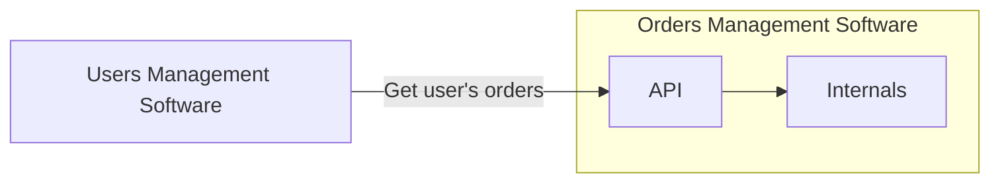

# API

API stands for Application Programming Interface
* A set of clearly defined methods of communication among various components
* Interface is the part that is exposed  
  * User interface normally is the visual representation
  * Application Interface that is exposed to another application, not the end user



## API Types

* Operating System API

  * the most famous is Win32 API
  * makes OS services available to the applications, for example:
    * File System
    * Network Devices
    * User Interface Elements

* Library API

  * normally a set of classes and functions to allow the user's application use the library

* Remote API

  * Tools that allows distribute the classes between multiple machines, connected by network.
  * It uses proxies to facilitate the communication, so at code level it is seamless
  * It is losing popularity and almost no one is using it nowadays.
  * All components have to use the same platform, for example `DCOM`, `.Net Remoting`, `Java RMI`, and so on.

  ```mermaid
  graph LR
    subgraph network
      direction LR
      subgraph A["Users Component"]
          Internals --> Proxy["Orders Proxy"]
      end
  
      B["Orders Component"]
      Proxy -->|Proprietary Protocol| B
    end
  ```

* Web API

  * APIs exposed to Internet
  * The components can use any Platform, OS or Language, as long as they respect the standard protocols (eg. HTTPS).

## Importance

* You API will be used:

  * By your UI
    * Modern apps are built for web and mobile
    * Mobile apps MUST have an API on the server in order to communicate with it
    * Web clients built using SPA also MUST have an API on the server.

  * Extend Your Reach
    * You API can be used by third parties.
    * it will help boost your application's popularity
  * Monetize
    * Charge for access for your data
