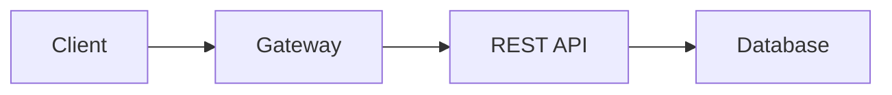

# REST Architecture Constrains

To a architecture be deemed as restful, it needs to follow 6 design rules:

## Client-Server

> “The application must have client-server architecture.”

* A client request a resource, that is responded by the server.
* We can have multiple servers, and multiple clients.
* Client-Server must not have run in same process
  * it means that Client-Server must communicate using IP.
  * it creates too much coupling 
  * it makes the Uniform Interface impossible
  * makes the creation of new clients much harder

## Uniform Interface

> “Client and Server share a common Technical Interface”

* The contract between client and server have to be well defined.

* 4 guiding principles:

  * Individual Resources are identified in the Request (URI/URL)

    * `GET /cars/12345/`
    * `GET /cars/67890`
    * `GET /vacations/21/reviews`

  * Representation of the Resources

    * Client receives the representation of the resource

      * ```json
        {
        	"VIN": 12345,
            "Make": "BMW",
            "Model": "X5",
            "Year": 2015
        }
        ```

    * Client receives the representation of the resource

      * `DELETE /car/12345`

  * Self descriptive messages - metadata

    * For example, the HTTP headers `Accept`, `Content-Type`, `Host` and the status code.

    * Server sends hydermedia [(HATEAOS)](07%20Advanced%20Topics.md#HateOAS)

### **Statelessness**

> “Client must manage its own state thus making the server stateless”

* it means:
  * server don't have session data
  * server treats each request as independent
  * server receives all session data from client on each request.
    * it increases the chattiness, that can lead to performance impact. It can be minimized by caching
* it makes easier to backend scaly horizontally.

### Caching:

> "Use Caching to achieve higher Scalability and Performance"

* Cache counter balances the negative effect of Statelessness
* We can use cache in:
  * Database
  * Server
  * Client: "Server should specify [Cache-Control Directives](../../HTTP%20headers.md) in responses to control Caching behavior"
    * For example, for stock prices, that isn't cacheable, the server must include on response that it isn't cacheable 

  * Proxies and Gateways

### Layered  Application

The server should be layered, and each layer should be independently manageable

* Layering simplifies the architecture - reduced dependencies
* The architecture may evolve with the changing needs.
* A layer can only connect to the layers that it depends on, it can't bypass layers.
  * for example, the gateway can't bypass the server and access the database directly. 

Example:




* Client: aware only about gateway
* Gateway: aware only about the REST API server
* REST API: aware only about the Database

So you can, for example, add a load balancer after gateway changing only the gateway. 

### Code on Demand

> "Server can extend the functionality of client by sending Code"

* It is a optional Constraint
* the server can not only send data to the client, but also code to be executed by the client.
* it is [HATEAOS](07%20Advanced%20Topics.md#HateOAS)
