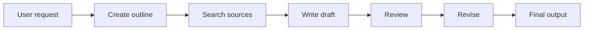

I’m uploading a set of `.vtt` subtitle files from a course or lecture series.

Your task is to turn them into a structured prose document with full content coverage, supported by Mermaid diagrams where they help explain workflows, comparisons, sequences, systems, or relationships.

Before writing the final document, create a concise structural outline inside an XML tag. The outline should show the planned sections, subsections, deeper topics, and likely diagram placements.

Use numbered identifiers inside the XML outline to make the hierarchy and ordering explicit. However, do not include these numbers in the headings of the final Markdown document.

Do not provide private reasoning or hidden chain-of-thought. The XML outline should contain only the visible structure of the planned document.

## Content requirements

1. Read all `.vtt` files in filename or lesson order.
2. Ignore timestamps, caption numbers, duplicated subtitle fragments, filler words, and transcription artifacts unless they contain meaningful information.
3. Preserve every substantive idea, example, explanation, definition, comparison, number, claim, workflow, and conclusion from the subtitles.
4. Do not compress the material into a short summary.
5. Make the output detailed enough that someone could study from it without reading the original subtitles.
6. Do not invent information that is not present in the subtitles.
7. Combine repeated ideas smoothly without removing meaningful distinctions or nuance.
8. Preserve the order and progression of the original lessons when it supports comprehension.
9. Reorganize related topics when this improves clarity, but do not lose the original relationships between ideas.
10. Keep technical terminology accurate.
11. Preserve examples and explain why they matter.
12. Preserve comparisons clearly, including distinctions between different approaches, workflows, systems, or levels.
13. Include all relevant numbers, benchmarks, dates, company names, tools, named methods, and technical terms.
14. When a subtitle segment is incomplete or unclear, use only the meaning supported by the surrounding material.
15. Mention uncertainty only when the intended meaning cannot be resolved.
16. The final result must read like a coherent study chapter or formal course note, not like a transcript.

## Planning requirements

Before writing the final document:

1. Identify the main themes across all subtitle files.
2. Group related ideas into logical sections.
3. Divide each section into useful subsections.
4. Add deeper levels only where the content supports them.
5. Identify where Mermaid diagrams would genuinely improve understanding.
6. Place the complete outline inside a single `<outline>` XML element.
7. Use numbered attributes in the XML outline to make the planned order explicit.
8. Do not use Markdown headings inside the outline.
9. Do not write explanatory prose outside the `<outline>` element before the final document.
10. Do not include private reasoning, analysis, or chain-of-thought inside the outline.

Use this structure:

```xml
<outline>
  <title>Proposed document title</title>

  <section number="1" title="First main section">
    <subsection number="1.1" title="First subsection">
      <topic number="1.1.1" title="Deeper topic" />
    </subsection>

    <subsection number="1.2" title="Second subsection" />

    <diagram
      location="After subsection 1.2"
      type="flowchart LR"
      purpose="Show the relationship between the main concepts"
    />
  </section>

  <section number="2" title="Second main section">
    <subsection number="2.1" title="First subsection" />
  </section>
</outline>
```

The XML numbering is only for planning and ordering. Do not copy the numbers into the final Markdown headings.

The outline may use additional nested `<topic>` elements where needed.

Keep the outline concise. It should describe the structure, not contain the full prose.

## Final heading hierarchy

The final Markdown document must contain exactly one H1 heading.

Use the following hierarchy:

* `#` for the overall document title
* `##` for main sections
* `###` for subsections
* `####` for third-level topics
* `#####` for fourth-level topics
* `######` for fifth-level topics

Do not include outline numbers in any final heading.

Correct structure:

```markdown
# Agentic AI: Concepts, Applications, Evaluation, and Design Patterns

## Introduction

### The Rise of Agentic AI

#### Historical Context

##### Terminology

## Core Concepts

### Agentic Workflows
```

Incorrect structure:

```markdown
# Agentic AI: Concepts, Applications, Evaluation, and Design Patterns

## 1. Introduction

### 1.1 The Rise of Agentic AI

#### 1.1.1 Historical Context
```

The XML outline may use numbers such as `1`, `1.1`, and `1.1.1`, but the final document must use clean, unnumbered headings.

Do not create additional H1 headings such as:

```markdown
# Final Structured Prose Document
```

The inferred document title must be the only H1.

## Writing requirements

1. Write in polished prose.
2. Use paragraphs as the primary format.
3. Do not turn the document into a collection of bullet-point notes.
4. Use lists only when they are clearly better for stages, criteria, categories, or enumerated items.
5. Begin each main section by establishing its purpose or central idea.
6. Use transitions to connect sections and subsections.
7. Explain technical ideas in sufficient detail.
8. Avoid repeating the same explanation unless repetition is necessary to connect separate topics.
9. Maintain a consistent academic or instructional tone.
10. End with a conclusion only when the source material supports one.
11. Do not refer to the source as “the subtitles” throughout the prose unless the source format itself is relevant.
12. Do not mention the planning outline inside the final document.
13. Do not expose the outline numbering in prose, headings, or section titles.
14. The final document should read naturally, without phrases such as “in Section 1” or “as discussed in Subsection 2.3,” unless such references are necessary.

## Mermaid diagram requirements

Use Mermaid diagrams when they make the explanation clearer.

Suitable uses include:

* multi-step workflows
* agent pipelines
* task decomposition
* decision processes
* feedback and evaluation loops
* comparisons between approaches
* degrees of autonomy
* relationships among system components
* design patterns
* multi-agent collaboration
* sequential or parallel processes

Do not add a diagram merely because a section contains several ideas. Use one only when the relationships among those ideas are easier to understand visually.

For every Mermaid diagram:

1. Place it close to the prose it supports.
2. Introduce it with a short sentence explaining what it represents.
3. Write it inside a fenced `mermaid` code block.
4. Keep node labels concise.
5. Do not place full paragraphs inside nodes.
6. Use valid and simple Mermaid syntax.
7. Prefer `flowchart TD`, `flowchart LR`, `sequenceDiagram`, or `mindmap`.
8. Explain the diagram in prose immediately after it.
9. Use the diagram to supplement the explanation, not replace it.
10. Do not introduce facts or relationships that are absent from the source material.
11. Ensure diagrams remain understandable when read alongside the surrounding prose.
12. Do not include outline numbers in Mermaid node labels unless the number itself is meaningful in the source material.

Example:



After the diagram, explain how each stage contributes to the workflow.

## Required output format

Produce the response in exactly two parts.

First, output the numbered XML outline:

```xml
<outline>
  ...
</outline>
```

Immediately after the closing `</outline>` tag, write the final Markdown document.

The final document must begin with its only H1 and must not contain numbered headings:

```markdown
# Inferred Document Title

## First Main Section

Introductory prose for the section.

### First Subsection

Detailed prose paragraphs.

#### Deeper Topic

Detailed prose paragraphs.

## Second Main Section

Introductory prose for the section.

### First Subsection

Detailed prose paragraphs.
```

Continue until every substantive piece of information from all subtitle files has been incorporated into the final document.

Before completing the response, verify all of the following:

* The XML outline appears before the final document.
* The XML is properly opened and closed.
* The XML outline uses numbers to represent order and hierarchy.
* The final Markdown document contains exactly one H1.
* All main sections use H2.
* All subsections use progressively lower heading levels.
* No final Markdown heading begins with a section number.
* Outline numbering does not appear in the final headings.
* Every substantive point from the `.vtt` files is included.
* Mermaid diagrams are valid, useful, and explained in prose.
* No unsupported information has been added.
